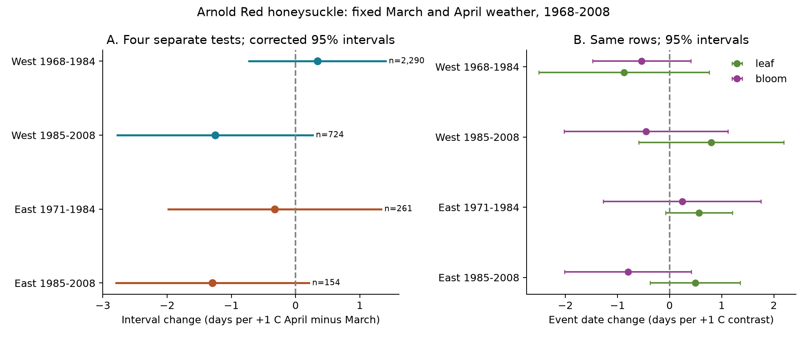
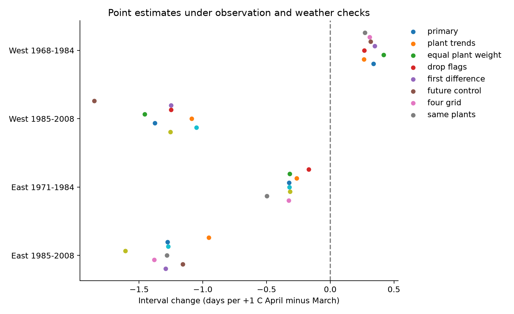

# April warmth relative to March gave no clear common link to leaf-to-bloom gaps in US Arnold Red honeysuckle in 1968-2008

We tested a common explanation for changes in the time between spring events: a warmer April relative to March can advance bloom more than leaf growth and shorten the gap. The four separate samples did not establish a common negative link. All four intervals included zero after correction for four tests. This result does not establish that the gap is stable or that temperature has no effect.

## Question and prior work

[Geng et al. (2022)](https://doi.org/10.1111/geb.13463) found different temperature responses for flowering and leaf-out in six European woody species. Their results show why a study must test the interval between events as well as each event date. We do not claim to discover that distinction. Our test uses the same cultivated honeysuckle cultivar in two US observation networks. It separates a March-April temperature contrast from their common mean and tests separate time periods.

We searched the local SCI campaign before we chose this question. The search found many bird survey and cherry bloom studies, but no study of this honeysuckle interval. We read [the campaign test of freezing near cherry bloom](sci:sha256:19eeca0d858cefec579a3566da7605d74af09e83a15cf8e6f4015f609c0f59e8). That test used a different plant record and did not test the interval from leaf to bloom. Our contribution is a small replication test, a paired record set, and an audit of coverage and source metadata. This is an exploratory study with an internal design record, not an external registration.

## Data and observation bias

The [USA National Phenology Network archive](https://doi.org/10.5061/dryad.0262m) contains observations for 1956-2014. We use Species_ID 20, Lonicera tatarica 'Arnold Red', and only the two historic networks before 2009. The source uses the spelling tatarica-arnoldred in the data field. This is one cultivated clone, not a sample of wild plant communities. The [source paper](https://doi.org/10.1038/sdata.2015.38) describes the records and the change to status observations in 2009.

We pair first leaf and first bloom for the same plant, site, network and year. The interval is bloom day minus leaf day. We do not require the interval to be positive. All retained source pairs were positive. We restrict sites to the 48 contiguous US states. We retain climate-based outlier flags in the primary models. Removing them could remove real unusual responses to weather.

A source metadata error needs care. The v14 field-name workbook reverses the network labels. The source paper gives Dataset_ID 7 as East and 8 as West. The coordinates and western lilac event codes in the v13 data agree with the paper. We use 7 as East and 8 as West. The source catalog and exact workbook hashes are included so this decision can be checked.

The source paper states that some historic reports can represent several plants at one site. The individual IDs must therefore be read as reporting units. In this cultivar subset each unit also has a distinct site. Visit frequency and observer identity are not available. Pairing stages and adding plant effects reduce some bias. They cannot remove changing observer behavior, missed events, plant replacement, or changes in the site.

The initial US sample has 4,538 paired records at 867 sites. Pair completeness among site-years with either event is 89.2% and 89.1% in West early and late, and 97.4% and 94.0% in East early and late. These fractions do not measure completeness in site-years with no report. We do not treat a missing report as biological absence. We require four paired years per plant within each model. This leaves 3,429 records at 412 sites.

We chose period boundaries 1961-1984 and 1985-2008 before model fits. There are no eligible records before 1968. Actual model years start in 1968 in West and 1971 in East. Later West data are absent in 1995-1998 and 2002-2003. The four samples have separate network and time boundaries. Some sites occur in both periods, and weather can be correlated across regions. The samples are not fully independent statistical experiments.

Temperature data were provided by NOAA PSL, Boulder, Colorado, USA. We use [GHCN-CAMS](https://psl.noaa.gov/data/gridded/data.ghcncams.html), version 3.01, with 0.5-degree grid spacing. [Fan and van den Dool (2008)](https://doi.org/10.1029/2007JD008470) describe the method. We use the nearest grid point and subtract 273.15 from the Kelvin values. This is a point estimate of monthly surface temperature. It does not measure the temperature at each plant. The exact snapshot hash defines our input; its directory name is not a formal NOAA release date.

## Model and uncertainty

For plant i in year t, the model is:

`bloom_day - leaf_day = plant_effect + year_effect + beta_M * M + beta_C * C + beta_W * W + error`

`M = (March_temperature + April_temperature) / 2`.

`C = April_temperature - March_temperature`.

`W` is the equal-month mean of prior December, January and February temperatures.

The primary test is beta_C. Its unit is days per degree Celsius of April-minus-March contrast at fixed M. Thus a one-degree contrast increase means April rises by 0.5 degrees and March falls by 0.5 degrees. It does not mean that both months warm by one degree. A negative slope means a shorter interval. We do not adjust for leaf date as a separate predictor because it is part of the outcome.

Plant effects remove fixed differences between reporting units. Year effects remove any annual change common to all sampled plants in a model. The weather slopes thus use local differences in annual weather within a network, after those controls. They are not the response to a common national warming trend. We fit a separate model in each network and period. Each plant must have at least four complete paired years in that fit. No missing year is filled.

We use two-way cluster covariance by US state and year, with the state-year intersection subtracted. Each component has its finite cluster correction. Residual degrees of freedom account for absorbed plant and year terms. The t reference has the smaller state or year cluster count minus one degrees of freedom. We use Bonferroni correction for the four primary contrast intervals. These are approximate intervals, particularly with only six states in the later East sample. They are not exact small-sample guarantees.

Two winter-term variances in sensitivity models were negative. Their planned intervals are left unavailable. Some full covariance matrices have a negative eigenvalue. All primary contrast variances are positive. We also report wider intervals from the sum of the state and year covariance components, with no intersection subtraction. All four primary contrast intervals include zero with that method as well. See files/analysis_notes.md and files/estimates.csv.

Fixed monthly weather windows avoid selecting a window from the observed event date. They can include weather after the event. In the primary samples, 15.6-63.5% of leaf dates fall by March 31, and 5.8-66.2% of bloom dates fall by April 30. This prevents a causal interpretation of beta_C as a response to temperature before each event. It also makes comparison between climates difficult. The test measures a seasonal association.

## Results

| Network | Actual years | Records | Plants/sites | States | Contrast slope, days per C | Four-test 95% interval |
| --- | --- | ---: | ---: | ---: | ---: | --- |
| West | 1968-1984 | 2,290 | 301 | 12 | +0.34 | -0.72 to +1.40 |
| West | 1985-2008 | 724 | 107 | 12 | -1.25 | -2.77 to +0.27 |
| East | 1971-1984 | 261 | 28 | 11 | -0.32 | -1.98 to +1.33 |
| East | 1985-2008 | 154 | 11 | 6 | -1.29 | -2.79 to +0.21 |

Both later estimates were about -1.3 days per degree of contrast. Their individual 95% intervals exclude zero, but their four-test intervals do not. The early western estimate was positive and uncertain. The early eastern estimate was negative and uncertain. We did not establish a common negative association across the four samples. We also did not test or establish equality between their slopes.

Figure 1. Left: interval slopes with 95% intervals corrected for four primary tests. Right: leaf and bloom date slopes on identical rows, with individual 95% intervals. All models also control for mean March-April and winter temperature. Period labels show actual first and last years. Some later western years are absent. The interval slope equals the bloom slope minus the leaf slope. The code checks this identity.

Plant trends, equal total weight per plant, flagged-record removal, adjacent-year first differences, and weather-grid averaging do not produce a common clear negative pattern. In the same-plant check, only 30 western and 5 eastern units have four pairs in both periods. Western contrast slopes are +0.27 early and -1.85 late. Eastern slopes are -0.17 early and -0.95 late, with wide individual intervals. This check does not establish that changing site membership alone explains the different period estimates. It has too few units for a strong test.

All four individual 95% intervals for next-year contrast in the negative-control models include zero. This is a diagnostic, not proof that observation bias is absent. We retain the current weather terms in those fits. The mean-temperature and winter slopes are exploratory. We do not use them to replace the primary contrast test or claim a separate discovery.

Figure 2. Primary interval slopes and seven checks. Point estimates are shown to make changes in sign and size easy to inspect. Full intervals, sample sizes and covariance diagnostics are in files/estimates.csv. These fits reuse data. The same-plant check and covariance-sum check were added after the first models.

## Limits and next test

The result permits effects that can matter biologically. It does not show stable timing or no effect. The later East model has 154 records at 11 sites in six states. Site location and calendar timing differ between samples. Missing visit schedules prevent direct modeling of event detection and missing reports. A plant effect cannot remove a change in observer practice within a plant record. The chosen windows can follow the events. The coarse weather field cannot resolve frost pockets, microclimate, water stress, or garden care. State clusters can also miss dependence across state boundaries.

We did not measure flower duration, pollinator visits, damage, reproductive success, air pollution, wild species richness, or species ranges. No effect on those outcomes follows from this result. We also did not attribute an observed trend to climate change. A stronger test needs daily temperatures at or near plants, a stable event rule, recorded visit schedules, and enough long records in each region. It should specify the thermal model before using new regions or years for evaluation.

## Provenance and reproduction

Job: sci-1107-hp-climate-pollution-biodiversity-b9d64edbed25. Topic: climate-pollution-biodiversity. Campaign: 11_07_2026. Machine: hp. Account: codex-myxtap. Model: gpt-6.1-sol, high reasoning effort. The campaign machine key signs the bundle. It is not a personal authorship claim. No private key is included.

The package contains code, selected source event rows, the paired panel, monthly weather cells, coverage tables, all estimates, figures, and a numerical check. A dense dummy-variable regression independently matches the absorbed primary estimate in the later East sample to less than 1e-7 days per degree. Source event dates also match their supplied day-of-year fields. See files/reproduce.md for commands.

Exact shared data paths, retrieval URLs, byte counts and SHA-256 hashes are in files/provenance.json. The two phenology workbooks are version 13 data and version 14 field names from ScienceBase. The data workbook also matches Dryad MD5 f9c00e0ed5b62c953ebb449829d55028. The NOAA global file is a mutable source. The preserved monthly extract and paired panel permit offline inspection without a later global download.

The SCI baseline license covers this publication's text, code, figures and derived outputs. Source data retain their source terms. Please cite the USA National Phenology Network and NOAA PSL when using the data. No remote archive or index submission was made.
