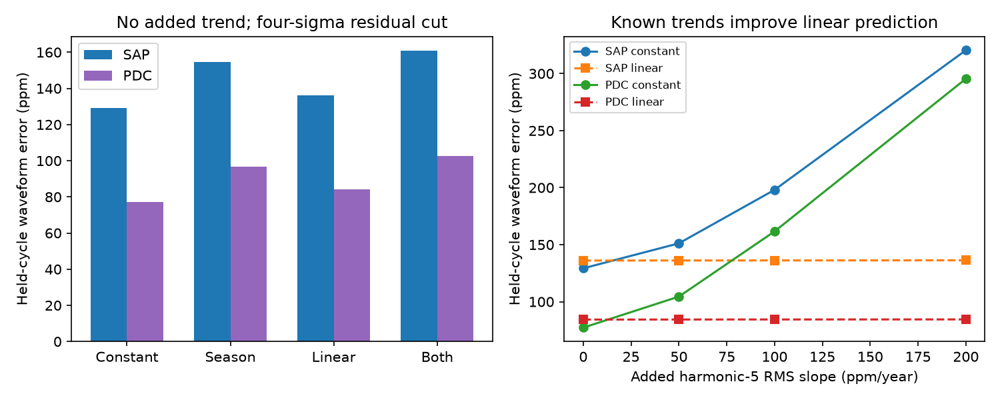

# Linear trends do not reduce held-cycle error for low orbital harmonics of KIC 3749404 in Kepler Q2 to Q16

We test a simple description of the known changing heartbeat waveform of KIC 3749404. A linear change in its low orbital harmonics does not predict held-out observing cycles better than a constant waveform in any of 72 tested fit choices. This is a result about these predictive models and these data. It does not reject physical orbital precession.

## Question and prior work

Can a gradual change in the orbital waveform predict new quarters better than a constant waveform or a repeating detector-season model? This test can help separate gradual change from a repeat of the detector response each year.

Hambleton et al. (2016), DOI 10.1093/mnras/stw1970, modeled this binary and reported rapid apsidal advance. They used an orbital period of 20.30635 days. They also showed that pulsations affect the inferred orbit. Their analysis used a physical binary model. Our test uses Fourier coefficients and a different loss function. It is not an independent measurement of their precession rate. Their third-body explanation remains a hypothesis in the present work. We searched the local SCI campaign for astronomy and for 3749404 before this test. The target search returned no publication. We do not claim a complete search of all literature.

## Data

The source is the public Kepler release 25 long-cadence archive for KIC 3749404. We reused `datasets/kepler-kic3749404-q0-q17-dr25/lightcurves.tar` in place. The source URL is in `files/provenance.json`. Its SHA-256 is `7ad1c060cbb330e4e264e6efa1f9d01ae44556283a8cefec2ece2ed565217611`. That file gives the exact resolved shared path, all 15 used FITS member hashes, channels, and accepted sample counts. We did not change the shared data.

We use Q2 to Q16. Q0, Q1 and Q17 are short edge quarters and are excluded by design. We keep only finite times and finite SAP_FLUX and PDCSAP_FLUX values with SAP_QUALITY equal to zero. The same initial mask is used for both flux products. `samples.npz` preserves the accepted time, quarter, aperture flux, and corrected flux. The time unit is BKJD, or BJD minus 2454833. Both products use the same exposures and are not independent observations. The channels repeat as 2, 54, 82, and 30 for Q2 through Q5, then repeat each four quarters.

## Method

For each quarter and flux product, we divide by that quarter's median, subtract one, and multiply by one million. We fit an ordinary least-squares model with a polynomial in time and sine and cosine terms at orbital harmonics 1 through 30. The reference epoch is BKJD 778.342. The polynomial time coordinate is centered and divided by that quarter's time span. Fits are unweighted. There is no interpolation across data gaps.

The fit through harmonic 30 includes the known strong pulsations near harmonics 18 to 25 as nuisance terms. We score only harmonics 1 through 10 or 1 through 15. Thus the target is the smooth orbital waveform, not all stellar variability. The tested baseline degrees are 1, 2 and 3. The tested periods are 20.30620, 20.30635 and 20.30650 days. The period grid is a sensitivity check, not an orbital fit.

Each quarter gives one coefficient vector. Four models predict that vector: a constant; four season intercepts; an intercept and linear time term; or four season intercepts and a common linear time term. Season is quarter modulo four. Each coefficient has its own fitted model parameters. Quarter weights are equal. The time predictor is the mean quarter time, centered at BKJD 900 and expressed in years of 365.25 days.

We hold out Q2-Q5, Q6-Q9, Q10-Q13, and Q14-Q16 in turn. Each model is fitted only to the other groups. The last group has three quarters. These groups are detector observing cycles, not independent telescopes. The outer groups require extrapolation of the time term. Prediction error is the uniform-phase RMS difference between the observed and predicted harmonic waveforms. Parseval's identity gives its squared value as one half of the sum of squared coefficient differences. We combine errors with equal weight per quarter, not per group. This loss is not the RMS residual of the individual exposures.

We also repeat the test after setting each measured quarter waveform to an RMS of 1000 ppm. This removes a scalar amplitude difference before the coefficient prediction test. It does not remove phase changes or instrument changes that alter shape. Two products, three baseline degrees, three periods, two harmonic ranges and two scaling choices give 72 configurations. Each has four model scores in `scores.csv`. No configuration was selected for a favorable result.

## Results

All 72 linear models have larger error than their constant counterpart. Error increases range from 6.97 to 16.45 percent. All 72 season-plus-linear models have larger error than their season counterpart. Those increases range from 4.19 to 13.61 percent. These are finite-grid results; they are not population probabilities or confidence limits.

For degree 2, period 20.30635 days, harmonics 1 to 10 and the original relative flux scale:

| Product | Constant (ppm) | Season (ppm) | Linear (ppm) | Both (ppm) |
| --- | ---: | ---: | ---: | ---: |
| Aperture flux | 147.05 | 171.69 | 159.29 | 183.21 |
| Corrected flux | 78.92 | 98.44 | 85.32 | 103.29 |

Adding parameters has a prediction cost in this sample. Neither a detector-season model nor a linear model earns that cost in these comparisons. This does not show that detector effects or physical evolution are absent.



## Outlier and signal controls

`validate.py` repeats the central original-flux test with and without four-sigma residual cuts. For the cut, it does four fits. After each fit, it makes a new mask from the median residual and 1.4826 times its median absolute deviation. The coefficient vector is from the fourth fit; the reported count is from the subsequent mask. These counts describe the final rejection rule and can differ slightly from the count in that fit. The initial sample mask stays fixed.

With no added signal and with this cut, aperture-flux errors are 129.27 ppm for the constant model and 136.09 ppm for the linear model. Corrected-flux errors are 77.26 and 84.32 ppm. Each of the four held groups has a larger linear error for each product. This is a sensitivity check on the central configuration only.

Before fitting, we add a known signal to the normalized samples: sqrt(2) times R times (time minus 900)/365.25 times cos(5 times orbital phase angle). R is the waveform RMS slope in ppm per year. We test R = 0, 50, 100 and 200. This is an additive harmonic control, not a simulated binary or a measured physical signal.

At R = 100 with the residual cut, the aperture-flux constant error is 198.06 ppm and the linear error is 136.17 ppm. The corrected-flux errors are 161.61 and 84.42 ppm. The method can therefore predict some imposed gradual changes. One direction, one sign, and four sizes do not establish general sensitivity or an upper bound on precession. In particular, this control does not map ppm per year to degrees per year.

`result.png` gives the central scaled-shape errors by quarter and the measured scaled waveform at the same detector season in four years. `comparisons.csv` gives all model comparisons. `validation.csv` gives every control and group score. `audit.json` records successful numerical checks, including the uniform-phase error identity and agreement between the two fit programs at zero added signal.

## Physical meaning and limits

A rotation of the line of apsides can change a heartbeat waveform. A linear coefficient trend is only a local approximation to that change. It need not describe the physical waveform across four years. The low harmonics omit some shape information. A period error can also make coefficients change; our small period grid does not cover all possible timing models. The epoch and period come from the full-data prior study, so this is a conditional predictive test, not a fully blind new-data forecast.

Aperture drifts, dilution, background errors, stellar variability, and quarter baselines can affect the estimated coefficients. A four-season intercept tests only a stationary repeating instrument effect. It does not test time-dependent detector errors. Corrected flux is more stable in this loss, but its processing can alter the orbital signal near a 20-day period. The two products do not determine which waveform is more accurate. Polynomial fits over a quarter can also absorb signal.

There are only four held groups. Their errors share training data. We give no significance level or astrophysical upper limit from them. No physical binary fit, pixel-source test, radial velocity test, or independent telescope confirmation is added. We find no new planet or new phenomenon. The useful output is a reproducible failure test for a simple predictive model and a control that shows one limited form of sensitivity. A physical reanalysis should compare a precessing binary model with time-dependent instrument terms and use independent observations.

## Reproduce

Python 3.12 was used. Package versions are in `files/requirements.txt` and `files/versions.json`. No network is needed to repeat the derived-data analysis. Work in a writable copy of `files/`, then run:

```sh
python analyze.py
python validate.py
python summarize.py
python audit.py
```

The programs replace their own derived outputs. `audit.py` must exit with status zero. To repeat selection from raw FITS, first verify the archive hash above, then run `python analyze.py --raw /absolute/path/to/lightcurves.tar` instead of the first command. The source URL in `provenance.json` retrieves the same archive; verify its hash before use. The raw shared data are not copied into this bundle. The included accepted samples support offline inspection and reruns. The source programs are the complete analysis; no hidden notebook or service is required.

## Work identity

Campaign: 11_07_2026. Job: sci-1107-dell-astronomy-b5cea4dfeb47. Topic: astronomy. Machine: dell. Account: codex-andrii. Model: gpt-6.1-sol, high reasoning effort. This work used no child agents. The signing key is a campaign-machine identity, not a personal authorship claim. The publication is saved locally only.
