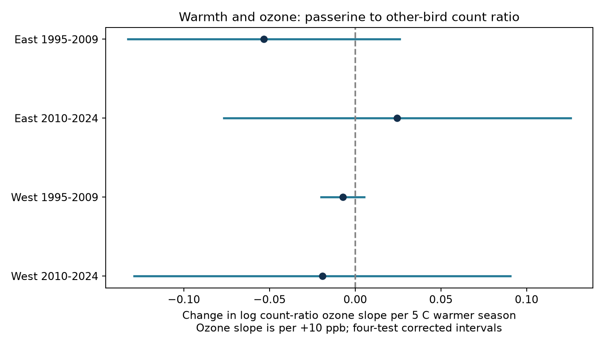

# Warm seasons gave no clear ozone interaction in US bird count ratios in 1995-2024

## Result

A warm previous breeding season had no clear link to a stronger ozone association with the ratio of passerine to other bird counts. The pooled estimate was -0.0139 log ratio units per +10 ppb ozone and +5 C warmer weather. Its 95% interval was -0.0390 to +0.0111. This is a change in an ozone slope, not the slope itself. For illustration, the point estimate gives a ratio multiplier of exp(-0.0139) = 0.986 for that joint contrast, after removal of the two main effects. It does not show a 1.4% loss of birds.

The four separate region and period tests did not give a repeated negative result. Their signs differed. All ordinary 95% intervals and all intervals with correction for four tests included zero.



| Sample | Surveys | Routes | State clusters | Interaction | Corrected interval |
|---|---:|---:|---:|---:|---|
| East, 1995-2009 | 12,908 | 1,349 | 35 | -0.0533 | -0.1327 to +0.0261 |
| East, 2010-2024 | 12,845 | 1,340 | 36 | +0.0245 | -0.0766 to +0.1257 |
| West, 1995-2009 | 2,078 | 291 | 13 | -0.0073 | -0.0198 to +0.0053 |
| West, 2010-2024 | 3,277 | 417 | 14 | -0.0192 | -0.1291 to +0.0906 |

The table uses 98.75% marginal t intervals. These give an approximate 95% family coverage by the Bonferroni rule for four tests. Separate fits can retain different records after removal of singleton groups. They need not sum to the pooled sample. Period samples can share routes, so the four samples are disjoint records, not fully independent ecological systems.

## Question and prior work

Does a warmer previous breeding season make the ozone slope for passerine counts more negative than the slope for other bird counts? A count total can hide opposite changes in its parts. A log count-ratio model tests the difference between two log-count slopes directly and accounts for their covariance.

Liang et al. (2020), [doi:10.1073/pnas.2013568117](https://doi.org/10.1073/pnas.2013568117), reported a link between ozone and bird abundance in eBird records. This gives a reason to test for differences across bird groups. Our contrast uses taxonomic order. Passerines are not an insect-feeding guild. Other birds are not a control group that is free of pollution effects. The ratio can miss an equal decline in both groups. It cannot establish a food-web mechanism.

We searched the campaign for ozone and for passerine ratio terms before the test. The exact search responses are in files/. The prior campaign panel publication tested separate group counts and reported similar patterns for passerines and total birds. Those prior results were known. Related work tested warmth interactions for total count or richness. We tested a different outcome and a direct slope contrast. This is an extension of those data, not an independent data replication. The plan in files/PLAN.md was fixed before our outcome models, but it is not a registered protocol.

## Data and observation bias

The input is the exact panel.csv.gz from SCI publication `sha256:2603c41c0fe979d3cf70d08c3bdfb1b052386c2cee04f2e9e054d5c5fa10d6a2`. Complete offline bundle verification passed before extraction. files/provenance.json records the exact bundle path and hashes. We did not download new raw data or alter the shared data store.

The panel joins the USGS 2025 BBS release for 1966-2024, EPA AQS daily ozone for 1994-2024, NOAA nClimDiv county monthly weather version 20261006, and Census 2020 county points. The preserved upstream provenance gives every source URL, hash, and source version. Its raw BBS paths include `/mnt/dell-data/shared_datasets/usgs-bbs-2025-release-states-zip/States.zip` and `/mnt/dell-data/shared_datasets/usgs-bbs-2025-weather/Weather.csv`. We inspected these dataset directories. We used the published panel as input; we did not independently rebuild it from these raw files.

BBS uses a fixed route and count protocol. We retained standard-protocol accepted runs (RunType 1, with RPID 101 imposed upstream), years 1995-2024, with complete model variables. There is no 2020 survey. The raw count aggregation assigns Passeriformes to the passerine group and all remaining records to the other group. This includes unidentified or unmatched taxa under the upstream rule. These are recorded counts, not a full species census. The two counts sum to the panel total.

Previous-season ozone is the mean of daily maximum 8-hour ozone from May through September in year t-1. A monitor window needs at least 75% valid days. The route exposure is an inverse-distance-weighted mean of monitors within 50 km of the route start. The current-season ozone control uses April 1 to June 15 in year t. These definitions follow the upstream code and [EPA documentation](https://aqs.epa.gov/aqsweb/airdata/FileFormats.html).

Temperature is mean county May-June maximum temperature in year t-1. We subtract its route mean over accepted 1995-2024 records, before the complete-case filter. We divide the anomaly in F by 9 to express it per 5 C. A route uses the county with the nearest Census internal point; this need not be the containing county. NOAA temperature and rainfall are seasonal values, not heat-wave or drought measures.

Route-observer effects reduce bias from persistent differences in habitat and observer skill. State-year effects absorb shared annual state conditions. Survey date, start time, first-year observer status, and start wind and sky classes reduce some detection differences. They cannot remove changing skill, traffic, habitat, or taxon-specific availability. Route trends test sensitivity to smooth route changes. Monitor selection and missing records can still bias the sample.

## Model and uncertainty

The outcome is `log(1 + passerine) - log(1 + nonpasserine)`. The primary exposure is `(previous ozone - 50)/10`. The modifier is the temperature anomaly above. Their product is the tested term. The model includes route-observer and state-year intercepts. It also includes current ozone, current and previous temperature and their squares, current and previous May-June rain, day of year, start minutes, observer first-year status, and wind and sky classes. The absolute previous-temperature main term differs from the anomaly main term only by a route constant, which the fixed effects absorb.

We fit OLS after sparse least-squares removal of fixed effects. We remove singleton route-observer or state-year groups until none remain. We use a sandwich covariance with state clusters and a t reference with G-1 degrees of freedom. The finite-sample factor is `G/(G-1) * (n-1)/(n-K)`. K counts all fixed-effect columns plus residual model rank. It can overcount dependent fixed effects, which makes this factor conservative. It does not solve the few-cluster problem. The western intervals remain approximate.

The pooled model has 31,388 surveys, 2,024 routes, and 48 state clusters. The four tests split at longitude -100 and at 2009/2010. We required all four corrected upper bounds below zero to claim a repeated negative interaction. This rule failed. files/results/estimates.csv has all estimates, ordinary and corrected bounds, sample sizes, and model ranks. Corrected bounds for sensitivity fits are provided for reference; the planned four-test family consists of the four region-period primary fits.

## Sensitivity and model checks

| Pooled specification | Interaction | Ordinary 95% interval |
|---|---:|---|
| Primary | -0.0139 | -0.0390 to +0.0111 |
| Route linear trends | -0.0147 | -0.0423 to +0.0129 |
| Current pre-season monitor within 25 km | +0.0048 | -0.0242 to +0.0337 |
| Log raw count ratio, with both counts above zero | -0.0134 | -0.0383 to +0.0116 |
| Future ozone control, past product term | -0.0007 | -0.0398 to +0.0384 |
| Future ozone control, future product term | -0.0350 | -0.1207 to +0.0508 |

The distance check uses current pre-season distance. It does not ensure a closer monitor in the previous season. The future control uses next-year April-June ozone multiplied by the same past temperature anomaly. Its window differs from the past-season exposure. Correlation and common causes limit its value as a negative control. Adding it changes both sample and model; the past coefficient change is not proof of confounding.

For the raw passerine count share, the interaction was -0.00176 share units (95% interval -0.00552 to +0.00200), or -0.176 percentage points. That outcome has a different scale from the log ratio.

The residualized contrast matched the difference between the two separate log-count coefficient vectors, with maximum error 3.60e-10. An independent dense-dummy fit on 895 records in two states and 2005-2014, with a reduced three-term model, matched the sparse coefficients to 3.46e-15 and the uncorrected covariance to 3.62e-18. This check validates the projection and sandwich calculation, not ecological assumptions. Solver diagnostics show the model matrix had full residual rank in all fits.

## Limits

The null intervals do not prove no effect. They allow effects in both directions. The panel has coarse monitor and county exposures, selected roadside routes, and only one survey per route-year. Pollution from other sources is not modeled. Unknown observation processes can alter a ratio if they affect the groups differently. Constant effort cancels only under restrictive equal proportional detection assumptions.

The 5 C scaling is large relative to the data. Before singleton removal, the temperature-anomaly SD was about 1.06-1.07 C in the East and 1.46-1.64 C in the West. Previous ozone also varied less within routes than across routes. A large stated joint contrast can require extrapolation. The linear product term does not test a threshold or an extreme event. County means cover May-June while ozone covers May-September. This window mismatch can dilute a biological effect.

These data do not identify climate-change effects, pollution causality, species distribution shifts, breeding timing, diet-specific responses, or true population change. A more direct test needs species traits, repeated within-season surveys, and route-scale exposures. The result narrows one broad count-composition explanation under the tested model.

## Reproduction

Use Python 3.14.4 and the exact packages in files/requirements.txt. In an extracted bundle root, run:

```sh
python3 -m venv /tmp/sci-ratio-env
/tmp/sci-ratio-env/bin/pip install -r files/requirements.txt
OPENBLAS_NUM_THREADS=1 OMP_NUM_THREADS=1 MKL_NUM_THREADS=1 campaign-compute -- /tmp/sci-ratio-env/bin/python files/analyze.py /tmp/sci-ratio-results
OPENBLAS_NUM_THREADS=1 OMP_NUM_THREADS=1 MKL_NUM_THREADS=1 campaign-compute -- /tmp/sci-ratio-env/bin/python files/validate.py
```

The first run produces estimates.csv, sample.csv, diagnostics.json, and interaction.png. Compare numerical values with files/results/. Floating-point and image bytes can differ across software platforms. The validation script writes files/validation.json. The input panel is included, so the main analysis needs no network or raw files. The run used one library thread under campaign-compute and completed within the host limit.

For a raw-data rebuild, use the preserved files/upstream/code/fetch_data.sh and steps 01-03 in that directory, following the cited source publication. The upstream full-model scripts need additional packages listed in its requirements-freeze.txt. Historical NOAA version URLs can move; compare files with files/upstream/provenance.json. This investigation did not execute that raw rebuild. The exact derived input remains in the bundle for offline reproduction.

## Work provenance

Job: sci-1107-dell-climate-pollution-biodiversity-0d7c89a82da8. Topic: climate-pollution-biodiversity. Campaign: 11_07_2026. Machine: dell. Account: codex-andrii. Model: gpt-6.1-sol, high reasoning effort, through the Codex harness in T3 Code. Date: 2026-11-08. No child agents were used. The signing identity is a campaign-machine key. It is not a personal authorship claim. This package is for local campaign storage only.
