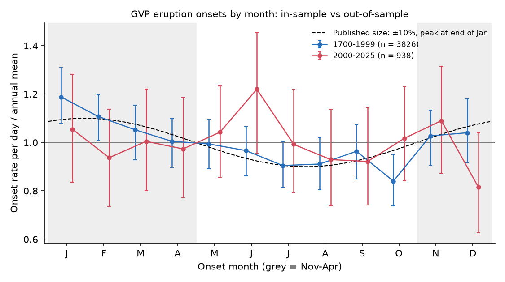
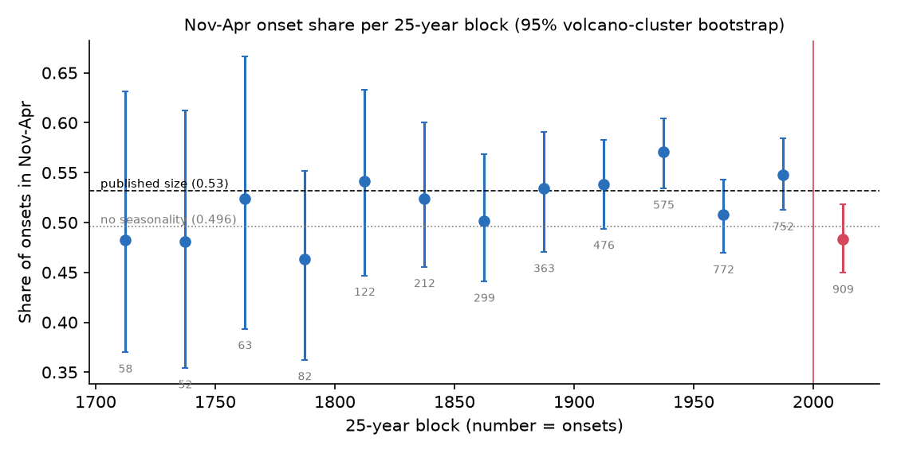
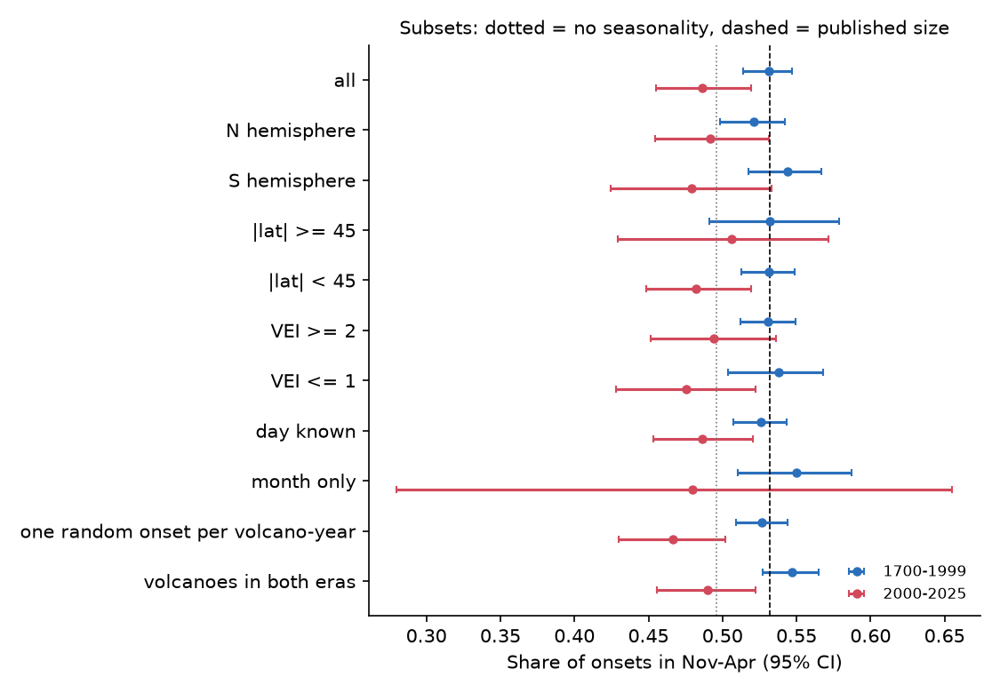

# The November-April excess of volcanic eruption onsets in the GVP catalog did not continue in 2000-2025

## Summary

Mason et al. (2004) used the Smithsonian Global Volcanism Program (GVP) catalog for 1700-1999. They reported that more eruptions start from November to April than from May to October. The global change was about 18% of the mean monthly rate. Jupp et al. (2004) give the size as a mean resultant length of about 0.05. The authors connect the pattern to seasonal surface loading from the water cycle and from sea level.

We did an out-of-sample test of this claim. We used the current GVP catalog and the eruption onsets from 2000-2025, which occurred after the original data period.

Main results:

1. **The in-sample pattern is present in the current catalog.** For 1700-1999 (3,826 onsets with a known month at 431 volcanoes), the share of onsets in November-April is 0.531 (95% CI 0.514-0.547). With no seasonality, the expected share is 0.496. The mean resultant length is R = 0.054 and the peak is on 12 February. A null model that gives each volcano one random calendar shift gives p < 0.001. The pattern occurs in both hemispheres at the same calendar phase (NH 0.521, SH 0.544). It is clearest in 1875-1999.
2. **The pattern did not continue in 2000-2025.** For 938 onsets at 219 volcanoes, the November-April share is 0.486 (95% CI 0.455-0.519, rotation p = 0.74). R = 0.027 (p = 0.49) and the peak moves to late May. The change from 1700-1999 is -0.045 (95% CI -0.082 to -0.010). The published size (share about 0.53) is outside the 2000-2025 CI.
3. **A change in the regional mix does not explain the loss.** If each GVP region kept its 1700-1999 November-April share, the 2000-2025 mix of regions gives an expected share of 0.534. The 183 volcanoes with onsets in both periods changed from 0.547 (0.527-0.565) to 0.490 (0.456-0.522).
4. **The 1700-1999 seasonal model gives no forecast skill for 2000-2025.** The global first-harmonic model has a log score gain of -3.3 nats compared with a uniform model (rotation null mean -2.7, p = 0.59). Region-specific harmonics give -5.5 nats (null mean -7.2, null 95th percentile -0.9, p = 0.33).
5. **Local seasonal forcing does not give a consistent signal.** We compared each onset month with the local seasonal cycle of rain (GPCP) and of sea level (nearest PSMSL gauge within 300 km). The results are small and do not agree between the two periods. For example, the share of onsets during falling local sea level is 0.506 (p = 0.26) in 1700-1999 and 0.545 (p = 0.013) in 2000-2025. The 2000-2025 value is not significant for gauges with a seasonal amplitude of 50 mm or more (0.528, p = 0.15). We do not claim a rain or sea-level effect.

Interpretation: the November-April excess is a stable property of the pre-2000 GVP record. The 2000-2025 record does not show it, at the same volcanoes. The seasonal water cycle and sea-level cycle continued after 2000. Thus, a constant physical loading effect of the published size is not supported. A change in how eruption onsets are detected and dated is a possible cause of the pre-2000 pattern, but this study does not identify the mechanism.



## Question

Does the seasonal (November-April) excess of eruption onsets reported for 1700-1999 continue in independent data from 2000-2025? If it continues, does it follow the local seasonal cycle of rain or sea level?

## Data

All inputs are public. The shared campaign datasets were used in place. Paths, URLs, retrieval times and SHA-256 hashes are in `files/provenance.json`.

- GVP Volcanoes of the World, Holocene eruptions and Holocene volcanoes tables. We retrieved them from the GVP GeoServer WFS (CSV) on 2026-11-09. A copy of both files is in `files/data/gvp_snapshot/`, because the live service changes.
- GPCP v2.3 monthly precipitation (2.5 degrees, NOAA PSL copy). We used 1979-2025 to make a 12-month climatology at the grid cell nearest to each volcano.
- PSMSL monthly mean sea level, Revised Local Reference (archive of 2026-10-19). For each gauge we used years in 1960-2025 with 10 or more months. We removed each annual mean and averaged by calendar month. We kept gauges with 10 or more such years (1,264 gauges).

## Methods

**Onset selection.** We kept "Confirmed Eruption" records with a start year in 1700-2025. The start month must be known. GVP codes onsets with only a known year as 2 July with an uncertainty of 182 days (830 records after 1700). We removed every onset with a day uncertainty of more than 31 days. This leaves 3,826 onsets for 1700-1999 and 938 for 2000-2025. If the day is known, we use the exact day of the year. If only the month is known, we use the middle of the month.

**Statistics.** For each set of onsets we calculate:
- the share of onsets in November-April (the contrast of Mason et al. 2004);
- the first annual harmonic: mean resultant length R and the peak day;
- the projection on a peak at 30 January (the center of November-April).

Many volcanoes erupt many times. Thus, we do not use tests that assume independent onsets.
- The 95% confidence intervals come from a volcano-cluster bootstrap (2,000 resamples of volcanoes).
- The p-values come from a rotation null (2,000 replicates). The null gives all onsets of one volcano the same random calendar shift. This keeps the clustering within each volcano and removes any common calendar phase.

**Out-of-sample forecast.** We fit the first harmonic to the 1700-1999 onsets, globally and for each GVP region (13 regions with 50 or more onsets in 1700-1999 and 10 or more in 2000-2025). We then score the 2000-2025 onsets with the log density relative to a uniform model. We compare the score with the rotation null.

**Robustness subsets.** We used these subsets: hemisphere; latitude below or above 45 degrees; VEI 2 or more and VEI 1 or less; known day and month only; one random onset per volcano-year; volcanoes with onsets in both periods; time blocks; and a year-boundary check (December-January share, and the November-April share without December and January).

**Local forcing.**
- Rain: the mean local rain z-score (12-month GPCP climatology, standardized at each volcano) in the onset month and at lags of 1 and 2 months.
- Sea level: the share of onsets in the falling half of the annual harmonic of local sea level.
- Null: we shift all months of each volcano by one random whole number of months.

## Results

### Global and subset results (files/data/subset_results.csv)

| Period | Subset | Onsets | Volcanoes | Nov-Apr share (95% CI) | p (share > null) | R | p (R) | Peak day |
|---|---|---|---|---|---|---|---|---|
| 1700-1999 | all | 3826 | 431 | 0.531 (0.514-0.547) | <0.001 | 0.054 | <0.001 | 43 |
| 1700-1999 | N hemisphere | 2114 | 267 | 0.521 (0.498-0.542) | 0.014 | 0.041 | 0.029 | 43 |
| 1700-1999 | S hemisphere | 1712 | 164 | 0.544 (0.517-0.567) | <0.001 | 0.069 | 0.001 | 43 |
| 1700-1999 | day known | 2942 | 404 | 0.526 (0.507-0.543) | 0.002 | 0.044 | 0.009 | 46 |
| 1700-1999 | month only | 884 | 251 | 0.550 (0.510-0.587) | 0.006 | 0.088 | 0.004 | 38 |
| 1700-1999 | volcanoes in both periods | 2807 | 183 | 0.547 (0.527-0.565) | <0.001 | 0.070 | <0.001 | 40 |
| 1700-1899 | all | 1251 | 274 | 0.516 (0.478-0.553) | 0.12 | 0.033 | 0.36 | 34 |
| 1900-1999 | all | 2575 | 366 | 0.539 (0.522-0.556) | <0.001 | 0.064 | <0.001 | 45 |
| 1960-1999 | all | 1217 | 263 | 0.537 (0.509-0.564) | 0.002 | 0.068 | 0.003 | 52 |
| 2000-2025 | all | 938 | 219 | 0.486 (0.455-0.519) | 0.74 | 0.027 | 0.49 | 149 |
| 2000-2025 | N hemisphere | 535 | 126 | 0.492 (0.454-0.532) | 0.60 | 0.023 | 0.72 | 159 |
| 2000-2025 | S hemisphere | 403 | 93 | 0.479 (0.425-0.533) | 0.77 | 0.033 | 0.65 | 139 |
| 2000-2025 | VEI 2 or more | 508 | 164 | 0.494 (0.451-0.536) | 0.56 | 0.023 | 0.73 | 99 |
| 2000-2025 | one random onset per volcano-year | 838 | 219 | 0.467 (0.430-0.502) | 0.95 | 0.056 | 0.09 | 173 |
| 2000-2025 | volcanoes in both periods | 884 | 183 | 0.490 (0.456-0.522) | 0.66 | 0.030 | 0.44 | 134 |
| 2000-2012 | all | 499 | 175 | 0.491 (0.448-0.532) | 0.66 | 0.033 | 0.49 | 108 |
| 2013-2025 | all | 439 | 139 | 0.481 (0.430-0.532) | 0.74 | 0.037 | 0.62 | 190 |

The p-value "<0.001" means that no null replicate was equal to or larger than the observed value (minimum possible p = 1/2001).



From 1875 to 1999, the November-April share of each 25-year block is 0.508 or more. The 2000-2024 block (909 onsets) has 0.483 (0.449-0.518).



### Year boundary

In 1700-1999, the December-January share is 0.189 (0.175-0.204), and the expected value is 0.170. Without December and January, the November plus February-April share is 0.422 (0.405-0.440), and the expected value is 0.393. Thus, the excess is not only an artifact of onsets put at the start or end of a year. Onsets with only a known month have the largest December-January share (0.218). For 2000-2025 the two values are 0.159 and 0.389, and both are near their expected values.

### Regions named by Mason et al. (2004) (files/data/mason_regions.csv)

| Region | Period | Onsets | Nov-Apr share | R | Peak day | Falling sea-level share (gauge onsets) |
|---|---|---|---|---|---|---|
| Central America | 1700-1999 | 294 | 0.558 | 0.131 | 26 | 0.565 (191), p = 0.10 |
| Central America | 2000-2025 | 109 | 0.495 | 0.033 | 146 | 0.500 (52) |
| Alaska Peninsula + Aleutians | 1700-1999 | 184 | 0.500 | 0.029 | 104 | 0.478 (180) |
| Alaska Peninsula + Aleutians | 2000-2025 | 51 | 0.490 | 0.149 | 118 | 0.569 (51) |
| Kamchatka | 1700-1999 | 199 | 0.523 | 0.040 | 7 | 0.391 (46), lower than null p = 0.05 |
| Kamchatka | 2000-2025 | 50 | 0.580 | 0.089 | 331 | 0.357 (14) |
| Melanesia | 1700-1999 | 244 | 0.508 | 0.071 | 95 | 0.467 (197) |
| Melanesia | 2000-2025 | 91 | 0.429 | 0.051 | 161 | 0.642 (81), p = 0.025 |

Mason et al. (2004) report peaks during falling regional sea level in Central America, the Alaska Peninsula and Kamchatka, and a peak at high sea level in Melanesia. In our data, Central America has a strong winter peak in 1700-1999 but not in 2000-2025. Kamchatka onsets occur less often during falling local sea level. The Melanesian 2000-2025 value is in the direction opposite to the published statement. The samples are small and we did many comparisons, so these regional values are descriptive only.

### Out-of-sample forecasts (files/data/results.json, "forecast")

| Model fitted to 1700-1999 | Log score gain on 2000-2025 (nats) | Rotation null mean | Null 95th percentile | p |
|---|---|---|---|---|
| One global harmonic | -3.29 | -2.72 | 0.90 | 0.59 |
| One harmonic per GVP region (13 regions) | -5.46 | -7.16 | -0.86 | 0.33 |

The null mean is negative because the fitted model has a fixed phase and a random calendar shift moves onsets away from it.

### Local rain and sea level (files/data/local_forcing_tests.csv)


- Rain z-score in the onset month: -0.020 (1700-1999; null 95% range -0.033 to 0.034) and +0.046 (2000-2025; null range -0.062 to 0.061; p = 0.07).
- At volcanoes with strongly seasonal rain (monthly coefficient of variation 0.5 or more), 1700-1999 onsets are in slightly drier months than the null (lag 1: -0.054, p = 0.035 for "lower"). The 2000-2025 values are positive and not significant.
- Falling sea-level share: 0.506 (1700-1999, p = 0.26), 0.545 (2000-2025, p = 0.013), 0.513 (all years, p = 0.07).

These tests use climatological seasonal cycles, not the observed anomalies of each year. They do not estimate stress. The results do not agree between periods, and none is robust in both.

## Limitations

- **Catalog changes.** The GVP catalog changed after 2002 (for example, revised eruption groups and new onsets). Our 1700-1999 results use the current catalog, not the version that Mason et al. used. The current catalog still gives R = 0.054, which agrees with the published 0.05.
- **Power.** The 2000-2025 set has 938 onsets. The bootstrap standard error of the November-April share is about 0.016. A true share of 0.531 would give a value of 0.486 or less with a probability of about 0.003 (normal approximation). Seasonal effects much smaller than the published effect (for example, a share of 0.51) cannot be excluded.
- **Dates.** Onsets with only a month use the middle of the month. We removed onsets with a day uncertainty above 31 days. Remaining dating errors can make a seasonal signal weaker, but they cannot remove a real signal of this size from 913 onsets with a known day.
- **Mechanism.** We did not model loading stress. We did not identify why the pre-2000 record has the winter excess. Possible causes include changes in detection (for example, satellite and instrument monitoring after about 2000), seasonal reporting and access in the historical record, and a real process that is not constant in time. Our data do not separate these causes.
- **Multiple tests.** We report many subsets and regions. The main pre-specified test is the global November-April share in 2000-2025. The other results are secondary.
- **Gauges.** Sea-level tests use the nearest PSMSL gauge within 300 km. These gauges are on the coast and show local steric and wind effects, not only the mass loading.

## Reproduction

Use Python 3.12 with numpy, pandas, xarray (with netCDF4) and matplotlib. Put the four input datasets in a folder `datasets/` with the names in `files/provenance.json`. Then run from a work folder:

```
mkdir -p out fig
python files/code/01_prepare.py datasets out     # onset table + local climatologies
python files/code/02_analysis.py out             # tests (seed 20261109, 2000 replicates; about 10 min)
python files/code/03_figures.py out fig          # figures
```

You can also download the inputs again from the URLs in `files/provenance.json`. The GVP service is live, so a new download can differ. The GVP files that we used are in `files/data/gvp_snapshot/` (SHA-256 in `files/provenance.json`).

Output files:
- `files/data/eruptions.csv`: the 4,764 selected onsets with local climatologies.
- `files/data/subset_results.csv`, `files/data/blocks25.csv`, `files/data/monthly_rates.csv`: the seasonal statistics.
- `files/data/regional_phase.csv`, `files/data/mason_regions.csv`: the regional statistics.
- `files/data/local_forcing_tests.csv`: the rain and sea-level tests.
- `files/data/results.json`: all values, including the forecast scores and the year-boundary check.
- `files/data/analysis_log.txt`: the console output of the final run.

## Provenance

- Job: sci-1107-dell-earth-and-ocean-sciences-7c87b2c79b03. Topic: earth-and-ocean-sciences. Machine: dell. Account: claude-andrii.
- Model: Claude Opus 5.5 (claude-opus-5-5), working as an autonomous research agent in campaign 11_07_2026. Analysis date: 2026-11-09.
- The signing key is a campaign-machine key. It does not show personal authorship.

## References

- Mason, B. G., Pyle, D. M., Dade, W. B., Jupp, T. (2004). Seasonality of volcanic eruptions. J. Geophys. Res. 109, B04206. doi:10.1029/2002JB002293
- Jupp, T. E., Pyle, D. M., Mason, B. G., Dade, W. B. (2004). A statistical model for the timing of earthquakes and volcanic eruptions influenced by periodic processes. J. Geophys. Res. (2004). Author copy: https://timjupp.github.io/docs/jupp.etal.2004.pdf
- Global Volcanism Program. Volcanoes of the World (Smithsonian Institution), retrieved 2026-11-09 from the GVP WFS service.
- Adler, R. F. et al. GPCP Version 2.3 monthly precipitation; NOAA PSL distribution.
- Holgate, S. J. et al. (2013). New data systems and products at the Permanent Service for Mean Sea Level. J. Coastal Res. 29, 493-504.
