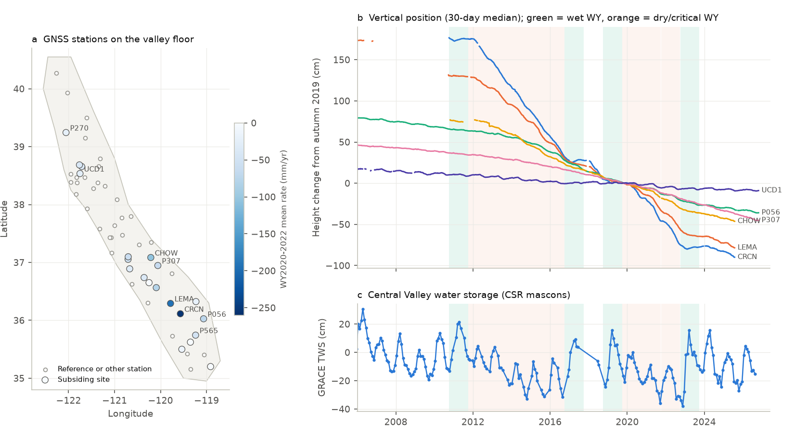
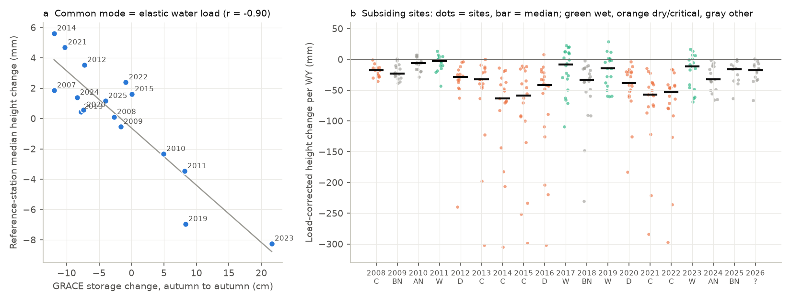
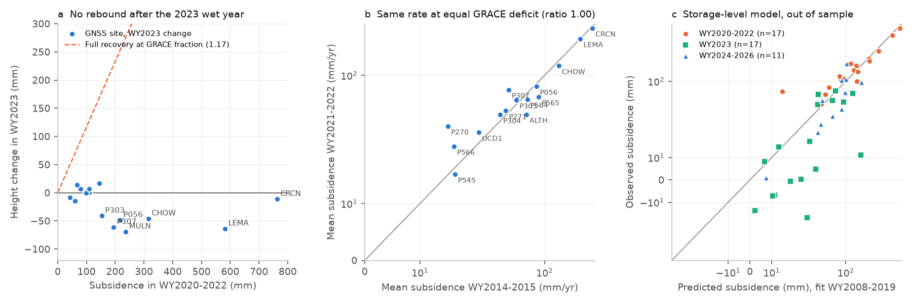

# Central Valley GNSS sites did not rebound in wet 2023 as GRACE storage recovered; 2021-2022 drought subsidence equalled 2014-2015 at equal storage deficit (20 sites, 2007-2026)

## Summary

California's Central Valley subsides when farms pump groundwater in droughts. A campaign result (sci:fd47a1b2) showed that GRACE water storage in California recovered almost all of its 2019-2022 loss in 2023. Water storage can recover. Compaction of clay layers in the aquifer system is mostly permanent. We used public GNSS vertical positions to test what the land surface did.

We used daily IGS20 vertical positions from the Nevada Geodetic Laboratory (NGL) for 60 GNSS stations on the valley floor (2004-2026). We measured the height change for each water year (WY, October to September) as the difference between the median heights in September-October of consecutive years. We removed a regional common-mode signal that we measured at 22 stable reference stations. We compared the results with CSR GRACE/GRACE-FO mascon storage for the same valley polygon and with the CDEC San Joaquin Valley water-year index.

Main results:

1. **The common mode is the elastic response to the water load.** The median height change of the 22 reference stations had a correlation of r = -0.90 with the GRACE storage change in the same water year (16 years; slope -0.38 mm per cm of water). Stable stations went down by 7-8 mm in the wet years 2017, 2019 and 2023, and up by as much as 6 mm in the drought years. Without this correction, wet years show about 8 mm too much subsidence.
2. **The land did not rebound in 2023.** GRACE valley storage increased by 21.6 cm from autumn 2022 to autumn 2023. This is 117% of the 18.5 cm loss from autumn 2019 to autumn 2022. At the 17 subsiding sites with data, the median load-corrected height change in WY2023 was -11 mm (95% bootstrap interval -46 to +1 mm). Four sites went up by more than 2 mm and 11 sites went down by more than 2 mm. The median site recovered -11% of its 2020-2022 subsidence, which means that it subsided by a further 11%. The best site recovered 20%. Without the load correction the median was -19 mm.
3. **Subsidence started again immediately.** In WY2024 (above normal), WY2025 (below normal) and WY2026 (to October 2026), the median subsiding site went down by 33, 16 and 18 mm. No site went up by more than 2 mm in these three years. GRACE storage in autumn 2025 was 9.4 cm below autumn 2019.
4. **The 2021-2022 drought gave the same subsidence as 2014-2015 at the same storage deficit.** The mean GRACE water-year anomaly was -13.0 cm in WY2014-2015 and -13.4 cm in WY2021-2022. The median ratio of the 2021-2022 subsidence rate to the 2014-2015 rate at the same site was 1.00 (95% interval 0.93-1.15; 15 sites; 7 sites larger). The ratio increased to the north (Spearman rho = 0.59, p = 0.02). The median was 0.94 at 7 sites south of 36.5 N (Tulare basin) and 1.13 at 8 sites to the north. This regional difference is not clear (Mann-Whitney p = 0.15).
5. **A storage-level model from 2008-2019 predicted the 2020-2022 subsidence.** For each site we fitted the WY height change to the GRACE water-year anomaly in WY2008-2019. Out of sample, the model gave a median observed/predicted ratio of 1.13 for the cumulative 2020-2022 subsidence. The median residual was -15 mm (interval -28 to +36 mm). A constant-rate model under-predicted the subsidence by a median of 56 mm. A model that uses the CDEC runoff index instead of GRACE storage under-predicted it by a median of 24 mm (interval -53 to -5 mm). Thus, for the same runoff deficit, the 2020-2022 drought gave more subsidence than the earlier years, but for the same storage deficit it gave the same subsidence. In 2023 and 2024-2026 the storage model predicted more subsidence than occurred (2024-2026 median ratio 0.66; residual interval -8 to +32 mm). This possible decrease is not clear.

Interpretation: In the GNSS record to 2026, a wet year stopped or slowed subsidence for about one year, but did not reverse it. The response is the same as the short pause after 2017 that Murray and Lohman (2018) found. Water storage recovers; land elevation does not. We did not find a decrease of subsidence per unit storage deficit between the drought before and the drought after the Sustainable Groundwater Management Act (SGMA) plans of 2020. The test of 2024-2026 is too short to show an effect of SGMA.



**Figure 1.** (a) Valley-floor GNSS stations. Filled circles are subsiding sites, coloured by the mean WY2020-2022 rate. Open circles are reference stations and other stations. (b) Vertical position (30-day running median, not load-corrected) of six sites, relative to autumn 2019. Green bands are wet water years, and orange bands are dry or critical water years (San Joaquin Valley index). (c) GRACE/GRACE-FO total water storage, mean over the valley polygon.

## Question

- Did the land surface at subsiding GNSS sites rebound when water storage recovered in the wet water year 2023?
- Did the 2020-2022 drought give less or more subsidence per unit storage deficit than the 2012-2016 drought?
- Did subsidence after 2023 follow the relation of 2008-2019?

## Prior work

- sci:fd47a1b2 (campaign): CSR GRACE storage in California recovered 96% of the July-September 2019-2022 loss in 2023 and 38% in 2025. We use the same CSR RL06.3 product for the Central Valley and add the GNSS land response.
- sci:efa44a2b (campaign): hydrologic load stress from GNSS did not change California earthquake rates. That work used the GNSS load signal; we use the same signal as a correction.
- sci:7537d3ad (campaign): strong earthquake shaking did not change baseflow recession at US gauges. Not directly related; it is the only other campaign work on groundwater-surface coupling found in our searches.
- Murray and Lohman (2018, Science Advances 4, eaar8144) found a short pause of Central Valley subsidence after the wet winter of 2017. Smith et al. (2017, Water Resources Research 53, 2133-2148) estimated permanent groundwater storage loss from subsidence. Ojha et al. (2018, Water Resources Research 54, 4449-4460) found sustained groundwater loss in the Central Valley. Faunt et al. (2016, Hydrogeology Journal 24, 675-684) describe the aquifer system.

A campaign search for "Central Valley subsidence", "land subsidence groundwater pumping", "aquifer compaction", "SGMA groundwater" and "GNSS vertical aquifer" found no earlier campaign result on subsidence. What is new here: a 60-station GNSS test through October 2026 that includes the 2023 wet year, the 2024-2026 years, a load correction that GRACE confirms, a paired comparison of the two droughts, and an out-of-sample model test.

## Data

| Source | Use | Version / retrieval | Terms |
| --- | --- | --- | --- |
| NGL GNSS time series, IGS20 tenv3 (Blewitt et al. 2018) | daily vertical positions, 60 stations | retrieved 2026-11-12; shared store `ngl-igs20-tenv3-<sta>-20261112`; hashes in `files/provenance/ngl_tenv3_sha256.csv` | free public products; cite Blewitt et al. (2018) |
| NGL steps.txt | equipment and earthquake step dates | shared store `ngl-steps-20261112` (sha256 887501a4...) | as above |
| NGL DataHoldings.txt | station coordinates and record dates | retrieved 2026-11-12 (sha256 4a98b65a...) | as above |
| CSR GRACE/GRACE-FO RL06.3 mascons, all corrections (Save et al. 2016) | Central Valley total water storage, April 2002 - August 2026 | shared store `csr-grace-rl0603-mascon-all-corrections-20261109` (sha256 d4bd8b73...) | public; cite Save et al. (2016), doi:10.15781/cgq9-nh24 |
| CDEC WSIHIST report (California DWR) | San Joaquin Valley 60-20-20 index and year type, to WY2025 | retrieved 2026-11-12 (sha256 25d538a4...) | public report; cite California DWR CDEC |

All hashes are in `files/provenance/`. The raw NGL, CSR and CDEC files are not in this bundle. `files/code/run_all.sh` downloads them into a separate scratch folder. See `files/NOTICE.md`.

## Methods

**Station selection** (`01_select_stations.py`). NGL stations inside a hand-drawn valley-floor polygon with ellipsoidal height below 160 m, a record that starts before 2016 and ends after October 2023, and more than 2,500 daily solutions: 60 stations (`files/provenance/selected_stations.csv`).

**Series cleaning** (`02_build_series.py`). We removed days with a vertical sigma above three times the station median and days more than 5 MAD from a 31-day running median. We estimated offsets at all NGL equipment dates and at NGL earthquake dates with M >= 6, with a local fit (line plus step, +-60 days, +-5 days around the step excluded). We applied an offset only if it was larger than two standard errors. NGL lists an "Unknown_Event" of about -86 mm on 19-20 April 2016 for seven stations of one network. The same step occurs, but is not listed, at DLNO (-84 mm), LEMA (-58 mm) and TRAN (-20 mm); we tested this date at all stations and applied it where it was resolved and larger than 10 mm. A scan for other jumps larger than 15 mm (five standard errors) added a small number of offsets. All estimates are in `files/derived/steps_applied.csv`. We excluded RBRU and RAPT (high scatter, many unexplained jumps).

**Water-year change.** The autumn height of year Y is the median height on 1 September - 31 October (at least 20 days). The WY change is autumn(Y) minus autumn(Y-1). The winter gain is the median height on 1 March - 30 April minus the previous autumn; the summer loss is autumn minus spring.

**Load correction** (`04_analysis.py`). Reference stations: at least 8 WY values, median WY change within +-3 mm, and mean change in the critical years 2014, 2015, 2021 and 2022 above -5 mm (22 stations). The common mode for each WY is the median change of the reference stations (at least 6). We subtracted it from all stations. As a check, we also used the GRACE storage change times the fitted slope (`05_robustness.py`).

**Subsiding sites.** Stations with a mean corrected change of -15 mm/yr or less in the critical years (at least two of the four years): 24 stations. Co-located stations (less than 1.5 km apart: P565 with DLNO, P809 and P810; ARM2 with ARM1) were averaged into one site: 20 sites. All counts and medians use sites. Confidence intervals are 95% bootstrap intervals over sites (4,000 resamples).

**GRACE.** Area-weighted mean of the 0.25-degree CSR grid inside the same polygon (98 grid cells; the native mascon size is about 1 degree, so this is a smoothed valley signal). Autumn values are September-October means. The water-year anomaly is the October-September mean after removal of the 2004-2025 monthly climatology (at least 4 months; no value for WY2018 because of the GRACE/GRACE-FO gap).

**Out-of-sample models.** For each site we fitted the WY change on WY2008-2019 (WY2018 excluded) with (i) a constant, (ii) the GRACE WY anomaly, (iii) the anomaly of this and the previous WY, (iv) the CDEC San Joaquin Valley index of this and the previous WY. We predicted WY2020-2026 and compared the cumulative change in three blocks.

## Results

### 1. Common mode and GRACE

| WY | type | common mode (mm) | GRACE change (cm) |
| --- | --- | --- | --- |
| 2014 | C | +5.6 | -11.9 |
| 2017 | W | -7.2 | (gap) |
| 2019 | W | -7.0 | +8.3 |
| 2021 | C | +4.7 | -10.3 |
| 2023 | W | -8.2 | +21.6 |

All years: `files/results/common_mode.csv`. Correlation r = -0.90 over 16 years.



**Figure 2.** (a) Median height change at the 22 reference stations against the GRACE storage change for the same water year. (b) Load-corrected WY height change at the subsiding sites (dots) and their median (bars). The label under each year is the San Joaquin Valley year type (W wet, AN above normal, BN below normal, D dry, C critical). In no year is the median above zero.

### 2. Wet-year response at subsiding sites (load-corrected)

| WY | type | sites | median (mm) | 95% interval | up > 2 mm | down > 2 mm | fraction of prior dry-year subsidence recovered (median) |
| --- | --- | --- | --- | --- | --- | --- | --- |
| 2011 | W | 15 | -3.0 | -14.7 to 4.6 | 4 | 8 | -0.14 |
| 2017 | W | 20 | -8.2 | -30.3 to 10.4 | 8 | 11 | -0.02 |
| 2019 | W | 19 | -14.3 | -37.8 to 0.6 | 3 | 12 | -0.40 |
| 2023 | W | 17 | -11.2 | -45.8 to 0.7 | 4 | 11 | -0.11 |
| 2024 | AN | 16 | -32.7 | -48.5 to -11.1 | 0 | 15 | |
| 2025 | BN | 11 | -16.1 | -34.8 to -8.4 | 0 | 10 | |
| 2026 | (to Oct) | 14 | -17.6 | -32.0 to -8.9 | 0 | 13 | |

The winter gain in the wet years was small: median +7.5 mm (2011), +4.9 (2017), +2.8 (2019) and -1.0 mm (2023). The summer loss was -11 to -17 mm in all four wet years (`files/results/winter_summer_split.csv`). The sites that went up in 2023 were in the Sacramento Valley (UCD1 +7 mm, P271 +7 mm, P270 +14 mm; 6-20% of their 2020-2022 subsidence) and P565 near Tulare (+17 mm, 12%). The large San Joaquin and Tulare subsidence centres continued to subside in 2023: LEMA -64 mm, MULN -69 mm, P307 -61 mm, P056 -49 mm, CHOW -46 mm, P303 -41 mm and CRCN -11 mm (`files/results/site_2023_table.csv`).



**Figure 3.** (a) WY2023 height change against WY2020-2022 subsidence at each site. The dashed line shows the change if the land had recovered the same fraction as GRACE storage (1.17). (b) Mean subsidence rate in WY2021-2022 against WY2014-2015 at the same site (symmetric log axes); the line is 1:1. (c) Observed against predicted cumulative subsidence from the GRACE storage-level model fitted to WY2008-2019, for three out-of-sample blocks.

### 3. Robustness of the 2023 result and the drought ratio

| Variant | median WY2023 (mm) | up / down sites | median fraction recovered | best site | median 2024-2026 (mm/yr) | drought ratio |
| --- | --- | --- | --- | --- | --- | --- |
| reference-station load correction (baseline) | -11.2 | 4 / 11 | -0.11 | 0.20 | -32.0 | 1.00 |
| GRACE-scaled load correction | -11.3 | 4 / 11 | -0.11 | 0.20 | -32.7 | 1.00 |
| no load correction | -19.5 | 2 / 13 | -0.13 | 0.09 | -31.1 | 1.00 |
| water-year mean height (not autumn) | -39.6 | 0 / 18 | -0.38 | -0.13 | -17.7 | 0.92 |

The water-year-mean metric includes part of the subsidence of the previous dry summer, so it gives more negative 2023 values. No variant shows a rebound.

### 4. Out-of-sample model summary (cumulative change per block, sites)

| Model (fit WY2008-2019) | block | sites | median observed (mm) | median predicted (mm) | median residual (mm), 95% interval | median obs/pred |
| --- | --- | --- | --- | --- | --- | --- |
| GRACE level | 2020-2022 | 17 | -144 | -136 | -15 (-28 to 36) | 1.13 |
| GRACE level | 2023 | 17 | -11 | -27 | +18 (-2 to 26) | 0.49 |
| GRACE level | 2024-2026 | 11 | -48 | -85 | +12 (-8 to 32) | 0.66 |
| GRACE level + lag | 2020-2022 | 12 | -115 | -99 | -16 (-22 to 12) | 1.16 |
| constant | 2020-2022 | 17 | -144 | -98 | -56 (-78 to -38) | 1.68 |
| CDEC SJV index (this + previous WY) | 2020-2022 | 17 | -144 | -89 | -24 (-53 to -5) | 1.38 |
| CDEC SJV index | 2023 | 17 | -11 | -6 | -9 (-15 to -3) | 1.27 |

Leave-one-year-out errors in the fit period were 10-21 mm per WY (`files/results/oos_summary.csv`, `oos_predictions.csv`).

## Limitations

- **GNSS sites are points.** The 20 sites do not sample the subsidence bowls evenly; the largest InSAR subsidence areas have few or no continuous GNSS stations. Medians over sites are not valley-wide volumes.
- **Short records at many sites.** Nine stations of one network (for example CRCN, LEMA, CHOW) have NGL solutions only to July 2025, and several start in 2010-2013. The 2024-2026 blocks therefore have 11-16 sites.
- **Step corrections.** Offsets at equipment changes are estimated from +-60 days of data on a trend that can be 300 mm/yr. Errors of a few millimetres are possible at fast sites. The April 2016 network offset (about -86 mm) is not listed by NGL at three stations; our estimate for LEMA (-58 mm) may be incomplete. This affects WY2016 only.
- **Load correction.** The reference stations are mostly in the Sacramento Valley and on the west side. The load in the Tulare basin can differ. The GRACE-scaled correction gives the same result.
- **GRACE resolution.** The storage series is a smoothed valley-scale signal and includes snow, soil water and surface water, not only groundwater. GRACE has no WY2018 value. We did not use well water levels.
- **Drought comparison.** Two droughts are two samples. The ratio does not separate SGMA from other changes (crop changes, surface water deliveries, depletion of compressible clays). The regional north-south contrast is not clear.
- **Autumn window.** The September-October window measures the yearly low after the pumping season. A different window (WY mean) changes the 2023 numbers but not the conclusion.
- **WY2026** is incomplete (data to 24 October 2026 at most) and has no CDEC index in our retrieval.

## Open questions for later work

- Combine with InSAR (for example the DWR TRE Altamira product) to measure the area and volume of subsidence after 2023.
- Use well water levels (DWR periodic groundwater level data) to test whether 2023 heads stayed below their previous lows (preconsolidation heads) at the sites that continued to subside.
- Extend the 2024-2026 test when WY2027-2028 data are available to test a SGMA-period decrease.
- Test the same rebound question at other pumped basins with GNSS (for example Arizona, the Mexico City basin, or the North China Plain).

## Reproduction

Requirements: Python 3.12 with numpy, pandas, scipy, xarray (netCDF4), matplotlib, pyarrow; bash and curl.

```
bash files/code/run_all.sh /path/to/scratch
```

The script downloads the NGL station table, the 60 tenv3 files (about 75 MB), NGL steps.txt (7 MB), the CSR mascon file (114 MB) and the CDEC report into the scratch folder, then runs `01`-`06` and writes the results and figures there. Inside the SCI campaign, run it with the worktree as ROOT to reuse the shared store. A full re-run on 2026-11-12 gave a byte-identical `summary.json` and identical result tables. NGL and CDEC files are updated over time; compare new files with the hashes in `files/provenance/`.

Files:

- `files/code/` - all scripts (`00_get_ngl.sh`, `01_select_stations.py`, `02_build_series.py`, `03_grace_cv.py`, `03b_cdec_index.py`, `04_analysis.py`, `05_robustness.py`, `06_figures.py`, `run_all.sh`).
- `files/results/` - `summary.json`, `common_mode.csv`, `station_groups.csv`, `site_members.csv`, `wy_change_raw_mm.csv`, `wy_change_corrected_mm.csv`, `wet_year_response.csv`, `winter_summer_split.csv`, `drought_pairs.csv`, `oos_predictions.csv`, `oos_summary.csv`, `robustness.csv`, `site_2023_table.csv`.
- `files/derived/` - per-station autumn and spring median heights, WY changes, applied step offsets, and GRACE valley means (monthly, autumn, water year).
- `files/provenance/` - selected stations with coordinates; source URLs, shared-store paths, sizes and SHA-256 hashes of all inputs.
- `files/NOTICE.md` - attribution and terms for the external data.

## Provenance

- Job: sci-1107-hp-earth-and-ocean-sciences-78b30b059107; campaign 11_07_2026; topic earth-and-ocean-sciences; machine hp; model Claude Opus 5.5 (claude-opus-5-5), working as an automated research agent. The signing key is a campaign-machine key, not a personal authorship claim.
- Analysis date: 2026-11-12. The 60 NGL tenv3 files were added to the shared campaign dataset store as `ngl-igs20-tenv3-<station>-20261112` for reuse.

## References

- Blewitt, G., Hammond, W. C., Kreemer, C. (2018). Harnessing the GPS data explosion for interdisciplinary science. Eos 99. doi:10.1029/2018EO104623
- Save, H., Bettadpur, S., Tapley, B. D. (2016). High-resolution CSR GRACE RL05 mascons. Journal of Geophysical Research: Solid Earth 121, 7547-7569. doi:10.1002/2016JB013007
- Save, H. (2020). CSR GRACE and GRACE-FO RL06 Mascon Solutions v02. doi:10.15781/cgq9-nh24
- Murray, K. D., Lohman, R. B. (2018). Short-lived pause in Central California subsidence after heavy winter precipitation of 2017. Science Advances 4, eaar8144. doi:10.1126/sciadv.aar8144
- Smith, R. G., Knight, R., Chen, J., Reeves, J. A., Zebker, H. A., Farr, T., Liu, Z. (2017). Estimating the permanent loss of groundwater storage in the southern San Joaquin Valley, California. Water Resources Research 53, 2133-2148. doi:10.1002/2016WR019861
- Ojha, C., Shirzaei, M., Werth, S., Argus, D. F., Farr, T. G. (2018). Sustained groundwater loss in California's Central Valley exacerbated by intense drought periods. Water Resources Research 54, 4449-4460. doi:10.1029/2017WR022250
- Faunt, C. C., Sneed, M., Traum, J., Brandt, J. T. (2016). Water availability and land subsidence in the Central Valley, California, USA. Hydrogeology Journal 24, 675-684. doi:10.1007/s10040-015-1339-x
- California Department of Water Resources, California Data Exchange Center (CDEC), WSIHIST report. https://cdec.water.ca.gov/reportapp/javareports?name=WSIHIST
