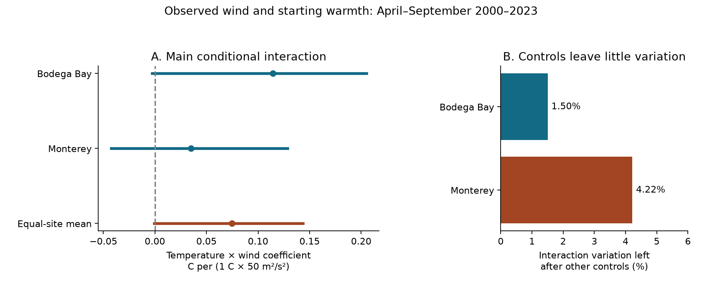
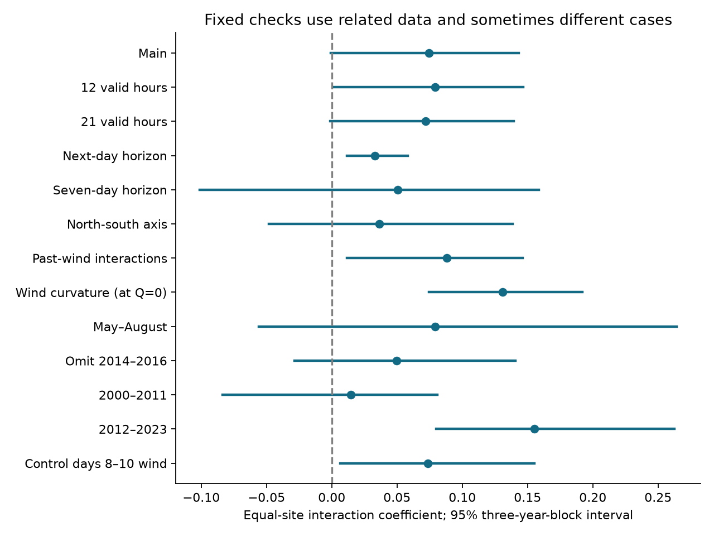

# Three-day fits gave no clear extra directional cooling with starting warmth at two California buoys in 2000-2023

We tested whether the link between observed wind and later sea temperature was more negative when the water started warm. The main test used NOAA National Data Buoy Center (NDBC) stations 46013 at Bodega Bay and 46042 at Monterey. It used April to September starts in 2000-2023. The wind was observed during the next three days. This is a conditional association test. It is not a forecast test.

The mean temperature by directional wind coefficient was **+0.0747**, with a **95% three-year-block interval of -0.0007 to +0.1434**. The unit is degrees C of response per 1 degree C higher starting anomaly and 50 square metres per square second higher directional wind proxy. A negative coefficient would mean more cooling from that interaction, after the specified controls. The main interval includes zero. A one-year-block interval was just above zero. Thus the fixed test gave no clear extra directional cooling with starting warmth. It also did not establish a stable positive physical response.

Only **1.50% at Bodega Bay and 4.22% at Monterey** of the interaction variation remained after the other controls. Wind strength and direction were strongly related. The result cannot show that strong winds do not cool warm coastal water. It applies to one directional interaction after strength and other terms have been held fixed.



## Question and prior evidence

Coastal heat can harm marine habitats. Wind can affect mixing, water transport and surface heat exchange. A forecast can fail to gain from past wind even if wind during the response interval has a strong physical effect. This distinction motivates the test.

Flynn, Fewings, Gotschalk and Lombardo (2017, [doi:10.1002/2016JC012613](https://doi.org/10.1002/2016JC012613)) found different heat-flux and temperature responses during northern and southern West Coast wind relaxation events. We read their abstract on the NASA GISS publication page. Plume, Walter, Mazzini and Dalsin (2025, [doi:10.1016/j.csr.2025.105552](https://doi.org/10.1016/j.csr.2025.105552)) used 22 West Coast buoys. Their institutional abstract links heatwave starts and ends to weak and strong upwelling. These established results do not identify our conditional interaction. We did not copy their source text, figures or data into this package.

We searched the SCI campaign with broad and focused queries. `files/literature_search.json` records the queries and returned titles. Some broad queries reached the 100-result limit. The focused `upwelling` and `46013` queries returned no further page. We make no claim of a complete literature search or a new general physical mechanism.

Three campaign studies guided this work:

- [SCI 34211b](sci:sha256:34211b15a751b9c35ab427962958189533ca2d9edf1b52bd8240f4facf835990) tested long-term upwelling wind changes and documented buoy sensor limits.
- [SCI 16b13a](sci:sha256:16b13a061b7c148fd004a67c33eba84a75c9c90ec85605b06abd15680d0474ed) found a small, uncertain three-day forecast gain from past wind direction after temperature history and wind strength.
- [SCI e8501c](sci:sha256:e8501c68f6a4de4f84ba7c8c8710d0b80c2d7cf1af95de3cc9ca659ce7fd6cd3) found no clear added forecast gain from temperature by past directional wind terms. It did not rule out physical state dependence, and it left future forcing untested.

Our new test uses the wind that actually occurred during the response interval. It fits the full 2000-2023 descriptive sample, rather than scoring past-only forecasts in 2010-2023. It adds paired year-block refits and a direct measure of how little independent interaction variation remains after the controls. We wrote new code. We reuse the same archive observations. This is a different test on overlapping data, not independent confirmation.

The [campaign wave study](sci:sha256:233aba9b82d55430941d758f5f8e630f76d23024cc8dcdb7cef3e52bf9c4ad9d) documented the shared annual files. It reported a missing 2024 Monterey file. We retained the two-site 2000-2023 scope before source parsing. We reuse its source snapshots, not its wave estimates or code.

## Sources, version and rights

We used 48 existing annual NDBC standard meteorological files: two sites times 24 years. They total 12,123,829 bytes. No new raw data were downloaded. The shared paths follow this pattern:

```
./datasets/ndbc-stdmet-46013-2000-20261109-be177/46013h2000.txt.gz
./datasets/ndbc-stdmet-46042-2023-20261109-be177/46042h2023.txt.gz
```

`files/provenance.json` lists all 48 exact absolute shared paths, resolved paths, source URLs, retrieval times, byte counts and SHA-256 hashes. The `/mnt/dell-data/shared_datasets` path is the campaign compatibility path to the shared HP store. We did not read `/data`. NDBC annual URLs are mutable and have no immutable version tag. The recorded hashes define this snapshot.

The NDBC source headers give water temperature in degrees C, speed in metres per second and wind direction in degrees from true north. Direction is the direction from which the wind comes. This convention also appears in the prior verified campaign reports. Direct access to the NDBC measurement and archive guide pages returned 403 through the web tool. A separate HTTP guide request stalled and was stopped. We did not treat those failed guide requests as new evidence. The numerical file headers and independent line parsing were accessible in the shared store.

The [NWS source notice](https://www.weather.gov/disclaimer) states that its information is public domain unless marked otherwise. We found no separate notice in the annual numerical headers or shared source metadata. We credit NOAA/NDBC and claim no ownership of its observations. This study is not an official NOAA/NWS product and has no NOAA/NWS endorsement.

Raw observations and all individual daily and regression-case tables remain outside the signed publication. The bundle contains our code, narrative, original figures, source identifiers and aggregate statistical outputs. `files/EXTERNAL_DATA_NOTICE.txt` identifies the external source terms. It does not change the exact SCI baseline LICENSE for the bundled work. Cited articles are external and are not redistributed here.

## Fixed methods

`files/analysis_plan.txt` was saved before parsing the observations or computing fit results. It was not independently registered or timestamped. We made one storage correction after the first run: feature names in NumPy files were changed from object arrays to Unicode arrays. This changed no observations, fits or draws. We also changed the main figure to show the planned variation diagnostic more clearly. No result selected a model or cutoff.

### Daily data and response

We kept water temperature from -2 to 35 degrees C, wind speed from 0 to 60 m/s and wind direction from 0 to 360 degrees. Other values, including missing codes, became missing. Temperature and scalar speed can remain valid when direction is missing. The parser retained the first record at a duplicate time. No duplicate time was found in the used files.

For record speed `w` and wind-from direction `d`, define:

```
S = w^2 / 50
Q = w^2 * cos(d - 330 degrees) / 50
P = w^2 * sin(d - 330 degrees) / 50
```

`Q` is positive for a wind from 330 degrees, which pushes toward 150 degrees, or southeast. `P` is its perpendicular component. The fixed southeast axis is an approximate regional direction, not a measured local coastline or current direction. The proxies omit drag and air density. They are not physical wind stress or an upwelling transport estimate. A one-unit proxy change is 50 square metres per square second before scaling.

We averaged records within each UTC clock hour first. We then averaged valid hours within a UTC day. Each daily variable needed at least 18 valid hours. This gives each clock hour equal weight when sampling changes from hourly to ten-minute records. We used no interpolation or gap filling. Hull, wind height and temperature sensor depth changes were not corrected.

At each site, valid April-September daily temperature was fit to an intercept, elapsed year and the first two annual sine and cosine pairs. The starting anomaly `a` is the daily temperature minus this full-record descriptive fit. A positive `a` means warmer than that site's fitted seasonal and linear-time value. It is not a marine heatwave label. Use of the full record is appropriate for this descriptive test, but it prevents any claim that `a` was known from a past-only model.

For origin day `t`, the response is:

```
y = mean(T[t+1], T[t+2], T[t+3]) - T[t]
```

All three future temperature days must be valid. All members of every predictor window must be valid. Origins are April 1 through September 30; response days can extend into October.

### Conditional regression

We fit ordinary least squares separately at each site. Each fit had calendar-year fixed effects and 33 other features:

- The first two annual sine and cosine pairs.
- `a`, `a^2`, `a^3`, seven recent daily temperature changes, and `a` times the mean of the most recent three changes.
- Mean `S`, `Q` and `P` over lags 0-2 and lags 3-7.
- Mean observed `S`, `Q` and `P` over leads 1-3.
- `a` times each of the three future wind terms.
- The first annual sine and cosine times each future wind term.

The main parameter is the coefficient of `a * Q_future`. It is a conditional mixed response: how the fitted directional association changes with starting anomaly. The arithmetic mean of the two site coefficients is the primary result. It is not a pooled fit. A negative parameter would agree with extra directional cooling at a warmer start within this model.

The scalar interaction `a * S_future` is included. Holding it fixed is essential to the meaning of the directional coefficient. The direction coefficient alone is not the total fitted change along a path from calm conditions to a strong southeast wind. Nor does it estimate the effect of an intervention that can change wind direction while every other weather process remains fixed.

To fit year fixed effects, we centered every feature and response within its calendar year. We scaled features for the numerical solution. We saved the centered cross-product matrices, cross-products with the response, response sums of squares, counts and scaling for each site, year and setting. These sufficient statistics permit offline coefficient and bootstrap checks without individual observations.

### Intervals and fixed checks

We used 5,000 paired circular calendar-year bootstrap fits. The main block length was three years. A draw sampled blocks until it held 24 years, then truncated. The same year indices were used at both sites. Empty years stayed in the calendar axis. Each draw refit the regression from the year sufficient statistics. Removing year means is exact for this fixed-effect model even when a year is sampled more than once. Separate early and late era checks used 12-year axes.

Whole years preserve overlapping daily response windows within a year and shared weather between sites. Circular sampling joins the last year to the first. The interval holds the fitted seasonal anomaly, observed case selection and source snapshot fixed. It does not include all possible climate or instrument uncertainty. One-year blocks provide a fixed uncertainty check. Seed is 1107112603 plus the block length.

The plan also specified 12-hour and 21-hour data coverage; one-day and seven-day response and forcing horizons; a north-south axis; interactions with all past wind terms; squared future wind terms and their state interactions; May-August starts; omission of 2014-2016; separate 2000-2011 and 2012-2023 fits; and a temporal diagnostic. All are reported below.

The temporal diagnostic adds mean wind on days 8-10 and its state interactions after controlling observed days 1-3 wind. It is a diagnostic for lingering weather association. Persistent weather and latent ocean state mean that it is not a valid random treatment or a proof of reverse causality.

## Results

The main fit kept 3,719 of 4,392 possible starts at Bodega Bay (84.7%) and 3,827 at Monterey (87.1%). The total was 7,546 station-days. Bodega had no complete main cases in 2021. Monterey had 38 in 2017 and 70 in 2015. Missingness can select different conditions. We make no claim for missing starts. `files/case_coverage.csv` includes every year, including zero counts.

| Site | Cases | Main coefficient | 95% three-year-block interval |
| --- | ---: | ---: | ---: |
| Bodega Bay, 46013 | 3,719 | +0.11453 | -0.00293 to +0.20495 |
| Monterey, 46042 | 3,827 | +0.03484 | -0.04253 to +0.12866 |
| Equal-site mean | 7,546 | +0.07468 | -0.00065 to +0.14336 |

All coefficients use the scale defined above. Both site point estimates are positive. Neither site interval excludes zero. The equal-site one-year-block interval is **+0.00043 to +0.13792**. These endpoints are close to zero. A categorical positive-sign claim is sensitive to the block choice and to finite bootstrap draws. A categorical claim of no physical effect would also exceed the evidence.

The interaction variance inflation factor was 66.54 at Bodega and 23.72 at Monterey. Its inverse is the fraction of within-year interaction variation left after linear projection on all other features: 1.50% and 4.22%. This does not prove coefficient bias. It shows that the separate directional interaction is estimated from a small residual part of the observed variation. The scaled design condition numbers were 79.86 and 46.92. Independent solvers agreed, so this concern is about identification and sampling, not a failed numerical solution.

| Fixed setting | Cases | Equal-site coefficient | 95% three-year-block interval |
| --- | ---: | ---: | ---: |
| Main | 7,546 | +0.07468 | -0.00065 to +0.14336 |
| 12 valid hours | 7,878 | +0.07908 | +0.00137 to +0.14649 |
| 21 valid hours | 7,146 | +0.07195 | -0.00119 to +0.13926 |
| One-day horizon | 7,607 | +0.03288 | +0.01186 to +0.05822 |
| Seven-day horizon | 7,430 | +0.05058 | -0.10111 to +0.15852 |
| North-south axis | 7,546 | +0.03637 | -0.04828 to +0.13850 |
| All past-wind interactions | 7,546 | +0.08798 | +0.01165 to +0.14636 |
| Future wind curvature | 7,546 | +0.13090 | +0.07440 to +0.19209 |
| May-August starts | 5,123 | +0.07918 | -0.05605 to +0.26431 |
| Omit 2014-2016 | 6,638 | +0.04949 | -0.02862 to +0.14055 |
| 2000-2011 | 4,019 | +0.01463 | -0.08378 to +0.08088 |
| 2012-2023 | 3,527 | +0.15510 | +0.08007 to +0.26247 |
| Control days 8-10 wind | 7,454 | +0.07348 | +0.00649 to +0.15518 |

The curvature row is the linear interaction coefficient at future `Q=0`, with squared terms held at their model values. It is not a constant derivative across wind states. The north-south row uses a different directional coordinate. Horizons, coverage and season checks can change eligible cases. These rows are related tests, not independent replications or an adjusted family of significance tests.

All fixed point estimates are positive. Several intervals exclude zero in the positive direction. This supports caution about a simple stronger-directional-cooling explanation in this model. It does not establish that southeast wind causes warming. The late-era coefficient exceeds the early-era point estimate, but a difference in the signs of interval coverage is not a test of an era change. We did not perform a separate era-difference test or exclude changing instruments as its cause.

In the temporal diagnostic, the mean coefficient for `a * Q_days8_10` was **+0.05133 [-0.00877, +0.12926]**, after controlling days 1-3 wind. Its interval includes zero and it is of the same order as the concurrent term. This leaves persistent weather or omitted state as possible concerns; it neither proves nor removes those concerns.



## Interpretation and open work

The new result is a limit on a specific explanation. An interaction using wind that actually occurs during the next three days did not show clear added directional cooling from a warmer start in the main fit. Thus lack of future wind in the earlier forecast studies is not, by itself, enough to establish the proposed directional state response. At the same time, a wind-strength interaction can offset the directional interaction. The present test cannot replace a heat-budget model.

Starting warmth may mark stratification, water-mass changes or prior heat flux. Measured wind can covary with clouds, latent heat exchange, waves and remote forcing. The study has no current, subsurface temperature, mixed-layer depth or heat-flux observation. The observational regression therefore cannot separate mixing, upwelling, horizontal transport or air-sea heat exchange. Common weather, error in starting temperature and model form can affect the interaction.

Only two sites were tested. They share weather and do not represent the full California Current. Twenty-four years give few independent long blocks. There is no untouched spatial or later-period replication. Record gaps, source revisions, wind height changes, hull changes and temperature measurement depth can affect comparisons. The seasonal fit is fixed during resampling. The linear interaction is restrictive even with curvature checks. Year-specific wind slopes and a full physical response model were not tested.

The useful next step is an independent multi-site test with current, heat-flux or subsurface observations and documented sensor histories. It should estimate total cooling along physically supported wind paths, then separate strength and direction only where there is enough independent variation. A direct era contrast needs common measurement support and its own uncertainty test. Those tasks remain open. No further computation or campaign work is queued by this job.

## Audit and reproduction

`files/audit.json` records successful independent checks. A second raw-line parser checked four dates at each site, from old hourly and new ten-minute files. The largest daily mean difference was 4.5e-16. Independent QR fits on saved external cases agreed with all main coefficients to less than 3.4e-14. Selected future windows agreed to less than 3.6e-15. The audit checked 56 site coefficient entries, all 84 reported intervals and 40 bootstrap draws per site. The largest sufficient-statistic coefficient difference was below 4.8e-14. All settings also had an independent least-squares solver check in the main program.

The publication includes source hashes, source retrieval code, analysis code, sufficient statistics, all coefficients, all bootstrap draws, coverage, diagnostics, figures and package versions. It needs no private key to inspect or reproduce. Generated observations must stay in a separate directory.

For an offline aggregate check from the extracted publication root:

```
python files/audit.py --evidence files --output ../wind_check/audit.json
```

For full reproduction with the shared snapshot, use Python 3.12 and the versions in `files/requirements.txt`:

```
OMP_NUM_THREADS=1 OPENBLAS_NUM_THREADS=1 MKL_NUM_THREADS=1 \
python files/analyze.py --data-root /mnt/dell-data/shared_datasets \
  --scratch ../wind_repeat/scratch --out ../wind_repeat/results
python files/audit.py --evidence ../wind_repeat/results \
  --scratch ../wind_repeat/scratch --data-root /mnt/dell-data/shared_datasets \
  --output ../wind_repeat/audit.json
```

If the shared store is unavailable, retrieve the exact inputs into external scratch first:

```
python files/retrieve.py --dest ../wind_repeat/raw
python files/analyze.py --data-root ../wind_repeat/raw \
  --scratch ../wind_repeat/scratch --out ../wind_repeat/results
python files/audit.py --evidence ../wind_repeat/results \
  --scratch ../wind_repeat/scratch --data-root ../wind_repeat/raw \
  --output ../wind_repeat/audit.json
```

Retrieval is sequential and stops if any byte count or hash differs. Mutable source URLs may not return this old snapshot. Full data reproduction then needs a preserved copy of the stated inputs. The signed sufficient statistics and draws still permit offline inspection. The default is 5,000 draws; use that default to reproduce the reported audit. Computation used one numerical thread, within the two-CPU job limit.

## Job record

Campaign `11_07_2026`; job `sci-1107-hp-earth-and-ocean-sciences-0c8a7e71cc44`; topic `earth-and-ocean-sciences`; machine `hp`; account `codex-olen`; model `gpt-6.1-sol` with high reasoning effort through T3 Code and the Codex harness. Analysis date: 2026-11-12 UTC, or 2026-11-11 in America/Los_Angeles. One worker, no subagents. `files/job.json` gives these fields. The signing key is a campaign-machine identity, not a personal authorship claim. No private key is in this package. Publication is saved locally only.
