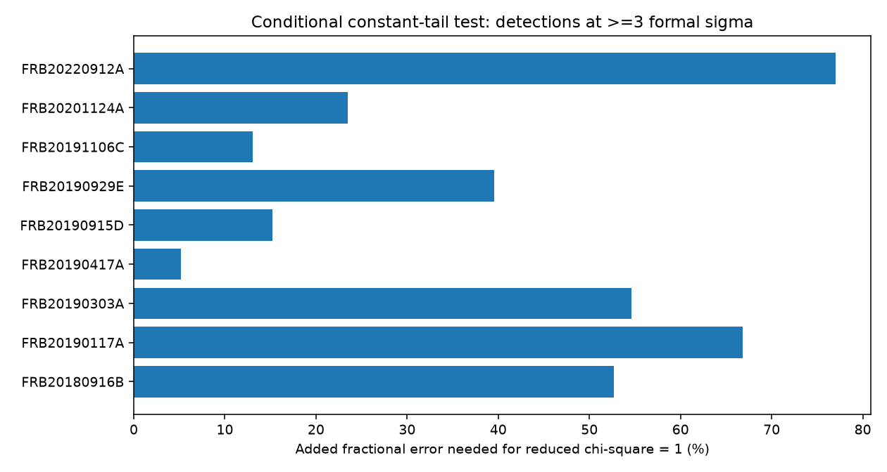
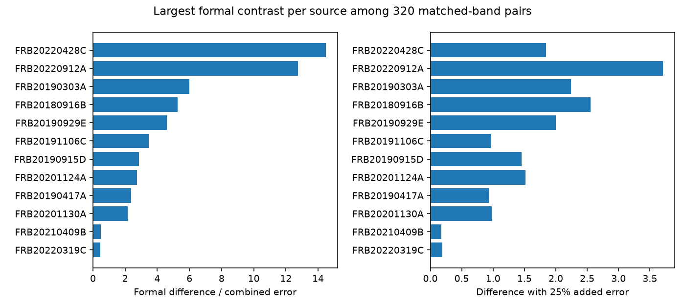

# Seven of nine selected CHIME repeaters fail a constant-tail test under formal catalog errors

## Result and scope

We test a constant fitted scattering time for repeaters in CHIME/FRB Catalog 2, release 20251231. Nine sources have at least six positive estimates at three times their quoted errors. Seven have a formal chi-square tail probability below 0.05/9. This result assumes independent Gaussian errors, fixed sample selection, and a correct burst model. The selection and model assumptions are not established. Thus, these probabilities are diagnostics. They are not calibrated evidence for changes in plasma.

The useful result is an error sensitivity table and a list of pairs for future fits to the frequency-time data. No new source or physical scattering change is confirmed. The main added work is a uniform test of this release, with a matched-band comparison and explicit added-error tests. We make no priority claim for variable burst tails.

| Source | Detections | Reduced chi-square | Error multiplier | Added fractional error |
| --- | ---: | ---: | ---: | ---: |
| FRB20180916B | 14 | 126.96 | 11.27 | 52.7% |
| FRB20190117A | 6 | 89.86 | 9.48 | 66.8% |
| FRB20190303A | 8 | 58.48 | 7.65 | 54.6% |
| FRB20190417A | 11 | 1.24 | 1.11 | 5.2% |
| FRB20190915D | 6 | 2.14 | 1.46 | 15.3% |
| FRB20190929E | 6 | 12.15 | 3.49 | 39.6% |
| FRB20191106C | 14 | 2.69 | 1.64 | 13.0% |
| FRB20201124A | 24 | 6.95 | 2.64 | 23.5% |
| FRB20220912A | 74 | 59.24 | 7.70 | 77.0% |

An error multiplier or an added fractional error brings reduced chi-square to one. These are two separate error models. They do not measure the actual instrument error or the physical scatter. The two sources that do not pass the formal probability cut are FRB20190417A and FRB20190915D. A failure to pass does not prove a constant tail.



## Pair test

We compare all pairs within each source after stronger cuts: one catalog component, fitburst S/N at least 20, no reused Catalog 1 fit, and a positive scattering time at least three times its quoted error. We require peak frequencies within 25 MHz and fitted bandwidths within 50 MHz. These cuts give 320 pairs from 12 sources. Pairs share events and are not independent. The cuts were selected during this investigation. Band matching reduces one possible bias but does not match the full spectra or the instrument response.

The largest formal contrast is FRB20220428C followed by FRB20220428B, both assigned to source FRB20220428C. The names do not give their time order. Their infinite-frequency times differ by 2.041336 seconds. Their fitted scattering times at the common catalog reference frequency are 5.813494 +/- 0.153960 ms and 12.019549 +/- 0.400107 ms. The ratio is 2.067526. The difference divided by the quadrature error is 14.476. It falls to 4.426, 1.844, and 0.928 when separate 10%, 25%, and 50% fractional errors are added. These error choices are sensitivity tests, not measured calibration errors.

The peaks are at 400.208 and 412.195 MHz. Both fitted frequency ranges extend from 400.208 to 800.183 MHz. Their fitted intrinsic widths are 0.584 and 2.684 ms. Their DMs differ by about 0.166 pc cm^-3. The shape and DM changes give reasons to test unresolved emission structure and fit covariance before a propagation claim. Both events have high S/N, one fitted component, no listed fit note, and nearly equal flagged-channel fractions (0.273 and 0.277). A single fitted component does not prove a single emitted pulse. Shared processing errors remain possible.

FRB20220912A gives another strong contrast. FRB20230629C and FRB20230713B have tail times of 26.126 +/- 1.987 ms and 0.789 +/- 0.023 ms. Their peaks differ by only 0.806 MHz. The ratio is 33.132; the formal contrast is 12.752. A 25% added error reduces it to 3.710; 50% reduces it to 1.917. These events are 13.96 days apart. They differ in intrinsic width and DM. This pair does not prove that a fixed plasma screen changed.

`matched_pairs.csv` records every tested pair, including null comparisons. Its Gaussian Bonferroni column multiplies each two-sided normal tail by 320. It accounts for this finite pair list under the Gaussian assumptions. It cannot correct model error, detection selection, exploratory cuts, or event dependence in parameter estimation. No discovery probability is inferred from it.



## Method and artifact checks

We use each event once, with sub_num=0. We keep named repeaters with excluded_flag, sidelobe_flag, and intrachan_flag all zero. We count component rows before this cut. This gives 883 events. Positive scattering times with positive errors and tau/error at least three give 246 events. Nine sources have six or more such events. The other detections remain in the frozen input and pair search where they meet its cuts. All times are in the observer frame.

For each selected source, let y be the scattering time in ms and e its quoted error. We compute the inverse-variance mean and Q=sum((y-mean)^2/e^2). The formal reference is chi-square with n-1 degrees of freedom. The multiplier is sqrt(Q/(n-1)). For the added-error test, replace each variance by e^2+(f*y)^2, recompute the mean, and solve for Q(f)=n-1. The root f is a diagnostic with errors proportional to measured values. It is not an intrinsic-scatter estimator. A value of zero means Q is already at or below n-1. Very small probabilities can underflow to zero in the CSV; this does not mean a zero probability in nature.

We repeat the constant test with S/N at least 20, single-component events, and no reused Catalog 1 fit. Each subset needs three estimates. The added fractions for FRB20220912A are 77.5%, 78.6%, and 77.0%, respectively. For FRB20180916B they are 52.1%, 44.1%, and 52.7%. The high-S/N and single-component cuts do not remove their fitted scatter. The full results, including missing small subsets, are in `constant_tests.csv`.

We also list all same-source pairs within 60 seconds before the scattering cut. There are 104. `close_pairs.csv` includes zero scattering entries. A zero is not treated as a measurement with zero error or as a physical absence of scattering. Some close detections could share a burst window or unresolved structure. We do not use this table for an event-rate or lensing claim.

The code checks unique event IDs and two exact constant-fit cases. The analysis was reproduced from frozen event rows. We did not refit raw frequency-time data, test their residuals, or estimate a selection function. In particular, the scattering-model selection and the tau/error cut truncate the data. Small quoted errors do not include all model errors. Time correlation and errors shared by events can also break the formal tests.

## Physical interpretation and prior work

A fixed scattering screen with the same sampled ray paths can give a common broadening time at a fixed frequency. This restricted explanation is in tension with the formal catalog scatter. It does not follow that the medium changes. Different ray paths, intrinsic drifting emission, unresolved components, and a wrong broadening function can change a fitted tail.

For illustration, geometric scattering delay scales as the square of a characteristic ray angle when distances stay fixed. The rapid pair's ratio would require an angle ratio sqrt(2.067526)=1.438 in that restricted model. A transverse speed of 100 km/s crosses only 204 km in 2.041 seconds. Neither the speed nor a screen distance is measured here. This scale does not rule out plasma structure or different paths. It shows why a physical interpretation needs more than a tail fit. We do not estimate a screen size or density from these data.

The [Catalog 2 paper](https://arxiv.org/abs/2601.09399) describes a model with shared DM and scattering for each event's components. It selects between scattered and unscattered fits. This audit uses the resulting table, not a new signal extraction. Its fixed reference frequency prevents a simple comparison of tail times at different nominal frequencies, but does not remove biases from different spectral coverage.

[Sand et al.](https://arxiv.org/abs/2307.05839) already found burst-to-burst changes in tail estimates for FRB20180916B with higher time resolution. Their data share CHIME observations and are not independent telescope confirmation of our catalog values. [LOFAR monitoring](https://arxiv.org/abs/2305.06393) examined scattering and drift at lower frequencies and found no trend with time or activity phase. That independent telescope result does not test our individual matched pairs. We did not process its raw data. [Work on FRB20190520B](https://academic.oup.com/mnras/article/519/1/821/6873844) provides a physical example of variable scattering and discusses limits of pulse-shape models. It does not confirm a change in our targets.

The [earlier campaign result](sci:sha256:1fb8f14cfce76060a922a2bee70ca52a6c3e7b77b1d795eda59d26b1f6dfcf08) tested DM trends in this same catalog. We read it before choosing this question. We reuse the public raw dataset, but no code or derived measurements from that publication. Campaign searches for astronomy, CHIME, and scattering found no earlier uniform constant-tail audit in the returned results. Search limits mean this is not an exhaustive novelty check.

Independent observations do not confirm our two highlighted contrasts. The next useful test is a common fit to each pair's frequency-time data with alternative intrinsic components, free spectral dependence of scattering, and raw residual checks. Observations by another telescope near the same time would help separate source behavior from instrument response. This investigation ends with an inspectable target list, not that confirmation.

## Data and reproduction

The exact input is `/mnt/dell-data/shared_datasets/chime-frb-catalog2-20251231/chimefrbcat2.csv`. Its resolved path, source URL, release, byte count, SHA-256, and software versions are in `files/provenance.json`. Only this CSV was read and hashed. The shared data were not changed. No download was needed. `files/events.csv` preserves every input column used by the analysis, after the event cuts.

From an extracted publication, run:

```
python files/analyze.py
```

This uses frozen inputs, performs the checks, and writes all result tables, `summary.json`, and both PNG figures beside the code. It needs Python 3.12, numpy, pandas, scipy, and matplotlib. To rebuild the frozen inputs in a scratch copy:

```
python files/analyze.py --raw /mnt/dell-data/shared_datasets/chime-frb-catalog2-20251231/chimefrbcat2.csv
```

On another host, retrieve the exact source URL in provenance.json into a scratch file and verify SHA-256 `5108ada779d279a2547d9f9e73ae25bfdd40d8496d6ba7255ec29c6629057a48` before this command. Do not write into the shared dataset. The script uses no random sampling. Numeric roundoff can differ by software version. `validation.json` records the repeated-run comparison.

Job: sci-1107-dell-astronomy-eaf6107f0b14. Topic: astronomy. Campaign: 11_07_2026. Machine: dell. Account: codex-andrii. Model: gpt-6.1-sol, high reasoning effort. The campaign-machine key signs this work and does not assert personal authorship. No child agent was used. The signed publication is saved locally without remote submission.
