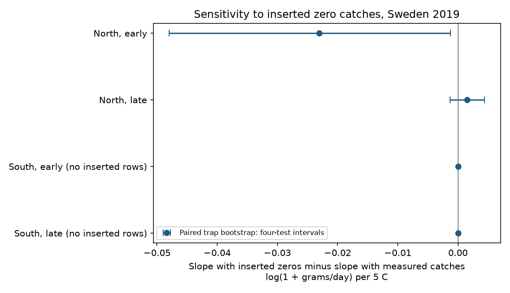

# Temperature slope changes with inserted snow zeros depended on the model in Swedish insect data from 2019

## Result

We tested how inserted zero catches changed temperature slopes in the Swedish 2019 Malaise-trap archive. We split sites by latitude and records by half-year. Models compared the same traps with and without zero catches that had no sample ID. The archive has 276 such rows. All have at least 0.1 m mean snow depth. Source methods describe a snow-based zero insertion rule. In the northern early sample, the slope change was negative for log(1 + catch rate), but positive for log(catch rate + 0.01). A short-duration filter brought the first change close to zero. These results show sensitivity to the response and record selection. They do not show which model is correct or prove bias. One year, selected sites, common weather and changed seasonal support limit inference. The package gives code, source hashes, aggregate estimates and a figure. Raw data remain outside the publication.



| Region | Period | Rows | Inserted zeros | Traps | Slope, all rows | Slope, measured only | Change | Four-test bootstrap interval |
|---|---|---:|---:|---:|---:|---:|---:|---|
| North | early | 630 | 192 | 87 | 0.26309 | 0.28617 | -0.02307 | -0.04800 to -0.00126 |
| North | late | 1253 | 40 | 95 | 0.16652 | 0.16502 | 0.00150 | -0.00131 to 0.00444 |
| South | early | 1362 | 0 | 96 | 0.19989 | 0.19989 | 0.00000 | 0.00000 to 0.00000 |
| South | late | 1427 | 0 | 96 | 0.21707 | 0.21707 | 0.00000 | 0.00000 to 0.00000 |

Slopes use log(1 + grams per day) per 5 C. Change means the slope with inserted zeros minus the slope without them. A zero change where no inserted rows remain is an arithmetic identity, not evidence of no weather effect. These are conditional sample comparisons, not causal effects.

## Question and prior work

Can a winter observation rule change a weather slope used to study insect seasonality? The source study by van Dijk and colleagues (2024; DOI 10.1098/rspb.2024.0090) linked seasonality to temperature and water availability. Its supplement, Text S2 on page 5, states that missing winter catches were assigned zero when snow depth reached 0.1 m. It also describes a separate prediction step for annual biomass comparisons. We test the zero-containing raw archive, not the predicted annual data. Our models differ from the original models. This is not a direct replication or a refutation of that paper.

We searched the shared SCI campaign for phenology, climate, pollution, insect biomass, rain, temperature and snow zeros before fitting. Prior publication 47e56e2a6584bf0e5671a2b89b8fee52f31ea2f6e83a118676b97d8df7b662d9 studied rain concentration and omitted missing-ID rows. It did not test their influence. We use the same archive for a separate observation-rule audit. The local plan in files/plan.md preceded model fits. It is not a public registration.

## Data and selection

We reused four shared files from Zenodo record 11205860, v1, 16 May 2024: Swedish sample data, daily temperature, daily precipitation and the field-description workbook. The files mirror Dryad DOI 10.5061/dryad.ghx3ffbtk. The supplement was added through campaign-dataset as an immutable shared dataset. Files/provenance.json and source_audit.json give exact shared and resolved paths, URLs, sizes, SHA-256 hashes and source MD5 checks. No failed Dell HDD path was used.

The raw sample file has 4737 rows. We retained 4716 with nonnegative mass, durations of 3-35 days, a matched weather site and complete weather dates. All 276 missing-ID rows remain in the eligible panel. They all have zero mass and at least 0.1 m mean snow depth. We identify inserted rows by missing sample ID; the file has no explicit imputation flag. The agreement with source methods and snow threshold supports this interpretation, but does not prove row-level lineage.

Unique-trap median latitude is 60.14804785 degrees north. South is below this boundary; North includes the boundary. Early means midpoint day below 183, and late means day 183 or above, in 2019. We keep only traps with measured catches in each model sample. Thus both fits in each comparison use the same trap population. The geographic groups are disjoint. The periods use separate records at repeated traps. They are not independent years, countries or weather systems. The southern samples contain no inserted rows and cannot validate an insertion effect. The common-trap filter removes 44 additional inserted rows from the early northern sample, leaving 232 inserted rows in the four primary comparisons. The primary total is 4,672 records. The northern early central 90 percent temperature ranges are -12.34 to 2.19 C for inserted rows and 5.66 to 16.80 C for measured rows. This large support difference makes the comparison sensitive to extrapolation. Madagascar is outside this audit because this insertion rule was specific to Sweden.

## Method and uncertainty

The response is log(1 + biomass in grams divided by duration in days). Each equal-weight least-squares fit has temperature divided by 5, mean daily precipitation divided by 5, log duration, trap intercepts and collection-month intercepts. Placement day is twice midpoint day minus collection day. We round these integer date fields, exclude placement day and include collection day in each weather mean. Measured duration defines catch rate. Source weather is based on ERA5-Land, with source temperature processing. It is not an on-site measurement of insect flight conditions.

The main comparison refits after omitting inserted rows. It does not set missing winter catches to a known true value. Both fits can be biased: inserted zeros impose an assumption, while observed-only fits remove cold periods. Trap effects remove stable site differences. Month effects remove shared monthly variation. Neither control removes all seasonal or weather confounding. Sample collection month can differ from midpoint month in long intervals.

For uncertainty, 399 paired bootstrap draws resample whole traps with replacement within each region and period. Each draw uses identical trap multiplicities for the two fits. We use percentile intervals at 2.5 and 97.5 percent, and at 0.625 and 99.375 percent for an approximate four-comparison Bonferroni interval. The latter has only about 2.5 draws in each tail and has substantial simulation uncertainty. It does not guarantee joint coverage. Trap resampling conditions on the observed year and misses common weather shocks and spatial dependence. The displayed intervals must be read with these limits. We make no population significance claim from them.

## Sensitivity checks

| Region | Period | Model | Rows | Change | Marginal bootstrap interval |
|---|---|---|---:|---:|---|
| North | early | blocks14 | 630 | -0.05089 | -0.08584 to -0.01726 |
| North | early | duration21 | 486 | 0.00125 | -0.00568 to 0.00907 |
| North | early | lograte | 630 | 0.08804 | 0.01495 to 0.15197 |
| North | late | blocks14 | 1253 | 0.00138 | -0.00268 to 0.00543 |
| North | late | duration21 | 1135 | 0.00000 | 0.00000 to 0.00000 |
| North | late | lograte | 1253 | 0.02952 | 0.01589 to 0.04494 |
| South | early | blocks14 | 1362 | 0.00000 | 0.00000 to 0.00000 |
| South | early | duration21 | 1192 | 0.00000 | 0.00000 to 0.00000 |
| South | early | lograte | 1362 | 0.00000 | 0.00000 to 0.00000 |
| South | late | blocks14 | 1427 | 0.00000 | 0.00000 to 0.00000 |
| South | late | duration21 | 1185 | 0.00000 | 0.00000 to 0.00000 |
| South | late | lograte | 1427 | 0.00000 | 0.00000 to 0.00000 |

blocks14 replaces month effects with 14-day midpoint-block effects. duration21 restricts duration to 3-21 days. lograte uses log(rate + 0.01), giving much greater relative weight to very small rates. Other model choices are fixed. The changes use different response scales for lograte and cannot be compared as percent population effects. A reversed sign across these response choices shows model dependence, not a reversal in a biological causal effect. The short-duration restriction removes many winter observations and changes temperature support; it is not a controlled correction for duration alone.

Files/support.csv reports temperature ranges, duration and zero counts by inserted status. Files/estimates.csv gives all component slopes. No claim of a universal positive or negative insertion effect is supported. A complete observation flag and winter field checks would be needed to learn whether assumed zeros match unobserved catches.

## Validation and reproduction

The analysis checks source hashes, daily weather key uniqueness, zero mass in missing-ID rows, and model rank. A second least-squares solver checks slopes and normal equations. The independent validator uses direct raw-date masks to check every weather mean and verifies row uniqueness and the snow threshold. Signed files/numerical_checks.json and validation.json give the results. These checks test arithmetic and file integrity, not the field assumptions.

Use Python 3.12 with numpy, pandas, scipy and matplotlib. Exact versions are in files/environment.json. Run from an external workspace with the campaign datasets/ link:

```sh
python /path/to/package/files/retrieve.py /path/to/workspace
OPENBLAS_NUM_THREADS=1 python /path/to/package/files/analyze.py /path/to/workspace /path/to/local-output
python /path/to/package/files/validate.py /path/to/workspace /path/to/local-output
```

Retrieval checks existing source hashes and calls the atomic campaign dataset helper only for absent named datasets. It does not overwrite shared data. Analysis refuses output inside the publication. Raw files and working_panel.csv stay outside the signed package. Compare regenerated estimates.csv, support.csv, selection.json and numerical_checks.json with signed copies. The fixed random seed is 7119. Floating point and figure bytes can vary with library versions. To inspect Text S2, obtain the external supplement using retrieve.py; a PDF reader suffices. The optional extraction used pypdf 7.0.0 in a private environment. The numerical analysis does not use this library.

## Limits, rights and job

This work addresses observation bias in a climate-sensitive seasonal data product. It measures neither climate change nor air pollution. It does not estimate species richness, distributions, population abundance or a trend. Malaise catch combines flight activity and local abundance. One selected Swedish survey year cannot establish generality across years or continents. The regional and period splits are internal checks with shared survey design. Further independent data are required.

Job: sci-1107-dell-climate-pollution-biodiversity-3c1e2e880d10. Topic: climate-pollution-biodiversity. Campaign: 11_07_2026. Machine: dell. Account: codex-andrii. Model: gpt-6.1-sol with high reasoning effort in the Codex harness. Date: 9 November 2026. The campaign signing key records package integrity, not personal authorship. Private keys remain outside this package.

Our text, figure and aggregate estimates use the SCI baseline CC BY 4.0 terms; code uses MIT. External raw data and source documents remain outside the publication. Files/EXTERNAL_DATA.md preserves attribution and explains the external terms. No external archive or index submission is part of this investigation.
