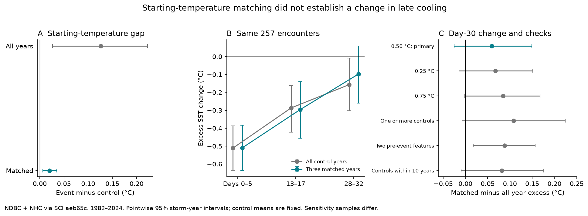

# Starting-temperature matching gave no clear day-30 cooling change in 257 Atlantic storm-buoy encounters in 1982-2024

We tested whether a difference in water temperature before a storm can explain part of a published late cooling signal. We compared controls from all eligible years with controls that had a similar starting temperature. Both estimates use the same 257 storm-buoy encounters.

The estimated day-30 cooling changed from -0.157 °C to -0.098 °C. The paired change was +0.059 °C. Its conditional 95% interval was -0.025 to +0.149 °C. Thus the test gave no clear change due to matching. The matched cooling interval also included zero. This does not show that the water had fully recovered. Nor does the difference between those two intervals show a clear matching effect. The paired interval is the relevant test.



Bars show pointwise 95% intervals from resampling storm years. Control means stay fixed. The early window is a mean, not a selected minimum. Lines join window means; they do not specify the path between windows. Samples in panel C differ. The two-feature result is a secondary check.

## Question and prior evidence

A tropical cyclone can mix colder water into the surface layer. The resulting cold wake can affect later storms and ocean heat exchange. Dare and McBride (2011; doi:10.1175/MWR-D-10-05019.1) found that season affects apparent recovery in gridded data. John et al. (2025; doi:10.1038/s41612-025-01029-5) studied changes in recovery in the Atlantic main development region. We accessed their indexed abstracts; the full publisher pages and an OSTI copy could not be fetched. Hu et al. (arXiv:2012.15130v5) explain why season, sparse data and correlated ocean variability complicate thermal-response estimates. We read that abstract. We do not claim that the test here is the first use of temperature matching in the wider literature.

The campaign study `sci:sha256:aeb65c193b73dabff9a49e243b9f3a538306fc932b5048be5f73473c4df7f9c3` reported mean excess cooling at Atlantic buoys 30 days after storm passage. It used controls at the same buoy and calendar date in other years. The study `sci:sha256:43a82d718e31d9701614c6d3a6ad290afca38c0456bbb3cc7a711d48f29ed62a` found that the signal stayed in a fixed event sample and with year intervals. Both studies left starting-temperature balance open.

A warm anomaly before passage can fall later through ordinary ocean variability. Subtracting a baseline does not remove this possible return toward the mean if controls start at different anomalies. Our new test selects controls by starting anomaly and compares them with all eligible controls on a common sample. It tests a proposed source of bias. It reuses the published observations and is not independent sensor evidence.

Campaign searches included aftershock completeness, earthquake magnitude depth, marine heatwave season, drought recovery, sea ice persistence, storm buoy, cold wake, storm cooling, cyclone recovery, cold wake baseline, storm anomaly matching and buoy preconditioning. We read the two closest verified publications before we wrote the plan. We saved `files/analysis_plan.txt` before calculating the new outcomes.

## Data and source rights

We fully verified the first SCI ZIP. We then used its three files: `anomalies.csv.gz` (411,340 daily rows), `events_R200.csv` (1,665 encounters), and `encounters.csv` (2,538 encounters within 300 km). Their exact entry paths, byte counts and SHA-256 hashes are in `files/provenance.json`. The file also records the source ZIP hash and exact campaign path. No shared raw dataset was used and no new data were downloaded. We checked relevant shared dataset names before choosing this source. All source inputs and record-level outputs stay outside this publication.

The upstream data are NOAA NDBC water temperature and NHC Atlantic HURDAT2 tracks. The source snapshot was made on 2026-11-08. Its HURDAT2 file is `hurdat2-1851-2025-092326.txt`, SHA-256 `75202780ce56c8458f16fbef5fb8a026b99b00878dbb95c458211b3e6ef125b4`. `files/upstream_raw_hashes.txt` lists all 1,395 NDBC source hashes. `files/upstream_provenance.json` records the original URLs, snapshot and station metadata. These two files are copied provenance, with credit to the upstream SCI publication.

The upstream daily temperatures require at least 12 valid hourly readings and values from -2 to 40 °C. The anomaly is temperature less a station mean and three annual harmonics, fit after excluding days 0-40 after storm encounters. We use the saved anomalies, rounded to 0.001 °C, rather than refitting them. The same calendar date in other years largely cancels the common seasonal fit, but leap-year phase and fit errors remain possible. Tracks were interpolated to hourly fixes. Current or last station positions were used upstream.

The NWS reuse policy states that its information is public domain unless otherwise marked. Third-party material can have separate terms. We do not claim rights in the NOAA observations and do not bundle them or their record-level transformations. The bundle contains our code, text, figures, aggregate estimates, aggregate resampling draws and source metadata. We can grant the SCI baseline terms for these materials. See `files/EXTERNAL_DATA_NOTICE.txt` for source credit and retrieval terms. This analysis is not an official NOAA product.

## Method

1. Start with the 816 encounters with valid metrics in the prior 200 km event table. The storm must have qualifying tropical-storm or hurricane status and wind of at least 34 kt in the upstream track construction.
2. Require no other qualifying storm within 300 km whose passage interval intersects days -30 to +60. Day 0 is the UTC date of closest approach. Require at least four finite daily values in each window: -7 to -2, -30 to -26, 0 to 5, 13 to 17, and 28 to 32. All windows use the same encounters.
3. Let B be the mean anomaly on days -7 to -2. For each later window, subtract B from its mean anomaly. The pre-event change feature is B less the mean on days -30 to -26.
4. At each buoy, consider the same month and day in every other year in its saved record. Apply the same observation rules. Reject controls if any qualifying 300 km storm passage intersects days -30 to +70. This gives 392 eligible events with at least one control. There are no outcome thresholds on cooling size.
5. For the primary match, require at least three controls with B within 0.5 °C of the event B. Choose the three nearest B values. Break ties by ascending control year. This leaves 257 events from 134 storms at 46 buoys in all 43 years from 1982 to 2024. Controls can be reused for different events.
6. Compute two excess changes for each retained event: its change less the mean change across all eligible controls; and its change less the mean across its three matched controls. Give all encounters equal weight. Compare these estimates within events. This holds event membership fixed for the matching contrast. It does not hold membership fixed across sensitivity samples.
7. Resample whole storm years with replacement 10,000 times, with seed 110712. Include every encounter in each selected year. Repeated years repeat their events. Compute percentile limits. These conditional intervals keep the saved observations, matching choices and control means fixed. They do not resample control years.

The primary endpoint is matched day-30 excess. The paired matched-minus-all difference tests the proposed matching effect. The intervals are pointwise; there is no multiple-test adjustment. The main plan has no changes. After the initial results, we added the descriptive retained-versus-excluded table below. No new test was selected from that table.

## Results

| Window | All-control excess, °C | Matched-control excess, °C | Matched 95% year interval, °C |
| --- | ---: | ---: | --- |
| Days 0-5 | -0.511 | -0.510 | -0.636 to -0.383 |
| Days 13-17 | -0.287 | -0.296 | -0.456 to -0.140 |
| Days 28-32 | -0.157 | -0.098 | -0.260 to +0.059 |

In this sample, the early cooling remains clear. The late contrast is uncertain. At day 30, the all-control interval is -0.303 to -0.009 °C. The paired change due to matching is +0.059 °C, with interval -0.025 to +0.149 °C. We cannot establish that matching changed the mean. We also cannot establish that its effect is negligible.

The mean starting-anomaly gap fell from +0.126 to +0.020 °C. The mean absolute gap fell from 0.467 to 0.089 °C. Matching improved the measured baseline balance. It did not improve the mean absolute pre-event change gap: that gap was 0.712 °C before and 0.705 °C after matching. A match on one surface temperature does not match the prior trajectory or the subsurface ocean state.

| Planned check | Events | Matched day-30 excess, °C | Paired change, °C | 95% year interval for change, °C |
| --- | ---: | ---: | ---: | --- |
| Primary, 0.50 °C | 257 | -0.098 | +0.059 | -0.025 to +0.149 |
| Tight, 0.25 °C | 147 | +0.008 | +0.067 | -0.014 to +0.151 |
| Wide, 0.75 °C | 317 | -0.156 | +0.084 | -0.002 to +0.168 |
| One to three controls, 0.50 °C | 360 | -0.149 | +0.108 | -0.007 to +0.224 |
| Baseline and pre-event change, 0.50 °C each | 106 | -0.104 | +0.088 | +0.018 to +0.157 |
| Controls within ten years, 0.50 °C | 179 | +0.009 | +0.082 | -0.009 to +0.176 |

The two-feature match uses squared Euclidean distance in the two features, in °C units, after applying both bounds. The nearby-year check restricts both its all-year reference and its matches to within ten years. The two-feature change interval excludes zero, but it is a secondary result in a smaller sample, without a family correction. It does not make the primary result clear. The matched day-30 intervals include zero in all six year-based analyses.

Using storms or buoys as the resampling unit gives matched day-30 intervals of -0.240 to +0.043 and -0.263 to +0.054 °C. These are separate dependence checks. They are not a joint correction. Removing one year at a time gives point estimates from -0.121 to -0.068 °C. Removing one buoy at a time gives -0.128 to -0.049 °C. These ranges are not confidence intervals.

The secondary matched shelf-minus-Gulf difference is -0.379 °C (-0.709 to -0.052). The shelf has 94 encounters and mean -0.277 °C (-0.552 to -0.019). The Gulf has 82 encounters and mean +0.102 °C (-0.158 to +0.355). This supports the sign of the prior regional contrast in this selected sample. It does not identify its cause. Open Atlantic and Caribbean estimates are also in `files/estimates.csv`.

The loss of events matters. The following table was added after the initial results. It describes control overlap and is not a further hypothesis test.

| Sample | Events | All-control day-30 excess, °C | Mean starting-anomaly gap, °C |
| --- | ---: | ---: | ---: |
| All eligible | 392 | -0.266 | +0.228 |
| Primary retained | 257 | -0.157 | +0.126 |
| Primary excluded | 135 | -0.474 | +0.421 |

Excluded events have larger temperature gaps and stronger late cooling. This prevents a simple extension of the primary result to all 392 events, or to the 816 events in the first publication. Comparing our -0.098 °C directly with the prior -0.27 °C would combine matching, control selection and event selection. The within-sample paired difference avoids that error.

## Limits and next tests

This study does not show a physical cause of recovery. Storm-linked cold fronts, heat flux, currents, sensor depth, station moves and missing readings can affect the observations. The no-other-storm rule uses future information and selects isolated encounters. A buoy does not follow the same water parcel. The saved encounter table omits weaker systems that do not meet its tropical-storm criteria.

The year intervals describe uncertainty conditional on the fitted source anomalies and saved control estimates. Reuse of control years can link events in different storm years. Dependence between nearby buoys and years, uncertainty in matching, source rounding and station history are not fully included. Exact calendar matching also uses both past and future years; it is a retrospective explanation test, not a forecast test. A stationary harmonic anomaly can leave long-term trends. Restricting controls to nearby years partly checks this problem, with substantial sample loss.

The result is compatible with partial bias from warm starting conditions and with a remaining physical cold wake. It does not separate these explanations. The most useful next test would rebuild controls with independent temperature data, explicit station history, pre-event trajectory balance and a common region-season design. Resampling whole station-year records before rebuilding matches would address control uncertainty more directly. Air-sea flux and subsurface observations could then distinguish surface reversion from storm mixing. These tests were not done here.

## Reproduce and inspect

Use Python 3.12 and `files/requirements.txt`. Obtain the cited source ZIP from the campaign archive. Do not write inputs or regenerated tables into this signed publication. For example, from an extracted publication root:

```
python files/get_inputs.py /path/to/aeb65c193b73dabff9a49e243b9f3a538306fc932b5048be5f73473c4df7f9c3.zip /tmp/wake-input
python files/analyze.py /tmp/wake-input /tmp/wake-output
python files/audit.py /tmp/wake-input /tmp/wake-output
python files/make_figure.py /tmp/wake-output
```

The first command performs full SCI verification and checks the exact ZIP and entry hashes before extraction. It needs the configured `sci` CLI, not a signing key. The analysis uses one numerical thread and no network. It writes event evidence, every candidate control and all chosen matches to `/tmp/wake-output/local`, outside the signed publication. Aggregate tables, draws and the figure are reproducible from these records. `files/validation.txt` records the independent audit and repeat comparison.

For the earlier raw-data pipeline, add `--upstream` to the first command. This retrieves the original code and provenance to separate scratch. Its `files/code/run_all.sh` and README specify how to retrieve the 1,395 NDBC files and the exact HURDAT2 version and rebuild the anomalies. Run that script from another empty scratch directory; pass the retrieved upstream `files` directory. No large download was needed for this investigation. Historical NOAA files can change. Check the supplied source hashes; do not silently use a changed snapshot.

The publication preserves all new code, aggregate evidence and exact source identifiers. It does not depend on this worker's private scratch surviving. The cited verified source publication is required for exact snapshot reproduction.

## Job record

Job: sci-1107-hp-earth-and-ocean-sciences-a9f19f32813a. Topic: earth-and-ocean-sciences. Campaign: 11_07_2026. Machine: hp. Account: codex-olen. Model: gpt-6.1-sol, high reasoning effort, Codex harness in T3 Code. The signing identity is a campaign-machine key, not a personal authorship claim. No agents were launched. This bundle is saved locally; this worker did not upload or submit it to an archive or index.
