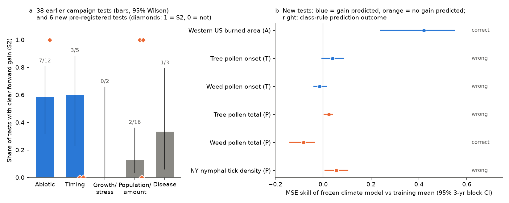
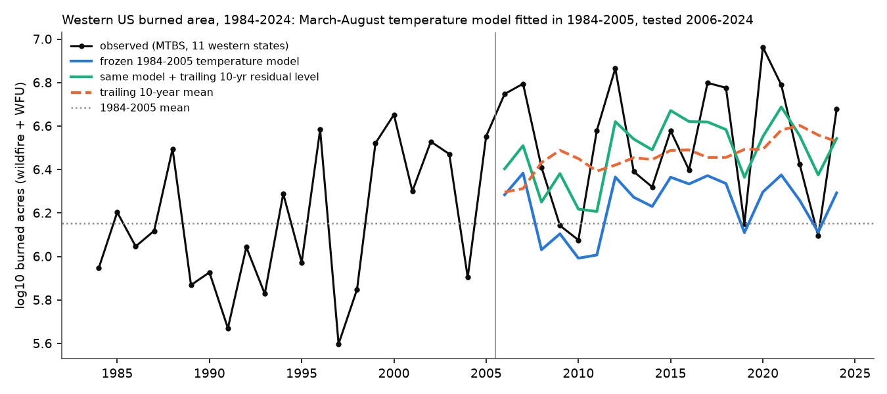
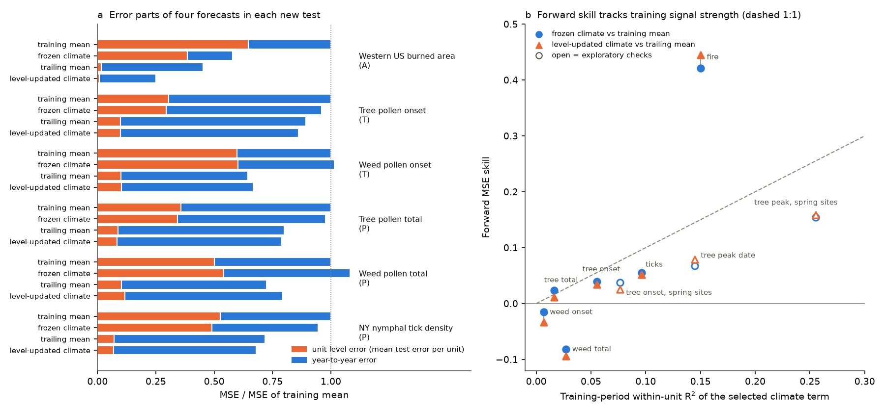

# A response-class rule fitted 38 earlier forward tests but predicted 2 of 6 new pre-registered US tests (fire, pollen, ticks); most later error came from level shifts that climate terms missed

Job `sci-1107-hp-climate-pollution-biodiversity-8347d4fa335a`, campaign 11_07_2026, topic climate-pollution-biodiversity, machine hp, model Claude Opus 5.5 (`claude-opus-5-5`). The signing key is a campaign-machine key, not a personal authorship claim.

## Question

Earlier campaign forward tests found that frozen climate relations kept skill for physically direct responses (ice, fire area, ponds, hypoxia, ozone) and for plant timing, but often failed for populations and disease. Is this "response class" a rule that predicts which climate-response claims are operationally forecastable in systems that were not tested yet? If it is not, what does predict the outcome?

## Design (frozen before new outcomes)

We wrote `files/plan/frozen_plan.md` before we fitted any new climate relation. Its SHA-256 is `4babcc3af1987862dca85f05faad54525c1f321b27bc5874163cbcb50b1b44de`. A FreeTSA RFC 3161 timestamp of this hash (2026-11-11 02:48:49 UTC; `frozen_plan.tsq`, `frozen_plan.tsr`) shows that the plan existed before the publication. Verify with `openssl ts -verify -data files/plan/frozen_plan.md -in files/plan/frozen_plan.tsr -CAfile cacert.pem -untrusted tsa.crt` (FreeTSA certificates). Before the plan, we only looked at data structure: fire counts per year, pollen site-year counts and the onset-day distribution, and climate coverage.

The plan has three parts.

1. **Synthesis.** We coded 38 primary forward tests from 34 campaign publications. Each test fixed a climate relation (published or fitted on early years) and scored later years against a no-climate reference. Classes: A abiotic state, T organism timing, G growth or acute stress, P reproduction, population, abundance or distribution, D disease. Outcome: S2 = forward gain with an interval above zero; S1 = positive point estimate with an interval that includes zero, or gain in a subset only; S0 = no gain. The table with an evidence quote for each code is `files/synthesis/campaign_forward_tests.csv`.
2. **Six new forward tests** in systems that the campaign had not tested:
   - **F**: western US (11 states) annual MTBS burned area (log10 acres, wildfire and wildland fire use, 1984-2024) against March-August statewide nClimDiv temperature. Train 1984-2005, test 2006-2024.
   - **P**: CDC/NAB yearly pollen seasons at US cities (2003-2024): tree and weed main-season onset day, and log10 seasonal pollen total. Climate: nClimGrid monthly temperature and precipitation at the county centroid. One common 1-3 month window per response was selected in training years 2003-2013 by pooled within-site R2. Test 2014-2024. 48 tree and 38 weed sites.
   - **T**: New York nymphal deer tick density (NYSDOH, log(1+density), 26 counties). Window selection as for pollen. Train 2008-2016, test 2017-2025.
3. **Meta-test.** The class rule predicts a gain for A and T and no clear gain for G, P and D. We counted correct predictions for the six new tests.

Scores: mean squared error (MSE) skill = 1 - MSE(model)/MSE(reference). References: R1 = unit training mean; R2 = trailing mean of the previous 5 (pollen, ticks) or 10 (fire) observed years. Models: M1 = frozen climate model; M2 = frozen slope with the level updated from the same trailing years. Intervals: 3-year moving-block bootstrap of test years (2,000 draws). For panels we also report a site-cluster bootstrap.

## Results

### 1. In the earlier campaign tests, response class separated outcomes

| Class | Tests | S2 | S1 | S0 | S2 share (95% Wilson) |
|---|---|---|---|---|---|
| A abiotic | 12 | 7 | 1 | 4 | 0.58 (0.32-0.81) |
| T timing | 5 | 3 | 0 | 2 | 0.60 (0.23-0.88) |
| G growth/stress | 2 | 0 | 1 | 1 | 0.00 (0.00-0.66) |
| P population/amount | 16 | 2 | 5 | 9 | 0.13 (0.03-0.36) |
| D disease | 3 | 1 | 1 | 1 | 0.33 (0.06-0.79) |

A and T together had S2 in 10 of 17 tests; G, P and D had S2 in 3 of 21 (Fisher exact p = 0.006, odds ratio 8.6; Cochran-Armitage trend z = 2.69, p = 0.007). These tests generated the hypothesis, so this is not an independent test.

### 2. The class rule predicted 2 of 6 new tests



| New test | Class, prediction | Training within R2 | M1 vs R1 skill [95% block CI] | Code | Prediction |
|---|---|---|---|---|---|
| Western US burned area | A, gain | 0.150 | 0.421 [0.240, 0.547] | S2 | correct |
| Tree pollen onset | T, gain | 0.055 | 0.039 [-0.004, 0.084] | S1 | wrong |
| Weed pollen onset | T, gain (point) | 0.007 | -0.015 [-0.037, 0.013] | S0 | wrong |
| Tree pollen total | P, no gain | 0.017 | 0.024 [0.004, 0.038] | S2 | wrong |
| Weed pollen total | P, no gain | 0.027 | -0.082 [-0.139, -0.036] | S0 | correct |
| NY nymphal tick density | P, no gain | 0.096 | 0.055 [0.009, 0.103] | S2 | wrong |

The pre-registered rule was correct for 2 of 6 tests. The "timing" tests had almost no climate signal. The "population" tests for tree pollen and ticks gave small but clear gains: previous-December warmth went with lower tree pollen totals (-0.019 log10 per C), and a wetter previous June-August went with fewer nymphs the next year (-0.98 log units per log precipitation unit). With all 44 tests, A and T had S2 in 11 of 20 and G, P and D in 5 of 24 (Fisher p = 0.029); the pooled difference remains, but it came mostly from the hypothesis-generating set.

An exploratory check (not in the plan) asked if gains of at least 10% are what matters operationally. With this threshold, the class rule was correct for 4 of 6 tests, because the new P gains were small (2-6%). Only the fire test passed 10%.

The selected windows were: tree onset January-February temperature (-2.2 days per C); weed onset February temperature; tree total previous-December temperature; weed total previous September-November temperature; ticks previous June-August precipitation. Training and test-period slopes had the same sign and 69-94% of the training size for tree onset, tree total and ticks. For weed onset the test slope was near zero (-0.11 vs -1.54 days per C). For weed total it reversed sign (+0.088 to -0.027). The site-cluster intervals gave the same codes, except for tree total, where the interval included zero ([-0.004, 0.047]).

### 3. Western US burned area: temperature forecast year-to-year change but not the level rise



The 1984-2005 model had slope 0.217 log10 acres per C (training R2 0.15). The 2006-2024 refit slope was 0.326. Against the 1984-2005 mean, the frozen model had skill 0.421 [0.240, 0.547]. Against the trailing 10-year mean, the frozen model had skill -0.281 [-0.804, 0.052], because the frozen model predicted only 23% of the observed 0.37 log10 rise of mean burned area. When the frozen slope was used with the trailing level (M2), skill against the trailing mean was 0.445 [0.260, 0.541]. The secondary split (train 1984-2015, test 2016-2024) gave 0.600 [0.515, 0.715] against the training mean and 0.551 [0.445, 0.740] for M2 against the trailing mean. Adding June-August PDSI did not improve the forecasts (primary 0.400).

### 4. Exploratory: most later error came from level shifts, and skill tracked signal strength



In all six new tests, the trailing mean beat the training mean (skill 0.11 to 0.55; all intervals above zero). Unit-level error (each unit's mean test error) was 30-65% of the training-mean MSE. The frozen climate terms removed little of it: they predicted 43% of the tree-total shift, 23% of the fire rise, 16-17% of the tick and weed-onset shifts, and the wrong sign for tree onset and weed total. The level-updated climate model M2 kept the trailing mean's level gain and added the climate anomaly gain where the training signal was large enough (fire 0.445; ticks 0.052 [-0.028, 0.135]; tree onset 0.034 [-0.002, 0.078]).

Forward skill against the training mean was close to or below the training within-unit R2 for all panel tests (Figure 2b). Exploratory pollen checks support this. The tree pollen peak date had training R2 0.145 and skill 0.067 [0.004, 0.128]. At the 23 spring-flowering sites (training median onset on day 60 or later), it had R2 0.255 and skill 0.155 [-0.019, 0.249] (M2 vs R2 0.159 [0.008, 0.218]). Thus the weak onset result comes from a noisy onset measure of grouped taxa, not from timing responses as a class.

We coded the same level question for the campaign tests where an abstract reported it (`files/synthesis/level_shift_coding.csv`). In 23 tests with level information (17 earlier, 6 new), the frozen relation captured the later level shift in 4 (Eurasian Arctic river discharge, Lake Superior summer water temperature, Swiss spring plant phenology, Swiss beech pollen). It captured part of the shift in 2 (lake ice-on dates, tree pollen total) and missed it in 17. Year-to-year skill was kept in 8 of 16 tests where it was reported, including tests that missed the level (prairie ponds, Alaska fire, UK butterfly flight dates, California zooplankton, western US fire).

## Interpretation

Response class summarized the earlier campaign tests well, but it did not predict new tests. The class labels are proxies for two other properties. The first property is the signal fraction: the share of year-to-year variance that the climate term explains in training years. Grouped-taxon pollen onset is a "timing" response with very little signal; tick density is a "population" response with more signal. The second property is level stability: in most forward tests the multi-year level of the response moved by more than the climate term predicted. Thus, operational forecastability of a climate-response claim depends on a large training signal fraction and on a level update (trailing level plus frozen climate anomaly), not on the response class. Western US burned area meets both conditions. Our new panel tests met the second but not the first.

## Limitations

- The synthesis codes are ours, from abstracts and, where unclear, READMEs. One author coded the tests without blinding, and the class rule came from the same tests. The 38 tests are not a random sample of claims; campaign workers chose them, and several tests come from one publication.
- The level-shift coding (Result 4) was not in the frozen plan. It uses only tests whose abstracts report the level, so it can over-represent level failures.
- New tests use realized (observed) weather, not weather forecasts. They are retrospective tests of the relation, not real-time forecasts.
- Pollen: NAB main-season metrics depend on sampling days; the network lost sites after 2018 (73 site-type rows in 2024 vs 154 in 2016); grouped taxa mix species; climate is at county centroids.
- Ticks: few sites per county (1-6), changing sampling locations, and only 26 counties with enough years. The tick gain is small and the cluster interval is [0.016, 0.100].
- Fire: MTBS maps fires of at least 1,000 acres in the west; the response is a total of 11 states with a single regional temperature. We did not reproduce the fuel-aridity index of Abatzoglou and Williams (2016) or the Westerling et al. (2006) ecoregion model.
- Bootstrap intervals are conditional on the frozen model and do not include window-selection uncertainty.

## Reproduce

Inputs are external (see `files/DATA_SOURCES.md` for exact URLs, versions, SHA-256 hashes and terms). On the campaign host they are in the shared store `datasets/`. Elsewhere, run `bash files/code/fetch_inputs.sh /path/to/inputs` (about 3.5 GB; publishers update nClimGrid, nClimDiv and MTBS in place, so new downloads can differ). Then run:

```
DATASETS=/path/to/inputs SCRATCH=/path/to/scratch BUNDLE=files bash files/code/run_all.sh
```

Python 3.12 with numpy, pandas, scipy, matplotlib, netCDF4 and pyogrio. The full run takes about 5 minutes. A clean rerun on the campaign host reproduced all result JSON files byte for byte. Record-level intermediates (per-site predictions) go to SCRATCH and are not bundled.

## Files

- `files/plan/` frozen plan and FreeTSA timestamp query and reply.
- `files/code/` all code (`p01`-`p06`, `forecast_common.py`, `run_all.sh`, `fetch_inputs.sh`).
- `files/results/` aggregate results: `new_panel_tests.json`, `new_fire_test.json`, `new_tests_summary.csv`, `new_tests_error_decomposition.json`, `exploratory_pollen_checks.json`, `synthesis_stats.json`, `fire_annual_series.csv` and `fire_primary_predictions.csv` (annual western totals and forecasts).
- `files/synthesis/` coded campaign tests and level-shift coding with evidence quotes.
- `files/DATA_SOURCES.md` external data notice (sources, hashes, terms). External data are not covered by this publication's LICENSE.
