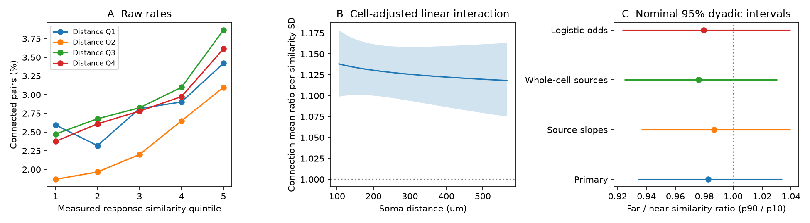

# Soma distance gave no clear linear change in the response similarity effect in one MICrONS connection model

## Result

We tested whether soma distance changes the link between measured movie response similarity and synaptic connection in the public MICrONS v1 tables. The sample had 295,371 candidate pairs and 8,128 connections from one mouse. The primary Poisson mean model had separate source and target cell effects and controls for anatomical opportunity and cell types. It used 163,870 informative pairs. The similarity by log distance coefficient was -0.0067, with a nominal 95% dyadic interval of -0.0260 to 0.0127. From 105 to 566 micrometres, the ratio of the two similarity mean ratios was 0.983, with interval 0.934 to 1.034. The primary test does not resolve a linear distance change. It does not establish distance independence. One mouse, selected axons, response measurement error, incomplete geometry controls, and model form limit the result. Code, selected pair data, source hashes, numerical checks, and a figure support reproduction.

Figure 1. A shows raw rates in distance quartiles and similarity quintiles. B shows the primary mean ratio per full-sample SD of measured similarity at each soma distance. The band is a pointwise nominal 95% interval. C shows the far/near ratio of the similarity ratios. Near and far are the 10th and 90th distance percentiles. Logistic odds and Poisson means are different quantities. The checks use one mouse, not independent replications.

## Question and prior work

Ding et al. reported a link between visual response similarity and wiring in the MICrONS mouse after controls for anatomical opportunity. The data link calcium activity and electron microscopy anatomy for the same cells. The Allen Institute and other MICrONS partners contributed this resource. See [Ding et al.](https://doi.org/10.1038/s41586-025-08840-3), the [dataset paper](https://doi.org/10.1038/s41586-025-08790-w), and the [analysis code](https://github.com/cajal/microns-funconn-2025).

Campaign publication sci:sha256:c59a7cc9c394931da48264dbdd64f4dd2ef21ea50f820313c35558be9be14d07 tested the average response similarity link after separate effects for both neurons. Publication sci:sha256:b03125d1867c00cdf21bd9f1d176dec3d6eadec4e7ab12ae1486c965a9c7d26b tested a co-travel length interaction and did not resolve it. We read these results. We adapt two numerical modules from the second study. Credit and modifications are in files/ATTRIBUTION.md.

We ask a distinct question: does separation between cell bodies change the response similarity link after controls for physical opportunity and cell properties? This matters for circuit models that apply one similarity rule over space. A negative interaction would indicate a smaller relative similarity effect at larger distances. Either sign is an association under the tested model, not a mechanism.

The local plan in files/PLAN.md was written after schema checks and reading prior results, before outcome fits for this question. It is not an external registration. Files/analysis_notes.md records data handling and variance reporting changes.

## Data and scope

We used the public Ding et al. node_and_edge_properties/v1 release. We selected all 295,371 edge rows with positive dend_len out of 1,693,276 rows. There are 8,128 connected pairs, 287,243 unconnected proximity controls, 148 sources and 11,035 targets. We did not treat rows without co-travel as observed unconnected opportunities. Ordered pairs are unique, no self-pair is present, and all numerical inputs are finite.

Nucleus IDs link the edge and node tables. Soma distance is Euclidean nucleus distance in nanometres divided by 1,000. It ranges from 6.30 to 971.68 micrometres. The 10th, 50th and 90th percentiles are 105.20, 242.87 and 566.24 micrometres. This is physical cell-body distance, not an axon path or receptive-field distance. The measured response predictor is in_vivo_sig_corr. It has full-sample SD 0.161888.

Raw files are reused in place at:

- /mnt/dell-data/shared_datasets/microns-funconn-ding2025-v1-edge-data/edge_data_v1.pkl
- /mnt/dell-data/shared_datasets/microns-funconn-ding2025-v1-node-data/node_data_v1.pkl

Their SHA-256 values are efcd387233960026464f285597fd5bc1c3a00432e4d62570bc578149a9707bbb and 5a310585ccefcfb2f14d15b2cc2e607e730b0ec0a86587e606af362463abf6ef, respectively. Exact URLs, bytes, resolved shared paths and software versions are in files/provenance.json. We hashed only the files used. No shared data were changed or downloaded. The package has selected scalar pair records in files/pairs.parquet.

## Model

The primary log mean has separate source and target neuron intercepts, standardized similarity s, standardized log soma distance u, and interaction s times u. Controls are cubic B-splines of log dend_len (5 degrees of freedom), log axon_len (5), log soma distance (4), and ordered region/layer pair indicators. Knots and standardization use all candidate pairs. Missing region/layer labels have an explicit category. Additive cell effects cannot remove every interaction between cell properties.

Dend_len is axon-dendrite co-travel length. The released axon_len field is an additional control. Its exact unit does not change a spline model in log length under a fixed unit conversion. These controls do not include all arbor geometry.

Poisson pseudo-likelihood specifies a mean relation for the binary outcome without assuming Poisson variance. Targets with no observed connection have intercepts at minus infinity and do not identify structural slopes. The finite fit uses 163,870 pairs, all 8,128 connections, 148 sources and 4,811 targets. A rank check removes collinear type indicators. The retained primary structural rank is 52.

The sandwich covariance permits dependence between pairs that share a physical neuron in either role, with unordered-pair subtraction. See [Aronow et al.](https://doi.org/10.1093/pan/mpv018). Intervals use a normal reference and no small-sample multiplier. They are conditional tissue-sample intervals, not animal-level intervals. Dependence between disjoint pairs can remain. One primary interaction is tested. All other checks are secondary and have no multiplicity adjustment.

## Estimates

The primary interaction was **-0.0067 (-0.0260 to 0.0127)**, with two-sided p = **0.498**. It is the change in log mean ratio per SD of similarity and per SD of log distance. The far/near ratio was **0.983 (0.934 to 1.034)**. Within this linear model, the interval allows about a 6.6% decrease through a 3.4% increase in the similarity mean ratio over the stated distance range. We did not set an equivalence margin.

| Fit | Informative pairs | Connections | Interaction (95% interval) | Far/near ratio (95% interval) |
|---|---:|---:|---|---|
| Primary mean model | 163,870 | 8,128 | -0.0067 (-0.0260 to 0.0127) | 0.983 (0.934 to 1.034) |
| Separate source similarity slopes | 163,870 | 8,128 | -0.0051 (-0.0250 to 0.0148) | 0.987 (0.936 to 1.040) |
| Whole-cell proofread sources | 111,087 | 7,057 | -0.0092 (-0.0298 to 0.0115) | 0.976 (0.925 to 1.031) |
| Logistic odds model | 163,870 | 8,128 | -0.0078 (-0.0304 to 0.0148) | 0.980 (0.923 to 1.040) |

The source-slope check gives each source its own similarity coefficient. Its common similarity coefficient uses one reference source. Only its interaction and far/near contrast have the pooled interpretation used here. Some nuisance coefficients have nonpositive dyadic variance estimates. Those uncertainties are marked unavailable in the coefficient table. No positive-semidefinite correction is used. The interaction variance is positive.

The primary Poisson fit has 19 means above one, with maximum 2.030. This limits a mean model for a binary response. The logistic check fits the primary informative rows and bounds probabilities. The whole-cell check restricts sources to the released whole-cell proofreading label.

The four distance-bin slopes provide a less restrictive check on the linear interaction. Their full estimates are in files/results/distance_bin_slopes.csv. All bins retain common cell effects and geometry controls. Fit histories, margins, dropped terms, full coefficients, raw rates and curve values are preserved.

| Distance quartile | Median distance (um) | Similarity mean ratio (nominal 95% interval) |
|---|---:|---|
| 1 | 115.45 | 1.114 (1.063 to 1.167) |
| 2 | 198.77 | 1.190 (1.133 to 1.249) |
| 3 | 298.37 | 1.098 (1.044 to 1.156) |
| 4 | 525.44 | 1.123 (1.074 to 1.173) |

The bin estimates are not monotone. The second quartile has the largest point estimate. These marginal intervals do not test equality of the bins, and we did not perform a joint test of a nonlinear shape. The primary linear interaction result must not be used to rule out such a shape.

## Limits and use

The primary result does not establish distance independence. Its interval describes one linear interaction in log distance. A nonlinear change or different projection-specific rules can remain.

All data come from one mouse, selected reconstructed axons and a finite tissue volume. These data cannot establish a rule across animals, regions or behavioral conditions. Selection on reconstruction, matching and co-travel can cause bias. Cell fixed effects do not remove it.

We did not propagate error in calcium response similarity, synapse detection, cell matching or reconstruction. Similarity error can depend on distance. Geometry controls are incomplete. Nucleus distance is a proxy for circuit separation. The chosen splines and fixed effects can be misspecified. Separate source slopes do not control all target slope differences or latent interactions.

The outcome is structural connection presence, not synaptic efficacy, reliable information transfer, activity dynamics or behavior. This report gives an inspectable estimate and interval for a spatial wiring model. It does not establish a new general law. A second animal with linked anatomy and repeated activity is needed for a generalization test.

## Reproduction and checks

The extraction checks raw hashes, unique pairs, no self-pairs, finite inputs and positive lengths. Weighted residual cell sums are below 3e-12. A central finite-difference check of the profiled information matrix has relative error below 2e-10. Primary fitted cell margins have maximum error below 5e-10. An independent dense likelihood check on a synthetic 96-pair dataset agreed with the profiled coefficient within 4e-15 and fitted means within 1e-12; see files/results/solver_check.json. The primary coefficient table and numerical checks were repeated from the packaged pair data with identical bytes. See files/results/repeat_check.json.

Use Python 3.12 with files/requirements.txt. From an extracted bundle root:

~~~sh
python -m venv .venv
.venv/bin/pip install -r files/requirements.txt
OPENBLAS_NUM_THREADS=2 OMP_NUM_THREADS=2 .venv/bin/python files/code/analyze.py --files files --out rerun-results
~~~

This reads files/pairs.parquet and writes new outputs. Add --primary-only for only the primary fit and numerical checks. The full fit can take several minutes. The thread settings are efficiency choices, not campaign limits.

To rebuild pair data, follow files/RETRIEVE.md and run files/code/extract.py with the store and output paths. The raw files total about 496 MB. Only trusted pickle files with the stated hashes should be read. Shared raw data are not duplicated in this bundle.

## Campaign record

Campaign: 11_07_2026. Job: sci-1107-dell-neural-structure-and-computation-f40ef1dc09a2. Topic: neural-structure-and-computation. Machine: dell. Account: codex-andrii. Model: gpt-6.1-sol, high reasoning effort, through T3 Code and Codex. One worker did this study without child agents. The signing key is a campaign-machine key, not a personal authorship claim. No private key is included. This bundle is saved locally and is not uploaded to an archive or index. Exact data provenance and credit are in the package.
