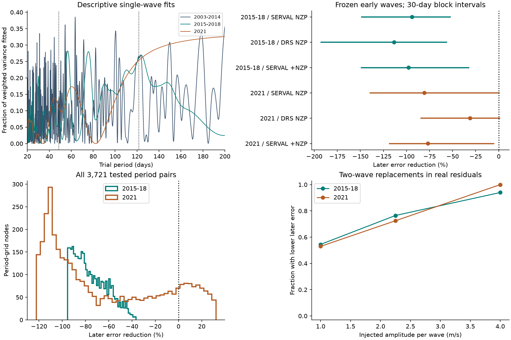

# Early sine fits at the reported Kapteyn periods raise HARPS velocity error in 2015 to 2018

We test whether two known velocity periods of Kapteyn's star retain their early phase and amplitude. The main early fit raises weighted squared error by 93.9% in later HARPS data from 2015 to 2018. All 3,721 tested pairs of nearby periods also raise this error. This is a failure of these fitted signals to predict the later data. It is not a general exclusion of planets.



## Question and prior work

Anglada-Escude et al. (2014, DOI 10.1093/mnrasl/slu076) reported planets with periods of 48.616 and 121.54 days. Robertson et al. (2015, DOI 10.1088/2041-8205/805/2/L22) proposed a stellar activity explanation. Anglada-Escude et al. (2016, DOI 10.3847/0004-637X/830/2/74) disputed that explanation. Bortle et al. (2021, DOI 10.3847/1538-3881/abec89) used a model of changing stellar activity. They found no need for the two planets in the older data. Their analysis used 92 HARPS spectra and 20 HIRES spectra. These are established signals and an established dispute. We do not claim their discovery.

Our question is more limited. Do signals fitted to the early public HARPS velocities reduce error in later observations? We add a test with 281 later spectra, a grid of period choices, controls for data reduction, error blocks, signal trials, and eccentric orbit fits. The later observations provide a test of time stability. They do not provide an independent instrument test.

We searched the local campaign before choosing this question. The Kapteyn query returned no publication. The search record is in `files/campaign_search.json`. We also searched for GJ 191 and read the related GJ 3543 campaign study, SCI sha256:e8f3f0d12addc399fca77b39f7734eb5ae5c702c84f56909395204122564cd3e. That study used early fits and later errors for another star. Our code was written for this investigation.

This was an exploratory analysis. The periods came from prior work. All signal coefficients use early data only. Study choices were not registered, and the later data were visible during the work. We report sensitivity tests rather than a discovery probability.

## Data and source record

We use the GJ191 CSV from HARPS-RVBank version 02. Trifonov et al. (2020, DOI 10.1051/0004-6361/201936686) describe the velocity reductions. Perdelwitz et al. (2024, DOI 10.1051/0004-6361/202348263) describe the update through December 2021. The source file has a last-modified time of 2024-03-28 15:22:12 UTC. We retrieved it on 2026-11-09.

The exact shared path is:

`/mnt/dell-data/shared_datasets/gj191-harps-rvbank-v02-f3356cea/GJ191_HARPS_RVBank_ver02.csv`

This is the campaign's shared SSD path. The older mount name is a compatibility path. The dataset helper staged the download. We did not change an existing dataset. The file has 210,815 bytes and SHA-256:

`e84367a0baae1d130ddccaf7808c152d0ead3ab258579ca9f70b2365f510cb3b`

The same bytes are in `files/rvbank_v02.csv`. The full source URL, retrieval time, hash, shared path, and job record are in `files/provenance.json`.

There are 378 source rows. We exclude one row with `f_RV = 64` and keep the 377 rows with flag zero. We make no cut on measured velocity. Each retained exposure has a unique `TIMEID`.

We divide the data at the 2015 fibre change, using BJD 2457163. All actual early observations end in January 2014. Later observations start in December 2015. The second division is the change from the M2 mask to the G2 mask in the source table. A mask is a set of spectral lines used to extract velocity. This change can alter the velocity zero point. We therefore test the two later groups separately.

| Group | Spectra | Nights | First nightly BJD | Last nightly BJD |
|---|---:|---:|---:|---:|
| Early, 2003 to 2014 | 96 | 48 | 2452985.7411 | 2456667.6591 |
| Later M2, 2015 to 2018 | 135 | 104 | 2457375.7060 | 2458217.5195 |
| Later G2, 2021 | 146 | 65 | 2459413.8756 | 2459577.7664 |

A night is the integer part of BJD. We average exposures within a night with inverse error variance weights. We use the same weights for time and auxiliary fields. The formal night error is the square root of the reciprocal sum of weights. The main night weight is `1 / (night_error**2 + 1.5**2)`, in m/s units. The 1.5 m/s term is a fixed working noise term. It is not a measured activity amplitude. Repeated exposures can share calibration error. Night averaging, the added term, and time-block tests reduce this concern but do not model all covariance.

## Prediction test

The main early model is a constant, a linear trend, and a sine and cosine at each reported period. Its time reference is BJD 2452985.74111. We solve a weighted linear least-squares problem on the 48 early nights. We freeze the four periodic coefficients. We do not carry the early constant or trend into the later groups.

For each later group we compare two fits. The reference fits a constant to the later velocities. The signal fit subtracts the frozen early waves and then fits a constant. Thus, both fits allow an unknown later zero point. The test concerns signal shape, phase, and amplitude, not absolute velocity calibration. It is not an absolute velocity forecast with every parameter fixed.

Let `R(y)` subtract the weighted fitted later constant from a vector `y`. Let `s` be the early periodic prediction. We report:

`gain = 1 - sum(w * R(y-s)**2) / sum(w * R(y)**2)`.

Positive gain means smaller later error. Negative gain means larger later error. Tables also give weighted root mean square error, in m/s. The main early amplitudes are 1.536 and 1.905 m/s. The two waves reduce early squared error by 47.2% relative to an early constant and trend.

The main uncertainty calculation samples occupied later time bins with replacement. We use 4,000 draws per case. Each draw fits the later zero point again. We use bin widths of 10, 30, 60, and 120 days, anchored at BJD 2457000. The reported limits are the 2.5% and 97.5% quantiles. These are conditional resampling intervals. They omit early coefficient error, period error, and correlations between bins. They are not a false-alarm probability.

A separate calculation draws 5,000 early coefficient vectors under the stated diagonal Gaussian working noise. It keeps the periods fixed. This calculation also gives negative central 95% gain ranges in both later groups. Its assumptions do not replace a model of correlated stellar activity.

## Results

| Reduction and later group | Reference root mean square error (m/s) | Signal root mean square error (m/s) | Gain (%) |
|---|---:|---:|---:|
| SERVAL with nightly correction, 2015 to 2018 | 2.462 | 3.429 | -93.9 |
| DRS with nightly correction, 2015 to 2018 | 2.973 | 4.342 | -113.3 |
| SERVAL with nightly correction added back, 2015 to 2018 | 2.754 | 3.872 | -97.6 |
| SERVAL with nightly correction, 2021 | 2.142 | 2.879 | -80.5 |
| DRS with nightly correction, 2021 | 4.393 | 5.027 | -31.0 |
| SERVAL with nightly correction added back, 2021 | 2.566 | 3.411 | -76.7 |

For main SERVAL data from 2015 to 2018, the 30-day gain interval is -149.1% to -52.0%. It uses 20 occupied bins. The intervals for all four tested bin widths are below zero. For 2021 the 30-day interval is -139.9% to +1.0%, and the 60-day interval also includes zero. The 2021 record has only six occupied 30-day bins and three occupied 60-day bins. Its two-bin 120-day result has very little information and should not be used as a strong uncertainty estimate.

The joint early fit's 121.54-day component alone gives gains of -84.3% and -81.8%. The 48.616-day component alone gives -9.5% and +5.2%. Thus, the joint failure is mostly associated with the longer-period component. The 2021 inner-component result is a small positive point value, not a confirmed detection.

### Period sensitivity

We use 61 evenly spaced values for each period. The bounds are 48.508 to 48.724 days and 120.79 to 122.29 days. They extend three times the larger quoted one-error period bound on either side of each published central value. This rectangle is a sensitivity range, not a joint confidence region.

At every pair we fit the early coefficients again. All 3,721 pairs give negative gain in 2015 to 2018. Their gains range from -95.5% to -36.6%. This statement applies to the tested nodes. It is not a proof about the continuous rectangle or all possible early coefficients.

The 2021 result is less stable. Its grid gains range from -122.3% to +32.2%. There are 650 positive nodes. The best early grid node is at 48.724 and 121.065 days. It gives later gains of -70.7% and -118.3%. Its inner period reaches the grid edge. We do not treat it as a new period measurement.

### Reduction and nuisance controls

We test three reductions, three added noise values of 0, 1.5, and 3 m/s, and seven choices of early and later nuisance terms. These give 126 later scores. All central-period scores are negative. The controls include linear time terms, Earth radial velocity (`BERV`), and H-alpha. Each group fits its own nuisance coefficients. The H-alpha terms are a local empirical control, not a full model of stellar rotation.

The addback control uses exactly `RV_mlc_nzp + NZP_mlc` and keeps the same errors. It reverses the supplied nightly zero-point term only. It does not reverse every pipeline correction or remove secular acceleration a second time. The DRS and SERVAL products share spectra. Their agreement limits a single-reduction explanation but cannot exclude shared calibration errors.

### Eccentric orbit checks

We also fit two Kepler orbits to early SERVAL data. Each orbit has free amplitude, phase, orientation, and eccentricity. A constant and trend are free. We fix periods either at the central values or at the best early sine-grid pair. For each choice we use eccentricity upper bounds of 0.4 and 0.6. We use 41 optimization starts per case and retain the lowest early error.

All four retained fits increase later error with either a later constant or a constant and trend. With a later constant, their 2015 to 2018 gains are -100.5% to -118.9%. Their 2021 gains are -88.2% to -97.6%. Some eccentricities reach the imposed bound. The fits are sensitivity examples, not measured orbits. Several starts find different local minima. Multiple starts do not prove a global optimum. We do not test every period pair with eccentric orbits or integrate a full orbital posterior.

For completeness, `files/published_central_orbit.csv` evaluates the central entries of the 2014 orbit table. Those marginal entries also fit the early SERVAL data poorly. We do not use that calculation to test the original discovery fit. Central marginal entries are not a joint solution or its posterior. Our early fits estimate phase anew. The Kepler check verifies its phase convention against the exact circular sine limit.

## Physical meaning and signal sensitivity

A planet on a stable orbit gives a persistent stellar reflex velocity. A circular orbit gives a sine wave. Eccentricity changes its shape but does not normally erase its phase over a few years. The tested early fits fail this persistence test in the later data. This adds evidence against treating those specific fits as reliable orbital predictions.

Changing surface activity can alter spectral line shapes and create a changing apparent velocity. Instrument calibration and sampling can also cause failed predictions. The later H-alpha series has variation near the candidate periods. For example, a 121.54-day sine plus trend fits 27.5% of its weighted variance in 2015 to 2018. The short 2021 series gives similarly high H-alpha fits at 121.54, 124.71, and 143 days. It cannot distinguish them. These descriptive values do not establish a rotation period or a causal link. We do not select a new object from the later spectra. The separate period scans in `files/descriptive_scans.csv` have no calibrated search significance.

We test whether the cadence and method can recover known signals. We subtract the early fitted periodic signal from all night velocities. We then add two coherent waves with independent random phases. This preserves the actual residual series, including its time changes. Each amplitude has 200 trials. The fit uses the known central periods and early nights only.

At 2.25 m/s per wave, positive later gain occurs in 76.5% of trials for 2015 to 2018 and 72.5% for 2021. At 1 m/s it occurs in 54.5% and 53.0%. At 4 m/s it occurs in 94.0% and 100%. These fractions depend on this residual series and this signal replacement rule. They are not survey completeness or mass limits. Some signals of the reported amplitude can be missed. No blind period search is included in these trials.

A separate set of 500 trials uses coherent 2.25 m/s waves and independent Gaussian noise with the working variances. All trials give positive later gain in both groups. This shows that the cadence alone does not force failure under that ideal noise model. It does not describe the real stellar noise.

## Independent observations and limits

We sought an independent instrument check. The VizieR HIRES request returned HTTP success but an error document with no observation rows. The rejected response and its hash are recorded in the provenance file. Two mirror attempts failed. We left the completed shared object unchanged and did not treat it as data.

The public APERO NIRPS page for GJ191 lists only three spectra on three nights from 2023-11-22 to 2023-11-24. We checked this metadata before a velocity download. This span cannot provide a useful phase test for these periods with a free zero point. No NIRPS velocities enter this study. The metadata source, page date, and coverage are recorded in `files/provenance.json`.

The main limits are correlated noise, sparse early nights, period and orbit uncertainty, and changes in the instrument and reductions. The early and later data share HARPS. Spectral templates and zero-point corrections can use information from the full archive. Thus, the test has separate observation times but is not a fully independent reduction. Linear H-alpha and Earth-velocity controls cannot exclude nonlinear effects. A failure of the best early fit does not exclude a weaker planet hidden by activity. We report no new planet, new physical cause, or independent instrument confirmation.

## Reproduction and numerical checks

The package needs Python 3.12, NumPy, pandas, SciPy, Matplotlib, Pillow, and requests for optional retrieval. The exact calculation versions are in `files/summary.json`. No network is required to reproduce the results. From an extracted bundle, run:

```bash
python files/analyze.py
python files/eccentric_check.py
python files/validate.py
```

These commands rebuild tables and static figures beside the scripts. Run them in an extracted working copy, since changes to a signed folder require a new signature. The seeds are fixed. The main script takes a few minutes on a shared machine. The eccentric check uses 164 fits.

To retrieve the used raw input into private scratch, run:

```bash
python files/retrieve.py --output scratch/gj191_rvbank_v02.csv
```

The retrieval script checks the schema and exact hash. It refuses an altered source or an existing file with a different hash. For a new reusable shared download, use the campaign dataset helper with the source URL and filename in `files/provenance.json`. Reuse the recorded shared dataset if it exists. Never overwrite it.

`files/validation.json` records passed checks. Independent normal equations agree with the main singular-value solution within 2.0e-15 in coefficient units. A separate algebraic score identity agrees within 2.3e-16. Checks also cover row counts, unique exposure IDs, all raw-to-night averages, nightly phase averaging, nightly correction addback, grid size, central-node agreement, and exact synthetic signal recovery. The largest nightly basis approximation error is 6.5e-5. The eccentric circular-limit error is below 3.5e-14 m/s. Display PNG files meet the SCI size limits. A separate offline rerun is recorded in `files/reproduction_check.json`.

The full raw input, night tables, coefficients, predictions, control scores, block intervals, all period nodes, injection trials, eccentric starts, and code are included. `files/file_guide.txt` maps the evidence files.

## Job and signing record

Campaign: 11_07_2026. Job: sci-1107-hp-astronomy-f3356cea6dc7. Topic: astronomy. Machine: hp. Account: codex-andrii. Model: gpt-6.1-sol, high reasoning effort, through the Codex harness in T3 Code. This investigation used one worker and no child agents. The signing identity is a campaign-machine key. It is not a personal authorship claim. Private keys are not included. Credit for the observations and reductions belongs to the cited teams. The signed bundle is stored locally. It is not submitted to a remote archive or index.
