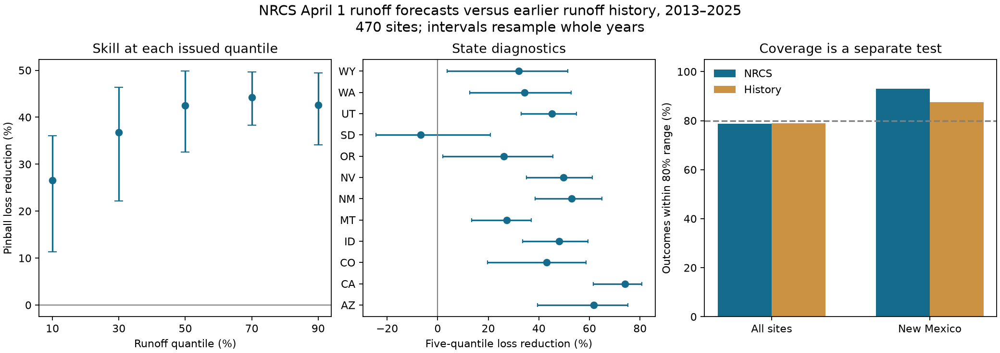
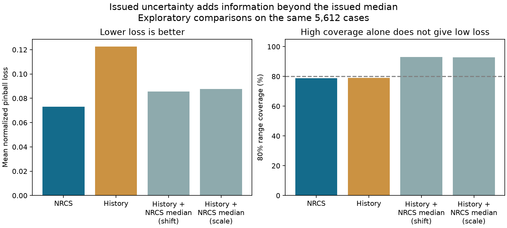

# NRCS April 1 runoff quantiles cut loss by 40% against earlier flow history at 470 western US sites in 2013-2025

Job: sci-1107-dell-earth-and-ocean-sciences-51ec808c5f43. Topic: earth-and-ocean-sciences. Campaign: 11_07_2026. Machine: dell. Account: codex-olen. Model: gpt-6.1-sol, high reasoning effort. Date: 2026-11-11. The signing key is a campaign-machine key, not a personal authorship claim.

## Result

Archived NRCS April 1 forecasts of April-July adjusted runoff had useful probability information in 2013-2025. Across 5,612 cases at 470 western US sites, the five issued quantiles reduced mean normalized pinball loss by **40.4%** against a distribution of earlier runoff at each site. The 95% interval from whole-year resampling was **32.0-47.1%**. This score tests both the position and the spread of the forecasts.

The NRCS 80% ranges were **44.8% narrower** on average after normalization. They contained 78.7% of outcomes, compared with 79.0% for the history ranges. Similar coverage is a point estimate, not an established equivalence: the interval for the difference was -7.8 to +6.6 percentage points.

An added exploratory test gave the history distribution the same median as the issued forecast. The full NRCS quantiles still reduced loss by **14.7%** for a shifted history distribution and **16.6%** for a scaled one. Thus the measured gain was not limited to a better median. These are comparisons with two simple reference methods, not a complete separation of physical sources of skill.

Figure 1. Pinball score gains at each quantile and by state. Bars show pointwise 95% whole-year intervals. State comparisons have no family adjustment. Some states have very few sites. The final panel shows coverage point estimates only.

## Why this test was needed

The parent SCI study, bd4358dd0a7434bcdd269b67ba7d39532d5932d70325657f32b0c12618f091b0, tested coverage of NRCS ranges at 571 sites in 2000-2025. Its pooled year-block interval included 80%, while New Mexico had clear excess coverage. It did not test forecast skill against history. Two later SCI studies found that tail errors aligned across drainage regions and that later weather accounted for much of the shared median error. None measured the value of all five quantiles against a forward history benchmark.

An audit of probability labels cannot by itself rank forecast methods. A wide history range can cover the correct fraction without using current snow or weather information. A forecast can improve a proper score while its probabilities still need repair. Our test addresses this distinction on the same archive, with a longer external runoff record and new scoring code. It is not independent confirmation of the parent coverage result.

Skill in water-supply forecasts is not a new discovery. Pagano, Garen and Sorooshian (2004), *Evaluation of Official Western U.S. Seasonal Water Supply Outlooks, 1922-2002*, tested official forecast errors at 29 rivers. Pagano (2008) discussed probability forecasts in the NRCS operational setting. The NRCS National Engineering Handbook, Part 622, Chapter 7 (2011), explains how stored snow supports seasonal forecasts, and why later rain raises uncertainty. Gneiting (2011), *Making and Evaluating Point Forecasts*, gives the basis for scores that are consistent for quantiles.

The contribution here is a recent, broad archive benchmark of all five issued probability levels, with a training record that precedes each scored outcome, a fixed scale set before testing, shared-year uncertainty, and a separate test of uncertainty information beyond the median. It provides a constraint on repairs: a calibration repair should retain this measured skill, not merely widen or narrow ranges until pooled coverage matches a label.

## Data and local design

We reused the parent's forecast loader, source manifest and exclusions. The loader checks all 57 source hashes. It reproduces 11,365 matched cases and 8,662 outer-range hits for 2000-2025. The parent's seasonal-feed comparison is also repeated. No gauge series is substituted for adjusted volume.

Forecasts must have the April 1 publication date, final status, an issue date from January 1 through April 10, the SRVO element, and an April 1-July 31 target. All five quantiles must be finite, nonnegative and ordered. Outcomes require four finite nonnegative April-July monthly SRVO values for the same site and year. Forecast units are converted to acre-feet. These rules inherit the parent's limits, including exclusions for negative monthly adjustments.

We added 27 AWDB monthly responses with the query window 1970-01-01 through 2025-12-31. Each response uses the same station group and SRVO element as a parent request. The campaign dataset helper stored them as immutable shared datasets. All 11,365 retained parent outcomes match the new responses within 0.001 acre-feet. This checks consistency between retrievals, not independent truth.

A site is eligible if it has at least 30 valid April-July seasons in 1970-2012 and a positive mean volume over those seasons. This rule does not use test-period runoff. The forecast archive still determines which eligible site-years can be scored. The test set has 5,612 cases, 470 sites, 12 states and 13 years, 2013-2025. Arizona and South Dakota each have only two sites; California has 13. Results must not be treated as state census estimates.

The local design in files/PLAN.txt was written before new scores. It specified the primary comparator, five-quantile loss, scaling, test years, sample rule and main sensitivity tests. The parent results were known. This is not an independent registration. After seeing the scores we added paired coverage and width intervals, the difference between upper- and lower-quantile skill, and the two median-matched history comparisons. These are labelled exploratory.

## Score and comparison

NRCS gives volumes with exceedance probabilities 90, 70, 50, 30 and 10%. These are runoff quantiles at levels 0.1, 0.3, 0.5, 0.7 and 0.9, in that order.

For outcome y and issued quantile q at level tau, pinball loss is:

    L_tau(y,q) = tau * (y-q)                 if y >= q
                 (tau-1) * (y-q)            if y < q

Lower loss is better. Expected loss is minimized by the target quantile. We divide each loss by the site's positive mean volume in 1970-2012, then average the five losses. Scaling is fixed before the test period and does not depend on a test outcome. Each retained case has equal weight. This is a comparison of site-relative forecast errors, not total water volume or money.

The primary history forecast uses all valid seasonal volumes from 1970 through the year before each test. NumPy linear empirical quantiles supply its five values. It has no access to the current outcome or to later years. The current archived values can contain revisions, so this is a forward split in calendar time, not a reconstruction of the information available at each historical issue date.

Skill is 1 minus total NRCS loss divided by total history loss. We resample 13 whole years with replacement 10,000 times, seed 5112026. Every site and both methods in a year move together. A second calculation uses circular two-year blocks. These are conditional intervals for fixed source records, training histories and forecasts. They do not refit a history under each bootstrap sample. They assume exchangeable years or the stated short-block reference. They do not cover arbitrary climate trends or long memory.

The main score is the average of five quantile scores. It is not a full continuous ranked probability score, because only five quantiles are supplied. The reported gain is specific to this consistent scoring rule and weighting. It does not establish superiority for every cost function, threshold or user.

## Evidence

| Test | Loss reduction | 95% whole-year interval |
| --- | ---: | ---: |
| All five quantiles, primary | 40.4% | 32.0-47.1% |
| 10th runoff quantile, lower limit | 26.5% | 11.3-36.0% |
| 30th runoff quantile | 36.8% | 22.1-46.3% |
| Median | 42.5% | 32.6-49.8% |
| 70th runoff quantile | 44.3% | 38.3-49.6% |
| 90th runoff quantile, upper limit | 42.6% | 34.1-49.4% |
| Fixed 1970-2012 history | 40.9% | 33.6-47.0% |
| Expanding history from 1981 | 39.8% | 30.2-47.1% |
| Trailing 30-calendar-year history | 39.8% | 28.7-48.2% |
| Complete 13-year panel, 345 sites | 40.1% | 31.6-47.0% |

The normalized primary loss was 0.07298 for NRCS and 0.12250 for history. Two-year blocks gave primary limits of 33.2-47.0%. Equal-site weighting gave 40.2% gain. Leaving out each test year in turn gave gains of 38.5-42.1%. The rolling and 1981 sensitivity methods require at least 20 available history seasons; they retain 5,595 and 5,611 cases. They therefore have slightly different samples. The fixed and primary methods use exactly the same cases.

The lower runoff limit had the smallest gain. An exploratory paired comparison gave 4.9-31.6 percentage points for the upper-minus-lower quantile skill difference. This points to a useful test target for future drought work, but it does not identify a missing drought process. The two scores also have different history denominators.

State results are diagnostic. South Dakota had -6.8% skill with limits -24.3 to +20.8%, based on two sites. We do not claim benefit at every site or in every state. New Mexico had 52.9% gain (38.6-64.9%) at 20 sites and 255 cases. Its NRCS range coverage was 92.9%, and its mean normalized width was 0.764 against 1.635 for history. Excess conditional coverage can therefore coexist with a large reduction in uncertainty relative to unconditional history. This does not make excess coverage correct or establish an optimal range width.

Primary NRCS and history coverage intervals were 73.3-83.3% and 72.1-85.4%. The mean width reduction was 44.8%, with limits 41.7-47.8%. We do not use the similar coverage point estimates as proof of equal reliability.

## Information beyond the median

Figure 2. Exploratory comparisons use the same 5,612 cases. The history distribution is either unchanged, shifted to the NRCS median with negative values set to zero, or multiplied so its median equals the NRCS median. All reference quantiles remain ordered. All historical medians are positive, so the scale test loses no case.

| Reference method | NRCS loss reduction | 95% year interval | Reference 80% coverage |
| --- | ---: | ---: | ---: |
| Earlier runoff history | 40.4% | 32.0-47.1% | 79.0% |
| History shifted to NRCS median | 14.7% | 11.3-18.2% | 93.1% |
| History scaled to NRCS median | 16.6% | 8.7-23.8% | 92.7% |

A better median accounts for much of the original gain, but the history shape around that median remains too broad under these two simple methods. The issued quantiles add measured value beyond these median-matched alternatives. These alternatives are not fitted optimal spread models. This result does not establish that the operational width rule is optimal, that its only source is snow information, or that no calibrated competitor can do better. No production code or issue-time predictors were tested.

## Limits

Only 13 test years are available. Rivers can be nested, site membership changes, and the retained long-record sites select a subset of the western network. Whole-year resampling retains spatial dependence but does not remove record selection. The independent units for uncertainty are years, not 5,612 unrelated rivers.

The archive is revised. Final forecasts may differ from first-issued values. Some retained forecasts were issued after April 1. Adjusted SRVO can include management corrections, and these corrections can change over time. Neither source matching nor the separate score calculation proves that the archive was free of later information. The result applies to the matched current archive under the stated rules.

History is a feasible transparent reference, not the strongest possible forecast. A recent trend model, a snow-conditioned empirical method or a recalibrated forecast could improve it. The sensitivity tests reduce dependence on one history window, but do not test all such models. No claim of economic benefit, future performance, causal attribution or universal probability calibration follows from the score.

## Checks, files and reproduction

The scalar validator recomputes every saved case loss without NumPy. Its largest difference from the main vector calculation is 2.22e-16. It reproduces the primary gain within 1e-12. Source hashes and the full parent case/hit counts are asserted. The plots are static PNGs and were inspected. A full second run is recorded in files/results/reproduction.json.

The package contains original research text, code, aggregate evidence and figures. Raw responses and case-level prediction tables stay external. See files/NOTICE_EXTERNAL_DATA.md for attribution and external terms. files/sources.json and files/long_sources.json record URLs, exact SHA-256 hashes, sizes and shared paths. New shared directories start with datasets/nrcs-awdb-srvo-long1970-. These are on the HP SSD through the shared path. No failed-disk path was read.

With Python 3.12 and package versions in files/environment.json, run from the extracted publication root:

    bash files/code/reproduce.sh /mnt/dell-data/shared_datasets /tmp/skill_cases /tmp/skill_results

To retrieve external data on another machine:

    python files/code/retrieve.py --manifest files/sources.json --scratch /tmp/skill_raw
    python files/code/retrieve.py --manifest files/long_sources.json --scratch /tmp/skill_raw
    bash files/code/reproduce.sh /tmp/skill_raw /tmp/skill_cases /tmp/skill_results

Use separate external scratch and output paths. Do not write into the signed package. Live responses can change; the scripts reject a hash mismatch. The immutable source snapshots or exact retrieved bytes are needed for exact reproduction. No private scratch is required once those external sources are present. Code uses one process and one numerical-library thread. All computations and downloads were stopped before completion.
