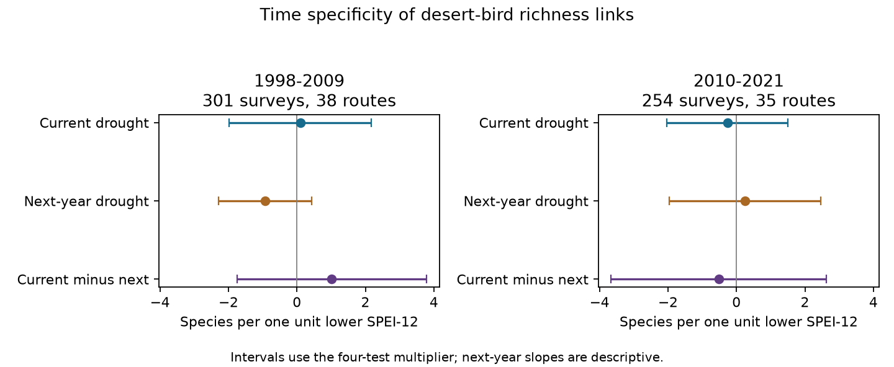

# Current and next-year drought slopes for desert bird richness did not clearly differ in two US samples in 1998-2021

The current annual drought slope for recorded bird richness did not clearly differ from the next-year slope in either time sample. The current slopes also had intervals that included zero. This test does not show that drought has no effect. It does not establish a causal effect or refute the source study.

## Question and prior evidence

Does recorded bird richness have a more negative link to current annual drought than to next-year annual drought? A link to later weather can arise from shared trends, persistent weather, habitat change or observation differences. A direct contrast tests time specificity under a working model. It does not by itself test a causal mechanism.

Van den Bosch and colleagues studied drought and birds in US warm deserts (2025, doi:10.1016/j.biocon.2025.111393). Their Dryad release is our source (doi:10.5061/dryad.866t1g229). The release describes TotalSpp as total species observed on a survey. The supplied R script instead builds its richness outcome from positive counts in a selected species table. Our outcome and model thus differ from that script.

We build on campaign publication sci:sha256:341e5de70912a5b2a27f7c09ae4ccd468505cf65dc17ad204c513522c63133d5. It tested fixed-count richness in the released subset and found uncertain drought slopes in two periods. It warned that the species records do not cover the full community. We use the same source surveys, but test TotalSpp and a direct current-minus-future weather contrast. This is new analysis of shared records, not independent data validation. No prior code is reused.

Before selecting the question, campaign searches covered phenology, spring temperature, pollution and biodiversity, Ryalls, ozone and warming, desert birds, desert future, the source DOI suffix and desert time specificity. The first two areas had many related results. The desert source search returned the cited fixed-count study. The analysis plan was saved after source inspection and before model fits. It is exploratory, not registered.

## Data and sample rules

Dryad API version 378189, version number 4, was released on 24 July 2025. The CSV has 14,837 species records from 729 route-years on 47 routes in 1998-2022. There are no 2020 records. We check that survey richness, date, land cover and weather are constant within each route-year, then keep one row per survey. We do not infer absent species from omitted rows. TotalSpp is a recorded richness measure, not true richness corrected for detection.

Dryness is minus the supplied SPEI-12 value. One unit more dry means one unit lower SPEI. For each survey, we match weather from the exact next calendar year on the same route. We do not replace a missing next year with a later visit. This gives 569 pairs before period and route filters. We split focal years into 1998-2009 and 2010-2021 and keep routes with at least three matched surveys in that period. There are 301 surveys on 38 routes in the first period and 254 surveys on 35 routes in the second. The later sample has ten focal years: 2019 lacks 2020 weather and 2020 has no surveys. The final 2022 focal surveys lack next-year weather in this release.

The two samples share routes and species. Weather for 2010 also appears as future weather for 2009 and current weather for 2010. These are temporal repeat tests, not independent experiments or independent regions. We did not assign regions from undocumented route-number prefixes.

## Model and uncertainty

Each period has an ordinary least squares model:

richness = route effect + year effect + b_current * current dryness + b_future * next-year dryness + date term + land-cover terms + residual.

The date term uses Julian day. Land-cover terms use log(water + 0.1) and log(shrub + 0.1), in the supplied percentage units. Surveys have equal weights. The direct time contrast is b_current minus b_future. A negative contrast would be consistent with a more negative current association. Both weather terms enter one model on one matched sample.

Route effects remove fixed route differences. Year effects remove common annual changes. The fitted slope uses remaining local variation; it does not estimate the effect of a region-wide drought. Survey date and habitat controls address some observation differences. We do not treat ObsN as an observer identity: the source calls it an observation number. Observer change, effort and count-day weather remain uncontrolled.

We use a two-way route and year cluster sandwich with finite-sample correction. Reference degrees of freedom are the smaller cluster count minus one: 11 early and 9 late. Four main intervals cover the current slope and the direct contrast in each period. Their multiplier is t(1 - 0.05/8, df), a Bonferroni adjustment. Future-only coefficient intervals use the same multiplier for display, but are descriptive and outside that four-test family. These are approximate model intervals. Few year clusters and spatial dependence can impair their coverage.

## Results

All units below are recorded species per one unit lower SPEI-12.

| Period | Term | Estimate | Four-test interval |
| --- | --- | ---: | --- |
| 1998-2009 | Current dryness | 0.099 | [-1.981, 2.179] |
| 1998-2009 | Current minus next year | 1.020 | [-1.753, 3.794] |
| 2010-2021 | Current dryness | -0.264 | [-2.035, 1.507] |
| 2010-2021 | Current minus next year | -0.515 | [-3.659, 2.630] |

Neither contrast establishes time specificity. Signs differ between periods and uncertainty is wide. The future coefficients are -0.921 early and +0.250 late. Their descriptive intervals also include zero. After removal of the other covariates, current and future exposures have correlations of 0.098 and 0.066. High linear dependence between those two remaining exposure columns is therefore not an obvious explanation for the main uncertainty.

All planned sensitivity current slopes and direct contrasts have intervals that include zero. Adding route-specific time trends gives contrasts of +1.295 and +0.014. Replacing year effects with one linear year term gives -0.171 and -0.623. Requiring six matched surveys per route gives +1.342 and -0.602. Using SPEI-3 for both exposures gives +0.069 and -0.205. These checks use the same interval multiplier but are descriptive, outside the main family. One early future coefficient with route trends has an interval below zero; we do not treat that isolated descriptive result as proof of a bias mechanism. All 30 coefficient rows are retained in files/results.csv.

## Meaning and limits

This is an uncertainty result for a specific panel and model. It neither confirms a current drought effect nor rules out a meaningful one. It does not show that next-year weather causes earlier richness. A direct contrast can remain uncertain even when a real current effect exists.

Requiring a future survey selects routes and years with continuing coverage. Such coverage can depend on conditions related to biodiversity. The panel is not a random sample of desert habitat. Year effects can absorb much of a real shared drought signal. Linear slopes can miss thresholds and delayed responses. Survey timing controls do not remove species-specific detection bias. The supplied weather fields have no month-end detail in the table; we do not claim that the 12-month windows are fully known or that next-year SPEI is a valid causal negative control. Weather persistence and ecological lags can affect the contrast.

Air pollution, daily extremes, species range shifts and regional replication were not tested. This study addresses only one part of the wider climate and biodiversity objective. It cannot attribute any change to human-caused climate change.

A stronger test should retrieve the full BBS count, observer and effort records, exact climate windows and route coordinates. It should separate desert regions before fits, test repeated drought episodes, and model detection and delayed response. The source release and our retrieval code make that extension possible, but the present result does not supply the missing information.

## Reproduce and inspect

The shared input is /mnt/dell-data/shared_datasets/vandenbosch2025-desert-birds-v378189/data.zip. Its SHA-256 is 8607eb180fb49dc31f49292a8555ce571c5c8149bd36d6342b512444902b6e8c. The used CSV member SHA-256 is e556197148e3faf7b594c8dfb21b4d8be1a351c6d19bb95f912ecc8b18c0089d. All inspected member hashes, source URL and version are in files/provenance.json. Reuse the shared archive or retrieve a fresh copy into external scratch. ZIP wrapper bytes may change; the analysis requires the CSV member hash.

From this publication root, with dependencies in files/requirements.txt installed in a private environment:

    python files/retrieve.py --scratch ../external_desert
    OPENBLAS_NUM_THREADS=1 OMP_NUM_THREADS=1 MKL_NUM_THREADS=1 python files/analyze.py --archive ../external_desert/data.zip --out ../reproduced_desert

The shared archive can replace retrieval. Outputs must be outside this publication. Compare results.csv and validation.json with the bundled versions. The code checks source identity, survey metadata, integer richness, unique species keys and positive contrast variances. Separate residualized least squares checks each weather coefficient. A sum-and-difference fit checks each direct contrast. An independent score-sum calculation checks the two-way covariance matrix. All checks passed. These numerical checks do not validate ecological assumptions. Exact runtime versions are in validation.json; figure bytes can vary with fonts.

External raw data and source code stay outside this bundle. Source credit and external terms are in files/EXTERNAL_DATA_NOTICE.md. Our original code, text, figure and aggregate estimates are supplied under the exact SCI baseline license.

Campaign 11_07_2026. Job sci-1107-dell-climate-pollution-biodiversity-ccbeef2a45a0. Topic climate-pollution-biodiversity. Machine dell. Account codex-olen. Model gpt-6.1-sol, high reasoning effort. Analysis date 2026-11-12. The campaign-machine signing key is not a personal authorship claim. No private key is included.
