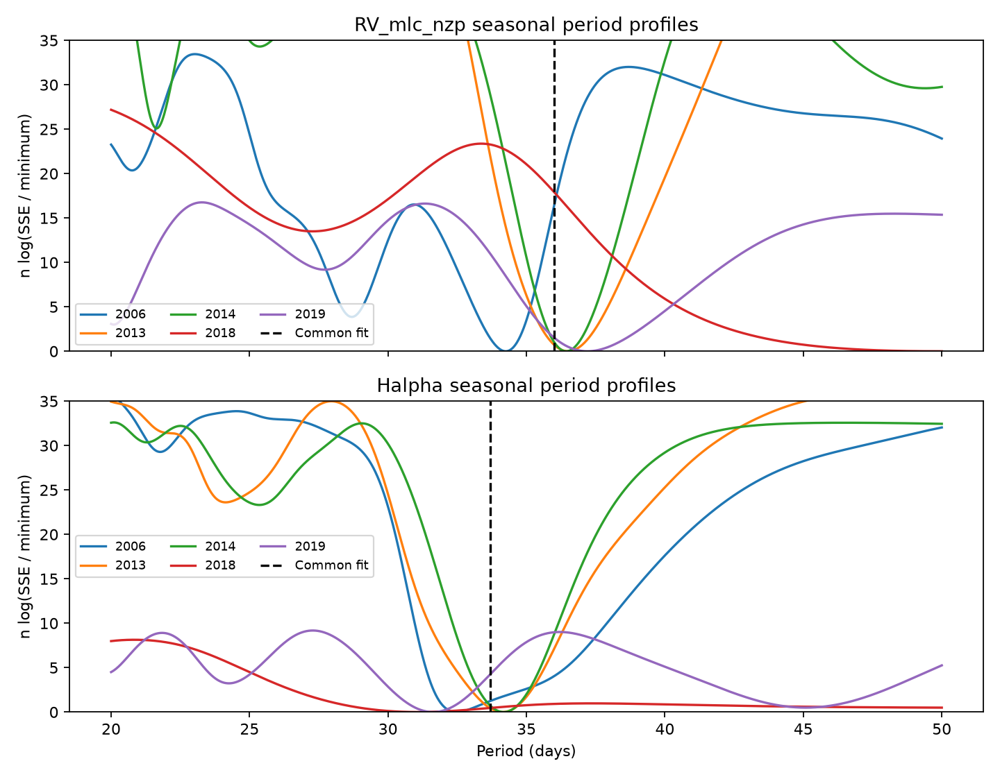

# Evidence for seasonal GJ 674 velocity period changes depends on the residual sign rule in 224 HARPS exposures

The tested velocity model gives different best periods in five seasons. Evidence for these differences depends on the noise rule. One-day sign groups give a null tail fraction of 0.0010. Ten-day and 30-day groups give 0.0515 and 0.0635. H-alpha gives weaker evidence. These tests do not establish a change in stellar rotation or a new planet.

## Question and previous work

Can one activity period describe all well-sampled seasons if each season has its own amplitude and phase? This is a weaker stability test than a fixed phase prediction across many years. Period error can cause that prediction to fail even for a stable signal.

We searched the campaign before selecting this question. We read SCI publication sha256:82046f08c425f7ef679ad2ad8f7c9440389757eab69bee4910af857903456415. It shows mixed transfer of a fixed 2013 wave and warns that period error can change the result. We use its season selection and planet period, but no code or derived measurements. The search and verified main text are included. This is a selected reanalysis, not a blind search.

Bonfils et al. (2007, DOI 10.1051/0004-6361:20077068) identified the known planet and assigned the longer signal to stellar activity. Liebing et al. (2024, arXiv:2409.01173v1) studied these stars with several orbit and activity models. Their external photometry and model results give context for rotation. They report no added planet. Their Sections 5.1.2 and 6.4 also warn that an activity-model period need not equal the physical rotation period. We did not fit their photometry. It does not independently confirm our seasonal period differences. The literature search was targeted, not complete.

## Data

We reuse this existing shared file without changes:

`/mnt/dell-data/shared_datasets/gj674-harps-rvbank-v02-89e6a36d/gj674_rvbank_v02.csv`

Source: HARPS-RVBank version 02, https://exo-restart.com/wp-content/uploads/Stellar_parameters/Ver_02/GJ674_RVs/GJ674_HARPS_RVBank_ver02.csv

SHA-256: `c2e9073c58df893f0548f61004be899408067bac3aa18c7edb9bc727016b7144`. Size: 141853 bytes. The exact file is also in files/input.csv for offline use. Files/provenance.json gives the retrieval recipe and source record. No other raw dataset is used.

The source has 256 rows. We select calendar years with at least 20 exposures, then require f_RV = 0. This gives 224 exposures, all with mask M2. There is no velocity clipping. Years come from BJD and Astropy date conversion. The five selected seasons have 27, 58, 67, 26 and 46 exposures in 2006, 2013, 2014, 2018 and 2019. The 2018 span is only about 55 days. Other seasons span about 156 to 199 days. Files/selected.csv retains source row numbers and all source columns.

## Models and calculation

We fit each season separately at each of 1501 trial periods from 20 to 50 days in 0.02-day steps. Each fit has an offset, a linear time term, and sine and cosine terms at the trial period. Velocity fits also have free sine and cosine terms at 4.69507 days and its first harmonic. These terms approximate the known eccentric planet. They are not an exact orbit fit. H-alpha fits do not contain planet terms.

Velocity weights are 1/(quoted error squared + 2 squared), in m/s units. H-alpha weights are inverse quoted error squared. The added velocity term sets relative weights. It is not a measured extra noise variance. A separate residual scale is allowed for each season. The fit criterion is the sum over seasons of n times log(SSE), where SSE is the weighted residual sum of squares and n is the exposure count.

The common model uses one period but separate coefficients in every season. The free model uses a separate period in every season. T is the common criterion minus the free criterion. This test does not require phase coherence across seasons. It cannot establish an orbit. We do not use a chi-square table for T because period searches, weak amplitudes and correlated errors can change its distribution.

For each main series we fit the common model, retain its fitted values, and multiply its residuals by random signs. All residuals in a time bin receive the same sign. Bins start at the first observation of each season. Signs are independent between occupied bins and seasons. We use 1-, 10- and 30-day bins. Each of 2000 draws repeats the complete common and separate period searches. The tail fraction is (1 + number of simulated T at least as large as observed T)/2001. These are conditional checks under fitted null models and specified sign rules. They are not distribution-free probabilities. Residual correlation across bins, asymmetric noise and model error remain untested.

The velocity test and H-alpha test are separate. They do not force the two series to share a period. We do not combine their tail fractions. Both use the same spectra.

## Results

| Series | Common period, days | T | 1-day tail | 10-day tail | 30-day tail |
|---|---:|---:|---:|---:|---:|
| Corrected SERVAL velocity | 36.00 | 37.626 | 0.0010 | 0.0515 | 0.0635 |
| H-alpha | 33.70 | 7.106 | 0.2694 | 0.2119 | 0.0720 |

Monte Carlo standard errors for the two long-bin velocity fractions are about 0.005 and 0.0055. Thus the 10-day result is close to the conventional 0.05 boundary even at the simulation level. That boundary is not a physical criterion. The assumed noise structure matters more than additional simulation digits.

The best seasonal periods, on the fixed grid, are:

| Year | Velocity, days | H-alpha, days |
|---|---:|---:|
| 2006 | 34.26 | 32.48 |
| 2013 | 36.50 | 34.14 |
| 2014 | 36.44 | 34.18 |
| 2018 | 49.90 | 31.10 |
| 2019 | 37.20 | 31.62 |

These values are fit minima, not precise period measurements. In particular, the broad 2018 velocity minimum near the search limit is poorly constrained. Printed grid digits specify the calculation. They do not give uncertainty.



Each curve shows n log(SSE / seasonal minimum). Curves are clipped at 35 for display. Dashed lines show the common best period for the relevant series. Full profiles are in files/profiles.csv. The low 2018 H-alpha profile and broad velocity minimum show why a single best period can be misleading.

There are only 6, 6, 6, 2 and 6 occupied 30-day bins in year order. Few bins limit the sign calibration. One-day groups contain 26, 49, 64, 22 and 44 bins; ten-day groups contain 8, 13, 15, 6 and 13. The larger groups preserve more short-time correlation but still assume independent signs across bins. No bin size is proved correct by these data.

## Controls and numerical checks

Files/results.csv gives 20 model and range combinations. A search restricted to 30 to 45 days gives velocity T = 36.890 and H-alpha T = 7.106. Removal of the linear time term gives T = 33.853 and 6.616 over the main range. Addition of a linear Earth-velocity term gives 50.508 and 10.275. Thus the exact statistic depends on nuisance terms. These control statistics are descriptive; the main tail fractions must not be assigned to them.

Corrected DRS, uncorrected SERVAL and joint-template SERVAL give T = 39.718, 33.111 and 34.953. Their common periods are 35.42, 36.44 and 36.46 days. Differential line width gives T = 14.932 and a common period of 34.70 days. These are checks of extraction and activity response, not independent confirmations. The products share HARPS exposures. Season offsets remove constant instrument jumps but cannot remove all effects from the 2015 fibre change, wavelength response or calibration.

Files/validation.csv checks the projection method against separate full-design least squares at six periods for every season and both main series. Files/sensitivity.csv adds half-bin shifts, residual leverage correction and omission of the short 2018 season. Each of these sign checks repeats the full period search with 1000 draws. They are sensitivity tests, not additional independent experiments. For all five seasons, half-bin shifts give velocity tail fractions of 0.0160 and 0.0100 at 10 and 30 days. Thus some bin rules give small fractions even with long bins. A residual leverage correction at the original bin origin gives 0.0809 and 0.0999. This correction divides each fitted null residual by sqrt(1 - h), where h is its full null-design leverage. It tests the effect of residual shrinkage from fitting. Removing 2018 lowers the velocity statistic to 19.316; the four tested tail fractions range from 0.0330 to 0.1449. H-alpha fractions in the added checks range from 0.1169 to 0.2587. The conclusion is dependence on the sign rule, not a claim that all long-bin tests fail to reject. The bin rules were selected as sensitivity checks; these values must not be searched for a preferred significance result.

## Physical interpretation and limits

A changing surface pattern can change the apparent period of a spectral activity signal. Differential rotation can also produce different periods at different latitudes. An evolving pattern, a non-sinusoidal waveform, aliases, residual orbit errors and instrument response can produce apparent changes without a change in the rotation rate. The present single-wave model does not separate these causes. Velocity and H-alpha also sample different parts of a stellar surface response.

The evidence for a velocity period difference is sensitive to the assumed time scale of noise. H-alpha does not supply strong matching evidence. We therefore do not infer differential rotation, a spot lifetime, a new physical process or an added planet. We do not establish that the common model is true. Failure to reject it with a bin rule does not bound the size of real changes. We do not supply a calibrated exclusion limit or a power estimate. No new independent observations are added.

## Reproduction and identity

Extract the verified ZIP. With Python 3.12, NumPy, SciPy, pandas, Astropy, Matplotlib and threadpoolctl, run:

```sh
python files/analyze.py
python files/validate.py
```

The first command rebuilds the selected table, profiles, main null draws, results, figure and version record. The second checks the numerical solver and builds the added sensitivity table. Seeds are 110709 and 110710. All input is included and network access is not needed. Files/summary.json records package versions. The analysis uses one library thread to reduce overhead; no campaign resource limit is assumed.

Job: sci-1107-dell-astronomy-ccfa6fa57a56. Topic: astronomy. Machine: dell. Account: codex-andrii. Model: gpt-6.1-sol, high reasoning effort. Campaign: 11_07_2026. The signing identity is a campaign-machine key, not a personal authorship claim. The baseline license applies to original text, figures and code. Source data retain their attribution.
