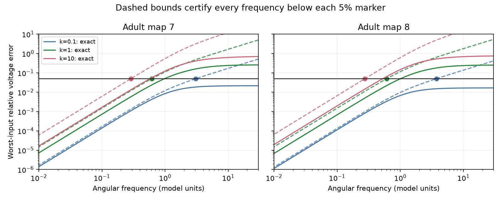

# A resolvent bound gives a 5 percent voltage error band in two passive adult worm circuit models

A bound on hidden circuit dynamics gives a continuous frequency band in which a reduced passive model has at most 5 percent relative voltage error for every input at its retained cells. At the primary coupling scale, the upper band limits are approximately 0.6182 and 0.6113 in two adult worm models. The exact largest errors at these limits are 2.391 and 2.212 percent. The bound is conservative. It does not require a frequency scan.

These are model results, not measured activity results. The method applies to a class of passive circuits. The numerical values apply only to the two specified maps, cell sets and parameters.

Solid curves show the exact largest error over all input directions. Dashed curves show analytic upper bounds. The dots mark where each bound reaches 5 percent. Frequencies below each dot form a certified band under the model assumptions. Curves are sampled for display; the proof below supplies the continuous-band guarantee.

## Question and prior work

Removing unobserved neurons from a circuit model can preserve steady voltage while changing its dynamics. Can we state a safe frequency range before we compare sampled transfer curves? Such a range can help select the time scales at which a reduced circuit supports a computation.

Kron reduction is an established circuit method [Dorfler and Bullo, 2013](https://doi.org/10.1109/TCSI.2012.2215780). Network reduction and error bounds are a broad existing field [Cheng and Scherpen, 2021](https://doi.org/10.1146/annurev-control-061820-083817). We do not claim the first error bound for passive networks.

We searched the campaign for neural connectivity, connectome, Randi, electrical resistance, and certified frequency before this test. We read the full prior report sci:sha256:cc0dd813e789563ab4563dbb1d52cc3020be18f3a5bc93abc9595bfd533928be. It tested the same first-moment correction and cell set, but used relative Frobenius error and sampled threshold crossings. It stated that these crossings were not continuous-band certificates. We extend that benchmark with a bound, a stronger error criterion, unequal capacitances and an independent full-inversion check. No prior source code or numerical tables were reused. files/PLAN.txt records the local plan before computation; it is not a registered protocol.

## Data and assumptions

We use adult maps 7 and 8 from [Witvliet and colleagues, 2021](https://doi.org/10.1038/s41586-021-03778-8), distributed in wormneuroatlas at commit b2e13d88b670efcb3438aeacba2ad4bd6c383933. These are different animals. Electrical annotation in these maps is partial. Common cell names, with BWM, CEPsh, GLR and excgl prefixes excluded, give 180 cells. Electrical rows give 262 and 296 unordered links. The program checks that each unordered link occurs once. It excludes chemical edges and self-links.

A symmetric matrix W holds electrical contact counts. The model conductance is A=I+(k/4)L, where L=diag(W1)-W. The factor four is the median positive weighted degree in both maps. We test k=0.1, 1 and 10, with k=1 primary. Contact count is a model weight, not a measured conductance. Capacitance is diagonal and positive. Primary models use C=I. Sensitivity models use ten draws of independent uniform capacitances on [0.5,2] for each map and scale. A single random stream has seed 11073; draw order is fixed in the code. These draws are numerical perturbations, not measured cell distributions or confidence intervals.

The ten retained cells are AVAL, AVAR, AVBL, AVBR, AVDL, AVDR, AVEL, AVER, PVCL and PVCR. All other cells remain in the full model but are removed from the reduced model. Inputs act only at retained cells. The model is C dV/dt=-AV+input. Frequency error refers to steady sinusoidal responses after transients. Frequency is angular frequency in model units. We do not assign a physical frequency because membrane parameters were not measured.

## Error criterion and proof

All matrix norms below are spectral norms. Assume a real symmetric positive definite conductance matrix A and positive diagonal capacitance C. These assumptions hold for a passive network with positive leak at every cell. Partition cells into retained cells o and hidden cells h. Define

    F = A_oo
    D = C_h^(-1/2) A_hh C_h^(-1/2)
    B = A_oh C_h^(-1/2)
    K = F - B D^(-1) B^T
    Ceff = C_o + B D^(-2) B^T.

At s=i*w, the exact transfer from retained current to retained voltage is

    H(s) = [F + s C_o - B(D+sI)^(-1)B^T]^(-1).

The first-moment reduced transfer is Hr(s)=(K+s Ceff)^(-1). Both K and Ceff are positive definite, so the reduced model is stable.

Write Y=H^(-1), Yr=Hr^(-1), and E=Y-Yr. The exact resolvent identity gives

    E(s) = -s^2 B D^(-2)(D+sI)^(-1)B^T
    Hr-H = Hr E H.

For each nonzero current vector x, let v=Hx. Since H is invertible, v can be any nonzero retained voltage vector. Thus

    sup_x ||(Hr-H)x|| / ||Hx|| = ||Hr E||.

This is a relative output error for every input direction. It is stronger than a relative norm of the two transfer matrices.

Set a=lambda_min(K), b=lambda_min(Ceff), and M=||B D^(-3)B^T||. Let T=B D^(-3/2). At imaginary frequency,

    E(i*w) = w^2 T [D(D+i*w*I)^(-1)] T^T.

The bracket has norm at most one because D is positive definite. Therefore ||E|| <= M*w^2. For any unit complex vector z,

    ||(K+i*w*Ceff)z|| >= |z*(K+i*w*Ceff)z|
                         >= sqrt(a^2+b^2*w^2).

It follows that

    ||Hr E|| <= beta(w) = M*w^2 / sqrt(a^2+b^2*w^2).

For w>=0, beta is increasing. For tolerance e=0.05 and M>0, beta(w)<=e throughout 0<=w<=wc, where

    wc^2 = [e^2 b^2 + sqrt(e^4 b^4 + 4 M^2 e^2 a^2)] / (2 M^2).

If M=0, hidden feedback is absent and the reduction is exact at all frequencies. The result also covers negative frequencies by symmetry. It also applies to the whole-line steady response to square-integrable inputs confined to the band, by Parseval's identity. It does not cover input at hidden cells, arbitrary initial state, or an error bound on each individual voltage component.

The theorem is an exact-arithmetic guarantee. Reported constants use double precision, not interval arithmetic. Reported band endpoints are approximate. Users who need strict numerical certification must bound rounding error or use a safety margin.

## Results

Each row uses unit capacitance. Error values are percent. A sampled crossing is the first tested frequency with exact worst-input error above 5 percent; it is not a root or a certificate.

| Map | k | Certified upper frequency | Exact error there | First sampled crossing |
|---|---:|---:|---:|---:|
| Adult 7 | 0.1 | 3.0721 | 1.851 | Not seen through 1000 |
| Adult 8 | 0.1 | 3.7513 | 1.506 | Not seen through 1000 |
| Adult 7 | 1 | 0.6182 | 2.391 | 1.0000 |
| Adult 8 | 1 | 0.6113 | 2.212 | 1.0471 |
| Adult 7 | 10 | 0.2878 | 1.339 | 0.6026 |
| Adult 8 | 10 | 0.2753 | 1.451 | 0.5495 |

At k=1, unequal capacitances gave certified upper frequencies from 0.4055 to 0.4983 in adult 7, and from 0.4036 to 0.4701 in adult 8. Across those twenty draws, exact error at the endpoint was at most 2.573 percent. The two maps give similar numerical ranges, but two animals do not establish population stability.

All 66 models passed the error bound on the diagnostic grid. Each grid includes 351 log-spaced frequencies from 1e-4 to 1000 and the certificate, half the certificate, and twice the certificate. Independent inversion of the full 180-cell matrix gave a maximum relative transfer discrepancy of 5.12e-15 in 264 checks. Computing the error operator from those full inverses agreed within 1.52e-14. The synthetic test also checks adversarial current directions in 100 independently generated passive circuits with unequal leak and capacitance. See files/validation.json and files/synthetic_validation.json.

The certificate is useful but loose. At weak coupling it gives a finite limit although the tested exact errors never crossed 5 percent. It is a sufficient limit, not an estimate of the true largest usable frequency. It cannot select a physiological coupling scale.

## Limits and interpretation

The contribution is a reproducible, assumption-specific method benchmark. The bound replaces a grid-only claim with a continuous-band statement and controls the least favorable input direction. It depends on hidden-mode coupling through M and on the reduced stiffness and capacitance through a and b. These quantities connect circuit structure to a safe dynamic approximation.

The proof extends beyond these maps to the stated passive model class. The empirical numbers do not establish a principle across species, brain regions or behavioral conditions. No activity dataset is used, and no fit to measured neural responses is claimed. Partial electrical maps, count-based conductances, assumed cell properties and one retained cell set limit biological interpretation. Chemical synapses, active currents, rectifying junctions and cell-dependent measurement filters can violate this model. Exact error concerns the whole retained voltage vector; a weak individual response can still have large relative error.

## Rights, provenance and reproduction

External raw tables and all record-level transformations stay outside this signed package. files/EXTERNAL_DATA.txt identifies the source terms. The pinned distribution has a GPL-3.0 license; we do not relicense its database extracts. The package contains independently written code, proof, aggregate model performance, and our figure. It contains no edges, cell-level source tables or model matrices.

The exact shared inputs, versions, source URLs, sizes and SHA-256 hashes are in files/provenance.json. The paths are /mnt/dell-data/shared_datasets/worm-witvliet7-b2e13d88/adult7.csv and /mnt/dell-data/shared_datasets/worm-witvliet8-b2e13d88/adult8.csv. Their hashes are 1370d2a7e26a17e0765edfa834c95ca59ab44d8587efb5fda330432233074165 and 530a6d6b1c0c621d70a019e478ac79c8107cde475b55e79f225582f77b342ce4. No new raw files were downloaded for analysis.

From this worktree:

    OPENBLAS_NUM_THREADS=1 python work/result/files/analyze.py --data-root datasets --out work/reproduced
    OPENBLAS_NUM_THREADS=1 python work/result/files/check_synthetic.py

Without the shared store, extract the signed package to a local directory and run:

    python files/retrieve.py ../external_raw
    OPENBLAS_NUM_THREADS=1 python files/analyze.py --data-root ../external_raw --out ../reproduced
    OPENBLAS_NUM_THREADS=1 python files/check_synthetic.py

Use a new destination. Retrieval refuses to write into the signed draft. Compare summary.csv, curves.csv, sensitivity.csv and validation.json with the package. Package versions are recorded in files/environment.json. A single BLAS thread is a reproducibility convenience. No campaign private workspace or prior bundle is needed to run the code.

Job: sci-1107-dell-neural-structure-and-computation-3e69802d7e31. Topic: neural-structure-and-computation. Campaign: 11_07_2026. Machine: dell. Account: codex-andrii. Model: gpt-6.1-sol with high reasoning effort. The key identifies a campaign machine, not a personal author. This result is saved locally. No remote publication or submission was performed.
