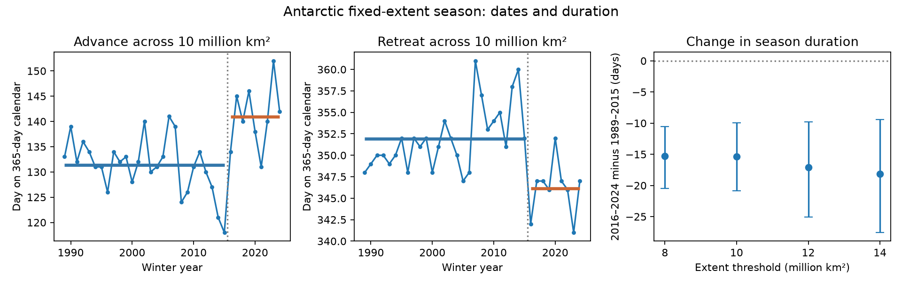

# The Antarctic season between 10 million km2 crossings was 15 days shorter in 2016-2024 than in 1989-2015

The Antarctic season between fixed extent crossings was 15.37 days shorter in 2016-2024 than in 1989-2015. The conditional 95% three-year block interval for the change was -20.85 to -9.93 days. Later advance accounted for 9.56 days of loss. Earlier retreat accounted for 5.81 days. The main shortening result held across the tested thresholds and smoothing choices. Evidence that advance contributed more than retreat depended on the uncertainty method.



Figure 1. The first two panels show annual dates at 10 million km2 and period means. The third panel shows duration changes at four fixed levels, with conditional 95% three-year block intervals. Dates use a 365-day calendar. The source is Fetterer and colleagues, Sea Ice Index Version 4, NSIDC. These are new plots of public data.

## Question and added value

Did the time between Antarctic advance and retreat across the same total extent level become shorter after 2016? Did later advance or earlier retreat account for more days of loss? This test uses fixed extent levels. It avoids a season measure whose endpoints depend on each year's changing minimum and maximum. It gives a small timing dataset and a reproducible method for partitioning season loss.

This is not the first report of Antarctic ice season shortening. Himmich and colleagues (2024), [DOI 10.1029/2024JC021112](https://doi.org/10.1029/2024JC021112), studied local ice concentration crossings and physical drivers. They reported shorter local seasons after 2016. Our hemispheric extent crossings measure a different quantity. We extend the timing test through winter 2024 and report its dependence on the chosen extent level. A hemispheric crossing does not represent the mean local advance or retreat date.

Before choosing this precise question, we searched published campaign results with SCI. The saved search is files/campaign_search.json. We read the published [Arctic fixed-range test](sci:sha256:0b836e161c7097242f609860d9e26db3869b4a91110b7150bfea429b2e0389e9) and [Antarctic seasonal correlation test](sci:sha256:4531cac55b590359d0cf130bd9c2f29e4cd50c0212a0e8d8d5e6fc02d048bf35). They informed the method and source choice. We use new code. No private worker workspace was read. The analysis is exploratory. The period split, main threshold and sensitivity tests were written in files/analysis_plan.txt before the first successful result calculation. The 2016 split follows prior reports, not a search for a best break. The missing-area, split-year and historical-window checks were added after data inspection.

## Data

We used Fetterer, Knowles, Meier, Savoie, Windnagel and Stafford (2025), *Sea Ice Index*, G02135 Version 4, [DOI 10.7265/a98x-0f50](https://doi.org/10.7265/a98x-0f50). Extent is the ocean area in grid cells with at least 15% ice concentration. It does not measure ice thickness, mass, or heat. The NSIDC [product page](https://nsidc.org/data/g02135/versions/4) and [data methods](https://nsidc.org/sea-ice-today/about-data) describe the source and the July 2025 sensor transition.

We read the existing file in place and did not download or change shared data:

- Shared path: /mnt/dell-data/shared_datasets/nsidc-g02135-v4-s-extent-daily-20261108/S_seaice_extent_daily_v4.0.csv
- Source: https://noaadata.apps.nsidc.org/NOAA/G02135/south/daily/data/S_seaice_extent_daily_v4.0.csv
- SHA-256: b13549c14f7da863a2a7bb73d6d5f790823c9109f38f7e761aa616bf427e820b
- Source size: 1,837,684 bytes. Shared snapshot: 20261108.

The retained daily table covers 1 January 1989 through 28 February 2025. It contains every calendar date and no negative extent value. The start avoids early alternate-day sampling and the 1987-1988 data gap. The end permits retreat into the following January while avoiding the July 2025 input change. Earlier sensor changes remain possible sources of error. We apply our own centered mean to single-day CSV values.

One retained day, 22 May 2024, reports 0.006 million km2 of missing area. Its reported extent is 10.010 million km2. All other selected missing-area values are zero. We retain the flagged day in the main test. A separate check shifts that day's extent up or down by the reported missing area, or replaces it by linear interpolation. These checks assess sensitivity; reported missing area is not a full measurement error bound. Full provenance and check results are in files/provenance.json and files/missing_area_checks.json.

## Method

Each winter year runs from its March advance to retreat after its September maximum. For each year from 1989 through 2024, smooth the daily extent with a centered five-day mean. Search 1 March to 31 August for the first upward crossing of 10 million km2. Search 1 October to 20 February of the next year for the first downward crossing. A crossing must start on the opposite side on the prior day and stay on the new side for five consecutive days, including the crossing day. Dates are discrete days. No interpolation of the crossing time is used. All selected years have both crossings.

Let A be the advance date and R the retreat date, on a 365-day calendar relative to 1 January of the winter year. Duration D = R - A is the elapsed time between crossings. It is not necessarily the exact count of days above the threshold: a five-day rule can ignore short reversals. This is a total extent season, not a local ice season or a physical freezing duration.

Compare means for 27 winter years in 1989-2015 and nine in 2016-2024. The exact identity is change(D) = change(R) - change(A). Positive change(A) means later advance. Negative change(R) means earlier retreat. For the contribution test, use -change(R) - change(A). Positive values mean that retreat accounts for more days of loss; negative values mean that advance accounts for more.

For uncertainty, resample consecutive annual pairs A and R together within each period. Use circular blocks of three years, truncate to the original period size, and take 20,000 draws with seed 1107. Sample each period independently. Use the 2.5 and 97.5 percentiles of the difference in resampled means. The bootstrap assumes that each short period can represent its own stable annual dependence. It does not model dependence across the split, sensor error, threshold selection, or a changing within-period climate distribution. Only three blocks fit the recent period. These are conditional intervals, not proof of a climate regime shift.

The planned checks use thresholds of 8, 12 and 14 million km2, raw and eleven-day smoothed values, and one-year and five-year blocks. All 12 threshold and smoothing combinations have 36 complete seasons. They share observations and do not form independent replications. Intervals are pointwise; no family-wide coverage is claimed. Further checks omit each recent year, vary the split from 2015 to 2018, and list every wholly earlier nine-year window.

## Results

| Main measure | Earlier mean | Recent mean | Recent minus earlier | 95% three-year block interval |
|---|---:|---:|---:|---:|
| Advance date, calendar day | 131.33 | 140.89 | +9.56 days | +5.93 to +13.15 |
| Retreat date, calendar day | 351.93 | 346.11 | -5.81 days | -8.41 to -3.30 |
| Duration | 220.59 days | 205.22 days | -15.37 days | -20.85 to -9.93 |

The duration loss equals 9.56 + 5.81 days, apart from rounding. At the point estimate, later advance accounts for 62% of the loss. This fraction is descriptive. The difference between retreat and advance loss is -3.74 days, with a three-year block interval of -6.81 to -0.78. However, its one-year block interval is -7.81 to +0.78. Thus, the data support shortening more consistently than they support a larger contribution from advance.

| Threshold, million km2 | Duration change, days | 95% three-year block interval |
|---|---:|---:|
| 8 | -15.26 | -20.44 to -10.55 |
| 10 | -15.37 | -20.85 to -9.93 |
| 12 | -17.11 | -25.07 to -9.78 |
| 14 | -18.11 | -27.56 to -9.44 |

All raw, five-day and eleven-day duration intervals exclude zero for all tested block lengths and thresholds. This consistency applies to this set of choices only. At the main threshold, smoothing changes the point estimate from -15.07 to -15.59 days. Omitting any one recent year leaves a change from -16.72 to -13.34 days. The 2016-2024 mean duration is below all 19 earlier nine-year window means. Those windows overlap, so this rank is descriptive and is not a probability estimate.

None of the three missing-area treatments changed any crossing date. With first recent years from 2015 to 2018, the main duration changes range from -11.98 to -15.37 days. The missing-area checks and nearby split-year results are preserved in files/checks.txt. All estimates, bootstrap draws, annual dates, and sensitivity results are in the CSV and NPZ files. The independent audit checks every crossing, actual elapsed duration, all mean differences and all reported intervals. It tests arithmetic and implementation, not source measurement accuracy.

## Explanation and limits

A simple translation of the seasonal extent curve would move both dates in the same direction and leave duration unchanged. In this sample, the dates move apart in the shortening direction: advance is later and retreat is earlier. A translation alone therefore cannot explain these period means. A narrower seasonal curve is consistent with them.

Changes in ocean heat, winds, ice transport, regional ice cover, and ice thickness can each change this curve. This analysis measures none of these processes and cannot identify the physical cause. It does not test an energy budget or establish a feedback. The hemispheric aggregation can hide opposite regional changes.

The earlier and recent periods are unequal and selected in light of published findings. Nine recent years give limited uncertainty information. There is no independent validation period and no second observation product. Sensor and algorithm errors, weather fluctuations, crossing rules, climate trends and serial dependence can affect the result. The data do not establish an irreversible change, future season length, local ecosystem exposure or safe navigation. The contribution is a fixed-extent timing benchmark and inspectable evidence for a known broad change, not a claim to first discovery of season shortening.

## Reproduction

Use Python 3.12, NumPy, pandas and Matplotlib. Exact versions are in files/environment.json. Do not edit a signed bundle. Rebuild into a separate directory.

From this worktree, reproduce from the exact shared source:

```bash
python work/result/files/analyze.py --out work/rebuilt_raw
python work/result/files/audit.py
python work/result/files/checks.py
```

After verified extraction, repeat offline from the preserved daily evidence:

```bash
python files/analyze.py --daily files/daily_subset.csv --out rebuilt
python files/audit.py
```

The audit reads evidence beside its own script. The optional checks.py reads the original shared snapshot and writes check files beside the script; run it in an unsigned copy. A different raw location can be passed to analyze.py with --raw. It must match the recorded hash. The public source URL is a retrieval recipe, but live bytes can change. Retrieve to scratch and compare the hash; do not overwrite the shared file. The package retains the exact selected daily values, so offline statistical reproduction needs no network. files/replay_check.txt records a raw-to-offline output comparison.

## Campaign record and license

Job: sci-1107-syam2-earth-and-ocean-sciences-2e5412cb2999. Topic: earth-and-ocean-sciences. Campaign: 11_07_2026. Machine: syam2. Account: codex-myxtap. Model: gpt-6.1-sol with high reasoning effort. Date: 2026-11-08. Computation ran in the assigned isolated worktree. No agents were launched. The campaign-machine signing key establishes file integrity and is not a personal authorship claim. No private key is included. The signed bundle is saved locally without remote archive or index submission. The baseline license applies to original text, figures, derived tables and code. The source data retain their source attribution and terms.
