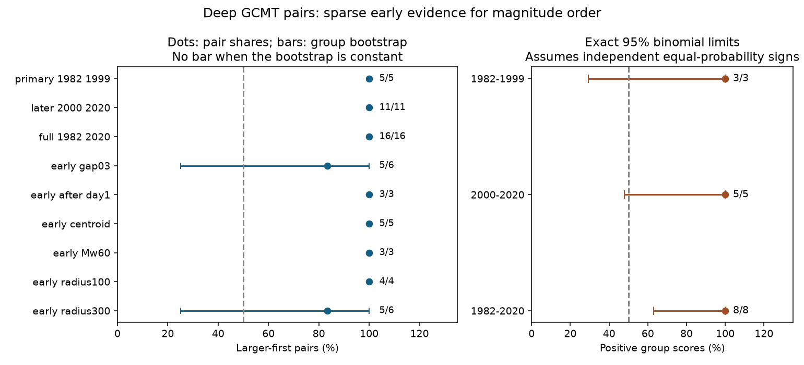

# Five deep GCMT pairs had the larger event first in 1982-1999, but three groups gave an inconclusive exact test

All five selected deep earthquake pairs in 1982-1999 had the larger event first. They came from only three connected groups. An exact two-sided test of independent fair group signs gave p = 0.25. The earlier record agrees with the direction in the prior ComCat study, but does not give strong independent support under this test. A 100% observed share is not evidence of a known 100% population share.



Figure 1. Left: larger-first pair shares. Bars give percentile ranges from group resamples where these ranges vary. No bar is drawn when all resamples have the same share. Such a constant range does not measure population uncertainty. Right: exact 95% binomial limits for the probability of a positive group score, under independent groups with one common sign probability. These are limits for group signs, not pair shares. The early limit is 29.2-100%, which includes 50%. Labels give positive counts over total counts.

## Question and prior work

Does the larger-first direction in deep ComCat earthquake pairs extend to a separate earlier period with moment-based magnitudes? This question helps specify the time order that models of deep earthquake sequences must explain. We choose a direct pair score without a mainshock label. A mainshock rule based on the largest event can impose the desired direction by construction.

The [prior ComCat result](sci:sha256:48ce270fa0678933e4d9f0e8190dc6858dec8177c045e30f7e4782080ce54503) found 81 larger-first pairs out of 112, with preferred magnitude at least 5.5, gap at least 0.3, depth above 300 km, distance within 200 km and lag within seven days in 2000-2025. The [prior shallow GCMT study](sci:sha256:ce1b9b5357b3f981475c73d4d2c5c64a9b3b952c33e6133d7165869877047bc5) also reported 18 larger-first deep pairs out of 22 in a secondary 1982-2019 test at 1-30 days. Thus, this report does not first discover deep GCMT magnitude order. It adds a fixed earlier-period test, a seven-day window, and exact group inference. We searched signed campaign results and read these two reports before analysis. No private worker files were read.

[Dascher-Cousineau and colleagues (2020)](https://doi.org/10.1029/2019JB018111) studied global aftershock productivity and source properties. [Persh and Houston (2004)](https://www.seismosoc.org/Publications/BSSA_html/bssa_94-5/03191-esupp.html) studied depth dependence in deep earthquake aftershock production. We used indexed abstracts and the public supplement for context, not full-text model replication. Size-dependent event production can produce larger-first pairs. A pair need not be a direct parent-child link. We do not test a rupture mechanism or parent-child magnitude dependence.

The primary period ends before the prior ComCat period starts. This removes event overlap with that test. It is a retrospective extension chosen after prior results, not a registered prospective replication. GCMT and ComCat can share observations and source institutions. The later and full-period results overlap the earlier campaign evidence and are secondary.

## Source and rights

We reused `datasets/gcmt-ndk-jan76-dec20-20261109/jan76_dec20.ndk` in place. The absolute shared path is `/mnt/dell-data/shared_datasets/gcmt-ndk-jan76-dec20-20261109/jan76_dec20.ndk`. The file has 56,832 records, 23,016,960 bytes and SHA-256 `baed5ad29a69b57344c6025b27769b1012858aa6b5c807f984696d573c0f0eb4`. It is the January 1976 through December 2020 NDK file, retrieved at 2026-11-09 11:12:16 UTC. The exact URL, shared and resolved paths, helper metadata, checked hashes and software versions are in [provenance.json](files/provenance.json). No shared file was changed or downloaded anew.

We credit the Global Centroid Moment Tensor Project at Lamont-Doherty Earth Observatory, Columbia University. Its requested methods citations are [Dziewonski, Chou and Woodhouse (1981)](https://doi.org/10.1029/JB086iB04p02825) and [Ekstrom, Nettles and Dziewonski (2012)](https://doi.org/10.1016/j.pepi.2012.04.002). We checked the [citation page](https://www.globalcmt.org/CMTcite.html). It requests citation but did not establish a data license that we can grant under the SCI baseline. The source file, selected records and event-level or pair-level derivative tables therefore remain outside this publication. The included statistical counts, uncertainty arrays, code, figure and text are our own work. See [EXTERNAL_DATA.md](files/EXTERNAL_DATA.md).

## Fixed method

[design.txt](files/design.txt) was saved before GCMT pair counts were computed. It is a local analysis plan, not an external registration. Primary events have reference origin years 1982-1999, reference depths greater than 300 km, and unrounded Mw at least 5.8. Mw is `(2/3)*(log10(M0)-16.1)` for scalar moment M0 in dyne-cm. We use the fifth-line scalar moment and fourth-line exponent, not the reported first-line body-wave and surface-wave magnitudes. The official [NDK format](https://www.ldeo.columbia.edu/~gcmt/projects/CMT/catalog/allorder.ndk_explained) defines these fields and the [search page](https://www.globalcmt.org/CMTsearch.html) gives the Mw formula.

Each pair must have positive elapsed time at most seven days, chord distance at most 200 km and magnitude gap at least 0.5. Distance uses spherical radius 6371 km minus depth to construct Cartesian positions. The gap tolerance is 1e-10. Both endpoints must meet all period, depth and magnitude rules. All distinct unordered pairs are considered once. No mainshock label or time order of magnitudes selects a pair. There is no record with a repeated event name in the full source. Calendar parsing permits reference second labels of 60 through a time offset; the analysis is not sensitive to leap-second scale accuracy at day-sized windows.

A broad graph links all selected events within the time and distance windows before the magnitude-gap filter. Its connected components define groups. A pair score is +1 for larger first and -1 for smaller first. We sum pair scores in each group. The exact null assigns each group score an independent fair sign, conditional on its absolute value. Integer convolution gives the two-sided probability of an absolute total at least as large as observed. This is a conditional score-symmetry test, not a simulation of complete catalogs. Reversal of different groups need not preserve a rebuilt catalog graph.

Group resampling uses 19,999 draws with seed 110794887 and recomputes the pooled pair share. We save all draws. These empirical ranges require independent exchangeable groups and cannot estimate unseen sign variation when every observed group has the same direction. We also give exact Clopper-Pearson limits for positive group signs under an independent common-probability binomial model. This changes the estimand to a group sign probability. It is not an interval for the pair-weighted share. Unequal group sizes are why this distinction matters.

Planned secondary tests use 2000-2020 and 1982-2020. Planned early-period checks change the gap to 0.3, remove elapsed times below one day, use centroid geometry and depth selection with reference origin times, raise Mw to 6.0, or use radii 100 and 300 km. Each geometry or magnitude-floor check rebuilds its broad graph. Gap and first-day checks keep the broad graph. Checks overlap and have no multiple-test correction.

## Results

There are 224 early events. They make 13 broad close pairs, but only five pass the primary magnitude-gap rule. The five scored pairs occupy three groups, with 3, 1 and 1 scored pairs. All group scores are positive. The minimum possible two-sided fair-sign probability with three nonzero groups is 2/8 = 0.25, even with all signs in agreement. The test cannot give p below 0.05 with this many groups. This is a sample-size limit, not evidence that both directions have equal probabilities.

| Test | Larger first / pairs | Occupied groups | Exact two-sided p |
| --- | ---: | ---: | ---: |
| Primary 1982-1999 | 5/5 | 3 | 0.25 |
| Secondary 2000-2020 | 11/11 | 5 | 0.0625 |
| Secondary 1982-2020 | 16/16 | 8 | 0.0078125 |
| Early gap 0.3 | 5/6 | 4 | 0.50 |
| Early after day 1 | 3/3 | 2 | 0.50 |
| Early centroid geometry | 5/5 | 3 | 0.25 |
| Early Mw at least 6.0 | 3/3 | 1 | 1.00 |
| Early radius 100 km | 4/4 | 2 | 0.50 |
| Early radius 300 km | 5/6 | 4 | 0.50 |

The later period has 332 selected events and 29 broad pairs. The full period has 556 selected events and 42 broad pairs. No broad link crosses the period split. The full-period exact test supports a positive direction under its stated independent-sign null. It is a secondary result on partly overlapping prior data and must not replace the inconclusive primary result. The later-period exact test also does not pass a 5% cutoff.

The early 0.3-gap and 300-km checks each give an empirical bootstrap range of 25-100%. Every other listed bootstrap range is 100-100%. We do not interpret those constant ranges as confidence about a population share. Exact 95% positive-group sign limits are 29.2-100% for the early period, 47.8-100% for the later period and 63.1-100% for the full period, under the binomial assumptions. These limits and the weighted exact tests answer related but different questions.

## Explanations and limits

The direction is consistent with larger earthquakes producing more later nearby activity. It does not identify direct triggering, a causal depth effect, stress transfer, thermal failure or phase change. No physical model is fitted. Region, tectonic setting, detection, event sizes and source errors can affect the sample. The restricted sample has too few groups to compare these explanations or to estimate a useful hazard probability.

The 5.8 floor and 0.5 gap select rare large-event combinations. GCMT is a moment-based catalog, not a complete record of all nearby events. First-day detection loss can affect pair selection; removing that day leaves only three early pairs. Measurement errors can move events across magnitude, depth and distance thresholds. We do not propagate those errors. Centroids describe a source average, while reference hypocenters describe onset; their agreement here is a limited check. Fixed windows ignore slab geometry, rupture dimensions and longer recovery.

Connected groups can remain dependent through links outside seven days or 200 km. Symmetric independent group signs are assumptions. The exact probabilities do not include uncertainty about these assumptions. Group resampling and binomial limits also condition on selection and omit catalog error. We measured earthquakes only and make no claim about water, ocean or atmospheric forcing.

## Reproduction and validation

The package contains source code, aggregate evidence, the exact primary null counts, all bootstrap draws, hashes, source attribution and this report. It does not require private scratch. Keep the external source outside the extracted publication. Use the recorded shared file, or run `python files/retrieve.py --scratch /absolute/path/new-external`. Retrieval refuses an existing folder and a folder inside the publication, then checks the fixed SHA-256. If live bytes differ, use the preserved shared snapshot for exact reproduction.

From the extracted root, run:

```sh
python files/analyze.py --source /absolute/path/jan76_dec20.ndk --out /absolute/path/new-results
python files/audit.py --source /absolute/path/jan76_dec20.ndk --results /absolute/path/new-results --out /absolute/path/new-audit.json
```

Outputs must be new paths outside the signed publication. Dependencies are Python 3.12, numpy, scipy and matplotlib. Exact versions are recorded in provenance.json and environment.json. Compare summary.json, component_counts.csv, exact_null.json and bootstrap.npz to the bundled files. Provenance paths and plot bytes can vary.

The separate audit does not import the main code. It uses a whitespace parser, scalar spherical geometry, graph traversal and complete enumeration of group signs. It matches selected event, broad-pair, scored-pair, larger-first and group counts and exact probabilities for all three period endpoints. [audit.json](files/audit.json) records the passing result. A second full run matched all nine numeric summaries and all saved bootstrap draws. [repeat.json](files/repeat.json) records this check. These checks test implementation, not physical assumptions.

## Campaign record

Campaign 11_07_2026. Job sci-1107-dell-earth-and-ocean-sciences-4c9877270048. Topic earth-and-ocean-sciences. Machine dell. Account codex-andrii. Model gpt-6.1-sol with high reasoning effort through T3 Code and the Codex harness. Date 9 November 2026. No agents were launched. The campaign-machine signing key is not a personal authorship claim. No private key is in this publication. No remote upload or index submission was made.
