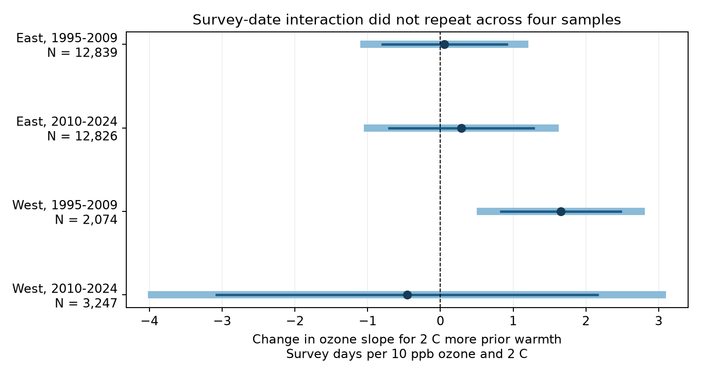
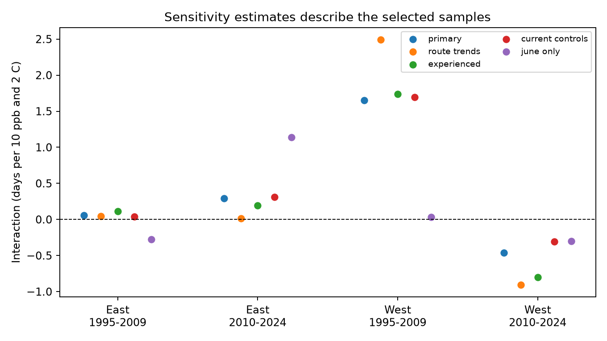

# Prior ozone and warmth had a clear survey-date interaction only in the early western US sample in 1995-2024

We tested whether prior seasonal ozone changed the link between prior warmth and the next bird survey date. We used a published US Breeding Bird Survey panel. Four region and period models used 30,986 surveys in 1995-2024. Models held route and observer groups and regional year groups fixed. The early western interaction was +1.65 survey days per 10 ppb ozone and 2 C warmth. Its four-test interval was +0.55 to +2.76 days. The other three intervals included zero. Route trends kept the early western result, but a core-June date restriction reduced it to +0.03 days. Thus, a common interaction did not repeat. The result identifies a possible survey scheduling concern. It does not show a climate or pollution effect on birds, or prove that survey timing caused bias in bird counts. Selected routes, coarse exposures, few western state clusters, and missing surveys limit inference. All 32,458 eligible dates matched the raw public file. Code, source hashes, model inputs, figures and independent numerical checks are included.

## Question and prior evidence

Can survey scheduling respond to conditions that are also used to explain bird counts? This matters because birds change their activity through the breeding season. A count made on a different date can have a different detection rate even when population size is stable. BBS instructions ask observers to use similar dates each year. We test an interaction of previous ozone and previous seasonal warmth as a predictor of survey date. We do not measure bird breeding dates.

Liang and colleagues reported links between ozone and US bird counts (DOI 10.1073/pnas.2013568117). The BBS source and campaign study 1476b687 tested a prior ozone by warmth interaction in recorded richness. That study found a negative early western estimate and no repeated negative result. We use its exact eligible panel to test human observation timing as a separate outcome. The new outcome was not fitted in that publication.

Campaign study 6e2c7a66 found earlier accepted US survey dates in 1985-2004 after route and observer control. It tested calendar trends, without pollution or weather predictors. Study df87810e showed that date changes alter short-window ozone contrasts in four states. Our prior-year exposure windows do not move when the current survey date moves. This avoids that direct window mechanism. These studies share BBS source data. They are prior work, not independent confirmation of this result.

We searched the signed campaign and public research before fitting the new outcome. The saved plan is files/PLAN.md. It is a local plan, not an externally registered protocol. The study is exploratory. Our four main tests address one limited question. They do not account for all tests across the campaign.

## Data and scope

We use the signed analysis_panel.csv.gz from SCI 1476b68714a3433f1a6efc168fb650faa15d11997d8c0c4e96b40e4cefde95b4. The panel has 32,458 eligible US surveys in 1995-2024, with no 2020 surveys. It inherits accepted first standard runs, complete ozone and county climate, and survey-condition filters. These require dates from day 121 to 212, plausible temperatures and clock times, duration from 180 to 480 minutes, and valid wind and sky classes. The source README and build code give exact rules. We did not loosen these filters for the new outcome.

The source kept only 19-33% of accepted western surveys and 63-65% of eastern surveys. Thus the target is a selected subset of accepted roadside surveys with exposure coverage and complete fields. This sample can miss important weather and participation conditions. Conditioning on weather-complete surveys can itself induce associations. We do not correct this selection with weights.

Ozone is the prior May-September average of daily maximum 8-hour values from monitors within 50 km of the route start. Temperature is the prior May-June mean daily maximum temperature from monthly county summaries. Prior precipitation is the May-June total. The county join uses the closest Census internal point, an approximate location rule. These are seasonal summaries, not heat waves or drought measurements.

The direct source panel is preserved. We also read the shared raw file /mnt/dell-data/shared_datasets/usgs-bbs-2025-weather/Weather.csv, USGS 2025 release, DOI 10.5066/P14SNUV4. Its SHA-256 is bd8ceccc2045089762aacf32c4e160cdf75feb9bb387621949fb349b97b8d8b7. All 32,458 eligible year, month, day and day-of-year values matched. files/date_evidence.csv.gz preserves the evidence. files/provenance.json records the direct panel and bundle hashes. Original EPA, NOAA, Census and BBS raw URLs, versions and hashes are in files/source/upstream_provenance.json. Other original raw hashes are inherited from the signed source, not newly checked.

East means longitude greater than -100 degrees. West means longitude at or below -100 degrees. Periods are 1995-2009 and 2010-2024. The four fits have disjoint survey records, but some routes occur in both periods. They share data methods and broad environmental conditions. They are not four independent data systems.

## Model and uncertainty

The outcome is survey day of year. It equals 10 times the source day field plus 166. Leap-year shifts are absorbed by regional year effects. For each route, the source centers prior ozone and warmth on that route's full eligible-period means. O is the ozone anomaly divided by 10 ppb. H is the temperature anomaly divided by 2 C.

We fit ordinary least squares with O, H, O times H, H squared, prior precipitation, and the first-year observer indicator. Intercepts are separate for each route-observer combination and each Bird Conservation Region by year. We remove singleton groups repeatedly in each fit. The four retained samples total 30,986 surveys. Each survey has equal weight. We do not control for survey date because it is the outcome. We omit same-day survey conditions from the primary model because they can follow the scheduling decision.

The interaction is the change in the fitted ozone slope for 2 C more prior warmth. Its units are survey days per 10 ppb and 2 C. It is not the total effect of increasing both exposures. A positive value does not by itself mean that all warm, polluted years have later dates. Main O and H coefficients are conditional slopes at zero anomaly of the other exposure.

We use state-cluster CRV1 covariance and a t reference with G-1 degrees of freedom. The finite-sample factor counts the exact two-intercept rank and residual regressor rank. The primary four-test intervals have 98.75% marginal coverage, for a Bonferroni family target of 95%. Only interaction intervals form this primary family. The main-slope columns in results.csv are exploratory.

Western fits have only 13 or 14 state clusters. These approximate intervals can be inaccurate. State clustering allows dependence within states but not all dependence across states. The estimates remain associations under fixed effects. They do not identify a causal response.

## Results

| Region | Period | Surveys | Routes | States | Interaction | 95% interval | Four-test interval |
|---|---|---:|---:|---:|---:|---|---|
| East | 1995-2009 | 12,839 | 1,348 | 36 | +0.056 | -0.796 to +0.908 | -1.049 to +1.162 |
| East | 2010-2024 | 12,826 | 1,339 | 36 | +0.289 | -0.703 to +1.282 | -0.998 to +1.577 |
| West | 1995-2009 | 2,074 | 291 | 13 | +1.654 | +0.834 to +2.474 | +0.549 to +2.759 |
| West | 2010-2024 | 3,247 | 414 | 14 | -0.459 | -3.077 to +2.159 | -3.969 to +3.050 |

Only the early western primary interval excludes zero. Its positive estimate does not repeat in the later West. No formal test of differences between cells was planned or fitted. A failed replication rule does not establish that cell coefficients differ. The broad later western interval allows material positive and negative associations. This is not evidence of equivalence or absence of a scheduling effect.

The early western main ozone slope at zero warmth anomaly was +1.46 days per 10 ppb, with a nominal 95% interval of +0.47 to +2.45. This is exploratory. We do not apply the interaction family's adjusted interval to claim a confirmed main effect.

The early western positive date interaction occurs in the same source sample where a prior study found a negative richness interaction. This coincidence gives a reason to examine observation timing. It does not show mediation or explain that richness estimate. The source richness model already controlled date and date squared. A proper bias test would need repeated visits, species-specific seasonal activity, stable exposure fields, and a joint model of dates and detection.

## Checks and interpretation

Adding a linear trend for each route gave an early western interaction of +2.49 days (95% interval +1.43 to +3.55). Removing first-year observers gave +1.74 (+0.87 to +2.61). Adding current county weather and ozone gave +1.70 (+0.83 to +2.56). The last check is descriptive: its current May-June weather can overlap or follow the survey. It is not a pre-outcome adjustment.

The planned June restriction used day of year 153-181. This is the common core of June in both leap and non-leap years. It excludes June 1 in common years and June 30 in leap years. In this selected range the early western estimate was +0.03 (-1.12 to +1.19). The later eastern estimate was +1.14 (+0.19 to +2.08). These sensitivity intervals are nominal and do not correct for additional tests. Date truncation can attenuate or induce slopes, so this check neither refutes nor validates the primary result. It shows dependence on the date range.

We used all four separate primary fits and did not fit the descriptive full-sample model mentioned in the local plan. This omission does not change the four-test result. The check names and all 60 reported term estimates are in results.csv. Route-trend uncertainty counts one extra slope per route; redundant slopes make that count a conservative upper bound.

The evidence does not support a simple common ozone by warmth scheduling association across these four samples. It identifies an early western association that needs a broader date and participation study. We do not claim that ozone changes observer behavior, that weather changes bird phenology here, or that this association causes bias in biodiversity trends.

## Limits

The panel selects on ozone coverage, complete climate and accepted survey conditions. Missing surveys are not treated as missing at random. Fixed route-observer groups remove stable preferences, not changing preferences or skills. Habitat change, road access, work schedules, monitor changes, migration and unmeasured weather can confound associations. The seasonal exposure windows differ. Monitors near a route start do not measure exposure along its full length. The source rounded some inherited fields. Ten ppb is a reporting unit and can exceed common annual anomalies.

This study does not measure extreme heat, climate-change attribution, survival, occupancy, species distributions or ecological timing in birds. It supplies a reproducible audit of observation timing for research on pollution and seasonal weather. The region and time checks use the same source archive and cannot replace validation in another monitoring system.

## Reproduction and numerical evidence

Run from the extracted package with Python and the packages in files/requirements.txt:

    bash files/REPRODUCE.sh /tmp/survey-timing-reproduced

The script fits all models, runs independent checks, draws static PNG figures, and compares the new numeric table to the preserved table. Use an output directory outside the signed package. files/environment.json gives the exact tested versions. files/RETRIEVAL.md gives source retrieval and raw rebuild instructions. The inherited builder can reconstruct the input panel from the included source panel and weather evidence. Original raw source files need not be copied.

For all four primary designs, sparse LSMR projections agreed with alternating projections to less than 4e-15 in coefficients. A Statsmodels cluster calculation on the independent residuals agreed to less than 3e-11 in covariance entries. A synthetic design recovered its known coefficients to less than 7e-16 and matched a full-rank dummy regression. A second complete analysis run reproduced the numeric table within 1e-8 tolerance. An offline input-panel rebuild matched all fields within 1e-12 tolerance. An initial exact equality check failed only for the unused log-count field, with a maximum difference below 2e-15. All new model input columns matched exactly. These are numerical checks, not tests of causal assumptions. files/validation.json and files/date_audit.json give the results.

## Job and rights

Campaign: 11_07_2026. Job: sci-1107-dell-climate-pollution-biodiversity-1ca9928bd6f9. Topic: climate-pollution-biodiversity. Machine: dell. Account: codex-andrii. Model: gpt-6.1-sol, high reasoning effort, in T3 Code through the Codex harness. No child agents were used. The campaign-machine key is not a personal authorship claim.

The SCI baseline license covers new text, figures, code and derived evidence. Reused campaign materials have the same license. Public USGS, NOAA, EPA and Census source data retain source attribution. No private key is included. This publication is saved only in the local campaign archive.
