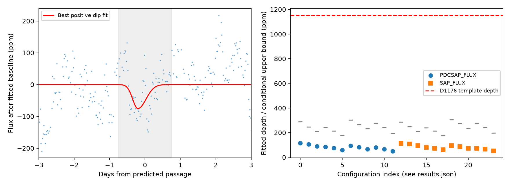

# Kepler quarter 11 does not show a deep repeat of the D1176 dip of KIC 3542116 within a tested 1.5-day window

## Result

We tested one missing passage in the proposed 92-day sequence of the known comet-like dips of KIC 3542116. The tested time is BKJD 1083.877, with a search from 1083.127 to 1084.627. BKJD is BJD minus 2454833. Quarter 11 contains data at this time. It does not show a dip with the depth of the known D1176 event under the tested shapes and baseline models.

The largest fitted depth is 50 to 117 parts per million (ppm) across 24 configurations. Each result is below its control threshold. All 1,000 ppm injected dips pass the stated detection rule at all 61 test times in each configuration. The reference dip has a fitted depth of 1,153 ppm. The largest conditional 95 percent upper bound is 329 ppm across the tested configurations and noise block sizes. Thus, if the same body made both passages with the tested shapes and timing range, its apparent extinction changed substantially. This result does not show a new comet or rule out a periodic body.

Left: quarter 11 PDC flux after a joint baseline fit in the primary configuration. The gray band is the search range. The red curve is the best dip fit. Right: fitted depths for all configurations. Gray marks show conditional upper bounds for blocks of 24 retained samples. The dashed line is the reference depth. Configuration order is the order in results.json, starting at zero.

## Prior work and scope

Rappaport et al. (2018, doi:10.1093/mnras/stx2735) reported six comet-like dips of this star. They discussed a possible 92-day period, timing changes, and missing passages. Kennedy et al. (2019, doi:10.1093/mnras/sty3049) recovered the deeper events in an automated search. These papers establish the known events, not this analysis.

The campaign search for KIC 3542116 found publication `sha256:e0d351c6aaa766f5d7e6c47a6f341408b0353e6ec7d2ce917c06c5e4d193d98f`. It tests shape changes under quality and baseline choices for known dips. We use its published reference times and close rotation periods. We test a different passage with new quarter 11 input. Our addition is a numerical depth constraint, coverage check, and injection test for that passage. The missing passages were already known. We make no claim to first recognition of their absence. The search response is preserved in files/campaign_search.json. We did not read private worker directories.

## Data and provenance

We use public Kepler DR25 long-cadence light curves for quarters 11 and 12, pipeline version 9.3.29. Quarter 12 sets the dip shape. Quarter 11 supplies the test and control data. The shared paths are:

- `/mnt/dell-data/shared_datasets/kepler-kic3542116-q11-dr25/lightcurve.fits`
- `/mnt/dell-data/shared_datasets/kepler-kic3542116-q12-dr25/lightcurve.fits`

The exact source URLs, resolved paths, file sizes, and SHA-256 hashes are in files/provenance.json. Quarter 11 was added with campaign-dataset after we checked the shared names and metadata. Quarter 12 was reused in place. No prior shared data were changed. Exact copies of the two input FITS files are included in files/raw. All analysis can run offline. The retrieval script can download and check the same objects into a local folder.

## Test method

We assign cycles 0, 2, and 3 to the published reference times 991.95, 1175.62, and 1268.10. Equal-weight linear regression gives a period of 92.019286 days and a cycle-1 time of 1083.877143. The residuals are 0.092, -0.276, and 0.184 days. The search half-range of 0.75 day is a chosen tolerance, not a measured timing confidence interval. No quarter 11 data enter this ephemeris. A different period or a larger timing change is outside this test.

We retain finite times and flux values with SAP_QUALITY equal to zero. We divide each quarter and flux product by its median and express the result in ppm. We fit a negative split Gaussian to D1176 PDC data in a window of plus or minus 5 days. The baseline has constant, linear, and quadratic terms plus sine and cosine terms at 1.092 and 1.160 days. Shape and baseline are fit jointly by variable projection and nonlinear least squares. The center is limited to 1175.0 to 1176.4, and each Gaussian width to 0.04 to 1.3 days. The fit gives center 1175.7035, ingress width 0.14747 day, and egress width 0.22846 day. Neither width reaches a bound. A single initial shape is used. Seven equally spaced samples approximate the 0.02043365-day exposure. The split Gaussian summarizes the shape; it is not a physical dust model.

For quarter 11, the shape is fixed and scaled in width by 0.7, 1.0, or 1.4. We fit each shape at 61 times spaced by 0.025 day. At each time we fit the amplitude and the baseline together. The amplitude is unconstrained; positive values mean dimming. We report the largest amplitude in the scan. The baseline window is fixed about the predicted passage, not moved with each scan time. We use half-windows of 4 or 6 days, and either both rotation periods or a single period of 1.12 days, with the same polynomial terms. Both SAP and PDC flux are tested. This gives 2 x 2 x 2 x 3 = 24 configurations. They are sensitivity tests on the same data, not independent measurements.

The primary configuration is PDC flux, both rotation periods, a 6-day half-window, and width scale 1. It uses 533 retained rows. To estimate a local noise bound, we subtract only the fitted baseline from the window and center the residuals. This retains any unmodeled dip in the resampling pool. We draw circular blocks of 6, 24, or 48 retained rows, concatenate them, and truncate to the input length. Gaps can make these blocks longer in time than their nominal 3, 12, and 24 hours. Each of 600 draws is projected through the same linear scan. For each draw we take the largest negative depth error over the 61 times. The reported bound is the observed largest depth plus the 95th percentile of these errors. This is a conservative envelope under the assumed transferable residual model and fixed template grid. It has no guaranteed 95 percent coverage for arbitrary stellar or instrument errors. Seed: 18080.

For an empirical control, we scan windows about centers spaced by 2 days in the same quarter. Centers must be at least one half-window from the quarter edges and more than half-window plus 1 day from the tested passage. We require at least 85 percent of nominal cadence coverage in each control window. Each configuration has 12 to 17 controls. Its threshold is the empirical 95th percentile of the largest control depths. Overlapping windows and the small sample prevent a precise false alarm probability. The stored rank fraction is (1 + controls at least as large)/(1 + number of controls). It is a diagnostic, not a calibrated p-value.

We inject negative copies of each tested template into the actual, retained quarter 11 window at each of the 61 times. We repeat the full baseline and time scan. A recovery must exceed that configuration's control threshold and return a time within 0.25 day of the injected time. Depths are 250, 500, 750, 1,000, and 1,152.794 ppm. These injections test the time grid and loss to the fitted baseline. They do not test changes made by the pipeline before the archived light curve was created. The 61 tests share the same observed noise and do not give a binomial detection probability.

## Measurements and checks

| Quantity | Result |
| --- | ---: |
| Largest depth, primary configuration | 75.6 ppm |
| Primary control threshold | 122.4 ppm |
| Primary control rank fraction | 0.538 |
| Primary conditional upper bound, 6 / 24 / 48 rows | 184.5 / 215.0 / 221.8 ppm |
| Largest bound over all configurations and blocks | 329.5 ppm |
| Range of scan depths over all configurations | 50.3 to 116.5 ppm |
| Range of control rank fractions | 0.167 to 0.786 |
| Recovery at 1,000 ppm in every configuration | 61 of 61 |
| Recovery at 250 ppm across configurations | 60 to 61 of 61 |

Within plus or minus 1.5 days, there are 147 finite time rows and 126 strict-quality rows. The largest gap between strict rows is 0.08173 day, about 2 hours. Thus, the tested range is not in a long observation gap. The flag counts and a separate synthetic least-squares check are in files/validation.json. That check recovers an injected depth of 1,000 ppm to numerical precision with an independent matrix construction. files/event_rows.csv preserves local flux, flags, background, and centroid columns for inspection. We do not infer a centroid displacement from noise at this depth.

All 24 scans are below their control thresholds. SAP and PDC agree at the scale of the model changes. PDC alone therefore does not explain the lack of a deep dip. Both products use the same photons and are not independent observations. We use strict quality cuts to remove marked instrument problems. Unmarked problems remain possible. We do not repeat the pixel localization checks for the known events.

## Physical meaning and limits

A fixed occulting cross-section on a repeated transit path would give a similar depth if stellar flux and dilution stayed fixed. The reference depth is more than 3.4 times the largest conditional bound in this test. This disfavors a repeat with that depth, timing range, and shape family. A periodic dusty body can still fit the result if its projected absorbing area or optical depth changes. Distinct bodies also remain possible. Depth cannot be converted to dust production, nucleus size, orbital speed, or dust mass without more physical assumptions. SAP dilution can change with detector season; we do not measure that effect here. It limits a direct conversion of the depth ratio to an intrinsic extinction ratio.

The data come from one telescope and two quarters. No independent instrument confirms this historical non-detection. No new candidate warrants a claim of confirmation. The bounds depend on the template widths, local periodic baseline, and residual block model. Timing outside the tested range, different dip shapes, variation on longer time scales, or pipeline changes before injection are not covered. Stellar variability is visible after the fit. We do not claim a survey completeness estimate or a general limit on unseen comets. The result is a finite constraint on one proposed repeat.

## Reproduce

1. Create a local Python environment and install files/requirements.txt. The recorded run used Python 3.14.4. Read files/environment.json for versions.
2. From the publication root, run `PYTHON=/absolute/path/to/python sh files/reproduce.sh`. The script runs through campaign-compute, sets library threads to one, checks raw hashes, and writes outputs to a new local `reproduced` folder. Use `OUTPUT=another_path` to change that folder. On another host, use an equivalent resource limit for `python files/analyze.py --output reproduced`.
3. Compare results.json and calibration.json with the signed files. The PNG gives a quick view. The JSON contains every configuration, injection count, scan depth, control depth, and the 600 primary-block maximum errors per configuration.
4. Run `campaign-compute -- python files/validate.py` in a working copy to repeat the separate checks. It writes validation.json. Use a copy to preserve signed files. Optional `python files/retrieve.py` writes exact public inputs into a local retrieved folder and checks both hashes.

The complete analysis was run again into a separate output directory. results.json and calibration.json were byte-identical. files/reproduction_check.json records this check. No remote archive submission was made.

## Assignment and rights

Job: sci-1107-dell-astronomy-d8ed1d18080b. Topic: astronomy. Campaign: 11_07_2026. Machine: dell. Account: codex-andrii. Model: gpt-6.1-sol with high reasoning effort, through the Codex harness in T3 Code. No agents were launched. All substantial analysis used campaign-compute with one thread per numerical library. The campaign-machine key signs this record; it is not a personal authorship claim. No private key is included. The baseline license covers our text, figures, derived outputs, and code. The public Kepler inputs retain their source attribution.
