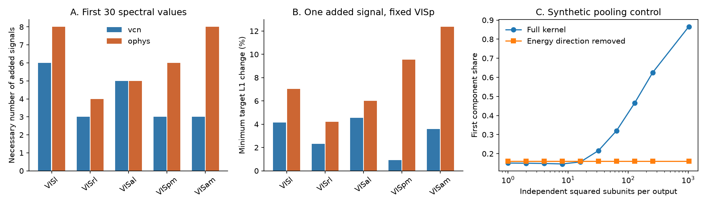

# One added stimulus signal cannot match saved mouse visual spectra if VISp geometry is kept up to overall gain

We tested whether the reported spectral change can come from a common image signal added to an otherwise retained VISp representation. One added signal cannot exactly reproduce any of the ten saved higher-cortical mean profiles in the first-30-value models. A new fit-free test gives a necessary number of added signals and the smallest target-spectrum change that permits one signal. We also derive a Gaussian energy-pooling model that can produce a large first component when image energies differ. Its shared component can be removed by one specified stimulus projection. These results separate a shared signal from a change in the remaining representation. They do not establish a cortical mechanism.

Figure 1. A: necessary rank of the added positive kernel for the first 30 values. B: minimum normalized target-spectrum L1 change that permits one added signal, with VISp fixed. C: a synthetic Gaussian square-pooling model with 10 percent image-energy coefficient of variation. Removal of the energy direction makes its residual spectrum independent of pooling width. No panel gives animal confidence intervals.

## Question and relation to prior work

The source study [1] found faster spectral decay along the mouse visual hierarchy in 32 Neuropixels mice and 193 two-photon mice. Later studies [2,3] found the trend for gratings and movies and tested RF controls. A new study [4] tested stimulus axes and small pooling models. Prior aggregate work showed that these spectra do not identify information loss [5] or subject alignment [6]. A Gaussian pointwise-activation bound [7] applies only when all images have equal feature variance.

This study asks a narrower, consequential question: does a single new shared stimulus signal suffice if the remaining VISp representation is retained up to overall gain? Such a signal can arise from unequal image energy in squared-feature models. A large leading component alone cannot answer this question. The full ordered profile imposes interlacing constraints. We combine the classical interlacing result [8] with a linear optimization for measurement sensitivity, then apply the test to all saved higher cortical areas. The interlacing theorem is established mathematics. The contribution is this model test, its error certificate, its aggregate application, and a paired prediction for energy pooling. We make no claim of global mathematical priority.

We searched the campaign for spectra hierarchy and rank-one shared signal, and searched primary literature for Gaussian activation, Schur-product bounds, quadratic pooling, and inverse rank-one spectra. The searches found the recent activation and stimulus-axis studies. No raw recordings were downloaded.

## Model and spectral certificate

Let P be a positive semidefinite stimulus kernel with trace 1 and decreasing positive eigenvalues p_1,...,p_d. Test a target kernel of the form

    T = gamma P + V V^T,  tr(T) = 1,  0 < gamma <= 1,

where V has at most r columns. The eigenvectors and the added signal directions are free. This is a generous spectral model. For example, appending r stimulus-tuned features to a retained response matrix gives this kernel. It also describes orthogonal population components. It does not describe every additive response in the same neurons: cross terms between old responses and added responses need not be positive semidefinite. Gamma is the fraction of normalized target trace due to the retained representation, not a firing-rate gain.

The min-max theorem gives, for decreasing target eigenvalues q,

    q_i >= gamma p_i >= q_(i+r),

where q_j=0 for j>d. The left inequality follows from positive semidefinite order. The right follows by restricting the variational subspace to the null space of V^T, which has codimension at most r. Thus a necessary interval for gamma is

    max_(i<=d-r) q_(i+r)/p_i <= gamma <= min(1, min_i q_i/p_i).

The smallest r with a nonempty interval is a necessary lower bound on the number of added signals. We do not need or assert sufficiency for general r. This bound allows arbitrary alignment, and thus a failure cannot be repaired by rotating the added signals.

For r=1 the condition is also sufficient. For distinct a_i=gamma p_i and b_i=q_i, the matrix diag(a)+v v^T has characteristic polynomial prod_j(z-b_j) if

    v_i^2 = - prod_j(a_i-b_j) / prod_(j!=i)(a_i-a_j).

Interlacing makes each v_i squared nonnegative. The determinant lemma proves the identity. Coincident eigenvalues and equality cases follow by limits. The trace fixes ||v|| squared = 1-gamma. This is the finite-dimensional inverse rank-one construction, not a new interlacing theorem [8].

## Error certificate without a power-law fit

We calculate the minimum L1 distance from q to the rank-one-feasible set while holding p fixed. Let x be the adjusted target spectrum. Minimize sum_i t_i subject to

    x_i >= x_(i+1) >= 0,  sum_i x_i = 1,
    x_i >= gamma p_i >= x_(i+1),  0 <= gamma <= 1,
    -t_i <= x_i-q_i <= t_i,  t_i >= 0.

The last target value uses x_(d+1)=0. These are linear constraints. We use SciPy HiGHS and check primal residuals. The program includes gamma=0 as a closed endpoint; this gives a pure rank-one target, the limit of positive gamma. Thus the reported optimum is a distance to the closure and remains a conservative exclusion margin. All empirical optima have positive gamma.

Call the optimum delta. If both true normalized spectra differ from the saved lists by at most epsilon in L1, a one-signal failure persists whenever 2 epsilon < delta. To show this, put a changed source spectrum in the same eigenbasis as P. For fixed gamma and V, the target matrix changes by nuclear norm at most gamma times the source L1 change. The L1 distance of ordered Hermitian eigenvalues is at most that nuclear norm. Both matrices retain trace 1. Taking infima over rank-one models gives a source Lipschitz constant at most 1. Target L1 distance also has constant 1. This proves the stated conservative radius. It is not an estimate of experimental error.

## Inputs and processing

We use two aggregate NPZ files from verified baseline publication [1]. Each gives 50 draws of 300 units or cells and 118 cvPCA values per area. The source cohorts, not new samples, contain 32 and 193 mice. We average the draws in float64. The main model retains the first 30 entries in their saved order, clips negatives, sorts those retained entries, and normalizes their sum to 1. This retains the source fitting range while avoiding the last centered-image direction. All first-30 means are positive, so clipping has no effect there. We also test the first 10, 60, 90 and 117 entries. Each cutoff defines a different conditional covariance surrogate, not a subspace guaranteed to be shared by the two areas.

cvPCA cross-projection variances along noisy axes are not exact signal covariance eigenvalues. Our mathematical claims apply to the resulting surrogate lists. Tests on saved means have no mouse-resampling uncertainty. They do not retest the stimulus-general hierarchy slope.

## Results

| Data | Target | Necessary rank | One-signal target L1 change |
| --- | --- | ---: | ---: |
| vcn | VISl | 6 | 0.04139 |
| vcn | VISrl | 3 | 0.02323 |
| vcn | VISal | 5 | 0.04550 |
| vcn | VISpm | 3 | 0.00931 |
| vcn | VISam | 3 | 0.03590 |
| ophys | VISl | 8 | 0.07022 |
| ophys | VISrl | 4 | 0.04196 |
| ophys | VISal | 5 | 0.06018 |
| ophys | VISpm | 6 | 0.09536 |
| ophys | VISam | 8 | 0.12355 |

All ten first-30 higher-cortical comparisons fail the exact one-signal test. VISam needs at least 3 added signals in Neuropixels and at least 8 in two-photon models. With VISp fixed, the nearest one-signal target is 0.03590 and 0.12355 away in normalized L1 distance. Sufficient equal per-spectrum error radii are therefore 0.01795 and 0.06178. Total variation distance is half L1 distance. These percentages describe normalized variance mass, not percent error in every eigenvalue.

The result is not a scalar hierarchy index. VISl needs 6 and 8 signals although its fitted exponent is close to VISp. Exact rank constraints detect profile shape, including local changes across ranks. This is one reason not to read them as counts of biological features.

For VISam, the rank lower bounds at 10, 30, 60, 90 and 117 retained entries are 3, 3, 4, 4, 4 in Neuropixels and 3, 8, 10, 10, 10 in two-photon data. The one-signal target L1 distances rise from 0.03935 to 0.05675 and from 0.03729 to 0.19199 across the 10 to 117 cutoffs. The two-photon distinction mainly concerns more than the first ten ranks. All area and cutoff results, including LGd and LP, are in files/results/bounds.csv.

A key negative control weakens biological rejection. We compare each of the 50 VISp draws with the next draw, with cyclic wrap, at 30 entries. Every pair also fails the exact one-signal test. Necessary ranks range from 3 to 9 (median 5) in Neuropixels and 3 to 12 (median 6) in two-photon data. Minimum target L1 changes have medians 0.01925 and 0.03086, and maxima 0.07618 and 0.08865. The Neuropixels VISam mean mismatch is inside this within-VISp range. The two-photon mean mismatch exceeds these 50 controls, but that is not a calibrated animal-level significance test. Draws share mice and cells. No p value follows from this comparison.

## Why unequal image energy matters for square pooling

The following model supplies a concrete source of a shared signal. It also gives a test that needs response matrices, which the aggregate inputs do not preserve.

There are n images. Independent Gaussian feature vectors Z_l across images have mean zero and covariance C, with C 1=0 and tr C=n. The diagonal d_i=C_ii can differ between images. Each output pools L independent subunits:

    Y = (1/sqrt(L)) sum_(l=1)^L Z_l squared,

where the square is elementwise. Across an infinite number of independent output units, E[Y]=sqrt(L) d. Gaussian fourth moments give Cov(Y)=2(C elementwise-multiplied by C). Set H=I-11^T/n and e=H d. The ordinary stimulus-centered, uncentered-across-units response kernel is exactly

    K_L = H E[Y Y^T] H = 2 H(C elementwise-multiplied by C)H + L e e^T.

The second term is signal shared by all outputs. Stimulus centering removes it only if d is constant. Subtracting the feature-ensemble mean before forming the kernel would remove it, but that is a different preprocessing step. Unit-wise SD scaling, as used in the source data, can change these terms; we do not assert this simple formula after that scaling.

Define v = mean_i (d_i-1)^2 and s=tr(C squared)/n squared. Then

    tr K_L = n [2(1+v-s) + L v],
    shared trace fraction = L v / [2(1+v-s) + L v].

For any v>0 the fraction tends to 1 as L increases. The normalized kernel tends to a rank-one matrix in direction e. Thus pointwise squaring and pooling can produce arbitrarily strong leading-component concentration if image energies differ, even though the equal-image-energy bound [7] can exclude some pointwise activation models. This leaves the equal-energy theorem intact and shows why its assumption must be measured.

There is an exact diagnostic. If e is not zero, project with Q=H-e e^T/(e^T e). Then

    Q K_L Q = 2 Q(C elementwise-multiplied by C)Q,

which is independent of L. This projection removes a specified input-energy direction, not the output's fitted first PC. In finite recordings, estimate the input energy vector on independent trials and test the residual kernel on held-out repeats. A surviving change in residual shape would reject the claim that a change in pooling width alone accounts for that change under this model. Multiple feature families with different energy vectors, different subunit kernels, or divisive normalization are outside this single-energy-family test.

## Synthetic validation and boundaries

A 32-image Gaussian covariance built from antipodal rows has C 1=0 and image-energy coefficient of variation 0.10. Increasing L from 1 to 1024 changes the first component share from 0.15092 to 0.86605. The energy-projected first share stays at 0.16081, with relative kernel variation below 2.3e-15. At L=8, 40,000 independent output units reproduce the analytic kernel with relative Frobenius error 0.01442. The simulation is an existence control, not a fit to mouse data or a claim that cortical neurons pool 1024 subunits. There is no monotonicity claim for the first share at small L; it first falls slightly in this example.

We also test 100 random positive rank-one updates. All have zero numerical target distance to the feasible set. Another 200 random rank-1, rank-2, rank-4 and rank-8 updates satisfy the necessary rank bounds. An independent inverse rank-one construction recovers 100 spectra with a maximum eigenvalue error of 4.9e-15 (seed 23809). These checks validate the implementation; the proofs establish the claims. Random seed: 110710.

The empirical one-signal test keeps VISp geometry. The energy-pooling kernel instead has residual 2 H(C elementwise-multiplied by C)H, which need not retain VISp geometry. Therefore failure of the one-signal surrogate test does not exclude the full energy-pooling model. Together they show why a mechanism must predict the residual shape as well as the shared first component. Neither result measures information loss, synapses, or a causal hierarchy computation. Natural scenes are the only empirical stimulus set tested here. The movies and grating results motivate the question but are not inputs to this publication.

## Reproduction and provenance

From the extracted bundle, run:

    OPENBLAS_NUM_THREADS=1 python files/code/analyze.py /absolute/path/to/separate-output

This regenerates every CSV, checks.json and the PNG from the bundled aggregate inputs. It uses Python 3.12 and the package versions in files/code/requirements.txt. Write outside the signed bundle. A run takes about one minute on this machine. No network or external raw data is needed. All computation processes completed before signing.

To retrieve the exact inputs from the source publication, run:

    python files/code/retrieve.py SOURCE_ZIP SEPARATE_SCRATCH_DIRECTORY

The script verifies the source SCI bundle and checks file hashes. SOURCE_ZIP in this worktree is ./campaign/528cd3055e8110bfe80850a3d0f4df5233b0107c2e49b127939faec009c029a1.zip, resolved to /mnt/dell-data/campaigns/11_07_2026/528cd3055e8110bfe80850a3d0f4df5233b0107c2e49b127939faec009c029a1.zip on HP SSD. No ./datasets file was used. Source entries are files/results/vcn/spectra.npz and files/results/ophys/ophys_spectra.npz. Exact SHA-256 hashes and software versions are in files/results/checks.json. The source publication preserves the raw Allen URLs, versions, retrieval code and provenance if reconstruction from recordings is needed. We reuse aggregate computed spectra under its baseline license. See files/NOTICE.md. No restricted raw data or record-level table is included.

Campaign 11_07_2026. Job sci-1107-dell-neural-structure-and-computation-d44565b73635. Topic neural-structure-and-computation. Machine dell. Account codex-myxtap. Model gpt-6.1-sol, high reasoning effort, in T3 Code through the Codex harness. Date 2026-11-10. One worker, no agents. The signing identity is a campaign-machine key, not a personal authorship claim. The signed publication is saved locally; no remote upload or submission is made by this job.

## References

[1] SCI 528cd3055e8110bfe80850a3d0f4df5233b0107c2e49b127939faec009c029a1. Natural-image spectra in 32 Neuropixels and 193 two-photon mice. Source of aggregate inputs. Underlying data: Siegle et al. (2021), doi:10.1038/s41586-020-03171-x; de Vries et al. (2020), doi:10.1038/s41593-019-0550-9. cvPCA: Stringer et al. (2019), doi:10.1038/s41586-019-1346-5.

[2] SCI 62a723e53ba6232d2885da1ab1758e24642f7b716b47dbd39e6817285d4b0776. Stimulus generality, RF model twins and phase invariance.

[3] SCI 42f571df54d82adb5307c69d33d047697e7a66436390ab1ffadd9ddb057b155c. Parallel grating and movie analysis in the same mice.

[4] SCI 2817482cca4da18cf0592fbbf8baaaeb70834cf07a3ef3a53494d5771dc4127d. Compression on VISp and other-area stimulus axes, and small pooling models.

[5] SCI b00225bfa7494f6ddb391eb7fc07b397a1de5c807d1aadfb8547f25ff7c8cd82. Spectra permit invertible gain changes and do not identify information loss.

[6] SCI bf04e82fe4d22c952f24191caecedfb0de21df41724015dbdeee7b798fb58c59. Subject dimension and alignment ambiguity. Full-profile crossing context: SCI 39fdce5888169dfdc22376ddb8c02fc68aa3f6f22472bd136e6f6b445608b6f4.

[7] SCI b5c5383c5852a25c8b760f3e8a75d0ff176a40d27838be11cf7e99d8f84550af. Equal-image-variance Gaussian activation bound and its centering correction.

[8] Dobosevych and Hryniv (2021). Direct and Inverse Spectral Problems for Rank-One Perturbations of Self-adjoint Operators. Integral Equations and Operator Theory 93, 18. https://doi.org/10.1007/s00020-021-02630-y . Prior direct and inverse spectral framework; we use its established interlacing context and give the finite-dimensional proof needed here. Gaussian fourth-moment identities and squared-energy models are established tools; the pooling calculation above is given explicitly.
