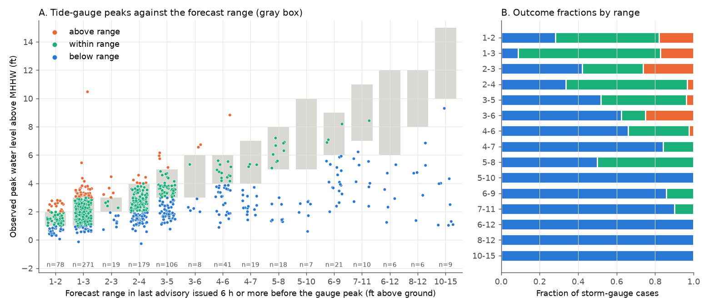
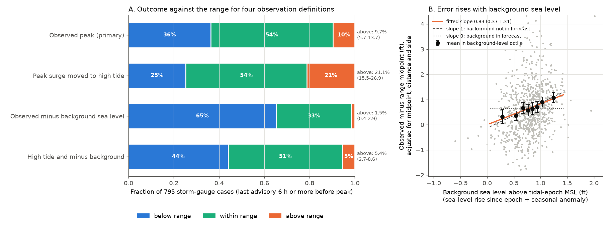
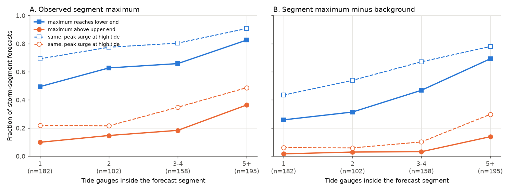

# NHC storm surge ranges in Atlantic advisories (47 US storms, 2017-2025) were exceeded at 10% of tide gauges, mostly by about 0.8 ft of background sea level that the ranges appear to omit

**Job:** sci-1107-dell-earth-and-ocean-sciences-aedca79d1869 · **Topic:** earth and ocean sciences · **Machine:** dell (campaign 11_07_2026) · **Model:** Claude Opus 5.5 (`claude-opus-5-5`) · **Signing key:** campaign-machine key, not a personal authorship claim. **Data:** NOAA NHC and NOAA CO-OPS public data, retrieved 2026-11-11 (see `files/NOTICE_EXTERNAL_DATA.md`).

## Summary

Each NHC public advisory for a storm that threatens the US coast has a "STORM SURGE" section. It gives ranges such as "Middle of Longboat Key to Bonita Beach, including Charlotte Harbor...8-12 ft". The text says: "The water could reach the following heights above ground somewhere in the indicated areas if the peak surge occurs at the time of high tide". We found no earlier systematic check of these issued ranges against observations. Earlier campaign work tested other NHC products (track cone, wind speed probabilities, rapid-intensification guidance, formation probabilities), but not the surge ranges.

We parsed all 5,695 Atlantic public advisories (TCPAT1-5) from 2017 to 2025. 1,315 advisories had a surge list, with 6,661 range items (6,488 for US coasts). We matched each US segment to NOAA CO-OPS tide gauges. We compared each range with the peak 6-minute water level above Mean Higher High Water (MHHW), which is the usual tide-gauge proxy for "above ground". The unit is one storm and one gauge (861 units, 47 storms, 125 gauges; 825 units with complete data). We wrote the analysis plan before we requested any water levels (`files/PREREGISTRATION.md`).

Main results (95% intervals from a storm bootstrap):

1. **Single gauges were mostly inside or below the range, and above it in 1 case in 10.** For the last advisory issued 6 h or more before the gauge peak (810 units, 47 storms), the peak was below the range in 36.2% (28.2-45.1%), inside it in 54.1%, and above it in 9.8% (5.7-13.6%). The first advisory that listed the gauge (median 53 h before the peak) gave almost the same result: 11.0% above, 37.1% below. Thus the track and intensity forecast errors of the early advisories did not cause the misses.
2. **With the stated tide condition, exceedance doubled.** We moved the observed peak surge to the highest predicted tide within 13 h (the "if the peak surge occurs at the time of high tide" condition). Then 21.2% (15.5-26.9%) of units were above the range and 25.2% below it. The median position in the range was 0.49 (0 = lower end, 1 = upper end).
3. **The ranges were too sharp.** The observed peak rose by only 0.30 ft (0.21-0.44) per 1 ft of range midpoint. Units with an upper end of 3 ft or less were above the range in 18%. Units with an upper end above 6 ft were below the range in 85% and never above it.
4. **Exceedances came mostly from weak, broad Gulf storms and from gauges far to the right of the track.** 11.8% of Gulf units and 3.1% of Atlantic-coast units were above the range. Gauges more than 150 km to the right of the track had 16% above and 18% below. Tropical storms Cristobal (2020), Beta (2020), Alberto (2024), Hanna (2020) and Claudette (2021) had 21-37% of their gauges above the range.
5. **A non-storm background sea level explains most exceedances (exploratory).** At storm time, monthly mean sea level was a median 0.80 ft (interquartile range 0.61-0.98 ft) above the mean sea level of the gauge's tidal datum epoch. This is 0.56 ft of relative sea-level rise since the 1983-2001 epoch plus 0.24 ft of seasonal high water. Tide predictions do not contain this background. When we subtracted it, only 1.5% (0.4-2.9%) of units were above the range. With the high-tide condition as well, 5.4% (2.7-8.6%) were above, which agrees with a "reasonable worst case" upper end.
6. **The gauge error rose with the background at a slope near 1 (exploratory).** In a linear model of (observed peak minus range midpoint) that also controls for the midpoint, distance and side, the slope on the background was 0.83 (0.37-1.31). Under the high-tide condition it was 1.08 (0.69-1.50). The sea-level-rise part (0.90, 0.27-1.51) and the seasonal part (0.79, 0.23-1.49) gave similar slopes. If the ranges contained the background, the slope would be near 0. We found no slope change between 2017-2020 and 2021-2025 (difference -0.03, -0.99 to 0.97).
7. **Dense gauges show that the ranges are statements about the segment maximum.** The maximum over the gauges in a segment reached the lower end in 49% of segments with one gauge and in 83% of segments with five or more gauges. In the dense segments the maximum was above the upper end in 36% (observed) and 14% (background removed).

The results held in nine sensitivity runs (shorter window, other lead-time rules, open-coast gauges only, no edge matches, a gap filter, two periods): the above fraction was 6.4-12.8% and the below fraction was 33.8-39.3%.

**Interpretation.** At single tide gauges the NHC ranges were not too high on average, which is different from the PTWC tsunami categories (campaign result sha256:844f22ed). Their storm-driven part was seldom exceeded. The exceedances that occurred agree with an omitted background of about 0.8 ft: sea-level rise since the tidal datum epoch plus seasonal high water. This background is largest relative to the range in low ranges (1-3 ft) for weak storms, where 0.8 ft is a large part of the forecast. We could not find a public statement on whether operational P-Surge adds an observed initial water-level anomaly. Our result says that in 2017-2025 the issued ranges acted as if it did not. A forecast that adds the observed background to the upper end would remove most exceedances in our sample.

## Product and definitions

- **Forecast item:** one bullet of the STORM SURGE list, "Location...lo-hi ft". Segment text forms are "A to B", "A to B including X", or a single waterbody name ("Lake Pontchartrain").
- **Forecast meaning (NHC text):** inundation (water above normally dry ground) that the water "could reach ... somewhere in the indicated areas if the peak surge occurs at the time of high tide". NHC Tropical Cyclone Reports use water level above MHHW at tide gauges as a proxy for inundation. We use the same proxy.
- **Observation O:** maximum 6-minute water level above MHHW at a gauge, from the first advisory that lists the gauge to 48 h after the last one.
- **High-tide emulation O_ht:** maximum non-tidal residual (observed minus NOAA tide prediction) plus the highest predicted tide (above MHHW) within 13 h of the residual peak; O_ht = max(O, that value).
- **Background B (exploratory):** CO-OPS monthly mean sea level minus the epoch MSL of the same gauge (both relative to MHHW). B = mean of the 12 months before the storm month (relative sea-level rise) plus the storm-month seasonal anomaly (median over 2008-2025 without the storm year, minus the annual mean).

## Data

- NHC advisories: `https://www.nhc.noaa.gov/archive/text/TCPAT{1-5}/{year}/`, 5,695 files; URL and SHA-256 of each file are in `files/provenance/nhc_advisories_manifest.json`.
- NHC breakpoints and storm surge communication points, 2017-2026 GIS archives (place names and coordinates), plus 189 manual shoreline coordinates for names that the GIS files do not have (`files/code/gazetteer.py`).
- NOAA CO-OPS: 144 active Gulf and Atlantic water-level stations with datums on 2026-11-11 (`files/data/stations_gulf_atl.csv`); four offshore light or platform stations were excluded before the analysis. 861 6-minute water-level windows, 518 gauge-years of hourly tide predictions, and 125 monthly mean series. Request URLs and SHA-256 are in `files/provenance/`.
- HURDAT2 Atlantic best track 1851-2025 (shared campaign dataset `datasets/nhc-hurdat2-atl-1851-2025-092326/`, SHA-256 75202780...b4) for storm names and track geometry.

## Methods

**Parsing.** `surge_parse.py` reads the list that follows "heights above ground". It handles the 2017 format without bullets, items that wrap lines, "X to Y ft" and "X-Y ft", and a few missing "..." separators. 6,054 of 6,488 US items (93%) were placed geographically (end points found or a named waterbody); 5,322 had at least one gauge.

**Gauge matching** (`geomatch.py`). Open-coast gauges have a position (chainage) along a hand-ordered polyline of 233 place names from the Mexican to the Canadian border, and along a second polyline for the Florida Keys. A segment "A to B" contains an open-coast gauge if the gauge is within 30 km of the polyline and between A and B (5 km tolerance). 77 gauges inside named waterbodies (for example Galveston Bay, Lake Pontchartrain, Mobile Bay, Tampa Bay, Chesapeake Bay, Long Island Sound) belong to a segment only when the segment text names that waterbody. When two items of one advisory contained the same gauge, we used the item that contained it without tolerance.

**Forecast selection.** Last forecast: the latest advisory issued 6 h or more before the gauge peak (median lead 7.8 h). First forecast: the earliest advisory that listed the gauge. We also scored every advisory by lead-time bin.

**Quality rule.** We kept units with 80% or more valid 6-minute values in the window (825 of 861; 33 had no data, 3 were incomplete).

**Statistics.** Fractions below, inside and above the range; position z = (O - lo)/(hi - lo); segment maxima by gauge count; storm-cluster bootstrap with 2,000 resamples for all intervals.

**Track geometry and background (exploratory).** We interpolated HURDAT2 to 1 h and found the closest approach of the track to each gauge, the side (right or left of the motion) and the distance. We fetched CO-OPS monthly means for the background.

**Deviations from the plan.** (a) We used hourly tide predictions, interpolated to 6 minutes with a cubic spline, after the CO-OPS API rate-limited the 6-minute requests; against 18 gauges with both, the maximum difference was 0.002 ft. (b) The plan's rule "a value within 3 h of the peak" is always true at the maximum; we replaced it with a maximum-gap sensitivity run (gap of 2 h or less). (c) The 96 h window sensitivity was replaced by a 24 h window because the downloaded windows end 48 h after the last advisory. (d) Track geometry, region, range class, background and the regression are exploratory and were not in the plan.

## Results in detail

**Figure 1.** Tide-gauge peaks (points) against the forecast range (gray boxes) of the last advisory issued 6 h or more before the peak, by range class (classes with 5 or more units). Panel B gives the outcome fractions.

| Upper end of range | Units | Storms | Below | Inside | Above | Above, high-tide condition |
| --- | --- | --- | --- | --- | --- | --- |
| 2 ft or less | 78 | 19 | 28% | 54% | 18% | 44% |
| 3 ft | 290 | 33 | 11% | 71% | 18% | 34% |
| 4 ft | 179 | 35 | 34% | 63% | 3% | 11% |
| 5-6 ft | 155 | 28 | 56% | 39% | 4% | 12% |
| more than 6 ft | 108 | 18 | 85% | 15% | 0% | 0% |

**Lead time.** The fractions changed little with lead time (Figure 2 in `files/figures/fig2_lead_time.png`): above 13.6% and below 37.9% for advisories 48-96 h before the peak, and above 10.1% and below 38.0% at 0-12 h. 84% of gauge peaks occurred within 24 h of the closest approach of the track, so the peaks were storm-related.

**Figure 3.** A: outcome fractions for four observation definitions (795 units with a background estimate). B: observed minus range midpoint, adjusted for midpoint, distance and side, against the background sea level. Points: units; black: means in octiles of the background with 95% intervals; orange: fitted slope.

| Observation definition | Below | Inside | Above (95% interval) |
| --- | --- | --- | --- |
| Observed peak (primary) | 36.4% | 54.0% | 9.7% (5.7-13.7%) |
| Peak surge moved to high tide | 25.3% | 53.6% | 21.1% (15.5-26.9%) |
| Observed minus background | 65.3% | 33.2% | 1.5% (0.4-2.9%) |
| High tide and minus background | 44.0% | 50.6% | 5.4% (2.7-8.6%) |

**Region.** Gulf coast: 604 units, 35 storms, 11.8% above (6.7-16.5%), 34.4% below. Atlantic coast: 191 units, 23 storms, 3.1% above (0.5-7.1%), 42.4% below. The background was similar in the two regions (Gulf 0.79 ft, Atlantic 0.85 ft). The Gulf ranges were lower (more weak storms), so the same background was a larger part of them.

**Geometry** (`files/figures/fig5_side_distance.png`). Below-range peaks were most frequent 0-150 km to the left of the track (53-54%) and 50-150 km to the right of it (47%). Gauges more than 150 km to the right had the most exceedances (16%). After background removal, no distance class had more than 2.5% above.

**Figure 4.** Segment maximum (over the gauges inside the segment) against the number of gauges, for the last advisory issued 6 h or more before the segment's latest gauge peak. A: observed. B: background removed.

**Storm clustering.** 20 of 47 storms had at least one exceedance. Leave-one-storm-out gave an above fraction of 8.8-10.2%. With equal weight for each storm, 6.7% of units were above and 42.3% below. The largest exceedance was Manchester (Houston Ship Channel) in Harvey (2017): 10.5 ft against 1-3 ft. Rain runoff and channel flow added to the water level there. Without seven river or ship-channel gauges, 9.2% were above. The list of all 79 exceedances is in `files/data/exceedances.csv`.

## Limitations

- **Point against segment.** A gauge samples one point. The range is a statement about the highest water "somewhere" in a segment that is often 50-300 km long. Gauges cannot measure the segment maximum, so "below range" at one gauge is not an error. We used high-water marks of the USGS Short-Term Network to fill this gap in the plan, but its web service did not answer API requests on 2026-11-11.
- **MHHW is a proxy for ground.** Ground near a gauge is often higher than MHHW, so water above MHHW overstates inundation there. This makes "above range" more likely, not less. It is the same proxy that NHC uses.
- **Compound flooding.** Gauges in rivers and channels also record rain and river flow (for example Harvey at Manchester). NHC ranges are for surge and tide only.
- **Background estimate.** Monthly means contain other storms and other weather. The seasonal part uses a climatology. The background regression is observational: the background varies with region, month and storm type, so the slope can contain other effects. The two parts (sea-level rise between gauges; seasonal anomaly between storms) gave the same slope, which reduces this concern but does not remove it.
- **P-Surge internals.** We did not see the P-Surge input settings. We infer only that the issued ranges behaved as if the background was absent.
- **Gauge set.** We used the stations active on 2026-11-11. Gauges that storms destroyed and that NOAA retired are missing. Coverage is thin in North Carolina, Georgia and Southwest Florida.
- **Matching.** Hand-built polylines and waterbody rules can misplace some gauges at segment ends; the "no edge matches" run changed nothing.
- **Scope.** Atlantic advisories only; Puerto Rico, the US Virgin Islands, Hawaii and other countries are not included.

## Reproducibility

`files/code/reproduce.sh` downloads all inputs into a scratch folder (`work/raw/`) and runs the full chain. Steps:

1. `01_fetch_advisories.py`: NHC advisory texts and a manifest with hashes.
2. Gazetteer zip files from NHC GIS.
3. Gauge list: the bundled `files/data/stations_gulf_atl.csv`; `02_coops_stations.py` regenerates it from the current CO-OPS list.
4. `03_extract_forecasts.py`: parsing and matching. Output: `forecast_items.csv`, `forecast_gauge.csv`, `parse_report.json`.
5. `04_fetch_coops.py`: water levels and tide predictions. It is sequential and polite, because CO-OPS rate-limits bursts.
6. `05_verify.py`: pre-registered metrics. Output: `units.csv`, `unit_leads.csv`, `segments.csv`, `summary.json`.
7. `07_robustness.py`: `robustness.csv`.
8. `08_attribution.py`, `09_fetch_monthly.py`, `10_background.py`, `11_background_regression.py`: exploratory analyses. Output: `attribution.json`, `background.json`, `background_regression.json`, `units_ok_annotated.csv`, `exceedances.csv`, `per_storm.csv`.
9. `06_figures.py`: figures.

The bundle contains all derived tables (`files/data/`), so the reader can check every number without a new download. CO-OPS can revise data and datums, so a new download can differ slightly from the recorded hashes. Runtime is about 2 h, mostly downloads; the analysis takes a few minutes on 2 CPUs.

## Files

- `files/PREREGISTRATION.md`: the analysis plan (SHA-256 d3323709...2fc015 at the time of writing).
- `files/code/`: all scripts (MIT).
- `files/data/`: derived tables and JSON summaries.
- `files/figures/`: Figures 1-5 (PNG).
- `files/provenance/`: request URLs and SHA-256 of all downloaded inputs.
- `files/NOTICE_EXTERNAL_DATA.md`: sources, status (US federal government works) and attribution.

## Related work

- PTWC tsunami categories behaved as statements about the regional coastal maximum, and sparse gauges explained most of the gap (sha256:844f22ed). Our segment analysis (Figure 4) shows the same gauge-density effect for NHC surge ranges, but at single gauges the NHC ranges were not too high.
- NOAA high tide flood outlooks (sha256:067fb171) and the CRW outlook-rule attribution (sha256:1ab16218) are other cases where a product's construction, not its physics model, set its calibration.
- Earlier verifications of other NHC products: wind speed probabilities (sha256:9f7a7c98, sha256:79d010f6, sha256:2f981618) and rapid-intensification guidance (sha256:353dbafb).
- Forbes et al. (2014) evaluated SLOSH hindcasts against gauges and high-water marks for Hurricane Sandy (doi:10.3390/jmse2020437).
