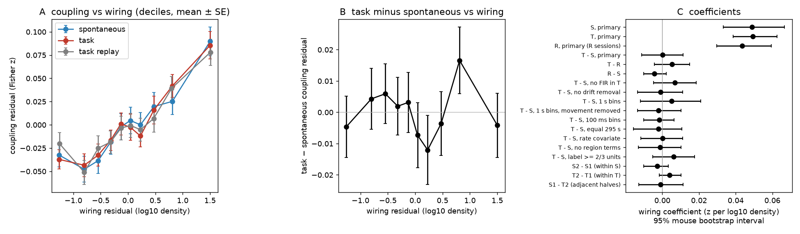
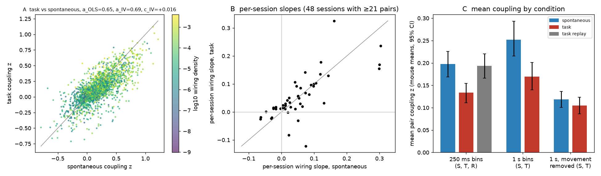

# In 111 IBL brain-wide sessions, the decision task decreased fast inter-regional co-variation by one third but did not change its slope on Allen axonal wiring

## Summary

We asked a structure–function question under different behavioural conditions in the same neurons. Does a task change how well the mesoscale axonal connectome predicts fast shared variation between brain regions?

An earlier campaign study (sci 63daa564, Allen Visual Behavior Neuropixels, visual regions) found that task engagement made this wiring slope 24% smaller than in passive replay of the same images. It also found that coupling decreased by about the same factor in all region pairs (active ≈ 0.64 × passive). We did an out-of-sample test of that result in a different data set, task, set of laboratories and set of brain regions.

Data: International Brain Laboratory (IBL) brain-wide map, 111 sessions from 76 mice in 12 laboratories. In each session we used the same good units in three epochs:

- T: 600 s in the middle of the visual decision task (wheel turn; engaged).
- S: the passive spontaneous epoch after the task (grey screen; 5 or 10 min).
- R: the passive replay of task stimuli (Gabor patches, tones, noise, valve clicks; 103 sessions, 72 mice).

For each node (Knox summary structure × hemisphere, 5 or more good units), we summed the spikes in 250 ms bins. We removed event-locked mean responses (task events in T, stimulus events in R) and slow drifts (90 s moving average). Then we calculated the Fisher-z correlation between nodes. Wiring was the log10 mean of the two directed Knox et al. (2019) normalized connection densities. The model controlled for distance (spline), opposite hemisphere, each region and each session. The 95% intervals came from a bootstrap over mice. In total there were 2,149 node pairs, 140 regions, and all major brain divisions. We wrote the analysis plan (files/PLAN.md) before we computed any coupling.

Main results:

1. Wiring predicted coupling in all three epochs. This is the positive control. Wiring coefficient: S 0.049 z per log10 density (95% CI 0.033–0.067), T 0.049 (0.039–0.063), R 0.044 (0.030–0.060).
2. The task did not change the wiring coefficient. T − S = +0.0001 (95% CI −0.011 to +0.011, p = 0.96). This interval excludes changes larger than about ±23% of the spontaneous value. T − R = +0.005 (−0.004 to +0.015). This interval excludes the 24% decrease that sci 63daa564 found for engaged versus passive viewing. R − S = −0.004 (−0.010 to +0.002).
3. The null result did not change with 100 ms or 1 s bins, no event-response removal, no drift removal, equal 295 s durations, a firing-rate covariate, no region terms, more units (label ≥ 2/3; 3,868 pairs), split halves, or removal of wheel, whisker and lick signals. The intervals of all 11 checks included zero (files/results/wiring_coefficients.csv). In 48 sessions with 21 or more pairs, the per-session slope was lower in the task in 19 sessions (Wilcoxon p = 0.38).
4. The task decreased the mean coupling. Mean pair z was 0.128 in T, 0.191 in S and 0.180 in R. The mouse-mean change T − S was −0.063 (−0.085 to −0.043), and T − R was −0.062 (−0.082 to −0.043). R − S was −0.005 (−0.015 to +0.005). Firing rates did not change (T − S: +0.006 log10 units, −0.027 to +0.038). Thus the decrease of coupling during engagement replicated from VBN. The change of the wiring slope did not.
5. The decrease was not proportional. When we predicted task coupling from spontaneous coupling of the same pair, the slope was 0.69 (0.62–0.76). We corrected it for noise with split halves of S (instrumental variable). The wiring term was positive: +0.016 (0.007–0.024) z per log10 density. Thus pairs with strong wiring kept more of their coupling than proportional scaling predicts, and the task mainly removed coupling that wiring does not explain. Relative to its mean, coupling depended more on wiring during the task.
6. Movement explained most of the mean change, but not the wiring slope. With 1 s bins, the mean T − S change was −0.082 (−0.113 to −0.053). After we regressed out wheel speed, whisker-pad motion energy and licks in each epoch, it was −0.013 (−0.030 to +0.005). The regression decreased the mean coupling by about half in S (0.242 to 0.116) and by one third in T (0.161 to 0.103). It changed the wiring coefficients only a little (S 0.042, T 0.040). Thus most of the extra spontaneous-epoch coupling followed body movement and did not depend on wiring.

Conclusion: in brain-wide IBL recordings, Allen axonal wiring predicted fast inter-regional co-variation equally well during the decision task, quiet spontaneous activity and passive stimulus replay. The task decreased the coupling by one third. This decrease was mostly a loss of movement-linked, wiring-independent co-variation, not a loss of wiring-related coupling. The VBN result of a smaller wiring slope during engagement therefore did not generalise to this data set.



Figure 1. A: Coupling against wiring after the distance, hemisphere, region and session terms were removed (deciles of the wiring residual; mean ± SE over pairs), for each epoch. B: Task minus spontaneous coupling against wiring. C: Wiring coefficients and 95% mouse-bootstrap intervals for each epoch, each difference and the checks.



Figure 2. A: Task against spontaneous coupling for each pair (colour = wiring); the title gives the OLS and split-half IV scaling slopes and the IV wiring term. B: Per-session wiring slopes (within-session model with a quadratic distance term). C: Mean pair coupling by epoch (mouse means, 95% CI); 1 s bins with and without regression of wheel, whisker and lick signals.

## Question and hypotheses

Earlier studies found that the Allen tracer connectome predicts inter-regional spike coupling beyond distance in spontaneous activity (sci fe558137), and that brain state can change this link: anaesthesia in mouse fMRI (sci 40af6bdd), ketamine in Neuropixels data (sci 74da6ee1), and task engagement in VBN visual regions (sci 63daa564). The VBN study had one task, visual regions only, and passive replay as the only reference. We tested whether its result generalises to a different task (IBL wheel-turn visual decision task), brain-wide regions, and two references (no stimuli, and replayed stimuli). The plan gave two predictions. A proportional-scaling account predicts that the wiring coefficient changes with the same sign as the mean coupling, and that the wiring term in the scaling model is about zero. A selective account predicts a non-zero wiring term. The primary test was two-sided.

## Data

- IBL brain-wide map (IBL et al. 2025, Nature, doi:10.1038/s41586-025-09235-0), release fixture 2023_12_bwm_release, spike sorting revision 2024-05-06. CC BY 4.0, credit the International Brain Laboratory. We used shared campaign caches. They were made by earlier campaign studies with HTTP range reads of the public S3 copy:
  - `datasets/ibl_bwm_task_window_allspikes/v1_2026-10-30` (T: all clusters, 600 s centred in the task epoch, 111 sessions with a CA1 probe, 190 probes).
  - `datasets/ibl_bwm_spont_allspikes/2026-10-30` (S: same sessions and probes, passive spontaneous epoch).
  - `datasets/ibl_bwm_passive_taskreplay_spikes/v1_2026-10-30` (R: good units, task-replay epoch, and the passive stimulus tables).
  - `datasets/ibl_bwm_passive_binned/2026-10-29` (trial tables; wheel, whisker motion energy and licks in 1 s task bins and 0.1 s passive bins).
- Connectome: Knox et al. 2019 (Netw Neurosci 3:217, doi:10.1162/netn_a_00066) regionalized model, `normalized_connection_density.csv.gz` (ipsilateral and contralateral blocks) in `datasets/knox2019_regionalized_connectivity/2025-02-21`; region table `datasets/knox2019_split_half_models/v1_2026-10-31/regions.csv`. Allen Institute terms of use.
- Region hierarchy: CCF 2017 structure graph 1 (`datasets/allen_ccf_2017/annotation_25_v2017/structure_graph_1.json`).
- files/results/input_hashes.csv gives the SHA-256 of all 1,155 shared files that we read (taken from each cache's SHA256SUMS; 27 random and small files re-hashed, all matched; the structure graph hash was computed).

All 111 sessions were analysed (no selection by results). Three sessions have no lick signal in the cache; the movement check used zero lick regressors for them. Eight sessions have no replay spikes or stimulus table, so R has 103 sessions.

## Methods

- Units: IBL good units (clusters.metrics label = 1), the same unit set in T, S and R. Region: Knox summary-structure ancestor of the channel's CCF 2017 id (fibre tracts and ventricles have none and were dropped). Node: region × hemisphere (sign of ML). Nodes with 5 or more good units. Position: mean ML/AP/DV of the node's units.
- Signal: node population spike count in 250 ms bins (checks: 100 ms, 1 s).
- Event removal: least-squares fit and removal of finite-impulse-response kernels. T: stimulus onset 0–1 s, first movement −0.5–1 s, correct feedback 0–1.5 s, error feedback 0–1.5 s. R: Gabor onset, tone, noise and valve, each 0–1 s. S: none.
- Drift removal: minus a centred 90 s moving average. Coupling: Pearson r of the residuals of two nodes, Fisher z.
- Wiring: w = log10 of the mean of the two directed normalized connection densities (ipsilateral block for same-side pairs, contralateral block for opposite-side pairs). Pairs of the same region in opposite hemispheres were not used. Distance: Euclidean distance between node positions (mm).
- Model: z = b·w + natural cubic spline of distance (4 df) + opposite-hemisphere flag + one additive term per region (each pair gets the terms of both regions) + one term per session; least squares. Differences between epochs used the same model on dz. 95% intervals and two-sided p values came from 2,000 bootstrap resamples of mice (weighted normal equations; a 1e-8 relative ridge keeps the matrix invertible when a resample lacks a region).
- Scaling: nuisance terms were partialled out once on the full sample. Then z_T = a·z_S + c·w. The IV estimate used z_S from one half of S as the instrument for z_S from the other half, and averaged the two directions. The mouse bootstrap resampled the residualised rows (an approximation, as in sci 63daa564).
- Movement check (1 s bins): wheel speed, left whisker-pad motion energy, licks, and their absolute first differences, z-scored, added to the residual regression in each epoch.

## Results tables

Wiring coefficient b (z per log10 density); 95% mouse-bootstrap interval; partial r of z and w given the other terms. 111 sessions and 76 mice unless noted (R: 103 sessions, 72 mice).

| Model | b | 95% CI | partial r | pairs |
| --- | --- | --- | --- | --- |
| S, primary | 0.0489 | 0.0333 to 0.0666 | 0.185 | 2,140 |
| T, primary | 0.0494 | 0.0385 to 0.0626 | 0.207 | 2,145 |
| R, primary | 0.0436 | 0.0297 to 0.0595 | 0.179 | 2,077 |
| T − S, primary | +0.0001 | −0.0112 to +0.0114 | 0.001 | 2,136 |
| T − R | +0.0052 | −0.0043 to +0.0148 | 0.028 | 2,073 |
| R − S | −0.0042 | −0.0103 to +0.0023 | −0.032 | 2,077 |
| T − S, no event removal in T | +0.0068 | −0.0049 to +0.0186 | 0.030 | 2,136 |
| T − S, no drift removal | −0.0011 | −0.0135 to +0.0112 | −0.005 | 2,136 |
| T − S, 100 ms bins | −0.0017 | −0.0101 to +0.0064 | −0.013 | 2,136 |
| T − S, 1 s bins | +0.0050 | −0.0120 to +0.0210 | 0.018 | 2,136 |
| T − S, 1 s bins, movement removed | −0.0021 | −0.0134 to +0.0102 | −0.010 | 2,136 |
| T − S, equal 295 s | −0.0020 | −0.0159 to +0.0106 | −0.010 | 2,133 |
| T − S, firing-rate covariate | +0.0002 | −0.0116 to +0.0110 | 0.001 | 2,136 |
| T − S, no region terms | −0.0012 | −0.0130 to +0.0102 | −0.006 | 2,136 |
| T − S, units with label ≥ 2/3 | +0.0062 | −0.0051 to +0.0175 | 0.030 | 3,868 |
| T − S, first halves | −0.0031 | −0.0165 to +0.0097 | −0.015 | 2,136 |
| T − S, second halves | +0.0036 | −0.0075 to +0.0162 | 0.018 | 2,136 |
| S second − first half | −0.0028 | −0.0102 to +0.0033 | −0.023 | 2,140 |
| T second − first half | +0.0040 | −0.0017 to +0.0103 | 0.042 | 2,145 |
| S first half − T second half | −0.0009 | −0.0129 to +0.0113 | −0.005 | 2,136 |
| S, 1 s, movement removed | 0.0422 | 0.0276 to 0.0571 | 0.171 | 2,140 |
| T, 1 s, movement removed | 0.0404 | 0.0302 to 0.0513 | 0.194 | 2,145 |

Mean coupling (mouse means of pair z differences; files/results/summary.json and followup.json):

| Contrast | mean dz | 95% CI |
| --- | --- | --- |
| T − S, 250 ms | −0.063 | −0.085 to −0.043 |
| T − R, 250 ms | −0.062 | −0.082 to −0.043 |
| R − S, 250 ms | −0.005 | −0.015 to +0.005 |
| T − S, 100 ms | −0.047 | −0.062 to −0.032 |
| T − S, 1 s | −0.082 | −0.113 to −0.053 |
| T − S, 1 s, movement removed | −0.013 | −0.030 to +0.005 |
| S second − first half | +0.013 | +0.002 to +0.025 |
| T second − first half | +0.004 | −0.004 to +0.011 |

Scaling (files/results/scaling.json): z_T on z_S: a_OLS 0.65 (0.58–0.72), a_IV 0.69 (0.62–0.76), c_IV +0.016 (0.007–0.024). z_T on z_R: a_IV 0.75 (0.66–0.84), c_IV +0.016 (0.008–0.024). z_R on z_S: a_IV 0.84 (0.80–0.88), c_IV +0.003 (−0.002 to +0.008). Split-half correlation of residual S coupling: 0.90.

Pair classes. Most pairs (1,950) were not cortex–cortex or cortex–thalamus. For them, S 0.055 (0.037–0.078) and T − S −0.004 (−0.018 to +0.010). Cortex–thalamus pairs (146) had no clear wiring slope in S (+0.024, −0.10 to +0.10). Cortex–cortex pairs were too few (44) for the model with region terms; that fit was degenerate (partial r 0.86), and we do not interpret it. Without region terms (exploratory, files/results/followup.json), cortex–cortex T − S was +0.16 (−0.12 to +0.72).

## Comparison with sci 63daa564 (VBN)

| | VBN (63daa564) | IBL (this study) |
| --- | --- | --- |
| Engaged vs passive mean coupling | lower (−0.046 z) | lower (−0.062 z vs replay, −0.063 vs spontaneous) |
| Wiring slope change | −24% (CI −35% to −14%) | +12% vs replay (CI −10% to +34%); 0% vs spontaneous (CI −23% to +23%) |
| Scaling slope a | 0.64 | 0.69–0.75 (IV) |
| Wiring term c | +0.006 (small) | +0.016 |

Possible reasons for the difference: VBN regions were mostly visual cortex and visual thalamus, where the VBN decrease was largest. Here, cortex–cortex pairs were few and cortex–thalamus pairs had no wiring slope. VBN mice ran in both blocks. IBL mice turn a wheel in the task and sit still or groom in passive epochs. The VBN coupling used 250 ms flash windows; here we used continuous bins.

## Limitations

- Epoch order is fixed in IBL: the passive epochs always come after the task. The halves analysis showed no change of the wiring slope inside either epoch or across the T-to-S boundary. The mean coupling changed at the boundary (S first half − T second half +0.056) and only a little inside S. We cannot separate the task from time, satiety or other changes between the epochs.
- The T window is 600 s; S is 300 s (25 sessions) or 600 s (86 sessions); R is 316–1,542 s. The equal-duration check gave the same result.
- Movement signals are coarse (1 s; whisker motion energy from one camera; wheel speed). The movement check shows that much of the coupling difference is linked to body movement, but it cannot establish cause.
- Event removal uses linear kernels. Choice-, reward- and movement-related responses with trial-to-trial variation remain in T. Without event removal the result was the same.
- Only 2,149 pairs passed the 5-unit rule. Cortex–cortex pairs (44) and cortex–thalamus pairs (146) were few; the result is mostly from hippocampus, thalamus, midbrain, striatum, hindbrain and cortex pairs across divisions. The sessions were selected for a CA1 probe by an earlier study; this can bias the region set.
- The wiring is a mesoscale tracer model from other mice (Knox et al. 2019). It has no sign and no cell types. Coupling is a correlation of summed population counts and includes shared input and common modulation.
- The scaling and movement analyses use partialled residuals and an approximate bootstrap. The class models without region terms and items 3–4 in files/code/08_followup.py were added after the main results were seen (exploratory).

## Reproduction

Python 3.12 with numpy 2.5.4, scipy 1.18.1, pandas 3.1.1, patsy, matplotlib 3.11.2 (files/results/pip_freeze.txt). The code expects the shared campaign `datasets/` folder at `files/../../../datasets` (or set `IBLW_DS`). Per-session outputs go to `IBLW_SCRATCH/sess`.

```
cd files/code
python 01_regions.py                         # CCF -> Knox map, wiring matrices -> data/regions.npz
python 02_coupling.py [eid ...]              # per-session coupling -> $IBLW_SCRATCH/sess/<eid>.npz (I/O bound; ~0.5-2 min per session)
python 03_pairs.py                           # pair tables -> data/pairs.csv, data/pairs_lab23.csv
python 04_stats.py                           # coefficients, mouse bootstrap -> results/wiring_coefficients.csv, summary.json
python 05_scaling.py                         # scaling, split-half IV -> results/scaling.json
python 08_followup.py                        # follow-up summaries -> results/followup.json
python 06_figures.py                         # figures
python 07_provenance.py                      # input hashes -> results/input_hashes.csv
```

The bundle holds the per-session outputs of step 02 (files/data/sess/*.npz). Set `IBLW_SCRATCH=files/data` to repeat steps 03–08 without the raw spike caches.

## Files

- files/PLAN.md: analysis plan, written before any coupling was computed.
- files/code/: all code (MIT). common.py holds the paths.
- files/data/: regions.npz (map and wiring; the Knox matrices in it come from the Allen Institute and keep the Allen Institute terms of use, not CC BY), pairs.csv (one row per node pair and session: wiring, distance, rates, coupling z for each epoch and variant), pairs_lab23.csv, sess/ (per-session node lists, positions, unit counts and z matrices).
- files/results/: coefficient table, summaries, scaling, follow-up, per-session slopes, figures, input hashes, pip freeze.
- files/logs/: run logs. The first coupling run stalled when the host ran out of memory. It was stopped and restarted with fewer workers (logs coupling_w*, coupling2_*, coupling3). Three sessions failed first because the cache has no lick signal for them, and were re-run after a fix (zero lick regressors). A re-run of one session with the final code gave identical output.

## Provenance

SCI campaign 11_07_2026; job sci-1107-dell-neural-structure-and-computation-32a5a5164f12; topic neural-structure-and-computation; machine dell; account claude-andrii; model Claude Opus 5.5 (claude-opus-5-5), working as an automated research agent. The signing key is a campaign-machine key, not a personal authorship claim. Analysis date 2026-11-08. Data provenance: see Data and files/results/input_hashes.csv.
