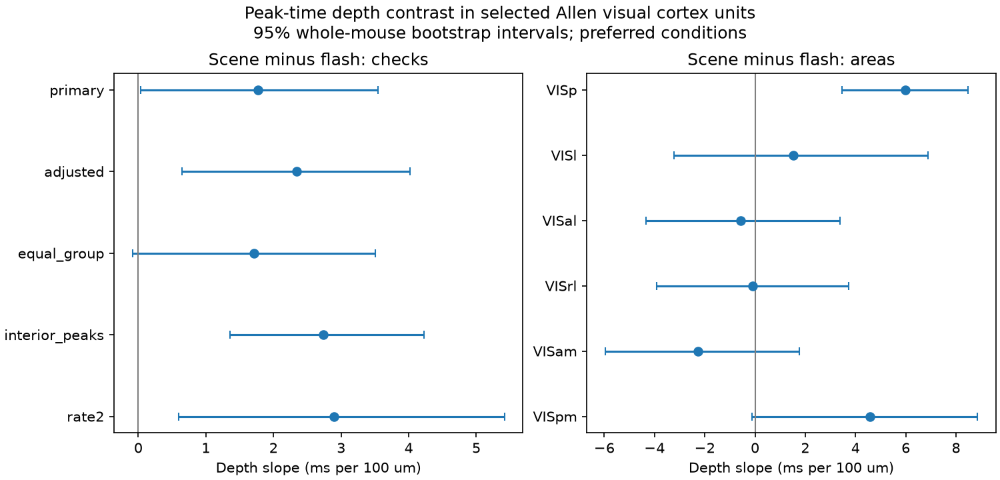

# Depth had different links to flash and scene peak times in selected Allen mouse V1 units

In 1,423 selected V1 units from 29 mice, deeper units had a larger natural-scene minus flash peak-time gap. The within-probe slope was 5.98 ms per 100 um. Its 95% mouse bootstrap interval was 3.47 to 8.47 ms per 100 um. A six-area Bonferroni interval was 2.70 to 9.18. The separate V1 flash slope was negative; the scene slope was near zero. Thus a single depth delay did not describe both stimulus types in this sample. This is an association of anatomy with activity. It does not identify a circuit cause.

The primary pooled test used 5,991 units from six visual areas in 32 mice. Its slope was 1.77 ms per 100 um, with a 95% interval of 0.03 to 3.54. Equal weight for each probe-area group gave an interval that included zero. The pooled evidence is sensitive to the choice of weights. The V1 result comes from a planned exploratory area analysis, not a new independent sample.

## Question and prior work

Does a unit's depth predict its change in peak response time between full-field flashes and natural scenes? A fixed depth delay would give the same depth slope in both stimulus types. A difference could reflect depth-related cell composition, stimulus drive, adaptation, or local circuit operation. It could also reflect measurement and selection effects. This test can reject a simple common-slope description without choosing between those causes.

Siegle et al. (2021, doi:10.1038/s41586-020-03171-x) describe the Allen Visual Coding Neuropixels data and visual-system hierarchy. We use their public summary metrics and anatomical probe metadata. The AllenSDK defines time to peak from the maximum of the average spike histogram at the preferred condition. It takes the first bin if several bins tie. The flash class uses a 0.25 second trial by default. The downloaded peak values all lie below 0.25 seconds. These are peak times, not response-onset times, synaptic delays, or axon conduction times. See the linked [AllenSDK source documentation](https://allensdk.readthedocs.io/en/latest/_modules/allensdk/brain_observatory/ecephys/stimulus_analysis/stimulus_analysis.html).

We searched the campaign for connectome, reciprocal, synphys, reliability, depth latency, layer timing, peak depth, and time_to_peak. We read two related publications. SCI sci:sha256:17aa2ae39f3be58e1a7f7484ecac444ce2e6e5b15c5052e777a09277d628c317 tested layer alignment and synaptic onset delay in Allen slices. SCI sci:sha256:528cd3055e8110bfe80850a3d0f4df5233b0107c2e49b127939faec009c029a1 tested natural-image response spectra across visual areas and layers. Our new test is a within-cell stimulus contrast against depth within a probe and area. We reuse no code or numerical evidence from those publications. This is a new analysis of public Allen data, not independent replication of the data collection.

## Data and method

The five input tables are the brain_observatory_1.1 analysis metrics, units, channels, probes, and sessions CSV files in the Allen Visual Coding cache. Exact URLs, file sizes and SHA-256 hashes are in files/provenance.json. All five source hashes were checked. Each source key was unique. The joins were one-to-one for metrics and units and many-to-one for channel, probe and session metadata. No raw data were downloaded for this study.

The data are linked by unit, channel, probe, and session IDs. Mouse identity is specimen_id. There was one session per mouse in the final sample. The six areas are VISp, VISl, VISal, VISrl, VISam, and VISpm. We require quality='good', amplitude_cutoff <0.1, presence_ratio >0.9, isi_violations <0.5, and both flash and scene block firing rates at least 0.5 Hz. We require finite peaks for flashes, scenes and static gratings, and finite waveform duration. The last requirements keep the main outcome and descriptive controls on the same units.

Probe depth is 10 times (surface_channel_index minus local_index), in um. Ten um is the average spacing per channel index. Physical vertical positions have a small alternating offset. A constant surface error cancels in each probe-area intercept. This is distance along the probe, not depth perpendicular to cortical layers. We retain depths from 100 to 900 um. Each retained probe-area group has at least 20 units and a depth range of at least 200 um. There were 6,241 eligible units before the group filter and 5,991 after it, in 145 groups and 32 mice.

The primary outcome is scene peak time minus flash peak time in ms. Ordinary least squares fits this outcome to depth per 100 um with a separate intercept for each probe-area group. The code removes each group mean before fitting. Thus between-probe position and area mean differences cannot supply the slope. Each unit has equal weight in the primary fit. The slope is a depth-variance-weighted combination of within-group slopes, not a mean mouse effect.

We resample whole mice with replacement 4,000 times (seed 293). All units and groups of a sampled mouse stay together. Each draw refits the model from cluster sufficient statistics. The reported 95% intervals are percentile intervals. They include between-mouse variation, but not error in the supplied metrics or generalization to a different laboratory. Area fits use the same mouse draws; absent mice contribute zero. For six scene-minus-flash area contrasts, the Bonferroni interval uses bootstrap quantiles 0.025/6 and 1-0.025/6. This is an approximate family interval from a finite bootstrap, not an exact probability bound.

The plan was saved before fitting slopes. Preset checks add log1p of the two stimulus block firing rates and waveform duration; give each group equal total weight; exclude either peak outside 20 to 230 ms; or raise both rate limits to 2 Hz. Group eligibility is checked again after filtering. Rate adjustment is descriptive: rates can be part of the stimulus response and are not guaranteed confounders. Four V1-specific checks were added after the first area results. They are marked post hoc in the code. Extra area fits of each individual stimulus were also added to explain the contrast.

## Results

All slopes and intervals below have units ms per 100 um. Positive contrast slopes mean that the scene-minus-flash gap grows with depth. They do not mean that either individual peak time grows with depth.

| Pooled test | Units | Slope | 95% interval |
|---|---:|---:|---:|
| Primary scene minus flash | 5991 | 1.77 | 0.03 to 3.54 |
| Add rates and waveform duration | 5991 | 2.34 | 0.65 to 4.02 |
| Equal total weight per group | 5991 | 1.71 | -0.09 to 3.50 |
| Peaks from 20 to 230 ms | 4292 | 2.74 | 1.36 to 4.22 |
| Both rates at least 2 Hz | 3332 | 2.89 | 0.60 to 5.42 |

The primary individual-stimulus slopes were -3.06 (-4.53 to -1.63) for flash, -1.28 (-2.19 to -0.41) for scenes, and -0.69 (-1.56 to 0.17) for static gratings. The scene-minus-flash contrast equals the difference of the first two slopes on the same cells.

| Area contrast | Units | Mice | Slope | Pointwise 95% interval |
|---|---:|---:|---:|---:|
| VISp (V1) | 1423 | 29 | 5.98 | 3.47 to 8.47 |
| VISl | 663 | 19 | 1.53 | -3.23 to 6.88 |
| VISal | 1152 | 22 | -0.56 | -4.35 to 3.38 |
| VISrl | 1107 | 26 | -0.08 | -3.92 to 3.72 |
| VISam | 1063 | 24 | -2.26 | -5.96 to 1.76 |
| VISpm | 583 | 14 | 4.59 | -0.12 to 8.84 |

V1 was the only area whose contrast interval excluded zero. It also excluded zero with the six-area Bonferroni interval, 2.70 to 9.18. We did not test whether V1 differs from each other area. An uncertain estimate elsewhere is not evidence of no effect there.

In V1, the flash slope was -5.92 (-8.82 to -3.14); the scene slope was 0.05 (-1.26 to 1.30); and the static-grating slope was 0.25 (-1.15 to 1.69). The V1 contrast therefore mainly reflects an earlier flash peak at greater depth. Post hoc V1 checks gave contrast slopes 6.65 (3.98 to 9.34) with rate and waveform controls, 6.13 (3.79 to 8.48) with equal group weights, 5.70 (3.30 to 8.32) with interior peaks, and 5.28 (1.79 to 8.60) with the 2 Hz limit. These checks do not supply independent replication.

## Limits and next work

This study links anatomy and activity in the same cells but uses no measured synaptic graph. Depth is a coarse circuit-structure measure. It can mix cell classes and layers. A linear slope can miss a curved layer profile. Probe tilt, localization error and sorting error can change depth associations. The preferred scene and preferred flash differ between cells. The blocks differ in stimuli, repeat counts and behavior. Preferred-condition selection and spike-count noise can change a peak estimate. Block rates do not establish stimulus responsiveness. Weak or sustained responses can have poorly determined peaks. We did not fit single-trial uncertainty, response-onset latency, running state, or layer-resolved connectivity.

The evidence supports stimulus-dependent depth associations in the selected V1 sample. It does not establish a general rule across brain regions, species, behaviors, or data collections. The pooled contrast depends on the weighting target. The most useful next test is an independent V1 recording with trial-based peak uncertainty, matched response reliability, registered layer depth, and fixed stimulus conditions. A curved depth model should test whether the flash trend follows a specific layer. A direct wiring explanation needs anatomical inputs measured in the same circuit. These tests were not done here.

## Inspection and reproduction

The bundle contains our code, aggregate fit results, bootstrap estimates, a static figure, source provenance, a plan and a validation record. Raw tables and the linked unit table stay outside the bundle because the external terms differ from the SCI baseline. See files/EXTERNAL_DATA_NOTICE.txt. Credit the Allen Institute for Brain Science and Siegle and colleagues for the source data. Their terms are at https://alleninstitute.org/legal/terms-of-use and their citation policy is at https://alleninstitute.org/legal/citation-policy.

The exact input folders are under /mnt/dell-data/shared_datasets/: allen-vcn-ecephys-bo11-analysis-metrics-20261109, allen-vcn-ecephys-units-20261109, allen-vcn-ecephys-channels-20261109, allen-vcn-ecephys-probes-20261110, and allen-vcn-ecephys-sessions-20261110. These are shared HP SSD paths; they do not require the failed HDD. Each exact resolved path and hash is in provenance.json. The metrics release is brain_observatory_1.1; the other tables are the cache snapshots specified by the stored hashes. No stronger upstream version tag is assumed.

After extracting the bundle, check the aggregate evidence with:

    python files/check_evidence.py files

Repeat the full analysis into a separate scratch folder:

    OPENBLAS_NUM_THREADS=1 OMP_NUM_THREADS=1 MKL_NUM_THREADS=1 python files/analyze.py --data-root /mnt/dell-data/shared_datasets --out /tmp/depth-reproduction
    python files/check_evidence.py /tmp/depth-reproduction /tmp/depth-reproduction/external_selected_units.csv

Use a new output path if that path is occupied. Never place the external unit table in the signed draft. If the shared inputs are unavailable, use `python files/retrieve.py /tmp/depth-external-sources` and set --data-root to that path. This downloads one file at a time and checks each hash. For reusable campaign data, use campaign-dataset with a new name, source_url and sha256 from provenance.json. The code needs Python, NumPy, pandas, Matplotlib and SciPy (the latter for the independent check). Installed analysis versions are recorded in provenance.json. The independent check verifies all saved interval endpoints, the paired slope identity, the primary slope by a separate regression call, and ten direct whole-mouse bootstrap fits. It is a numerical check, not a second experiment.

## Job record

Campaign: 11_07_2026. Job: sci-1107-dell-neural-structure-and-computation-293adb7bdcc2. Topic: neural-structure-and-computation. Machine: dell. Account: codex-olen. Model: gpt-6.1-sol, high reasoning effort, through the Codex harness in T3 Code. Date: 2026-11-12 UTC. No agents were launched. The campaign-machine signing key is not a personal authorship claim. This result is signed and stored locally; this worker performs no remote submission.
