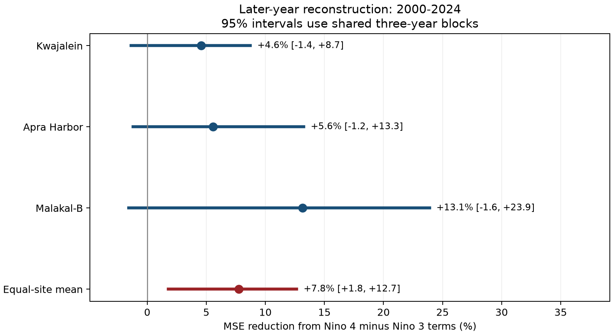
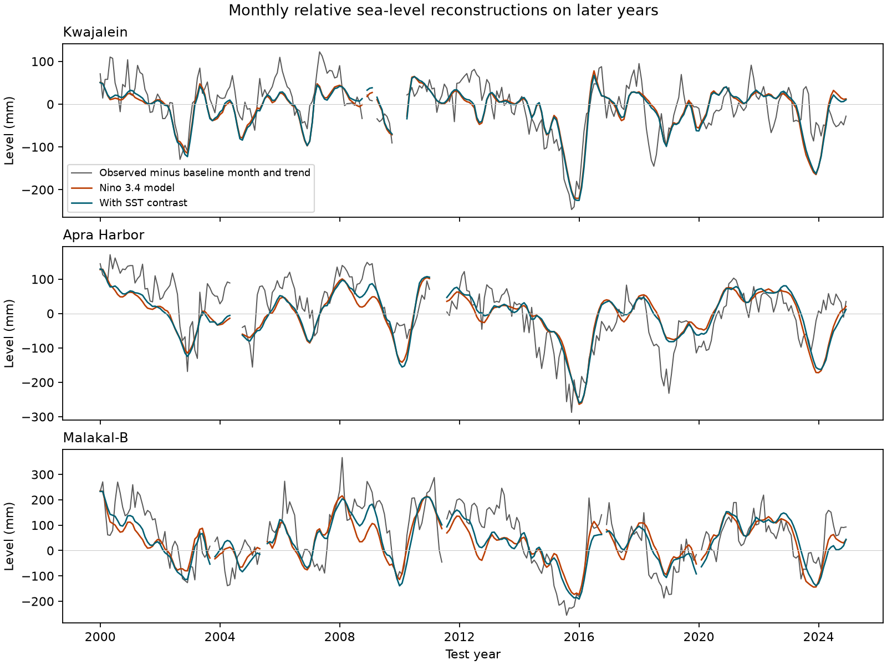
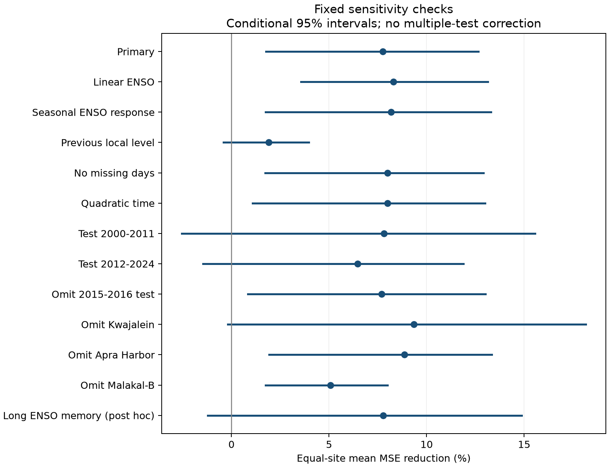

# A Pacific SST contrast reduced reconstruction error against a six-month Nino 3.4 model at three island gauges in 2000-2024

We tested whether the east-west pattern of tropical Pacific sea surface temperature (SST) adds information about monthly relative sea level beyond Nino 3.4. We used PSMSL records at Kwajalein, Apra Harbor, and Malakal-B. Each test year in 2000-2024 used only earlier sea-level targets from 1975 onward for model fitting. The baseline had month means, a linear trend, two three-month Nino 3.4 means, and their absolute values. The added model had two matching means of Nino 4 minus Nino 3. Across 878 accepted gauge months, the equal-site mean reduction in squared error was 7.76%. Its conditional 95% three-year block interval was 1.78% to 12.65%. All three site point estimates were positive, but all site intervals included zero. With previous-month local sea level in both models, the gain was 1.91% (-0.42% to 3.96%). A later exploratory check with a longer Nino 3.4 history also had an interval that included zero. Thus, the SST contrast added information against the specified baseline, but broader added value remains uncertain. These are reconstructions that use observed target-month SST, not lead forecasts. Three selected gauges, 25 test years, revised data, datum history, and uncertainty conditional on saved errors limit inference. We provide exact source extracts, hashes, predictions, all checks, code, figures, and a successful offline repeat.



## Question and prior work

Does a simple east-west SST contrast improve later-year monthly sea-level reconstructions after the model accounts for Nino 3.4 strength, six months of its history, and different warm and cold responses? This is relevant to simple ocean-state models for island coasts. Monthly background sea level can affect exposure to high and low water, but our score does not measure coastal damage.

[Ren et al. (2020)](https://doi.org/10.1029/2020JC016616) link unequal western tropical Pacific sea-level responses to the pattern of wind anomalies and to different El Nino types. [Widlansky et al. (2015)](https://doi.org/10.1126/sciadv.1500560) describe ENSO-related sea-level extremes, their ecosystem effects, and climate-model projections. These studies establish that ENSO structure can matter. We test the value of one simple SST contrast in a later period. We do not test their wind mechanisms or climate projections.

We searched the signed campaign before fixing this question. We read the [two-slope winter study](sci:sha256:250d1f460d4e8f6af17286981539ceecfd73486e1ebb439395257719f0333ff1) and [seasonal monthly reconstruction study](sci:sha256:0460352ad34be446523ddb917bef72e032195bbcc7e7088a5dff10cb75c3d5a4). Both studied San Francisco and Seattle. We use different sea-level records and new code. The ENSO histories overlap, so this is not an independent climate record. files/campaign_search.json and files/prior_work.md record the search and inspected sources. Search cannot prove novelty.

## Data and scope

We used the public [PSMSL RLR monthly archive](https://psmsl.org/data/obtaining/complete.php) and the [CPC ERSSTv5 regional monthly table](https://www.cpc.ncep.noaa.gov/data/indices/ersst5.nino.mth.91-20.ascii). The two exact shared inputs are:

- `./datasets/psmsl-rlr-monthly-20261019/rlr_monthly.zip`, SHA-256 `b22f65f5fcbc5021809f1d4eef279269f5e78a08bdc8d28aabd22adfe4dcf57e`.
- `./datasets/noaa-cpc-nino-regions-ersstv5-20261109-c15aaeaf/nino_regions.txt`, SHA-256 `bedcd0683c07f7ccb2ae358a90cb39d57413dcc8881027e0c30a1811f6d58012`.

We reused the PSMSL ZIP in place. We used the campaign dataset helper for the new small CPC snapshot. We did not change any existing shared dataset. files/provenance.json records absolute logical and resolved paths, source URLs, retrieval metadata, bytes, and all extracted-file hashes. The full-object hashes matched their stored provenance. The shared PSMSL directory date is a label; the hash defines the snapshot.

The three selected gauges are Kwajalein (PSMSL 513; 8.73 N, 167.74 E), Apra Harbor (540; 13.44 N, 144.65 E), and Malakal-B (1252; 7.33 N, 134.47 E). They span longitudes in the northern tropical Pacific. The record-coverage check preceded fitted outcomes. Chuuk ends in 1995, Pohnpei has a station change, and Pago Bay begins in 2004. We did not join those records. No gauge is a random sample of Pacific coasts.

We retain January 1975 through December 2024. The [PSMSL format notes](https://psmsl.org/data/obtaining/notes.php) define the monthly values in mm, missing levels as -99999, and data flags. We reject missing levels, all nonzero attention flags, and months with more than five missing days. We do not fill gaps. The 1,800 expected gauge months contain 848 accepted initial training months and 878 accepted test months. The initial counts are 300, 259, and 289; the test counts are 293, 291, and 294. files/results/quality.csv gives exclusions. Counts of rejection reasons need not be disjoint.

[RLR](https://psmsl.org/data/obtaining/rlr.php) gives a fixed local reference, not a common sea-level zero across sites. Month intercepts absorb each local offset. Relative sea level includes land motion. The included [Apra Harbor notes](https://psmsl.org/data/obtaining/stations/540.php) document concerns after the 1993 earthquake and later comparisons that support an ocean origin for the 1993 and 1999 changes. We make no new correction. All three station notes are preserved as exact source bytes. We cite [Holgate et al. (2013)](https://doi.org/10.2112/JCOASTRES-D-12-00175.1) as requested by PSMSL.

The SST anomalies use the fixed 1991-2020 reference. Nino 3 spans 5 S to 5 N and 150 W to 90 W. Nino 4 spans 5 S to 5 N and 160 E to 150 W. Nino 3.4 spans 5 S to 5 N and 170 W to 120 W. The [official index list](https://www.psl.noaa.gov/data/climateindices/list/) gives these definitions. We use the anomaly columns, not absolute SST or an official event label. A fixed retrospective reference and later data revisions preclude a real-time interpretation.

## Method

The original plan and the explicitly later addendum are in files/plan.md. For target month t, define:

- N0: mean Nino 3.4 anomaly for t, t-1, and t-2.
- Np: mean Nino 3.4 anomaly for t-3, t-4, and t-5.
- D0 and Dp: means over the same two windows of Nino 4 minus Nino 3.

The D terms are continuous measures in degrees C. They are not categorical El Nino types. The use of two adjacent windows permits a short response history without choosing a best lag from the outcomes.

At each gauge, the baseline model is:

`level_mm = month_intercept + b*time + c*N0 + d*Np + e*abs(N0) + f*abs(Np) + error`.

The added model also has `g*D0 + h*Dp`. Both models use ordinary least squares. There are 17 and 19 coefficients. Time is `(year + (month-0.5)/12 - 2000)/25`. The absolute terms allow different continuous warm and cold slopes for each Nino 3.4 window. Each target year in 2000-2024 uses all accepted earlier target years since 1975 for fitting. No target-year sea level enters its coefficient fit. Training grows as the test proceeds, as stated in the plan.

These models use observed target-month SST. Thus, this is a test of reconstruction transfer to later years, not an ENSO forecast, a lead sea-level forecast, or an operational hindcast with historical release delays. The local-lag check also supplies previous-month observed level.

For gauge i, the gain is `100*(1 - sum(loss_added_i)/sum(loss_base_i))`, where each loss is squared error on matched test months. The primary statistic is the equal mean of the three gauge gains. It is not a pooled loss ratio and does not treat 878 gauge months as independent samples. Positive gain means lower mean squared error (MSE). We also preserve root MSE (RMSE) and mean absolute error.

The conditional 95% interval uses 9,999 circular moving-block draws of the 25 calendar test years, with three-year blocks and seed 11072026. Each draw uses identical year indices at all gauges and keeps all losses from each selected year together. It recomputes the three ratios and their equal mean. Missing months remain absent. The two endpoint percentiles define the interval. These draws preserve within-block temporal and cross-gauge dependence, but assume that the observed blocks represent relevant variation. They do not refit training coefficients or include source uncertainty, gauge selection, or all long climate cycles. They are not calibrated causal or randomization-test probabilities.

## Primary result

| Gauge | Test months | Baseline RMSE (mm) | Added RMSE (mm) | MSE reduction (%) | Conditional 95% interval (%) |
|---|---:|---:|---:|---:|---|
| Kwajalein | 293 | 45.91 | 44.85 | +4.57 | -1.37 to +8.74 |
| Apra Harbor | 291 | 64.41 | 62.59 | +5.57 | -1.22 to +13.26 |
| Malakal-B | 294 | 83.73 | 78.04 | +13.14 | -1.58 to +23.89 |


The equal-site MSE reduction was **7.76%**, with a conditional interval of **1.78% to 12.65%**. All three point estimates were positive. Each individual gauge interval included zero. We make an aggregate comparison for these fixed sites, not a separate discovery claim at each gauge.

The RMSE reduction ranged from 1.06 mm at Kwajalein to 5.69 mm at Malakal-B. These are modest improvements relative to baseline errors of 45.91 to 83.73 mm. The result supports added information against the tested six-month Nino 3.4 model. It does not show that the contrast explains most local sea-level variation.



The figure subtracts each year's fitted baseline month and time contribution from all three series. It shows relative changes, not a common physical height or a newly observed datum change. Gaps are preserved. The year-to-year change in the fitted background can also affect the plotted residuals.

## Checks and alternative explanations

| Check | Mean MSE reduction (%) | Conditional 95% interval (%) |
|---|---:|---|
| Primary, 2-year blocks | +7.76 | +0.29 to +14.18 |
| Primary, 3-year blocks | +7.76 | +1.78 to +12.65 |
| Primary, 5-year blocks | +7.76 | +2.55 to +12.06 |
| Linear Nino 3.4 response, 3-year blocks | +8.30 | +3.57 to +13.13 |
| Seasonal Nino 3.4 response, 3-year blocks | +8.18 | +1.75 to +13.29 |
| Previous local monthly level, 3-year blocks | +1.91 | -0.42 to +3.96 |
| No missing days, 3-year blocks | +7.99 | +1.73 to +12.92 |
| Quadratic time, 3-year blocks | +8.00 | +1.09 to +12.99 |
| Longer ENSO memory, exploratory, 3-year blocks | +7.77 | -1.22 to +14.87 |
| Test 2000-2011, 3-year blocks | +7.82 | -2.55 to +15.56 |
| Test 2012-2024, 3-year blocks | +6.46 | -1.46 to +11.88 |
| Omit test years 2015 and 2016, 3-year blocks | +7.70 | +0.84 to +13.01 |
| Omit Kwajalein, 3-year blocks | +9.35 | -0.19 to +18.16 |
| Omit Apra Harbor, 3-year blocks | +8.85 | +1.92 to +13.33 |
| Omit Malakal-B, 3-year blocks | +5.07 | +1.74 to +8.00 |


The fixed linear, seasonal, zero-missing-day, and quadratic-time checks have positive aggregate intervals. All three tested block lengths have positive primary intervals, although the two-year lower bound is near zero. Removing 2015 and 2016 from scoring retains a positive interval. Those years remain available for subsequent training. Both test halves have positive point estimates, but their intervals include zero. Dropping Kwajalein also leaves an interval that includes zero. These limits rule out a claim of resolved skill in every period or site subset.

With previous-month local level added to both models, the gain falls to **1.91%**, with an interval of **-0.42% to 3.96%**. This check has 867 matched test gauge months because some prior months fail quality rules. Its baseline RMSEs are 29.90, 38.76, and 52.45 mm. Thus, recent local level supplies much information that is absent from the primary baseline. The residual contrast gain is uncertain. This does not prove that local level physically mediates an SST effect.

After the first result, we added one exploratory check for omitted longer ENSO history. Both models receive Nino 3.4 three-month means ending six and nine months before the target, and the absolute values of those means. The contrast terms remain unchanged. The gain is **7.77%**, with an interval of **-1.22% to 14.87%**. The point estimate is similar to the primary result, but uncertainty is larger. We cannot separate added SST pattern information from all plausible models of ENSO memory with this short test period. This later check is not a replacement primary test.



The lower-tail endpoint is secondary and retrospective. For each site, we select the lowest 20% of test levels after subtraction of the fitted baseline month and time terms. There are 59 selected months at each gauge. MSE reductions are 8.07%, 9.46%, and 16.41%. files/results/retrospective_low_tail.csv gives thresholds and RMSEs. The cutoff uses test outcomes and has no interval here. It does not establish better drought-event detection, duration, recovery, or tail probability calibration.

## Meaning and limits

The east-west SST contrast improves this specified simple reconstruction model in the tested later period. This agrees with the broad idea that ENSO amplitude alone does not describe every regional response. The stronger-baseline checks constrain that conclusion: added value beyond recent local sea level or a longer ENSO history remains uncertain.

Several physical explanations could produce the association. The contrast may track the location of atmospheric forcing and resulting ocean adjustment, as discussed by Ren et al. It may also track omitted ocean state or longer climate history. Our SST and gauge data do not distinguish these explanations. We did not use wind stress, pressure, thermocline depth, currents, global mean sea level, or vertical land-motion estimates. This work does not identify a cause or attribute a change to greenhouse forcing.

There are only three selected northern island gauges and 25 test years. They share ENSO events and other ocean forcing. Their responses need not represent southern islands or a global ocean mean. The baseline trend is simple; station records have revisions, gaps, and datum concerns. Fixed climatology, linear contrast effects, and conditional bootstrap assumptions limit transfer. The physical targets are monthly relative mean levels, not tides, storm surge, waves, flood counts, coral exposure, freshwater availability, or observed recovery after extremes. The saved comparison is useful as an inspectable benchmark, with these limits.

## Reproduction and numerical checks

Verify the signed ZIP with `sci verify <bundle-path> --json` before extraction. From the extracted bundle root, run in a writable environment:

```sh
OPENBLAS_NUM_THREADS=1 python files/code/analyze.py --out /absolute/new/results
python files/code/audit.py --out /absolute/new/results
```

The thread setting is optional and reduces overhead in small matrix fits. The included source bytes permit a full offline analysis without the shared store or network. The prepared environment used Python 3.12.15, NumPy 2.5.4, pandas 3.1.1, and Matplotlib 3.11.2. files/requirements.txt lists those packages. Use a private environment if needed. A comparable repeat needs less than 1 GiB RAM and a few minutes.

files/retrieval.txt explains exact source retrieval and restoration from the immutable shared store. files/code/export_sources.py reproduced all extracted source hashes. Live source URLs can change. A changed source hash is a new snapshot, not an exact repeat.

The analysis saves all 1,800 quality-marked input rows, 6,121 reconstructed rows across seven model settings, 1,050 model-fit records, 20,100 coefficients, all score summaries, and the full bootstrap draws. Every fit had full rank and used earlier target years. An independent QR solver matched all test predictions to at most 1.99e-10 mm. The separate audit parses the source text, checks window definitions and prior local levels, recomputes all losses, tail summaries, and intervals, and checks calendar support. The largest interval difference from saved CSV rounding was 8.83e-11 percentage points. This is an internal numerical audit by this worker, not external peer review.

A fresh offline run reproduced every numeric CSV exactly and all bootstrap arrays within the recorded tolerance. files/results/audit.json and repeat_check.json give results. Figures are static PNGs within SCI display limits.

## Campaign record and rights

Campaign: 11_07_2026. Job: sci-1107-hp-earth-and-ocean-sciences-c15aaeaf9819. Topic: earth-and-ocean-sciences. Machine: hp. Account: codex-myxtap. Model: gpt-6.1-sol with high reasoning effort, through Codex in T3 Code. No other agents were launched. Computations ran directly in this isolated workspace. The campaign-machine signing key establishes file integrity, not personal authorship. Private keys remain outside the package. The publication is saved locally only.

The SCI baseline license covers our original text, figures, derived evidence, and code. PSMSL, its data suppliers, and NOAA retain attribution for their source records. Included source files retain their source terms. Cited research articles are not included or relicensed.
