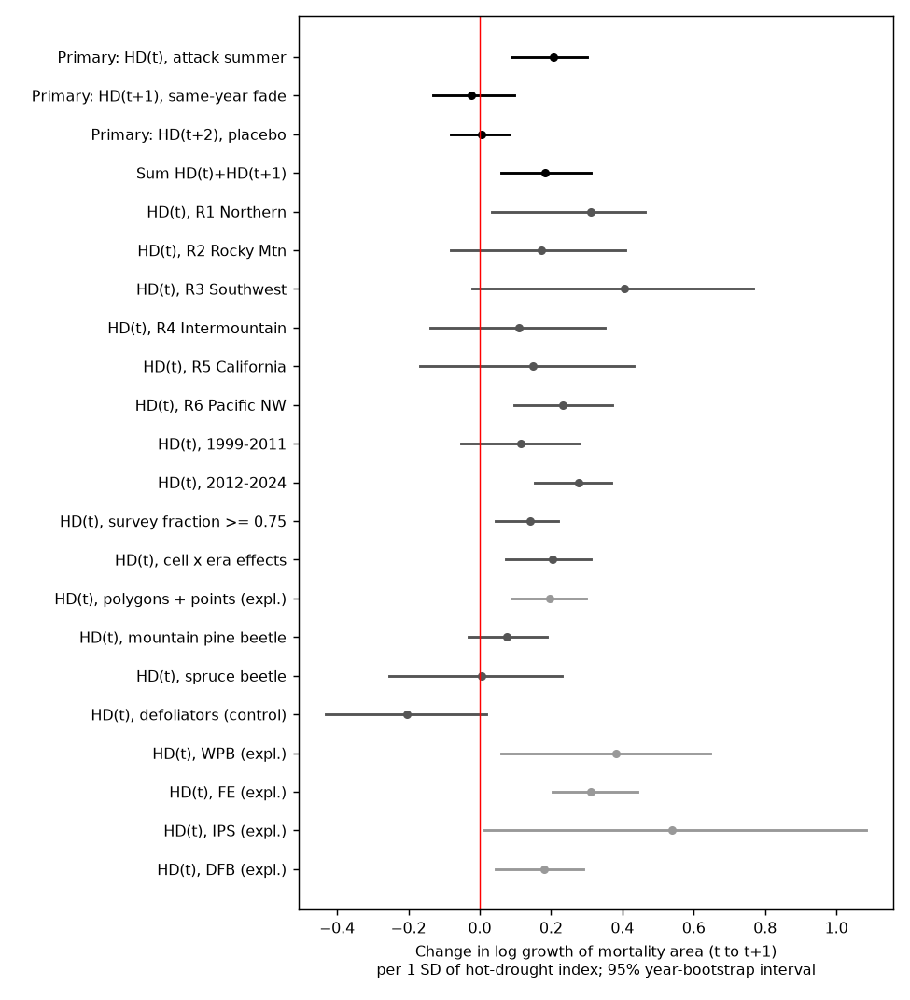
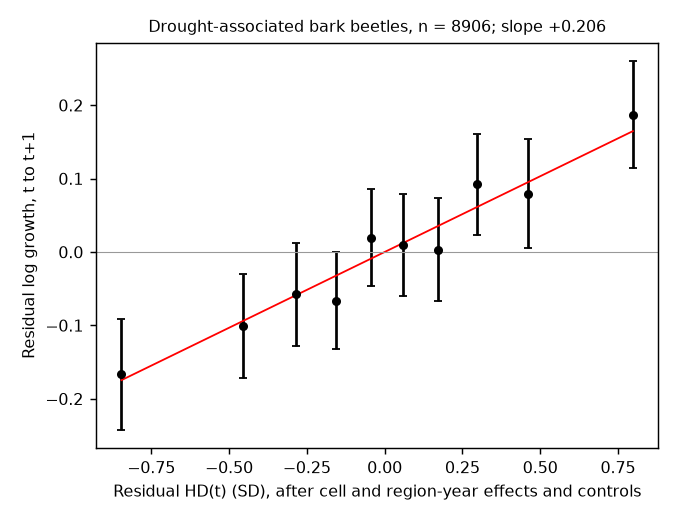
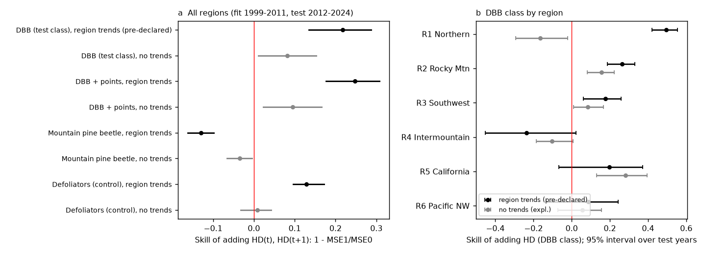

# A hot-dry summer increased the next-year growth of bark beetle tree-mortality area by about 23% per standard deviation in western US aerial surveys, 1999-2025

## Summary

Many studies state that drought and heat make trees easy for bark beetles to kill. We tested
this statement with a plan that we wrote before we related the data to climate
(`files/analysis_plan.md`). We used the USDA Forest Service Insect and Disease Detection Survey
(IDS) maps of 1997-2025 for all six western US Forest Service regions (R1 Northern, R2 Rocky
Mountain, R3 Southwestern, R4 Intermountain, R5 Pacific Southwest, R6 Pacific Northwest). We put
the mapped mortality area on 0.5-degree cells. We used NOAA CPC daily maximum temperature and
precipitation for a hot-drought index HD. HD is the June-August Tmax z-score minus the water-year
precipitation z-score of the cell, scaled to unit standard deviation (SD). Positive HD is hot
and dry.

The test class is "drought-associated bark beetles" (DBB): all bark beetle mortality codes
except mountain pine beetle (MPB) and spruce beetle (SPB). Most DBB area comes from western pine
beetle, fir engraver, Douglas-fir beetle, pinyon ips and other ips, and "unknown bark beetle".
The response is the log growth of mapped DBB mortality area from survey year t to t+1 in a cell.
The model removes cell effects and region-by-year effects. Thus the test uses only differences
between cells of the same region in the same year. These effects absorb survey method changes,
flight effort and region-wide outbreak phases. The model also controls outbreak size and the
mortality of the five previous years, and it keeps only cells that the survey footprint covered
by at least 25% in both years.

**Main result.** In 8,906 cell-year pairs (661 region-cells, 26 survey-year pairs), a 1 SD
increase of HD in summer t (the attack summer for trees that fade before the t+1 survey)
increased the log growth by **+0.206** (95% interval over survey years **+0.090 to +0.302**).
This is a 23% (9% to 35%) increase of next-year growth per SD, or about 51% for a 2 SD hot-dry
summer. All three parts of the pre-declared decision rule were met:

| Pre-declared criterion | Result | Met? |
|---|---|---|
| (a) Pooled HD(t) coefficient > 0, interval excludes 0 | +0.206 [+0.090, +0.302] | Yes |
| (b) Positive in at least 4 of 6 regions and in both periods | Positive in 6 of 6 regions (intervals exclude 0 in R1 and R6 only); positive in 1999-2011 (+0.115) and 2012-2024 (+0.277) | Yes |
| (c) Placebo HD(t+2) smaller than HD(t), interval includes 0 | +0.005 [-0.081, +0.085] | Yes |

The signal came from dryness more than from heat. In a model with both parts, water-year dryness
gave +0.133 [+0.054, +0.217] per SD and summer heat alone gave +0.065 [-0.059, +0.179]. Their
product (hot and dry at the same time) gave +0.127 [+0.055, +0.210]. Thus a hot summer increased
growth mainly when the year was also dry.

The control classes did not show the same response. Mountain pine beetle gave +0.077
[-0.032, +0.189], spruce beetle +0.006 [-0.253, +0.230], and the defoliator negative control
(western spruce budworm and Douglas-fir tussock moth) gave -0.204 [-0.433, +0.018].

## Why this is new

The campaign record had one earlier test on IDS data (sci:sha256:ef47f93b..., mountain pine
beetle and winter cold, a null result). It did not test drought, the other bark beetle agents,
Regions 3 and 5, or the DMSM-era coding change that we report below. We used the same type of
design (cell and region-by-year effects, footprint rule, year bootstrap), so the two results can
be compared directly: a weather link that the design did not find for cold winters and MPB, the
design finds for summer drought and the drought-associated agents. Published work on this
question is mostly regional (for example, California in 2012-2016) or uses region-wide years,
which mix weather with survey effort. Here the test is within region and year, in six regions
and two periods, with a placebo and a negative control.

## Data

| Source | Use | Version and access | Terms |
|---|---|---|---|
| USDA Forest Service, Forest Health Protection, IDS "AllYears" flat file geodatabases, CONUS Regions 1-6 | Damage polygons (mortality, defoliation), DMSM damage points, surveyed-area polygons | Files dated 22 April 2026 (HTTP Last-Modified), retrieved 2026-11-11 from `https://www.fs.usda.gov/foresthealth/docs/IDS_Data_for_Download/`. Byte counts and SHA-256 in `files/provenance.json`. | US Federal data, public domain in the USA; USFS disclaimers apply. |
| NOAA PSL CPC Global Unified Temperature, daily Tmax, 0.5 degree | Summer heat | `tmax.1991.nc` ... `tmax.2026.nc`; campaign shared copies `noaa-psl-cpc-global-temp-tmax-<year>-20261111` | NOAA PSL: no restrictions; acknowledgement requested. |
| NOAA PSL CPC Unified Gauge-Based Daily Precipitation over CONUS, 0.25 degree (V1.0 to 2006, RT from 2007) | Water-year precipitation | `precip.V1.0.<year>.nc`; shared copies `noaa-psl-cpc-us-precip-v1-<year>-20261111` | As above. |

`files/provenance.json` lists all 78 input files with their shared paths, source URLs, byte
counts and SHA-256. The SHA-256 of all 72 shared CPC files matched the hashes that the campaign
store recorded at download. The 2026 CPC files were partial-year copies (data to 2026-11-10);
only their complete June-August 2026 Tmax and October 2025 - September 2026 precipitation enter,
as the placebo HD(t+2) for t = 2024.

**Data-quality notes found in this work.**
1. The shared campaign copies `usfs-ids-conus-region{1,2,4,6}-allyears-20261109` are truncated
   (about 7 MB of 139-304 MB; they are not valid ZIP files). We did not use them and did not
   change them. `files/code/fetch_ids.sh` downloads complete files with two parallel byte
   ranges and checks the length and the ZIP structure (about 2 MB/s on 2026-11-11). We added the
   complete files, with SHA-256 enforced by the campaign helper, as
   `usfs-ids-conus-region{1..6}-allyears-20260422-complete` in the shared dataset store.
2. From about 2015, Digital Mobile Sketch Mapping (DMSM) codes defoliation as damage types 12,
   13 and 14 (severity classes) instead of 1. A selection on type 1 alone loses almost all
   defoliation after 2015. We use {1, 12, 13, 14} for defoliation and {2, 11} for mortality
   (plan amendment 1, written before any growth value or climate link was computed).
3. In Region 3 the label "western pine beetle" almost disappears after 2015 and "unknown bark
   beetle" (11900) takes its place. Agent-level trends across 2015 are therefore not reliable in
   R3. The pooled DBB class includes 11900 and is not affected by this relabelling.
4. CPC precipitation changes from the retrospective V1.0 product to the RT product in 2007. A
   check with cell-by-era effects (eras 1999-2006, 2007-2014, 2015-2024) gave the same result.

## Methods

1. **Gridding** (`grid_ids.py`). For each region, survey year and class, we rasterized the union
   of the damage polygons at 250 m in the native Albers projection (ESRI:102039, pixel-centre
   rule) and summed the pixels into CPC 0.5-degree cells (km2). We did the same for the surveyed
   area. DMSM damage points (from 2015) are summed by their ACRES field in a separate class and
   enter only a robustness check. A cell that occurs in two regional files keeps a separate
   record per region (648 distinct cells, 661 region-cells).
2. **Climate** (`climate.py`, `build_panel.py`). Mean June-August Tmax and precipitation from
   1 October y-1 to 30 September y, on the CPC Tmax cells (2 x 2 aggregation of the 0.25-degree
   precipitation). z-scores within each cell over water years 1992-2025. HD = (tz - pz)/1.646.
3. **Timing.** Pine and fir trees that bark beetles kill in summer t mostly fade to red before
   the survey of summer t+1. Thus HD(t) is the test variable for the growth from t to t+1.
   HD(t+1) covers the summer of the t+1 flight (same-year fade). HD(t+2) cannot change the
   t+1 map and is a placebo.
4. **Sample** (primary). DBB class; t = 1999-2024 (survey footprints start in 1999); surveyed
   fraction >= 0.25 of the cell in t and t+1; A(t) >= 0.5 km2. Response
   g = log((A(t+1)+0.1)/(A(t)+0.1)).
5. **Model** (`analyze.py`, `fe.py`). OLS of g on HD(t), HD(t+1), HD(t+2), log(A(t)+0.1),
   log(1 + sum of A over t-5..t-1), cell effects and region-by-year effects (alternating
   projections). Intervals: 999 bootstrap draws of whole survey years; a year that is drawn
   twice gets separate region-by-year effects. Percentile 95% intervals. Region models use cell
   and year effects within the region.
6. **Forward test** (`forward.py`). Without region-by-year effects: cell effects, outbreak size,
   host depletion and a linear trend per region (pre-declared). We fitted on t <= 2011 and
   predicted t >= 2012 for cells that occur in the training years, with and without HD(t) and
   HD(t+1). Skill = 1 - MSE(with HD)/MSE(without HD); intervals from a bootstrap over test years.

## Results

All values are changes in log growth of mapped mortality area per 1 SD of HD (or of the
component), with 95% intervals from the survey-year bootstrap. Full tables:
`files/results/estimates.csv` (pre-declared), `exploratory_estimates.csv` and
`exploratory_observer.csv` (exploratory).

| Model (pre-declared) | HD(t) | 95% interval | n |
|---|---|---|---|
| DBB primary | +0.206 | +0.090, +0.302 | 8,906 |
| DBB primary, HD(t+1) | -0.023 | -0.132, +0.097 | |
| DBB primary, HD(t+2) placebo | +0.005 | -0.081, +0.085 | |
| DBB primary, HD(t) + HD(t+1) | +0.183 | +0.060, +0.310 | |
| R1 Northern | +0.312 | +0.035, +0.463 | 1,303 |
| R2 Rocky Mountain | +0.173 | -0.081, +0.408 | 1,096 |
| R3 Southwestern | +0.406 | -0.021, +0.767 | 1,032 |
| R4 Intermountain | +0.111 | -0.139, +0.350 | 1,155 |
| R5 Pacific Southwest | +0.148 | -0.168, +0.433 | 1,384 |
| R6 Pacific Northwest | +0.233 | +0.098, +0.371 | 2,936 |
| Survey years 1999-2011 | +0.115 | -0.051, +0.280 | 4,499 |
| Survey years 2012-2024 | +0.277 | +0.155, +0.369 | 4,407 |
| Components: heat tz(t) | +0.065 | -0.059, +0.179 | 8,906 |
| Components: dryness -pz(t) | +0.133 | +0.054, +0.217 | |
| Components: heat x dryness | +0.127 | +0.055, +0.210 | |
| Onset (A(t) < 0.1 km2; P[A(t+1) >= 0.5 km2], base rate 0.21) | +0.051 | -0.002, +0.091 | 2,368 |
| MPB growth | +0.077 | -0.032, +0.189 | 5,214 |
| SPB growth | +0.006 | -0.253, +0.230 | 1,312 |
| Defoliator growth (negative control) | -0.204 | -0.433, +0.018 | 3,485 |
| DBB, surveyed fraction >= 0.75 both years | +0.140 | +0.046, +0.221 | 4,636 |
| DBB, cell-by-era effects | +0.205 | +0.073, +0.311 | 8,906 |

| Model (exploratory, 499 draws) | HD(t) | 95% interval | n |
|---|---|---|---|
| DBB polygons + DMSM points | +0.196 | +0.090, +0.298 | 9,034 |
| Western pine beetle only | +0.383 | +0.061, +0.647 | 2,296 |
| Fir engraver only | +0.311 | +0.204, +0.442 | 4,209 |
| Pinyon ips and ips engravers only | +0.540 | +0.012, +1.085 | 958 |
| Douglas-fir beetle only | +0.180 | +0.043, +0.289 | 4,652 |
| DBB with HD(t-1) added (HD(t-1) term: +0.006) | +0.205 | +0.089, +0.320 | 8,906 |
| DBB, start 2002 | +0.219 | +0.089, +0.321 | 8,196 |
| DBB, A(t) >= 2 km2 | +0.235 | +0.124, +0.347 | 6,409 |
| DBB, no cell effects | +0.200 | +0.074, +0.325 | 8,906 |
| DBB, legacy sketch-map years t <= 2013 | +0.132 | -0.053, +0.301 | 5,171 |
| DBB, DMSM years t >= 2016 | +0.315 | +0.137, +0.430 | 2,924 |
| Survey footprint change log(sf(t+1)/sf(t)) as the response | +0.001 | -0.011, +0.013 | 8,906 |
| DBB with log(sf(t+1)/sf(t)) as a control | +0.206 | +0.094, +0.311 | 8,906 |
| DBB, cells surveyed >= 95% in both years | +0.138 | +0.005, +0.272 | 2,406 |

**Other terms.** Growth decreased with outbreak size (log A(t): -0.500 [-0.547, -0.447]). The
host-depletion term was near zero for DBB (-0.021 [-0.088, +0.050]); these mixed-host agents
do not deplete their hosts in the way that MPB does.

**Observation checks.** Drought did not change where the survey flew: the change of the surveyed
fraction of a cell did not depend on HD(t) (+0.001 [-0.011, +0.013]), and a control for it left
the result unchanged. In cells that the survey covered almost completely in both years the
estimate was smaller (+0.138) but its interval still excluded zero. The estimate was larger in
the DMSM years than in the legacy years; the two intervals overlap.

**Forward test (pre-declared, secondary 6).** With a linear trend per region, adding HD(t) and
HD(t+1) reduced the 2012-2024 out-of-sample squared error by 22% (skill 0.218 [0.135, 0.287];
better in 13 of 13 test years). This number overstates the forecast value. Under the same
baseline the defoliator negative control also gained 13% (0.128 [0.096, 0.172]), so part of
the gain corrects a poor trend extrapolation. Without the trend terms (exploratory), the DBB
skill was 0.082 [0.011, 0.153] (better in 8 of 13 years), the defoliator skill was 0.009
[-0.033, +0.042], and the MPB skill was -0.035 [-0.066, -0.004]. Skill differed by region: it
was positive in R2, R3, R5 and R6 under both baselines (intervals include zero for R5 and R6
under one baseline), it changed sign in R1, and it was negative in R4 under both. Thus the
drought term carries a small, real forecast gain for the DBB class only, of order 8% of the
squared error of a persistence-type model.

## Interpretation

- At the scale of 0.5-degree cells, a hot-dry year was followed by faster growth of mapped
  mortality from drought-associated bark beetles in the next survey, in all six regions and in
  both periods (point estimates), with a placebo near zero. The effect is moderate: 1 SD of HD
  is about +23% of next-year growth, while outbreak size alone changes log growth by -0.5 per
  log unit.
- Dryness carried the signal; heat added to it mainly when the year was also dry (positive
  hot x dry interaction). This is a compound-extreme effect, not a heat effect alone.
- Mountain pine beetle and spruce beetle did not show a clear response. Defoliator area tended
  to decrease after hot-dry years. These differences fit the view that tree water stress
  matters most for the agents that usually attack weakened trees.
- The same design gave a null for cold winters and MPB in sci:sha256:ef47f93b. The present
  positive result shows that the design can detect a weather link of this size in these maps.

## Limitations

- **Mapped area is not tree number or biomass.** Aerial sketch maps give polygons that contain
  both dead and live trees; DMSM gives percent-affected classes that we do not use. The method
  changed in about 2015-2017; region-by-year effects remove region-wide changes but not
  observer differences inside a region and year.
- **Only within-region contrasts are tested.** The region-by-year effects remove region-wide
  drought years such as California 2012-2016. The primary result is about which cells grew
  faster in a given region and year, not about the size of region-wide die-offs.
- **Climate is gridded at 0.5 degree.** One cell mixes valleys and ridges and many forest types.
  HD is a simple index, not a climatic water deficit or a tree water-potential measure.
- **Agent attribution changes.** Observers changed agent labels (for example the R3 change from
  western pine beetle to unknown bark beetle). The pooled class avoids most of this, but the
  agent-level estimates are exploratory.
- **The early period alone is uncertain.** For 1999-2011 the interval includes zero (+0.115
  [-0.051, +0.280]). Region-level placebo estimates are noisy: R1 had a positive placebo
  (+0.252 [+0.030, +0.466]) and R6 a negative one (-0.203 [-0.341, -0.055]); only the pooled
  placebo is near zero.
- **Many tests.** The pre-declared plan has one primary test and several secondary tests; the
  exploratory rows were added after the primary results were seen and have no multiplicity
  control.
- **Not causal proof.** Cell and region-by-year effects remove many confounders, but a cell-level
  factor that varies with year-to-year drought (for example fire or salvage logging in the same
  cells) could still contribute.

## Open questions for the next study

1. Use a water-balance index (for example TerraClimate or gridMET climatic water deficit) at
   4 km and test whether the effect becomes larger with less measurement error.
2. Use DMSM percent-affected classes and damage points to estimate tree numbers after 2015.
3. Test the region-wide (between-year) signal with a survey-effort model, for example
   California 2012-2016 and the Southwest 2002-2003 pinyon die-off.
4. Add Regions 8 and 9 (eastern US) and southern pine beetle as an independent test.
5. Test the defoliator decrease after hot-dry years with a separate plan.

## Reproduction

`bash files/code/reproduce.sh /path/to/empty/workdir [/path/to/shared_datasets]` downloads the six
IDS files (and, without the second argument, the 72 NOAA PSL files), grids the IDS data, builds
the climate index and panel, and runs all models and figures. It refuses to write inside the
publication folder. On 2 CPU cores the gridding takes about 10 minutes, the full bootstrap about
10 minutes; reading the CPC files from the campaign NFS store took about 40 minutes.

Bundled derived files (all from US Federal data):

- `files/data/ids_grid_r{1..6}.csv.gz` and `_cells.csv.gz`: area (km2) per 0.5-degree cell,
  survey year and class (`SURVEYED`, `DBB`, `MPB`, `SPB`, `DEF`, `WPB`, `FE`, `IPS`, `DFB`,
  `DROUGHT` and `<class>_PTS` from DMSM points); cell = floor((lat+90)*2)*720 + floor((lon+180)*2).
- `files/data/climate_index.csv.gz`: CPC summer Tmax, water-year precipitation, z-scores and HD
  per cell and year (1992-2026).
- `files/data/panel.csv.gz`: the analysis panel of all classes (input of `analyze.py`).
- `files/results/`: all estimates, forward-test tables and predictions, and the analysis log.
- `files/analysis_plan.md`: the plan and its amendment.
- `files/results/reproduction_check.txt`: a rerun of `analyze.py` on the bundled panel gave
  byte-identical estimate tables.

## Provenance

Job `sci-1107-dell-climate-pollution-biodiversity-6a6d12b13b84`, campaign 11_07_2026, topic
climate-pollution-biodiversity, machine dell, account claude-sci, model Claude Opus 5.5
(`claude-opus-5-5`). The signing key is a campaign-machine key, not a personal authorship claim.
Analysis date 2026-11-11. Python 3.12 with numpy, pandas, xarray, pyogrio, rasterio, pyproj and
matplotlib. External-data attribution: `files/EXTERNAL_DATA_NOTICE.md`.

## References

- sci:sha256:ef47f93b1045294999071d43110e73228b3f01ab539ad20901e00c9182367367 - mountain pine
  beetle and winter cold with the same IDS design (null).
- Kolb, T.E. et al. (2016) Observed and anticipated impacts of drought on forest insects and
  diseases in the United States. Forest Ecology and Management 380, 321-334.
  doi:10.1016/j.foreco.2016.04.051
- Hicke, J.A. et al. (2016) Recent tree mortality in the western United States from bark beetles
  and forest fires. Forest Ecology and Management 375, 84-95. doi:10.1016/j.foreco.2016.05.020
- Young, D.J.N. et al. (2017) Long-term climate and competition explain forest mortality patterns
  under extreme drought. Ecology Letters 20, 78-86. doi:10.1111/ele.12711
- Fettig, C.J. et al. (2019) Tree mortality following drought in the central and southern Sierra
  Nevada, California, U.S. Forest Ecology and Management 432, 164-178.
  doi:10.1016/j.foreco.2018.09.006
- Hart, S.J. et al. (2014) Drought induces spruce beetle (Dendroctonus rufipennis) outbreaks
  across northwestern Colorado. Ecology 95, 930-939. doi:10.1890/13-0230.1
- Williams, A.P. et al. (2013) Temperature as a potent driver of regional forest drought stress
  and tree mortality. Nature Climate Change 3, 292-297. doi:10.1038/nclimate1693
- Creeden, E.P., Hicke, J.A., Buotte, P.C. (2014) Climate, weather, and recent mountain pine
  beetle outbreaks in the western United States. Forest Ecology and Management 312, 239-251.
  doi:10.1016/j.foreco.2013.09.051
