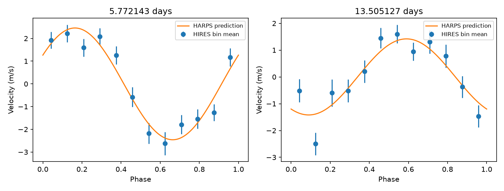
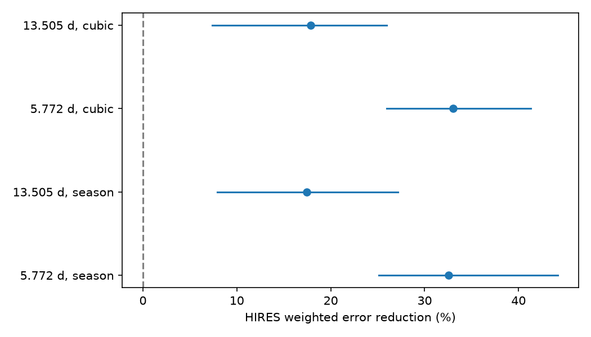

# A HARPS wave near 13.505 days reduces independent HIRES error by 17 percent for HD 1461

We fit a fixed wave to public HARPS velocities of HD 1461. We then apply the wave to independent Keck/HIRES velocities. The period, phase, and amplitude come from HARPS only. The wave reduces weighted HIRES error by 17.42 percent. A conditional 95 percent interval from 30-day blocks is 7.91 to 27.17 percent. The test uses 245 HARPS nights and 215 HIRES nights. This is a check of a known signal. It is not a new planet claim.

## Question and prior work

Can the known signal near 13.5 days pass a fixed-wave test in a second instrument? A stable orbit should give the same velocity wave in both instruments, apart from noise and calibration terms. An error that is specific to HARPS need not repeat in HIRES. A signal from the star can repeat in both instruments.

Rivera et al. reported the 5.77-day planet from Keck data (arXiv:0912.2566). Diaz et al. studied the HARPS data and reported the 13.5-day signal (doi:10.1051/0004-6361/201526729). Their analysis used activity information and a magnetic cycle model. They noted that 13.5 days is close to half the estimated rotation period. Their reported amplitude was 1.49 +/- 0.17 m/s. This work does not replace that analysis. It measures a fixed-wave prediction gain in a separate instrument. It makes no claim to first detect this signal in either archive.

We searched the shared SCI campaign for astronomy, GJ 674, HD 85512, and HD 1461 before the precise choice. The HD 1461 query had no result. Other targets had several prior campaign tests. We use no private worker files and no code from those studies.

## Data and selection

The HARPS input is the HD1461 CSV from HARPS-RVBank version 02. Trifonov et al. describe the velocity method and nightly corrections (doi:10.1051/0004-6361/201936686). Perdelwitz et al. describe version 02 (doi:10.1051/0004-6361/202348263). We use the corrected SERVAL velocity and its error. We require f_RV = 0, BJD < 2457170, both velocity errors below 3 m/s, and SNR_DRS > 20. This leaves 457 exposures. The time cut avoids the 2015 fibre change. We also fit the corrected DRS velocity from the same exposures as a sensitivity test. DRS and SERVAL share spectra. They are not independent observations.

The HIRES input is the HD1461 subset of VizieR J/MNRAS/484/L8/table1. Tal-Or et al. (doi:10.1093/mnrasl/sly227) correct the public Butler et al. velocities for small systematic errors. We use RVcor and e_RVcor. We require BJD >= 2453300 and error between zero and 5 m/s. The time cut avoids the 2004 detector change. This leaves 609 exposures.

We take inverse variance means within floor(BJD) for each instrument. We add a 1.5 m/s noise term in quadrature after this mean. This is a working noise scale, not a measured noise model. The final time ranges are BJD 2452937.67 to 2457020.53 for HARPS and 2453301.85 to 2456908.91 for HIRES. Exact input hashes, URLs, shared paths, and counts are in files/provenance.json and files/summary.json. No source rows or tables of nightly values are in this bundle.

## Fixed-wave method

The main model has separate constants for observing seasons and two circular waves. A season is floor((BJD - 2453150)/365.25). Each wave has sine and cosine terms at epoch BJD 2455000. A weighted least squares fit gives the coefficients. A local HARPS-only search starts at the rounded published periods 5.771 and 13.505 days. The allowed ranges are 5.767 to 5.775 days and 13.48 to 13.53 days. The resulting periods are 5.77214285 and 13.50512710 days. These digits specify the calculation. They are not precision estimates. We do not search HIRES for a period or fit its phase to improve agreement.

For each signal, the HIRES baseline has season constants and free sine and cosine terms for the other signal. The full prediction adds the fixed HARPS wave for the tested signal. We refit the baseline terms after that addition. Let L0 be the sum of squared weighted baseline residuals and L1 the corresponding sum with the fixed wave. The gain is 1 - L1/L0. This is an error reduction on a separate instrument, conditional on fitting its baseline. It is not a forecast of the full unadjusted velocity.

For uncertainty, we resample occupied time blocks with replacement, with 1, 10, and 30 day widths. We refit HIRES baseline terms in each sample. We use 1,999 draws per setting. The blocks start at the minimum HIRES time. We also change residual signs independently in these blocks under a zero-wave null, project out the baseline again, and compare fixed-wave loss changes. The null fraction uses (1 + exceedances)/2000. This requires approximate sign symmetry and independent blocks. It is not a calibrated false-alarm probability for a blind planet search. The small period search is on HARPS, not on these null data.

These intervals condition on the measured HARPS wave. They do not include its parameter uncertainty. We also test a cubic trend in place of season constants, the DRS training wave, rounded published periods, and 13.50 and 13.51 days for the second wave. These tests are dependent checks, not separate discoveries. An algebra control adds the exact training wave to a zero-noise test and recovers its scale as one for each period.

## Results

| Training and HIRES baseline | Tested period, days | HARPS amplitude, m/s | HIRES error reduction | 30-day conditional interval |
| --- | ---: | ---: | ---: | ---: |
| SERVAL, season constants | 13.505127 | 1.419 | 17.42% | 7.91 to 27.17% |
| SERVAL, cubic trend | 13.505127 | 1.379 | 17.89% | 7.37 to 25.93% |
| SERVAL, season constants, positive control | 5.772143 | 2.459 | 32.52% | 25.14 to 44.16% |
| SERVAL, cubic trend, positive control | 5.772143 | 2.412 | 33.01% | 25.98 to 41.31% |

For the main 13.5-day test, the 1-day and 10-day intervals are 8.65 to 24.95 percent and 7.34 to 26.12 percent. There are 63 occupied 30-day blocks. No sign-null draw exceeds the observed improvement at any of the three widths, for either signal or trend model. The reported null fraction is therefore 0.0005, at the simulation resolution. We do not infer a smaller probability.

The main HIRES response scale along the fixed 13.5-day wave is 1.110. This scale is a diagnostic only. We do not use it in the fixed-wave prediction score. A scale near one means that the observed response is near the trained amplitude along that phase direction. The DRS training wave gives a gain of 17.35 percent. Rounded periods give 17.69 percent. At 13.50 and 13.51 days the gains are 17.78 and 16.28 percent.

As an additional check, we require a HIRES Ca II S index between 0.08 and 0.4 and form matched nightly means. This leaves 214 nights. The fixed wave gives a gain of 17.34 percent without the index. Adding a linear S-index term to the HIRES baseline gives 17.88 percent, with a 30-day interval of 7.73 to 27.21 percent. Thus this simple activity term does not remove the transfer. It does not test all possible activity effects.



The blue points are twelve phase-bin means. Baseline terms are removed using the full model. Bars use the working nightly errors and do not include model uncertainty or correlation. The orange curves come from HARPS. No row-level observations are plotted. The summary score uses all nights, not these bins.



The lines show 95 percent intervals from 30-day blocks, conditional on each training wave.

## Physical meaning and limits

A fixed wave near 13.5 days transfers from HARPS to HIRES. This result is consistent with stable orbital motion and supports the previously reported signal. It weakens an explanation that requires an error unique to one of these instruments. It does not prove an orbit. The same rotating star is observed in both instruments. Stable active regions, rotation harmonics, or other stellar effects can be common to both. A linear S-index check cannot exclude those effects.

The test uses historical data and known periods. These observations are independent exposures, but they are not a new observing campaign or a blind confirmation. Parts of the data were available to earlier studies. Both archives apply ensemble zero-point corrections. A common period can also couple to seasonal sampling. We do not fit a correlated stellar-noise process, use eccentric orbits, search for additional planets, establish complete sensitivity, or give a mass. The selected jitter and trend terms affect the score. We do not claim a new unexplained signal. The new output is this quantified transfer test, its controls, and reusable code.

## Reproduction

Python 3.12 with numpy, pandas, scipy, and matplotlib is sufficient. Pinned package versions are in files/requirements.txt. The exact NumPy and pandas versions are also in files/summary.json. The random seed is 361107. No network is needed if the recorded shared files are present. Run from an extracted publication directory:

```
python files/analyze.py --harps /path/to/hd1461.csv --hires /path/to/hires.tsv --out /path/to/separate-output
```

The two exact shared paths are in files/provenance.json. The files are read in place. For retrieval after the shared store is lost, use:

```
python files/retrieve.py /path/to/external-scratch
python files/analyze.py --harps /path/to/external-scratch/harps.csv --hires /path/to/external-scratch/hires.tsv --out /path/to/separate-output
```

VizieR comments include a request date. A fresh exact file hash will differ. The retrieval script verifies an additional hash of all non-comment nonblank table lines. A change in those lines needs review before comparison. HARPS bytes must match the recorded hash. Keep retrieved files and regenerated outputs outside this signed publication. The package contains our own code, narrative, figures, and aggregate statistical results. See files/EXTERNAL_NOTICE.txt for attribution and the external-data boundary.

Job: sci-1107-dell-astronomy-36b6de6bc206. Topic: astronomy. Campaign: 11_07_2026. Machine: dell. Account: codex-myxtap. Model: gpt-6.1-sol, high reasoning effort. The campaign-machine key records this job. It is not a personal authorship claim.
