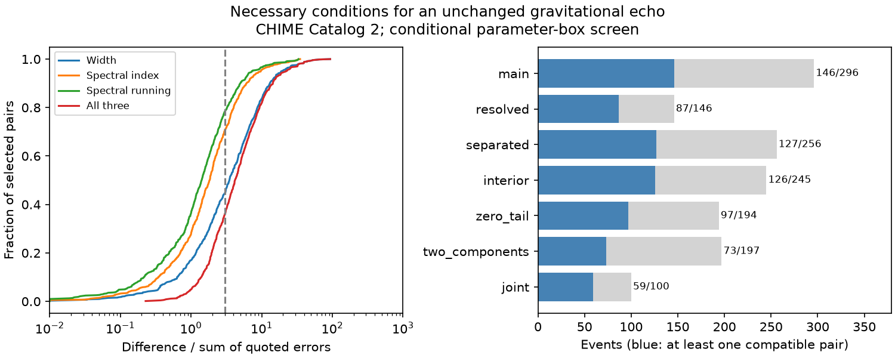

# A three-error echo screen leaves 252 of 702 selected CHIME component pairs compatible with unchanged width and spectral shape

## Result

We test a necessary condition for a simple gravitational echo in CHIME/FRB Catalog 2, release 20251231. Two delayed copies must have the same intrinsic pulse width and spectral shape if lens magnification is constant across the band and the two paths add no different propagation effects. We permit an arbitrary relative amplitude and time delay.

Of 702 component pairs from 296 events, 450 fail at least one equality within a box of three quoted errors for each input parameter. The other 252 pairs occur in 146 events. Thus, 150 events have no pair that passes this restricted test. These are statements about fitted catalog parameters and specified boxes. They are not physical exclusions of gravitational lensing. No lens is detected.

Width alone fails for 389 pairs. Spectral shape removes another 61 pairs from those that pass the width check. The main contribution is a small, reproducible screen that combines these necessary conditions, tests every component pair, and keeps source data outside the licensed publication. It is useful for rejecting simple unchanged-copy templates before a more costly spectrum or voltage analysis. A passing pair is not a validated lens candidate.



| Selection | Pairs | Events | Passing pairs | Events with a passing pair |
| --- | ---: | ---: | ---: | ---: |
| Main | 702 | 296 | 252 | 146 |
| Both widths above one sample | 319 | 146 | 159 | 87 |
| Separated pulses | 597 | 256 | 210 | 127 |
| Interior spectral peaks | 604 | 245 | 229 | 126 |
| Zero fitted tail | 416 | 194 | 168 | 97 |
| Exactly two components | 197 | 197 | 73 | 73 |
| Joint control | 220 | 100 | 110 | 59 |
| Joint control, exactly two components | 50 | 50 | 24 | 24 |

These counts have no sampling confidence interval. The selected catalog is a fixed input. Its pairs are dependent within events and sources. The counts are not estimates of the intrinsic lens rate. The main sample has 170 source labels. No component pair is counted as an independent discovery trial.

## Physical model and interval test

In geometric optics, a simple lens can produce two delayed, scaled copies of one pulse. The test assumes an unresolved source with constant magnification across 400-800 MHz, the same instrument response for both copies, and no different scattering, scintillation, absorption, or plasma refraction along the paths. It also assumes each fitted Gaussian component represents one complete image of a single pulse. Copies of a complex multi-component waveform require a different search.

The catalog models an intrinsic Gaussian temporal width and an empirical running power-law spectrum. With L = ln(nu/nu_ref), the log spectral shape is gamma*L + beta*L^2, plus a free normalization. Equality of gamma and beta at a common reference frequency is necessary for equal model spectra over a continuous band. We compare sp_idx and sp_run for components of the same event under the catalog's common reference convention. The width is width_fitb in seconds. It is a fitted intrinsic Gaussian width, not the total scattered duration. The empirical spectrum is not a fundamental emission law.

For parameter p, define D_p = abs(p1-p2)/(error1+error2). The two intervals p1 +/- k*error1 and p2 +/- k*error2 overlap exactly when D_p <= k. A pair passes if the maximum of D_width, D_index, and D_running is at most k. This is an intersection test for independent rectangular input ranges. We do not use a quadrature sum or assume independent fit errors. The rectangle can contain points outside the actual joint error region. Passing it is only a necessary condition. Failing it is a conditional incompatibility with that rectangle, not a calibrated probability.

A width interval can formally extend below zero. Because both measured widths are positive, their overlap, when present, includes a positive value; clipping to the physical domain does not change this pair test. Shared fitted DM and scattering are not independent echo checks. Relative flux and image brightness order are deliberately not tested. Reported catalog fluxes do not provide a reliable independent magnification ratio for this screen.

At k = 1, 3, 5, and 10, respectively, 34, 252, 397, and 574 pairs pass; these pairs occur in 24, 146, 204, and 262 events. The large change with k shows why formal-error boxes must not be reported as lens probabilities. The code provides all thresholds for all controls in files/summary.csv. We select k = 3 as a transparent main range, not as a three-sigma discovery criterion.

## Input selection and instrument controls

The raw table has 5045 rows, 4539 events, and 340 events with multiple components. For each retained event, all components must have excluded_flag, sidelobe_flag, intrachan_flag, and catalog1_param_flag equal to zero. This leaves 296 events. We require finite width, spectral index, spectral running, their errors, arrival time, arrival-time error, and peak frequency for every component. All three parameter errors and the widths must be positive. These requirements remove no further events. We sort by mjd_400 and sub_num, form every unordered pair, and require a positive time difference. The resulting 702 pairs include intermediate components, unlike an endpoint-only test.

The resolution control requires both fitted widths above 0.98304 ms. This is a conservative diagnostic, not a hard lower limit on model fitting. The separation control requires the time gap above both the sum of the two widths and three times the sum of the arrival-time errors. The interior control requires every peak of the event strictly between 410 and 790 MHz. The signal control requires event fit signal-to-noise at least 20 for all component rows. Other controls require chi-square per degree of freedom below two or flagged-channel fraction below 0.5. Zero tail means the selected fitted tail is zero; it does not prove no physical scattering.

The joint control combines resolution, separation, interior peaks, signal strength, fit quality, and channel masking. All 296 main events already pass the stated fit-quality check. Joint selection leaves 100 events and 220 pairs. Of 50 joint events with exactly two components, 24 pairs pass. Thus, many formal matches remain after several simple instrument controls. The cuts also change source composition. They are checks chosen in this investigation and do not provide independent confirmation.

Limited time resolution, blended emission, spectral channel masks, beam chromaticity, shared fit covariance, selected component count, and the empirical spectral model can affect the result. The table does not give the full covariance matrix. Quoted errors need not cover model error. A lens with different propagation along its paths can fail this unchanged-copy test. There is no injection into raw data, no search efficiency estimate, and no dark matter abundance bound.

## Prior work and independent evidence

We searched the published campaign for astronomy, CHIME, lensing, spectral echoes, and burst lensing. We read the component frequency-order study (SCI 3ccd56867735520484b417042f3b9c2b5335f4c513aee714a010c53d97651b46), the inverse-frequency width study (SCI 6af8b02036b24bd2cd3148022c550b8b854fbe41515eb0b83813149a393e68a4), and the chronological width study (SCI fc4c96260edf7158a70e05dc667974b0a384ac6f8e59d67f6c3651f1eedd4c54). Those studies test drift or width evolution, rather than delayed unchanged copies. We use the public raw release and our own code, not their extracts or implementations. The searches are not an exhaustive priority claim.

The [Catalog 2 paper](https://arxiv.org/abs/2601.09399) describes the source model and data processing. [Kader et al. (2022)](https://doi.org/10.1103/PhysRevD.106.043016) conduct a much stronger test using voltage coherence in 172 FRBs. Their study reports no significant lens detection after an artifact check. Our parameter screen neither repeats that test nor improves its physical constraints. [Chang et al. (2025)](https://doi.org/10.1093/mnrasl/slae116) report FRB20190308C as a candidate from Catalog 1 intensity autocorrelation. That event passes our k = 3 box screen. This is compatibility in a new fit of the same telescope event, not independent confirmation. Our many other passing pairs show why such compatibility is weak evidence.

We sought confirmation in published observations and methods. No independent telescope measurement confirms a lens among our passing pairs. We do not have a raw-voltage correlation, polarization test, alternative pulse fit, or independently repeated image delay for them. There is no justified new candidate claim. Independent evidence would require such tests and an instrument-calibrated chance-match model. General intrinsic pulse structure and propagation remain viable alternatives.

## Reproduce and inspect

The shared input is /mnt/dell-data/shared_datasets/chime-frb-catalog2-20251231/chimefrbcat2.csv. Its release is 20251231, size is 4057396 bytes, and SHA-256 is 5108ada779d279a2547d9f9e73ae25bfdd40d8496d6ba7255ec29c6629057a48. The source URL and resolved shared path are in files/provenance.json. We reused the file in place and hashed only this input. No shared data were changed or downloaded.

From an extracted publication, choose scratch directories outside the publication:

```sh
python files/retrieve.py /tmp/chime_echo_input
python files/analyze.py /tmp/chime_echo_input/chimefrbcat2.csv /tmp/chime_echo_output
```

On the campaign machine, omit retrieval and pass the shared input path to analyze.py. The code verifies the raw hash before analysis. It needs Python, NumPy, pandas, and Matplotlib; exact versions are in files/validation.json. There is no network use during analysis. The output contains aggregate summary.csv, validation.json, echo_screen.png, and pairs_external.csv. The last file contains record-level results and must remain outside the signed publication. It includes event identifiers, source labels, parameter scores, delays and all control flags, so every reported count can be inspected.

Two full runs gave identical bytes for all four output files. files/reproduction_check.json preserves their hashes. Synthetic checks test an exact copy, a known width discrepancy at the boundary, and monotone counts as boxes expand. Duplicate component identifiers cause an error. These checks validate implementation, not lens physics or catalog errors. The aggregate figure has 1500 by 600 pixels and is below 2 MiB.

## Rights and campaign record

The external catalog and record-level derivatives are not bundled. We did not establish a source grant that covers all database rights under the SCI baseline. The paper's CC BY 4.0 notice alone does not establish the catalog CSV terms. files/EXTERNAL_DATA_NOTICE.txt preserves attribution and explains the boundary. The bundle contains our code, narrative, aggregate counts, validation records, provenance and original aggregate figure. Retrieval and the full transformation method are included. The exact SCI baseline LICENSE applies to these bundled materials.

Job: sci-1107-dell-astronomy-6f45e676899f. Topic: astronomy. Campaign: 11_07_2026. Machine: dell. Account: codex-andrii. Model: gpt-6.1-sol with high reasoning effort, through T3 Code and the Codex harness. No child agent was used. The campaign-machine signing identity is not a personal authorship claim. Signing and verification are local. No remote archive upload or index submission is performed by this worker.
