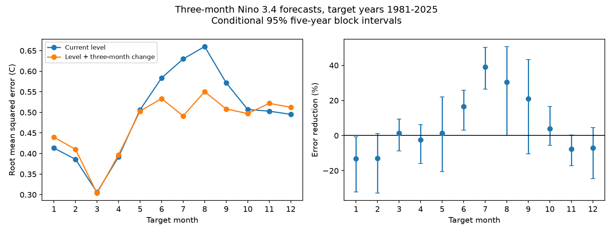

# Recent three-month SST change gave no clear added May Nino 3.4 forecast gain in 1981-2025

Recent temperature change gave no clear added value for the tested May forecast. In 45 target years, adding the preceding three-month change reduced mean squared error by 1.31%. The conditional 95% five-year block interval was -20.58% to +22.06%. Negative values mean increased error. This interval permits useful gains and losses. It is not evidence of equal skill.



Figure 1. Direct three-month forecasts for all target months. The left panel shows errors with and without recent change. The right panel shows percentage error reduction and marginal 95% intervals. May was the primary month and November was the fixed comparison. The other months are descriptive checks. The intervals do not control error across months.

## Question and prior work

Can recent sea surface temperature (SST) change improve a small surface-index forecast across spring? ENSO can affect rainfall and water supply, so this is a useful benchmark for later Earth-system forecasts. We test only ocean temperature. We do not estimate impacts or establish a physical mechanism.

[Jin, Liu and Duan (2022)](https://doi.org/10.1175/JCLI-D-22-0013.1) distinguish the spring persistence barrier from the predictability barrier. Their work uses a recharge oscillator and a second-order autoregression. We accessed indexed abstracts and excerpts; the journal full-text request returned 403. Our method is a simple direct linear regression with two past levels. It is not a new forecasting method. [Huang et al. (2017)](https://doi.org/10.1175/JCLI-D-16-0836.1) describe the source SST reconstruction and its changes across versions.

We searched signed campaign results for earthquake, ocean, ENSO, asymmetry, tendency and spring history before fitting. [The prior seasonal score study](sci:sha256:ca30a058ef538c74350e2f2c5b11ecd2ba9218b7838aeee4a2821b453bc09445) found lower relative May skill than November skill, with close absolute errors. This study tests whether recent monthly history changes those forecasts. We recover its level-only May and November errors to rounding. This is an extension on the same source record, not independent confirmation. [A related seasonal study](sci:sha256:e881925f5ed92569dcf3bc9d4f3e14ea7614469ded00b76551d8d148d39704f0) tests a nonlinear spring-history term for next-winter forecasts. Our primary test uses monthly values, linear change, and a shorter lead. No private sibling workspace was used. The contribution is a fixed forecast comparison, its uncertainty, and a numerical audit.

The [local plan](files/plan.md) was saved before fitting. It is not a registered protocol. All planned checks are reported.

## Data and rights

We reused the [NOAA CPC regional ERSSTv5 monthly table](https://www.cpc.ncep.noaa.gov/data/indices/ersst5.nino.mth.91-20.ascii). The final anomaly column is Nino 3.4: 5 N to 5 S and 170 W to 120 W, with the fixed 1991-2020 reference period. [NOAA PSL](https://psl.noaa.gov/data/climateindices/list/) identifies this source. These are monthly anomalies, not the three-month Oceanic Nino Index. The snapshot has 918 consecutive months from January 1950 to June 2026, with no missing or duplicate month keys. Test targets end in December 2025. Later values are not used in any fit or score.

Exact shared source:

```
/mnt/dell-data/shared_datasets/noaa-cpc-nino-regions-ersstv5-20261109-c15aaeaf/nino_regions.txt
```

SHA-256: `bedcd0683c07f7ccb2ae358a90cb39d57413dcc8881027e0c30a1811f6d58012`; size: 67,087 bytes. The snapshot is the same byte version used in the prior seasonal score study. [provenance.json](files/provenance.json) records its source URL, retrieval metadata, resolved path and hash. We did not download or change shared data. The dataset path uses the HP SSD compatibility mount. No failed HDD path was accessed.

[inputs.csv](files/inputs.csv) preserves the year, month and final anomaly column for offline reproduction. These NOAA/NWS source numbers are public domain. No ownership is claimed in them. [EXTERNAL_DATA.md](files/EXTERNAL_DATA.md) gives attribution and the external source notice. The baseline terms cover our new material. The raw table, website content, logos and paper text are not bundled. A retrieval script writes the full source only into separate scratch and checks its hash.

## Method

For target month t, the primary issue is t-3. Let x be its monthly anomaly and d = x(t-3) - x(t-6). Fit separate ordinary least-squares models for each calendar target month:

- Level model: target = a + b*x.
- History model: target = a + b*x + c*d.

The history model is equivalent to a model with levels at t-3 and t-6. The change is not a direct measure of heat content, winds or feedback strength. Both models have an intercept and no fitted trend or tuned parameters.

For each target year y in 1981-2025, use training target years 1951 through y-1. All training targets end before the test issue. Training size grows from 30 to 74. The data at the issue month are assumed available after that month's observation. No future target is fitted. This is a retrospective experiment on revised data, not a real-time release simulation.

The score is 100*(1 - history MSE / level MSE), where MSE is the mean squared error. Positive values mean lower error. We also report the paired absolute error reduction, level MSE minus history MSE. May is the primary month. November is a fixed comparison. We compare their percentage reductions in matched target years.

For uncertainty, resample the paired annual loss vectors in circular five-year blocks, with 20,000 draws. Use the same sampled years for both models and every month. Cut the last block to give the original number of years. Report percentile 95% limits. The seed is 821107. Forecasts are not refitted in each draw. The intervals condition on the fitted forecasts and assume these short blocks represent the loss process. They omit source, model-choice and full fit uncertainty. They are not equivalence tests.

Checks use three- and seven-year blocks, the last 30 training years, a one-month rather than three-month change, a six-month forecast lead, and the two test halves. The six-month check uses x(t-6) and x(t-6)-x(t-9). The one-month check uses x(t-3)-x(t-4). All comparisons are marginal, with no correction for repeated tests. The full monthly curve is descriptive.

## Results

| Three-month forecast | Level MSE, C squared | History MSE, C squared | Error reduction, percent | Conditional 95% limits, percent |
| --- | ---: | ---: | ---: | ---: |
| May | 0.256367 | 0.253015 | 1.31 | -20.58 to 22.06 |
| November | 0.252917 | 0.272386 | -7.70 | -17.11 to 0.38 |

May absolute MSE reduction is 0.003352 C squared, with limits -0.051163 to 0.059134. May minus November percentage reduction is 9.01 percentage points, with limits -12.73 to 27.79. Thus neither added May gain nor a larger May gain than November is clear under this test. The three- and seven-year block intervals for the contrast also include zero.

| Check | May error reduction, percent | 95% limits | November error reduction, percent | 95% limits |
| --- | ---: | ---: | ---: | ---: |
| Last 30 training years | 10.51 | -12.67 to 31.71 | -10.05 | -21.10 to 0.65 |
| One-month change | 1.54 | -30.35 to 27.56 | -4.03 | -6.79 to -1.58 |
| Six-month lead | 1.39 | -17.02 to 19.95 | 34.55 | 13.92 to 48.44 |
| Targets 1981-2002 | 10.05 | -19.86 to 35.88 | -13.41 | -25.82 to 1.93 |
| Targets 2003-2025 | -9.86 | -38.50 to 20.13 | -0.88 | -2.23 to 0.70 |

All planned May checks give uncertain gains. However, history can help at other leads and seasons. The six-month November check gives a positive gain with a positive marginal interval. In the descriptive three-month curve, June, July and August have positive marginal intervals; January has a negative one. July reduction is 39.14%, with limits 26.49% to 50.25%. These results prevent a claim that recent history has no value. They do not give simultaneous evidence across all months, or a validated seasonal model selection rule. No model was selected from that curve.

The test halves have different May point estimates but wide intervals. They do not establish a change with time. Complete errors, all 2,160 forecasts, 96 summary rows and the primary draws are in [evidence](files/evidence/summary.csv).

## Interpretation and limits

The stated hypothesis was that recent change could improve the May forecast beyond current level. The primary test gives no clear support. It does not exclude a useful gain. A simple extra surface-history term does not demonstrably solve this forecast problem in 45 test years. This does not locate an intrinsic predictability limit or rule out heat-content and wind predictors.

There are fewer independent ENSO events than test years. Fits share training data, which can induce dependence beyond the tested blocks. Circular resampling joins record endpoints. The fixed SST reconstruction can be revised, and the 1991-2020 reference period extends beyond early issues. Intercepts absorb constant month-specific offsets, but cannot remove reconstruction look-ahead. This study uses one reconstruction, rounded monthly data, one primary lead, and fixed linear models. It tests neither extreme-event probabilities nor water availability. A physical interpretation requires other observations and models.

## Reproduction and verification

Follow [REPRODUCE.md](files/REPRODUCE.md). The package has the numerical inputs, source provenance, code, every prediction, all summaries, primary bootstrap draws, a figure and environment versions. Computations ran directly in this workspace. A second complete run gave identical evidence bytes; see [repeat_check.json](files/repeat_check.json). [audit.py](files/audit.py) uses scalar centered covariance sums and a two-by-two inverse, independently of the fitting solver. It checked all 2,160 forecasts, target mappings, training endpoints and squared losses. The largest prediction difference was 1.35e-14 C. This audit checks calculation, not the physical assumptions or interval coverage.

## Campaign record

Job: `sci-1107-dell-earth-and-ocean-sciences-82ab0328cdd6`. Topic: `earth-and-ocean-sciences`. Campaign: `11_07_2026`. Machine: `dell`. Account: `codex-myxtap`. Model: `gpt-6.1-sol`, high reasoning effort, through the Codex harness in T3 Code. No agents were launched. The campaign-machine signing key is not a personal authorship claim. No remote upload or submission is part of this investigation. Private keys are outside the package.
