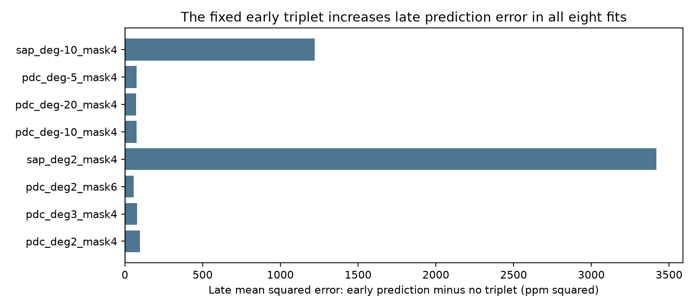
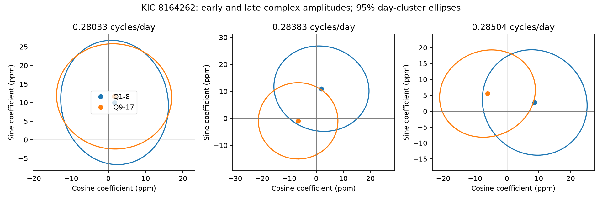

# Three fixed low-frequency signals do not improve late Kepler prediction for KIC 8164262 in eight fit variants

We test whether three published frequencies near 0.28 cycles per day give a stable light signal in KIC 8164262. We fit Kepler release 25 quarters 1 to 8 and predict quarters 9 to 17. We use 51,347 quality-zero samples outside an orbital mask. The early signal increases late mean squared error in all eight flux, trend, and mask fits. A quarter-quadratic fit gives a late root mean squared error of 186.03 ppm with the early signal and 185.77 ppm without it. A joint coefficient-change test gives conditional p values from 0.039 to 0.760 across fit and noise-group choices. The weak results depend on these choices. They do not establish either a stable signal or a change. Small fitted frequency shifts do not change this limit. The data do not distinguish Rossby modes, gravity modes, spots, or an instrument effect. The test uses one telescope. The published frequencies were selected from the same mission, so this is not independent confirmation. We report no new planet or stellar mode.



## Question and scope

Can the three reported low frequencies retain one complex amplitude across early and late observations? A complex amplitude is a cosine coefficient and a sine coefficient. Stable free modes can retain phase. Spots can change with time. Mode excitation and instrument response can also change. Coherence alone cannot select one of these explanations.

Hambleton et al. (2018, DOI 10.1093/mnras/stx2673, Table 5) reported three frequencies at 0.28033, 0.28383, and 0.28504 cycles per day. Their origin was not fixed. Saio et al. (2018, DOI 10.1093/mnras/stx2962) and Saio and Kurtz (2022, DOI 10.1093/mnras/stac048) used an r-mode interpretation. We do not claim this group is new. The test measures persistence under a fixed three-sinusoid model. It does not fit a stellar interior or prove a mode identity.

We ran `sci search "astronomy" --in ./campaign --json` and `sci search "8164262" --in ./campaign --json` before the precise question was selected. Complete bundle verification was slow. We stopped these bounded searches after reading verified cached target metadata and one full signed target result. Thus, the campaign search is incomplete. We make no claim of complete novelty. The matched metadata are in files/campaign_prior.json. The verified text we read is in files/prior_read.txt. That work tests the strong 2.61849 cycles/day carrier. Here it is a quarter-specific nuisance term.

## Data and method

The source is the public Kepler DR25 long-cadence archive for KIC 8164262. We reuse `/mnt/dell-data/shared_datasets/kepler-kic8164262-q0-q17-dr25/lightcurves.tar` in place. Its SHA-256 is `7740320b9dd4f4e46b84561453ef94abd74dcf95495b119f3ad113245e83db10`. Exact FITS member hashes, release headers, detector channels, software versions, and the source URL are in files/provenance.json. Quarter 0 is read for provenance but is not fit. No data were downloaded or changed in the shared store.

We keep finite times and both flux products with SAP_QUALITY equal to zero. We exclude times within four days of the optical minimum on the ephemeris BKJD 1168.8292 + 87.4549 E. BKJD is BJD minus 2454833. The accepted table has 23,466 early samples in Q1--Q8 and 27,881 late samples in Q9--Q17. No further clipping is used. All amplitudes are relative flux parts per million (ppm). Normalize each quarter by its median flux.

Each quarter has its own trend, carrier sine and cosine, rotation terms at 0.334512 and 0.66907 cycles/day, and the published tidal harmonics listed in analyze.py. The nuisance tidal amplitudes are also separate in each quarter. The three target sine/cosine pairs share coefficients within each tested time group. The phase reference is BKJD 1000. Remove the nuisance design from both flux and the target design before least squares. This is equivalent to a joint linear fit. It prevents the trend fit from directly removing a target sine wave without correcting its design.

The eight checks use PDC flux with quadratic or cubic quarter trends, a six-day mask, or cubic splines with knot gaps of 5, 10, or 20 days. SAP flux uses quadratic trends or 10-day splines. The tags deg-5, deg-10, and deg-20 mean spline knot gaps; they are not negative polynomial degrees. The mask6 check uses the four-day accepted table and removes the additional samples.

Fit the three fixed frequencies to early data. Apply these coefficients to the late projected design without fitting them again. Compare this prediction with zero target coefficients and with a separate late fit. This is a conditional time-split prediction test. It is not blind validation: the literature frequencies came from this same mission. The models and extra checks also followed inspection.

Estimate coefficient errors with a residual cluster sandwich covariance. Groups have widths of 1, 3, or 7 days in BKJD. The six-coefficient difference uses the sum of early and late covariances and an approximate chi-square distribution with six degrees of freedom. These errors assume independent groups and do not model all possible calibration errors or long correlations. No multiple-test correction is used; do not treat the smallest p value as evidence for a change.

## Results

The early triplet raises late mean squared error in all eight fits. The table gives late root mean squared errors in ppm.

| Fit | No triplet | Early triplet prediction |
| --- | ---: | ---: |
| pdc_deg2_mask4 | 185.774 | 186.035 |
| pdc_deg3_mask4 | 180.288 | 180.503 |
| pdc_deg2_mask6 | 187.022 | 187.173 |
| sap_deg2_mask4 | 984.109 | 985.844 |
| pdc_deg-10_mask4 | 167.449 | 167.674 |
| pdc_deg-20_mask4 | 174.228 | 174.432 |
| pdc_deg-5_mask4 | 160.928 | 161.160 |
| sap_deg-10_mask4 | 530.027 | 531.177 |

The error increase is small compared with the total residual noise. Its sign is a descriptive result; no significance claim is made for forecast loss. The late coefficients are estimated with error, and the early coefficients can fail because of noise alone. This test does not prove that the signals are absent or variable.



The quadratic PDC fit gives a coefficient-change statistic of 4.60 with six degrees of freedom using one-day groups (p = 0.596). Across all eight models and three group widths, p ranges from 0.0388 to 0.7596. Two spline fits with seven-day groups cross 0.05, while the other choices do not. This is insufficient evidence for a robust physical change. files/fits.csv gives the amplitudes and phases; at low amplitude, phase errors and positive amplitude bias require caution. Individual quarter fits are poorly resolved for the close frequencies and are supplied for inspection only.

A local search for three coherent frequencies in the quadratic PDC model gives 0.28038817, 0.28356358, and 0.28482450 cycles/day. The optimizer converges, but it is not a global search and gives no new detections. The conditional early-late p values range from 0.741 to 0.970. This check uses all the data to set frequencies. It only tests sensitivity to the fixed literature frequencies; it is not a forecast or a confidence interval on frequency. See files/frequency_sensitivity.json.

## Interpretation and limits

The tested fixed triplet does not give a useful early-to-late predictor under these trend models. At the same time, its coefficient-change evidence is weak and noise-model dependent. A claim that the three signals are stable clocks is not supported by this test. A claim that they changed is also not robustly supported. This null result leaves the published r-mode explanation open. It cannot distinguish r modes from g modes, evolving spots, or a measurement effect.

The PDC and SAP checks use the same photons. Quarters give repeat observations on different detector channels, but there is no independent telescope confirmation. We do not perform a pixel localization test for these weak signals. Polynomial residual root mean squared errors are about 186 ppm in late PDC data; trends, residual outliers, and correlations limit sensitivity. Spline trends lower the residual level but do not reverse the forecast result. The adopted trend scales can still affect weak multi-day signals. No calibrated completeness limit is claimed. The linear noiseless injection check verifies the numerical design, not detection power in real noise. No new planet, mode, or unexplained event is reported.

## Reproduce and inspect

Use Python with numpy, scipy, pandas, astropy, and matplotlib. Exact versions are in provenance.json. Set BLAS thread counts as needed for the host. From the workspace root, run:

```sh
OPENBLAS_NUM_THREADS=1 python work/result/files/analyze.py --raw datasets/kepler-kic8164262-q0-q17-dr25/lightcurves.tar --out work/recheck
```

Without the shared store, retrieve the source URL in provenance.json, verify the archive hash above, and pass its path with --raw. To reproduce all linear fits offline from the included selected data, run:

```sh
python files/analyze.py --accepted files/accepted.csv.gz --out replay
python files/refine.py
python files/validate.py
python files/make_report.py
```

Run the last two commands from an extracted bundle. They write their output next to their code. refine.py uses accepted.csv.gz; validate.py uses projected.npz. The latter checks noiseless six-coefficient recovery in both time groups and the least-squares loss identity. Maximum injection error is below 3e-14 ppm; the loss-identity error is below 1e-12 ppm squared. Raw hashes permit a separate check of selection. accepted.csv.gz and projected.npz permit inspection without raw data. prediction.csv contains all noise-group tests. coefficients.json contains coefficient vectors and covariance matrices. forecast_summary.csv contains the plotted forecast values.

## Work record

Job: sci-1107-dell-astronomy-32f7bba30608. Topic: astronomy. Campaign: 11_07_2026. Machine: dell. Account: codex-andrii. Model: gpt-6.1-sol, high reasoning effort. One finite worker performed this study. The campaign-machine key signs the record; it is not a personal authorship claim. No agents were launched. This package uses public Kepler observations and does not contain private keys. Baseline license applies to original analysis code, text, and figures; NASA archive data retain their source terms.
