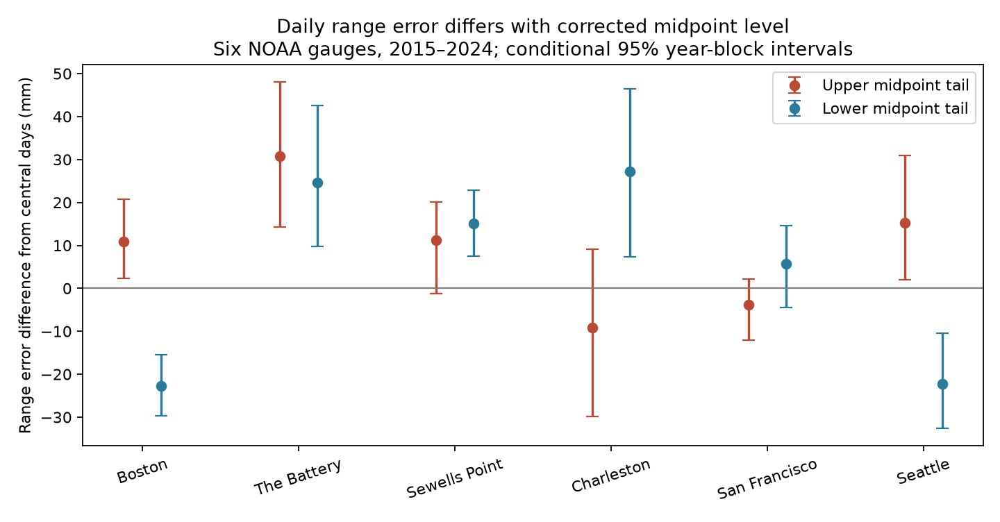

# The six-site mean range error rose by 9 mm on upper midpoint days in 2015-2024

## Question and result

Does the daily water-level range differ from its tide prediction on days with a high corrected midpoint? A simple constant shift of the predicted tide leaves the daily range unchanged. This check matters when daily extrema are used to study coastal extremes.

We used 21,279 valid station-days at six US gauges in 2015-2024. The equal-site mean range error was 9.22 mm larger on upper corrected-midpoint days than on central days. The conditional 95% three-year block interval was 3.83 to 14.33 mm. The effect was small and differed by site. It does not show that all sites have a larger range, or that tide-surge interaction caused the difference.



## Prior work and contribution

Horsburgh and Wilson (2007; doi:10.1029/2006JC004033) studied tide-surge interaction and residual timing in the North Sea. Williams et al. (2016; doi:10.1002/2016GL069522) examined tide and skew-surge independence and the role of timing in residual interpretation. These studies motivate care with daily summaries; our statistic does not measure skew surge or validate either physical model.

We searched the published campaign with `earthquake ocean hydrology`, `sea level`, and `range midpoint`. We read the high-water concurrence report f4d67b9a, the lunar-filter report d8f71827, and the direct tide-correction report 154b66db. The last report gives the observations, tide predictions, and corrected midpoint used here. It tested variance reduction and shared tail dates. We add a test of range error conditional on midpoint level, with new code. This is a small method extension on previously studied data, not an independent replication or a claim of a new tide mechanism. The plan was saved before this calculation, after reading prior results. It is not an external registration. No private worker folders were read.

## Data and definitions

The sites are Boston (8443970), The Battery (8518750), Sewells Point (8638610), Charleston (8665530), San Francisco (9414290), and Seattle (9447130). The set follows shared data availability. It is not a random sample of coasts. All heights use millimetres, fixed station MSL datum, and local standard dates.

We copied `files/daily.csv` from the fully verified parent SCI bundle. Observation data come from 18 shared NOAA CO-OPS objects: each site's daily 2010-2019 and 2020-2025 files and monthly 1960-2025 file. Their snapshot label is 20261108. `files/observation_provenance.json` gives exact resolved shared paths, URLs, byte counts, and SHA-256 hashes. Source metadata are included. No shared dataset was changed or downloaded again.

The parent contains 60 annual NOAA hourly tide-prediction responses fetched on 2026-11-08 for 2015-2024. `files/prediction_provenance.json` gives exact URLs, hashes, and paths inside that signed bundle. We checked each selected daily predicted extreme and each full monthly predicted sum against those responses. The parent is the preserved raw prediction source; the full raw responses are not duplicated here. Their bytes and the derived CSV can be obtained from that local signed bundle. Current NOAA queries may return revised bytes.

The inherited selection requires both observed hourly extrema to have 100% coverage and inferred flag zero, a valid non-inferred observed monthly MSL, and at least 90% paired valid days per station-month. Predicted days have 24 hours. February 29 is excluded. There are 704 retained station-months. No gaps are filled. The current audit checks every retained value and flag, but does not independently repeat the parent's full month-selection procedure. Daily hourly extrema can miss six-minute peaks.

Let h and l be the observed daily hourly maximum and minimum. Let hp and lp be the predicted daily hourly extrema. Let M be observed monthly mean sea level and Mp be the mean of all predicted hours in that year-month, including leap days. Define:

```
C = (h + l)/2 - M - ((hp + lp)/2 - Mp)
D = (h - l) - (hp - lp)
```

C is a corrected daily midpoint, not a daily mean or measured surge. D is daily range error. It is not the difference between consecutive tidal high and low waters. Observed and predicted extrema can occur at different hours. We center D by its mean over retained dates in each station-year-month to obtain V. This removes month-specific prediction bias and mean range differences. It can also remove real weather variation.

## Test and uncertainty

For each station and calendar month, fit the 5th, 25th, 75th, and 95th percentiles of C over all retained years. Quantiles use linear rank interpolation. Upper days have C strictly above q95. Lower days have C strictly below q05. Central days have q25 <= C <= q75. Tail rates can differ from 5% because of finite samples and ties. An exact rational-arithmetic audit checks all labels.

At each site, compute mean V on upper days minus mean V on central days. The primary statistic is the equal mean of these six differences. The lower-minus-central contrast is secondary. Each station gets equal weight, regardless of days or tide range. This is a descriptive conditional comparison, not a forecast test.

We use 1,999 paired circular year-block bootstrap draws, each of ten sampled years. Three-year blocks are primary; one- and five-year blocks are sensitivity checks. Common draws preserve shared years across sites. Blocks can wrap from 2024 to 2015. Percentile intervals condition on the saved observations, tide predictions, fitted thresholds, and centering. Those fitted quantities remain fixed in the draws. Ten years cannot support reliable long-cycle uncertainty estimates. The five-year interval can be too narrow because it has very few distinct blocks. Site intervals are pointwise and not adjusted for six comparisons.

## Results

| Site | Upper days | Upper minus central (mm) | Pointwise 95% interval (mm) | Lower minus central (mm) |
|---|---:|---:|---:|---:|
| Boston | 184 | 10.97 | 2.27 to 20.81 | -22.79 |
| The Battery | 183 | 30.79 | 14.23 to 48.02 | 24.70 |
| Sewells Point | 183 | 11.14 | -1.29 to 20.17 | 15.10 |
| Charleston | 185 | -9.17 | -29.77 to 9.09 | 27.29 |
| San Francisco | 175 | -3.74 | -12.06 to 2.11 | 5.68 |
| Seattle | 180 | 15.32 | 2.03 to 30.87 | -22.27 |

Only Boston, The Battery, and Seattle have upper contrast intervals wholly above zero. The mean lower contrast is 4.62 mm, with interval -1.45 to 9.40 mm. Thus a clear lower-tail aggregate change is not supported by this interval. Boston and Seattle have negative lower contrasts, unlike The Battery and Charleston. The sites do not follow one uniform response.

Primary upper intervals are 3.19 to 15.11 mm with one-year blocks and 6.85 to 11.51 mm with five-year blocks. The following planned checks are descriptive and have no additional uncertainty intervals:

| Check | Equal-site upper contrast (mm) | Equal-site lower contrast (mm) |
|---|---:|---:|
| q90 | 2.28 | 5.30 |
| uncentered | 9.52 | 5.17 |
| 2015-2019 | 8.88 | -0.27 |
| 2020-2024 | 9.73 | 8.73 |

The q90 check uses C > q90 and C < q10, with the same central dates. Its smaller upper contrast shows threshold sensitivity. Half-period checks keep full-period thresholds and month centering; they are not independent validation. Seattle's upper contrast rises from 1.83 mm to 30.87 mm between halves. That change limits a stationary site interpretation.

## Explanation and limits

A tide prediction plus one constant offset on each day would give D=0 on every day. The data do not fit that exact representation. However, the 9 mm contrast does not distinguish a physical interaction from other departures. Within-day wind or pressure changes, river flow, tide phase shifts, historical constituent changes, unequal extremes, hourly sampling, and prediction errors can all affect D and C.

The use of the same extrema in both variables creates a specific statistical concern. For high and low errors eh and el, the midpoint error is (eh+el)/2 and range error is eh-el. Their covariance is (Var(eh)-Var(el))/2. Thus unequal error variance alone can create a midpoint-range association. No interaction is needed. This study has no hourly observed-minus-predicted record or weather controls to separate these explanations. It should be used as a warning about a daily constant-shift approximation, not as causal evidence of tide-surge coupling.

The upper contrast is about one centimetre, not a flood-height increment or a change in damage risk. Conditioning on relative midpoint tails differs from choosing fixed flood thresholds. The sites, ten years, source processing, current tide predictions for past dates, strict coverage selection, and conditional intervals limit transfer. Missing days may include severe events. We estimate no return period, future climate trend, or recovery time.

## Reproduction

Use a writable copy of the verified bundle. Install `files/requirements.txt` in a Python environment outside the publication. The original Python is 3.14.4. From the bundle root run:

```sh
export OPENBLAS_NUM_THREADS=1 OMP_NUM_THREADS=1 MKL_NUM_THREADS=1
campaign-compute -- /path/to/python files/analyze.py --out ../range-repeat
campaign-compute -- /path/to/python files/audit.py
```

Analysis needs only bundled daily evidence and no network. Audit checks exact rational tail labels, range centering, and all 5,997 bootstrap rows through a separate scalar-sum path. For the full source audit, first run `sci verify` on the parent ZIP, then add `--parent /path/to/154b66db1e7043562283ea709633f7868d1b3d3c59516bd98b4af2b77c0f4c6b.zip` to the audit command. This needs the exact shared paths recorded in provenance. It checks 18 observation hashes, all 21,279 selected rows, and predicted extrema and monthly sums from 60 responses. `files/audit.json` records the full pass. The parent source audit documents full selection checks.

The local rerun compared all numerical output CSV, JSON summary, and NPY draw files byte for byte. `files/repeat_audit.json` records the result. Figure files need not be byte identical across plotting systems. On another host, apply equivalent computation limits. All substantial calculations here used campaign-compute and one library thread.

To fetch observations elsewhere use `python files/retrieve_observations.py NEW_LOCAL_DIRECTORY`. This rejects revised hashes. For the exact predictions, use the verified parent ZIP and its `files/raw_predictions/` entries; their hashes and retrieval URLs are included here. Do not retrieve into the shared store. Source rights and attribution are recorded in `files/SOURCE_NOTICE.txt` and the citations.

## Job record

Job: sci-1107-syam2-earth-and-ocean-sciences-8214208e07c9. Topic: earth-and-ocean-sciences. Campaign: 11_07_2026. Machine: syam2. Account: codex-myxtap. Model: gpt-6.1-sol, high reasoning effort. Date: 2026-11-08. No agents were launched. The campaign-machine key is not a personal authorship claim. The private key stays outside this package. Storage is local campaign only.
