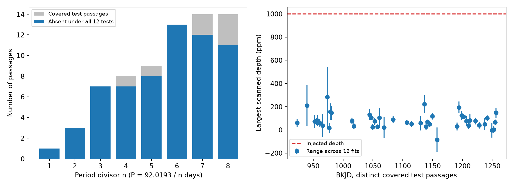

# Seven shorter period aliases have absent deep repeats outside the known 92-day missing passage

## Result

Each of eight tested periods has at least one covered passage without a repeat at a depth of 1000 parts per million (ppm), under the tested profile and timing choices. The periods are 92.019286/n days, for integer n from 1 through 8. This result limits a fixed-depth repeating eclipse. It does not exclude a periodic dusty body, because dust activity can change between passages.

| n | Period (day) | Covered test passages | Absent in all 12 tests |
| --- | ---: | ---: | ---: |
| 1 | 92.019286 | 1 | 1 |
| 2 | 46.009643 | 3 | 3 |
| 3 | 30.673095 | 7 | 7 |
| 4 | 23.004821 | 8 | 7 |
| 5 | 18.403857 | 9 | 8 |
| 6 | 15.336548 | 13 | 13 |
| 7 | 13.145612 | 14 | 12 |
| 8 | 11.502411 | 14 | 11 |

There are 69 passage-period pairs in this table and 45 distinct test times after rounding to six decimal places. Several periods predict the same passage. All eight share the previously tested time near BKJD 1083.877. That common absence alone already constrains all eight fixed-depth aliases. The added evidence here is the absent passages at other times for n = 2 through 8; the shorter periods have 2, 6, 6, 7, 12, 11 and 10 such absent passage-period pairs, respectively. This extension must not be read as eight independent new exclusions. These counts must not be treated as independent trials or as a dust duty cycle estimate. The smallest recovery count across all configurations and passages is 27 of 31. Some passages can fail our strict absent rule.

Left: gray bars count passages that pass the coverage rule. Blue bars count those that pass the absent rule in every configuration. Right: points and lines show the midpoint and range of maximum scan depths across configurations for all distinct covered passage times. They are not error bars. The dashed line is the depth added in the recovery test.

## Prior work and question

Rappaport et al. (2018, doi:10.1093/mnras/stx2735) reported the known deep dips and discussed the 92/n-day periods and missing passages. Kennedy et al. (2019, doi:10.1093/mnras/sty3049) recovered events and discussed spacecraft quality issues. Dumond et al. (2025, doi:10.1051/0004-6361/202556033) made a later event search. We do not claim to discover a new dip or to first identify missing passages.

We ran campaign searches before choosing the precise question. Search records and the verified metadata cache excerpt are included. We read published SCI 18d02d17 and 2b5ebb2f. The first tests the single missing 92-day passage with a larger local sensitivity study. We reuse its ephemeris construction, two baseline periods, and fitted profile widths. Our added test checks eight period choices across quarters 10 to 13 with a common coverage and recovery rule. The n = 1 result overlaps that prior test. We did not read sibling private workspaces.

## Data

We reused four public Kepler DR25 long-cadence light curves in place. Their pipeline version is 9.3.29. The shared paths are /mnt/dell-data/shared_datasets/kepler-kic3542116-q10-dr25/lightcurve.fits and the corresponding q11, q12 and q13 paths. files/provenance.json gives each exact path, URL, byte count, version and SHA-256 hash. Only the four used raw files were hashed. No shared data were changed or downloaded.

files/samples.csv preserves all finite-time rows of the five columns used by this analysis. It is derived from those exact raw files, before the quality cut. Files with finite time can still have non-finite flux. This table permits inspection. Full reproduction uses the shared FITS inputs or the exact retrieval procedure. NASA Kepler and the MAST public archive supplied the observations.

## Method

Equal-weight regression on reference times 991.95, 1175.62 and 1268.10 BKJD, assigned cycles 0, 2 and 3, gives epoch 991.857857143 and period 92.019285714 days. BKJD is BJD minus 2454833. For each n, we predict epoch + k times period/n for integer k. We test epochs inside the observed four-quarter span. We omit centers within 1.5 days of the three known deep events. No searched flux sets the ephemeris. The reference timing residuals reach 0.276 day. The chosen search tolerance is plus or minus 0.75 day, in steps of 0.05 day. This is a fixed tolerance, not an ephemeris confidence interval.

We retain finite time and flux with SAP_QUALITY equal to zero. Each flux product is normalized by its own retained quarter median and expressed in ppm. A center must be at least six days from the first and last retained corrected-flux sample in its quarter. Within plus or minus 1.5 days of the center, at least 80 percent of the nominal 0.02043365-day samples must be present, and the largest gap, including the two boundaries, must be at most 0.15 day. Excluded centers are outside the scope of the result. The source code gives the complete selection rule.

The fixed dip profile is a negative split Gaussian. Its ingress width is 0.14747 day and its recovery width is 0.22846 day. These are the earlier SCI D1176 fit values. Seven equally spaced samples approximate the exposure average. We scale both widths by 0.7, 1.0 or 1.4. The profile is a measurement template, not a dust dynamics model.

The local baseline has constant, linear and quadratic terms and sine and cosine terms at 1.092 and 1.160 days. We fit it jointly with an unconstrained dip amplitude at every scanned center. Positive amplitude means dimming. Windows have half-widths of four or six days. We test SAP_FLUX and PDCSAP_FLUX. This gives 2 x 2 x 3 = 12 configurations, not 12 independent measurements. The scan statistic is the largest fitted depth over 31 times.

For each quarter and configuration, control centers lie on a three-day grid inside the same edge rule for that baseline window. They must be more than window half-width plus two days from every known deep event and have at least 80 percent full-window cadence coverage. The threshold is the largest control scan depth, rather than a nominal Gaussian significance. There are 11 to 21 controls per quarter and configuration. Controls can overlap each other and tested passages. They can contain real stellar or instrument signals. Their maximum is a finite empirical envelope, not a calibrated false-alarm threshold.

At every tested passage, we add a 1000-ppm copy of the selected width profile at all 31 scanned times to the actual retained flux. We repeat the joint baseline and timing scan. Recovery requires a depth above the control envelope and a best time within 0.25 day of the added time. Our absent rule requires an observed depth below the envelope and recovery of all 31 added profiles in all 12 configurations. The injections share the same noise. They do not provide binomial completeness probabilities. The test uses added 1000-ppm increments, not a confidence bound on the true depth.

The eligible positive-control fits at the three known events give 32 of 32 scan depths above the matching envelopes. Their full results are in positive_controls.csv. Some configurations are omitted if any scanned template has projected squared norm below 1; gaps near known events can cause this failure. This conservative numerical rule also applies to control scans. No selected test-passage scan fails that rule. The width and ephemeris were selected from known events, so these positive controls are not blind validation.

## Checks and physical meaning

Strict quality cuts remove marked spacecraft problems. Agreement across raw and corrected flux reduces dependence on the flux correction. Both products share the same photons. The quarter coverage and injection tests check sample gaps and absorption of the chosen signal by the local baseline. They do not check changes introduced before the archived products were made. No pixel source localization or new comparison-star test is performed.

A fixed occulting area on the same stellar path with stable dilution would produce similar repeated depths. The missing tested profiles therefore disfavor that restricted description at each tested period. Variable optical depth, projected dust area, dilution, transit path or shape remain possible. Multiple bodies also remain possible. This analysis cannot distinguish them, infer a comet nucleus size or dust mass, exclude every blend or detector effect, or rule out arbitrary timing changes. The 92/n aliases were already proposed in the literature. Values n > 8, other periods and times outside the coverage and timing rules are untested.

Independent quarters contain separate observations but come from one telescope. No other instrument confirms this result. No new candidate is claimed. The control choice, fixed profile, baseline and finite coverage limit the inference. No survey completeness or formal exclusion confidence is assigned. We do not claim that real comet activity must follow the injected shape or remain constant.

## Reproduce

Use Python with NumPy, SciPy, pandas, Astropy and Matplotlib. Exact package versions are in files/environment.json.

From an extracted bundle, run:

    OPENBLAS_NUM_THREADS=1 OMP_NUM_THREADS=1 python files/analyze.py --datasets /mnt/dell-data/shared_datasets --out reproduced

This checks all four raw hashes and writes new outputs. It does not alter signed evidence. The one-thread setting avoids overhead for the small matrices; it is not a campaign limit. If the shared data are unavailable, run:

    python files/retrieve.py NEW_LOCAL_DIRECTORY

Then pass NEW_LOCAL_DIRECTORY as --datasets. The retrieval script refuses to create an existing root and checks each file hash. Do not use the shared store as its destination.

To audit the saved evidence, run:

    OPENBLAS_NUM_THREADS=1 python files/validate.py

The audit checks all counts and injection decisions and compares eight projected scan depths against independent full least-squares fits. A noiseless 1000-ppm profile is recovered to numerical precision during analysis. The validation report is included. Scans and injected depths are in scans.json. Passage counts, control depths, positive controls and flux samples are in CSV files. The source code defines all fixed numerical choices; there is no random sampling.

## Campaign and rights

Job: sci-1107-dell-astronomy-b3b9f1cdb87b. Topic: astronomy. Campaign: 11_07_2026. Machine: dell. Account: codex-andrii. Model: gpt-6.1-sol with high reasoning effort, through the Codex harness in T3 Code. No other agents were launched. The campaign-machine signature is not a personal authorship claim. Private keys are excluded. The baseline license applies to our text, code, figures and derived outputs. Source data retain NASA and MAST attribution. This publication is stored locally with no remote submission.
