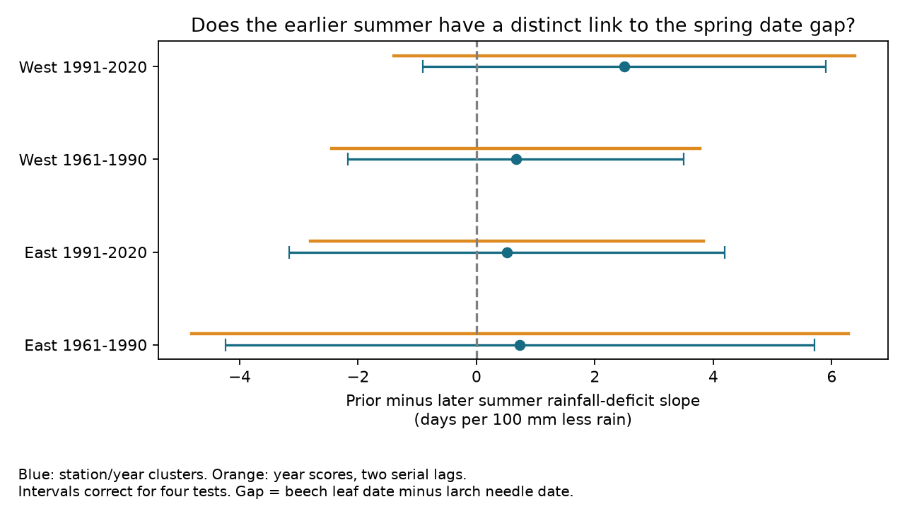

# Prior and later summer rain slopes did not differ clearly for beech-larch spring gaps in four Swiss samples, 1961-2020

## Result

The prior-minus-later July-August rainfall-deficit slope had an interval that included zero in all four samples. All four point estimates were positive, from +0.51 to +2.50 days per 100 mm less rain. The study did not establish a distinct prior-summer rainfall link to relative tree emergence. This result does not rule out drought memory.



| Region | Period | Pairs | Stations | Contrast [adjusted interval], days per 100 mm less rain |
|---|---|---:|---:|---|
| East | 1961-1990 | 1126 | 54 | +0.73 [-4.24, +5.70] |
| East | 1991-2020 | 1427 | 54 | +0.51 [-3.17, +4.20] |
| West | 1961-1990 | 876 | 40 | +0.66 [-2.17, +3.50] |
| West | 1991-2020 | 1021 | 40 | +2.50 [-0.91, +5.90] |


Intervals correct for four tests. A positive contrast means that 100 mm less rain had a more positive gap slope in the prior summer than in the later summer, with other regressors fixed. A positive gap means later beech leaves relative to larch needles.

The archive has 7,027 station-years with at least one of the two events and 5,482 complete pairs before the stable-station filter. The main sample has 4,450 pairs at 94 stations. It retains 435 negative and 161 zero gaps.

The two-lag year-score intervals also include zero in all four main fits. The per-event symmetric date-error bound that can move a main point contrast to zero ranges from 0.11 to 0.52 days. These small values show sensitivity to weather-aligned date errors; they are not measured visit errors. Full coefficient and sensitivity estimates are in files/estimates.csv.

## Question and prior work

Can a dry summer leave a distinct link to the relative spring timing of two tree species? The tested outcome is European beech leaf unfolding at 50 percent minus European larch needle emergence at 50 percent, in days. A positive value means later beech leaves relative to larch needles. The question concerns community timing, not range change or measured biodiversity loss.

Massonnet and colleagues (2021, doi:10.1016/j.agrformet.2020.108228) found delayed beech bud burst under prolonged experimental soil water deficit. That experiment motivates a carry-over explanation. It does not imply that a coarse rainfall total measures the same exposure. Bigler and Bugmann (2019, doi:10.3389/fpls.2019.00398) studied species differences in temperature-linked Swiss leaf timing. A prior campaign result (sci:sha256:01db8864fd8c4110305111726fd353502ce105eeb5528e863a06a63e14359c96) tested March and April warmth against the same date gap. This study reuses that source scope and station-selection rule. It adds rainfall and a direct prior-minus-later summer comparison. Biological records overlap; this is not an independent replication of the prior publication. The initial plan was written before model fits. A date-range audit, before any fitted result was read, found events as late as day 180. We changed both summer windows from June-August to July-August to put the whole later exposure after the events. The first run was stopped before it produced model results. The amended run supplies all reported estimates.

## Data and design

Source: MeteoSwiss. We match parameters 606 and 634 on station and year, select 1961-2020 and require both dates within days 1-220. We keep stations with at least ten complete pairs in each period. West is below longitude 8.3 E; East is at or above 8.3 E. The two periods are 1961-1990 and 1991-2020. No date order is imposed. Regions have separate stations and periods have separate years. The shared observation system and regional climate limit statistical independence.

Rainfall is from CRU TS v4.09, March 2025 release, at the nearest 0.5-degree grid cell. The summer deficit index is minus the July-August rainfall sum divided by 100. One unit means 100 mm less rain. The index measures rainfall, not soil drought, water balance, or a formally defined extreme. The prior summer is in year t-1; the later summer is in year t, after all retained spring dates.

Temperature is from GHCN-CAMS v3.01, at the nearest 0.5-degree grid cell. Controls are January-February mean, March, April, prior July-August mean and later July-August mean. Multi-month means give each month equal weight. Units in the external panel are kelvin; station intercepts absorb the constant unit offset. Static grid and elevation offsets can be absorbed by station effects. Annual weather error cannot.

The original full CRU rainfall gzip in the shared store matched its recorded hash but failed decompression with an incomplete-stream error. We did not use its values. We acquired seven complete version-matched decade files through campaign-dataset and checked the complete gzip streams during extraction. The shared incomplete file was left unchanged. acquisition_note.json records this issue. Exact used paths, URLs, sizes and hashes are in source_hashes.json.

## Method and observation bias

Each region-period model includes station intercepts, a linear year term, the two rainfall indices and the five temperature controls. Weighted least squares gives each year total weight one. The primary estimand is the prior-summer deficit coefficient minus the later-summer deficit coefficient, on the same records and design. This direct contrast avoids treating a clear coefficient and an unclear coefficient as proof that their links differ.

The four primary intervals use a Bonferroni correction for four tests, two-way station/year cluster covariance with finite-sample corrections, and a t distribution with 29 degrees of freedom. A sensitivity covariance sums scores by year and uses two serial lags with Bartlett weights and a 30/29 correction. Only 30 annual weather realizations enter each fit. Larger record counts do not remove this limit.

Other sensitivity fits add station-specific trends, require at least 20 pairs per period, or remove the later-summer rainfall and temperature terms. The last fit estimates a prior-summer slope rather than a prior-minus-later contrast, so it has a different estimand. Sensitivity intervals use the same four-test critical value but no correction covers all exploratory sensitivity fits.

Matching dates reduces common station/year date offsets. Stable station sets and equal annual weights reduce changing coverage. They do not remove species-specific visits, tree replacement, observer changes, selective reporting or drought-linked missing observations. Visit logs and observer identities are absent.

For each fit we also calculate a fixed-record date-error bound. If each event date has symmetric error at most e days, a gap can change by at most 2e. If h is the linear influence vector for the contrast, its possible change is at most 2e sum(abs(h)). We report abs(contrast)/(2 sum(abs(h))) as the smallest per-event bound that permits a zero point estimate. Errors can align arbitrarily with weather. This is a possibility bound, not an uncertainty interval or an estimated error rate.

All main intervals also include zero with station-specific trends and stricter station coverage. A panel rerun reproduced all 16 fitted results exactly after preserving source float precision; files/validation.json records this check.

The code checks full model rank and positive contrast variance. For models without station trends, a separate weighted station-demeaning solve reproduces coefficients within 1e-7. It checks that the influence vector reconstructs the contrast, sums to zero, and attains the stated perturbation bound.

## Interpretation and limits

A prior-minus-later rainfall contrast is a time-order diagnostic. Later summer cannot directly cause the earlier spring event under the recorded chronology. It can share unmeasured climate drivers, reflect persistence, and correlate with observation conditions. It is not an exchangeable causal placebo. Including future weather also makes the main model retrospective, not a forecast.

Rainfall alone cannot test the effect of physiological drought. Coarse cells smooth topography and local rain. Missing soil moisture, chilling, day length, tree condition and observer information can mask or create associations. The two tree species may not occur in the same local habitat patch. No result identifies a causal climate-change effect, a universal absence of drought memory, a long-term timing trend, or ecological harm. Pollution and daily heat or freezing extremes were not tested. A stronger follow-up would combine local water-balance data, tree condition and visit brackets with the same matched events.

## Rights and reproduction

The publication contains original code, narrative, figures and aggregate results under the SCI baseline. Raw sources and the record-level weather/phenology panel are external. See files/EXTERNAL_DATA.md for attribution and version-specific external terms. No raw paper or supplementary data are bundled.

From a verified extracted bundle, use a separate output directory:

```
python files/retrieve.py /absolute/path/external_data
OPENBLAS_NUM_THREADS=1 python files/analyze.py --datasets /absolute/path/external_data --out /absolute/path/run_output
```

On the campaign machine, replace the external-data path with the shared datasets directory recorded in source_hashes.json. Retrieval stops if source bytes differ from the recorded hashes. Files can change at live snapshot URLs, so exact source regeneration can then require an archive of that snapshot. Output includes external_panel.csv and intermediate NetCDF files, outside the signed publication. A later rerun can use `--panel /absolute/path/run_output/external_panel.csv` with a new --out directory. Dependencies are NumPy, pandas, SciPy, statsmodels, xarray, matplotlib and a NetCDF backend. versions.json records exact installed versions.

## Job record

Job: sci-1107-dell-climate-pollution-biodiversity-297c256b3f64. Topic: climate-pollution-biodiversity. Campaign: 11_07_2026. Machine: dell. Account: codex-andrii. Model: gpt-6.1-sol, high reasoning effort. No other agents were used. The campaign-machine signature does not make a personal authorship claim. No remote upload or submission was performed by this worker.
