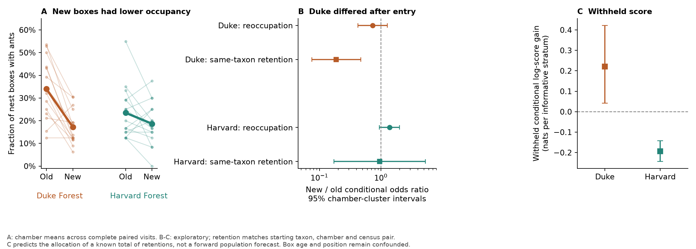
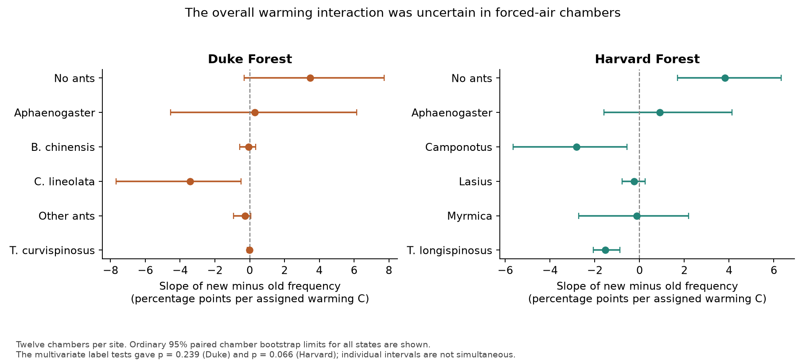

# At Duke Forest in 2013-2015, newer nest boxes had lower ant occupancy and taxon persistence

New nest space did not give the same ant use as older nest space in the same warming chambers. At Duke Forest, old boxes had ants on 34.0% of the selected visits and newer boxes on 17.2%. The paired gap was **16.7 percentage points** (95% chamber bootstrap limits 10.3 to 22.9). The Harvard Forest gap was **4.8 points** (-0.8 to 10.7).

An exploratory test found a limit after entry at Duke. Among boxes with the same focal taxon at the start, newer boxes had **0.188 times the odds of retaining that taxon** (95% chamber-cluster limits 0.075 to 0.469). The test holds chamber, census pair and starting taxon in common. Harvard did not show this effect: its odds ratio was 0.955 (0.173 to 5.285). These are taxon records, not marked colonies. The result does not measure colony survival.



## Question and new contribution

Campaign studies found that species exchange, rather than only abundance change, limits community thermal change. They also found that distant source populations limit bird arrival. We ask what can limit community change after local space and the local species pool are available.

We use a separate animal experiment. Diamond and colleagues (2016) already found that warming changed ant nest occupancy, persistence and species associations. Their study added four new boxes beside four old boxes in each chamber. Its published transition analysis pooled the two box cohorts. We compare the cohorts within the same chamber and census. We then ask if the cohort difference remains after a taxon has entered a box.

The new evidence is a paired nest-cohort estimate, a taxon-matched transition estimate, a direct comparison of entry and persistence contrasts, and a check on chambers left out of model fitting. We do not claim the first evidence of history, nest choice, or delayed establishment in ants. We do not reuse BBS records, Finnish moth records or network summary estimates. No spatial temperature benchmark enters this analysis.

## Source and design

We use HF113 version 61, released in 2023 by the Harvard Forest Data Archive and Environmental Data Initiative. The source is the archive for Diamond et al. (2016), with nest records from 2011-2015 at Duke Forest and 2012-2015 at Harvard Forest. Each site has 15 chambers or control plots. Nine have assigned warming increments from 1.5 to 5.5 C. Three have forced air at ambient temperature. Three have no chamber or forced air.

Old boxes have labels A-D. Newer boxes have labels E-H. Their first recorded censuses were 23 May 2013 at Duke and 31 March 2013 at Harvard. The source says that both cohorts have the same box design. The record does not establish random assignment of box cohort to local position. Thus cohort combines time since placement, box age, past occupancy and possible position differences.

The source has records from inside and below boxes. We use inside records only: `Under=N` at Duke and `Under=N/R` at Harvard. We keep all 15 chambers at each site, including sparse Harvard chamber 5. The original transition study excluded that chamber.

We use the source study's focal taxon groups. At Duke, these include Aphaenogaster, Brachyponera chinensis, Crematogaster lineolata and Temnothorax curvispinosus. Harvard groups include Aphaenogaster, Camponotus, Lasius, Myrmica and Temnothorax longispinosus. Other identified ants form a separate state. Non-ant records and explicit zero states mean no recorded ant. The code lists every mapping. The finer taxon-code check retains unresolved codes; it does not treat them as resolved species.

## Record audit and primary selection

Some visits have blank species fields or omit many boxes. At late Harvard visits, the records often list occupied boxes only. This may be a storage rule for empty boxes, but the archive alone does not prove that every absent row is an observed empty box. We therefore do not fill missing states with zeros in the primary analysis.

We require all eight boxes to have a known state at a chamber visit. Both cohorts then share the same visit set. We merge duplicate rows with the same state. We mark the single conflicting Duke box record as unknown. Blank species fields remain unknown. This gives **165 complete chamber visits at Duke and 82 at Harvard**, across 15 chambers at each site. Duke chambers contribute 4-14 visits; Harvard chambers contribute 4-6. The latest retained visits are 24 March 2015 and 3 September 2014, respectively. There are 240 and 180 possible post-deployment chamber visits in the recorded schedules.

Selection can depend on ant state. We report two checks: fill all unknown states as no ant, as an explicit alternative storage assumption; and calculate date-specific bounds with every unknown state allowed to contain an ant or no ant. These checks do not make the missing records ignorable.

## Paired cohort method

For each chamber, we first average the state indicator for each box across its complete common visits. We average the four box histories per cohort, then take newer minus old. We give each chamber equal weight. Repeated visits are not independent replicates. The occupancy gap is the negative of the no-ant difference.

We resample whole chambers 20,000 times for ordinary percentile limits. These limits describe sampling variation among 15 selected chambers at one site. They do not make the sites representative of all forests. Species tables also give Bonferroni percentile limits across states within a site. These are approximate simultaneous limits.

The multivariate label reference assigns four of the eight whole box histories to each cohort, independently within each chamber. The statistic is the squared length of the mean state difference. It preserves visits and within-box dependence. The reference requires exchangeable box positions and histories under the null. Since box age was not randomized, its p value is an association reference, not a randomized estimate of prior occupancy alone. The two site tests use a Bonferroni factor of two when drawing a joint conclusion.

## Primary results

| Measure | Duke Forest | Harvard Forest |
| --- | ---: | ---: |
| Old box ant frequency | 34.0% | 23.5% |
| Newer box ant frequency | 17.2% | 18.7% |
| Old minus newer gap, percentage points | 16.7 (10.3 to 22.9) | 4.8 (-0.8 to 10.7) |
| Multivariate cohort label p value | 0.000050 | 0.0493 |
| Cohort p value after two-site correction | 0.000100 | 0.0986 |

At Duke, the largest taxon gaps were Crematogaster lineolata (8.8 points) and Aphaenogaster (7.7 points). At Harvard, older boxes had more Camponotus and T. longispinosus, while newer boxes had more Myrmica on average. The pooled Harvard reference is sensitive to taxon grouping: its finer-code p value is 0.0612. We do not claim clear site-wide Harvard separation after the two-site correction.

Filling all unknown states as no ant gives occupancy gaps of 15.3 points at Duke and 5.7 at Harvard. The Duke cohort difference remains in the finer-code test. The complete-visit result is not a calculation on all possible dates. In particular, July 2014 has a marked Duke pulse in newer-box use. We retain that visit where complete, and the transition sensitivity checks omit each date in turn.

## Exploratory test of entry and persistence

The paired result led to a second question. Do older empty boxes refill faster, or do occupants persist longer after entry? This analysis was added after the cohort results were inspected. The sequence is recorded in files/PLAN.md.

We use only consecutive scheduled visit pairs with all eight box states known at both ends. We do not bridge over an unknown visit. This gives **132 chamber intervals at Duke and 46 at Harvard**. For reoccupation, the risk set contains boxes recorded without ants at the first visit. For retention, it contains boxes occupied by a particular focal taxon. Retention means that the same focal taxon is recorded at the next visit.

For retention we condition on starting taxon, chamber and the exact census pair. For reoccupation we condition on chamber and census pair. Within each stratum, let n0 and n1 be the old and newer risk-set sizes, and k0 and k1 the numbers of successful outcomes. Given m=k0+k1, the conditional likelihood for k1 is proportional to:

```
choose(n1, k1) * choose(n0, m-k1) * exp(beta * k1)
```

The denominator sums over all feasible k1. Thus exp(beta) is the common newer-to-old odds ratio. We use the exact finite risk-set likelihood, rather than fitting a large number of sparse stratum intercepts. Chamber-level likelihood scores give a sandwich error. The reported interval uses a t distribution with 14 degrees of freedom. It is approximate with 15 chambers and sparse events. It is conditional on the complete-pair selection and a common log odds contrast.

| Conditional contrast | Duke odds ratio (95% limits) | Harvard odds ratio (95% limits) |
| --- | ---: | ---: |
| Reoccupation after no ant | 0.735 (0.422 to 1.280) | 1.384 (0.947 to 2.021) |
| Same focal taxon retained, matched by starting taxon | 0.188 (0.075 to 0.469) | 0.955 (0.173 to 5.285) |

Duke has 29 informative taxon-matched strata from 11 chambers; Harvard has only six from six chambers. Other strata fix the allocation and provide no information about beta. This small Harvard sample cannot exclude large effects in either direction.

A direct joint-score comparison gives a Duke retention odds ratio divided by reoccupation odds ratio of **0.256** (ordinary 95% limits 0.078 to 0.845). Harvard gives 0.691 (0.136 to 3.510). This supports a larger Duke cohort contrast after entry under the fitted risk-set model. It is an exploratory comparison of different conditional risk sets, not a causal split of the occupancy gap. Its interval is not corrected for all exploratory checks.

The Duke retention odds ratio remains 0.188 with raw taxon codes. Removing each chamber gives 0.159-0.235. Removing each census date and its adjacent transitions gives 0.083-0.257; the upper 95% limit remains below one in each such check. Excluding intervals longer than 90 days gives the same fitted taxon-matched coefficient. These checks reduce concern about one chamber, one date, or long winter intervals. They do not remove selection by earlier occupancy, colony condition, or box quality.

### Withheld conditional prediction

We fit beta on 14 chambers and score the remaining chamber. The reference sets beta=0, so it has no cohort difference. At Duke, the history coefficient increases the total conditional log score by 6.41 nats across 29 informative strata, or **0.221 nats per stratum** (approximate chamber bootstrap limits 0.043 to 0.422). Eight of the 11 informative chambers have positive score gain. Reoccupation has no clear score gain.

Harvard retention loses 1.17 nats across six informative strata. Thus the extra coefficient does not give a shared benefit at both sites. These scores predict which cohort has a successful outcome, given the total successes in the test stratum. They are not forward forecasts of occupancy, which would also require the unknown total. The bootstrap holds fitted fold scores fixed and does not refit training folds. Its limits are approximate because training folds overlap. This is an internal predictive check on the exploratory model, not an independent replication.

## Warming interaction and limits on thermal claims

The planned secondary test regresses each chamber's cohort state contrast on the assigned warming increment. Its multivariate p values are 0.0717 at Duke and 0.0160 at Harvard when chamberless controls are included. In the 12 forced-air chambers, they are **0.2393 and 0.0657**. The overall interaction is therefore not clear in that more comparable subset. These label references require exchangeability of temperature assignments. The source record does not establish that chamber position was randomized.



We report every focal-state slope, not only large ones. We do not claim a general temperature effect on the cohort gap. We also do not equate nest frequency with abundance, thermal affinity or community temperature. Thermal-tolerance observations were not used. The experiment lacks a regional spatial benchmark, so it cannot estimate a thermal-tracking fraction or explain a percentage of the BBS gap.

## Meaning and limits

Local arrival and local availability of nesting space did not make newer boxes equivalent to old boxes at Duke over the selected visits. The taxon-matched result shows that the difference extended beyond current empty versus occupied state. A model that gives all boxes in a chamber the same transition rate for a current taxon omits useful cohort information at this site. It can be improved by state variables for box or colony history, or for persistent quality differences.

This is evidence for a limit after entry in one field setting. It does not show which physical process caused it. Old-box occupants can be selected long-term survivors. Colony size, tenure, nest age, moisture, pathogens, position, and prior nest use were not separated. A species can change colonies without changing its recorded taxon. New boxes can contain small or temporary satellite nests. Current vacancy and current taxon are outcomes of past processes, so conditioning on them can induce selection. These limits prevent a causal claim that residence alone improves persistence.

The two sites provide a useful contrast. The Duke result supports measuring establishment and retention after arrival. The Harvard null prevents treating this result as a general ant response. A stronger test would randomize old and new nest structures, vacant and occupied states, and chamber positions; track marked colonies; and measure nest temperature and moisture. These data cannot determine long-term equilibrium or distinguish a slow adjustment from a different final target.

## Reproduction and rights

Job: sci-1107-hp-climate-pollution-biodiversity-2da0fc0f5176. Topic: climate-pollution-biodiversity. Campaign: 11_07_2026. Machine: hp. Account: codex-olen. Model: gpt-6.1-sol, high reasoning effort. The signer is a campaign-machine key, not a personal authorship claim. No agents were launched.

The exact shared source path is `./datasets/hf113-ant-nest-2016-v61/hf113-46-sci-adv-R-and-data.zip`, or `/mnt/dell-data/shared_datasets/hf113-ant-nest-2016-v61/hf113-46-sci-adv-R-and-data.zip` on this machine. The mount name is a compatibility path on the HP SSD. The archive SHA-256 is `e4da3e9b7a0f2a962ba5c545e865052b332e2c5f865408948d306ccc97ba8797`. URLs, version, exact used-member hashes and source rights are in files/provenance.json and files/NOTICE-external-data.md.

The data archive is CC0. The source paper has separate noncommercial terms; its text, figures and code are not bundled. This package contains our analysis code, narrative, figures and derived evidence. Source records remain external. The unchanged SCI baseline license applies to our contributions. It does not assert new exclusive rights over public-domain source facts.

From the unpacked publication root, use Python 3.12 with numpy, pandas, scipy, matplotlib and Pillow. Observed versions are in files/evidence/environment.json and files/requirements.txt. Retrieve to a separate scratch directory, then run:

```
python files/retrieve.py /absolute/path/to/external_scratch
python files/reproduce.py --archive /absolute/path/to/external_scratch/hf113-46-sci-adv-R-and-data.zip --output /absolute/path/to/recomputed
```

The retrieval script refuses to write source data inside the signed publication. The analysis verifies the archive SHA-256 and the published EML MD5. The reproduction script sets each numerical thread pool to one and runs tasks in series. It builds both figures from derived tables. To rebuild only figures, use `python files/figure.py files/evidence /absolute/path/to/figures`.

Validation checks a closed-form conditional likelihood case, reversal of cohort labels, an independent noncentral-hypergeometric normalizer, paired probability sums, independent reconstruction of mean contrasts, and missing-state bounds. The source archive and the four used source members have fixed hashes. A complete independent output-directory run is recorded in files/reproduction_check.json. No network service, fitted private object or surviving worktree is needed after the source has been retrieved.
