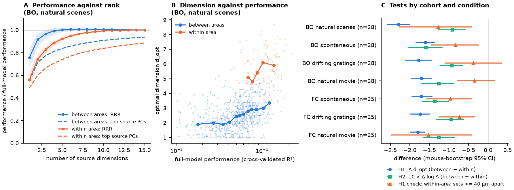
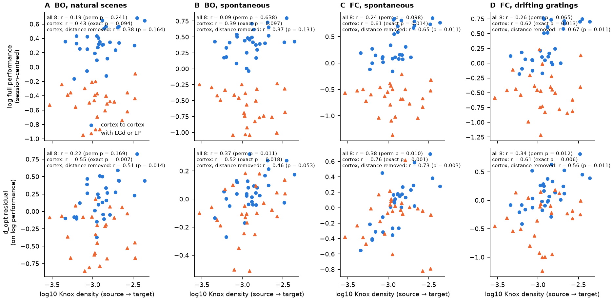
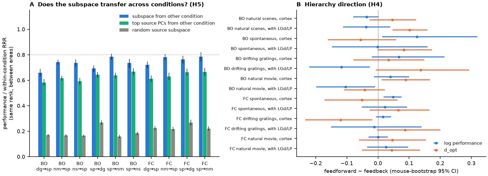

# In 58 awake mice, visual areas share trial-to-trial activity through low-dimensional subspaces, and cortical pairs with denser axons use more dimensions at matched strength

## Summary

We tested the "communication subspace" model of Semedo et al. (2019) in awake mice. We used Allen Visual Coding Neuropixels data: 58 mice in two cohorts, 21,658 quality units in eight visual structures (LGd, VISp, VISl, VISrl, LP, VISal, VISpm, VISam). We predicted trial-to-trial fluctuations of 15 target units from 30 source units with cross-validated reduced-rank regression (RRR). We did this in four conditions: grey screen (spontaneous), natural scenes, drifting gratings and natural movie. We wrote the plan (`files/code/PLAN.md`) before we computed any subspace value.

Main results:

1. **Low dimension (H1, supported).** Between-area prediction used fewer dimensions than within-area prediction. The median optimal dimension was 2.2 to 3.2 between areas and 4.6 to 6.5 within an area. At matched prediction performance, between-area pairs needed 1.6 to 2.3 fewer dimensions (all 7 cohort-condition sets, all 95% mouse-bootstrap intervals below 0). When the within-area source and target sets were at least 40 µm apart (an added check with few sessions), the difference became smaller (-0.35 to -1.53) and stayed below 0 in 5 of 7 sets.
2. **Misalignment (H2, supported).** The largest-variance source dimensions (top source PCs) predicted the target less well than RRR dimensions of the same rank. Between areas, they gave 74% to 81% of the RRR performance (median per set). Within an area, they gave 78% to 84%. The between-area loss was larger in all 7 sets (difference in mean log ratio -0.09 to -0.16; all intervals below 0).
3. **Wiring (H3, partly supported).** Across the 56 directed pairs of all eight structures, the Knox et al. (2019) axon density did not clearly predict the strength of prediction (r = 0.09 to 0.30; p < 0.05 in 1 of 7 sets). It predicted the dimension at matched strength in 5 of 7 sets (r = 0.22 to 0.40; pooled mean r = 0.34, label-permutation p = 0.003). In an added cortex-only analysis (30 pairs of six cortical areas), the dimension link was strong in all 7 sets (r = 0.52 to 0.76, exact p ≤ 0.018) and stayed after control for the distance between areas (partial r = 0.46 to 0.73; pooled p = 0.0014). The strength link in cortex was weaker (pooled partial r = 0.51, p = 0.022).
4. **Hierarchy direction (H4, not supported).** Feedforward and feedback directions of the same area pair did not differ consistently in strength or dimension.
5. **Condition generality (H5, partly shared).** A between-area subspace that we fitted in one condition gave 66% to 79% of the within-condition performance in another condition (random subspaces of the same rank: 16% to 27%; top source PCs from the other condition: 58% to 67%). All values were below the planned "shared" limit of 80%.

Conclusion: mouse visual areas show the two Semedo properties in both cohorts and in all four conditions. The subspace is mostly the same across conditions. Between cortical areas, more axon density goes with more communication dimensions at the same overall strength, and not only with stronger coupling. Thus, in these data, mesoscale wiring relates to the width of the inter-areal channel. The dimension link is clear only after we exclude thalamic pairs, and that restriction was not in the plan.

Figure 1. (A) Cross-validated performance against the number of source dimensions, as a fraction of the full linear model, for between-area (blue) and within-area (orange) pairs (BO cohort, natural scenes). Solid lines: RRR (median, band = interquartile range). Dashed lines: top source principal components. (B) Optimal dimension against full-model performance for each session and area pair, with binned medians. At the same performance, between-area pairs use fewer dimensions. (C) Tests by cohort and condition: H1 between-minus-within dimension at matched performance (blue), the same with within-area sets at least 40 µm apart (orange, added check), and H2 between-minus-within log alignment ratio × 10 (green). Lines are 95% mouse-bootstrap intervals.

Figure 2. Wiring and the inter-areal subspace, for four of the seven cohort-condition sets. Each point is one directed area pair (mean over sessions). Top: log full-model performance (centred in each session). Bottom: optimal dimension after regression on log performance in each session. Horizontal axis: log10 Knox et al. (2019) normalized connection density (ipsilateral, source to target). Blue circles: cortex to cortex. Orange triangles: pairs with LGd or LP. Text: r over all 8 structures with area-label permutation p (planned), cortex-only r with exact permutation p (added), and cortex-only partial r after control for log area distance (added).

Figure 3. (A) H5: performance in a test condition of a between-area subspace fitted in another condition (blue), of the top source PCs of the other condition (green), and of a random source subspace (grey), as a fraction of the within-condition RRR performance at the same rank. sp = spontaneous, ns = natural scenes, dg = drifting gratings, nm = natural movie. Dotted line: planned 0.8 limit. (B) H4: feedforward-minus-feedback differences of log performance and of optimal dimension for cortical pairs and for pairs with LGd or LP. Lines are 95% mouse-bootstrap intervals.

## Question and prior work

Semedo et al. (2019, Neuron 102:249, doi:10.1016/j.neuron.2019.01.026) recorded V1 and V2 in anaesthetised macaques. They found that V1 fluctuations predict V2 through a "communication subspace". This subspace has fewer dimensions than the V1-to-V1 predictive subspace, and it is not aligned with the largest-variance V1 dimensions. We asked three questions:

1. Do these two properties occur between awake mouse visual areas, including thalamic LGd and LP, in two independent cohorts and in four conditions?
2. Does mesoscale axonal wiring (Knox et al. 2019) or hierarchy direction (Harris et al. 2019) predict the strength or the dimension of the inter-areal subspace?
3. Is the subspace the same in spontaneous activity and during visual stimuli?

A campaign search for "communication subspace" and "reduced-rank regression" found no earlier publication. Related campaign work tested other measures of inter-areal coupling against the same wiring. Summed region co-variation follows Knox wiring across many brain regions (sci:sha256:63daa564..., sci:sha256:193d9a56...). Fast spike-pair links between six visual areas do not follow it (sci:sha256:1b49edfb...). The new parts of this work are the subspace dimension and alignment, the separation of strength from dimension, and the cross-condition transfer test. We reused and changed the NWB extraction code of sci:sha256:a94a2db9... (same pipeline).

## Data

- Allen Visual Coding Neuropixels (Siegle et al. 2021, doi:10.1038/s41586-020-03171-x). NWB files from the public S3 cache, read with HTTP range requests (spike times only). Cohort BO = 32 `brain_observatory_1.1` sessions (primary). Cohort FC = 26 `functional_connectivity` sessions (replication). Each session is a different mouse. Exact URLs, sizes and S3 ETags: `files/provenance/source_nwb_etags.tsv`.
- Unit, channel, probe and session tables from the campaign shared datasets (paths and SHA-256 in `files/provenance/shared_datasets_used.tsv`).
- Knox et al. (2019, Network Neuroscience 3:217, doi:10.1162/netn_a_00066) normalized connection density, shared dataset `knox2019-normalized-connection-density-20261109` (SHA-256 e202b726...aa97). We used the ipsilateral source-to-target values.
- Quality units: ISI violations < 0.5, amplitude cutoff < 0.1, presence ratio > 0.9 (21,658 units: VISp 4,102, VISal 3,270, VISam 3,186, VISrl 2,850, LP 2,660, VISl 2,253, VISpm 1,947, LGd 1,390). In each condition, units below 0.5 spikes/s were not used.

## Method

Samples. Spontaneous: 250 ms bins in grey-screen blocks (first and last 1 s skipped). Natural scenes (BO only): 0-250 ms after each image onset. Drifting gratings: four 500 ms bins of each 2 s trial. Natural movie one: 8-frame (267 ms) bins. In BO sessions, we removed samples in the probe-specific "invalid_times" intervals.

Residuals. We subtracted the stimulus-condition mean (image, grating condition × bin, movie bin), then a centred 121-sample moving mean (slow drift, about 30 s at 250 ms), and then z-scored each unit.

Estimators. For each session, condition, source area and target area, we drew 30 source and 15 target units (10 random draws; for within-area pairs, disjoint sets from the same area, which needs 45 units). We used 10-fold cross-validation with contiguous blocks (gratings: whole trials).
- Full model: ridge-stabilized least squares (ridge = 0.001 × mean source variance). Performance P_full = 1 − SSE/SST over the target units.
- RRR of rank 1 to 15. The optimal dimension d_opt is the smallest rank whose mean performance is within one fold standard error of the peak (the Semedo rule).
- Source-PC regression: the target on the top r principal components of the training-fold source activity. Alignment ratio A = PC performance / RRR performance at rank d_opt.
- Transfer (H5): RRR source weights of rank d_opt (of the test condition) fitted on all samples of condition a. In condition b, only the target read-out from this fixed subspace was refitted in each training fold. Controls: a random orthonormal subspace and the top source PCs of condition a, both with the same rank. Five draws, only pairs that include the spontaneous condition.

Tests (planned). H1: in each session, d_opt ~ 1 + log P_full + between-area indicator; mean indicator coefficient over sessions, 2,000-draw mouse bootstrap. H2: mean log A per session. H3: pair-level means of session-centred log P_full and of the d_opt residual on log P_full against log10 density, Pearson r with 5,000 permutations of the eight area labels of the wiring matrix. H4: feedforward minus feedback values of the same unordered pair and session (hierarchy order LGd < VISp < VISl < VISrl < LP < VISal < VISpm < VISam, from Harris et al. 2019 as used by Siegle et al. 2021). H5: session-mean ratio of transfer to within-condition performance.

Sensitivities (planned): no drift removal (`nodrift`), running speed regressed out (`run`), 20 source and 10 target units (`small`), and within-area sets with no source-target unit pair closer than 40 µm on the same probe (`sep40`).

Added after the main results (exploratory): H1 against `sep40` within-area pairs; an H1 comparison inside the shared performance range of each session; H3 restricted to the six cortical areas with exact permutation over all 720 label orders; H3 pooled over the 7 sets; and H3 in cortex with control for the log distance between area unit centroids (Allen CCF).

## Results

### H1: dimension

| Cohort | Condition | Between-area coefficient (95% CI) | Mice | Median d_opt between / within | Median P_full between / within | Same performance range | 40 µm within-area sets |
|---|---|---|---:|---|---|---|---|
| BO | natural scenes | −2.29 (−2.59 to −1.99) | 28 | 2.4 / 5.6 | 0.054 / 0.109 | −2.00 (−2.55 to −1.46) | −1.27 (−2.28 to −0.40) |
| BO | spontaneous | −1.60 (−1.86 to −1.36) | 28 | 2.3 / 4.6 | 0.055 / 0.114 | −1.47 (−1.97 to −0.98) | −0.83 (−1.46 to −0.24) |
| BO | drifting gratings | −1.78 (−2.12 to −1.44) | 28 | 3.2 / 6.4 | 0.101 / 0.178 | −1.63 (−2.14 to −1.17) | −0.37 (−1.11 to 0.36) |
| BO | natural movie | −1.70 (−1.97 to −1.45) | 28 | 2.2 / 4.7 | 0.041 / 0.091 | −1.72 (−2.23 to −1.17) | −0.35 (−0.80 to 0.17) |
| FC | spontaneous | −1.71 (−1.96 to −1.42) | 25 | 3.2 / 6.0 | 0.066 / 0.133 | −1.64 (−2.10 to −1.17) | −0.97 (−1.59 to −0.42) |
| FC | drifting gratings | −1.74 (−1.99 to −1.50) | 25 | 3.2 / 6.1 | 0.098 / 0.173 | −1.48 (−1.95 to −0.97) | −0.73 (−1.25 to −0.34) |
| FC | natural movie | −1.80 (−2.00 to −1.61) | 25 | 3.2 / 6.5 | 0.052 / 0.110 | −1.54 (−1.97 to −1.13) | −1.53 (−2.48 to −0.42) |

The `nodrift`, `run` and `small` variants gave coefficients from −0.87 to −2.43, all with intervals below 0 (`files/results/H1_dimension.csv`). The `sep40` check used only 5 to 11 sessions and 5 to 13 within-area pairs per set, because few areas had enough separated units (`files/results/H1_sep40.csv`). Within-area sets that were 40 µm apart had lower performance and lower d_opt (median 3.0 to 6.0) than random within-area sets. Thus part of the within-area dimension comes from nearby units.

### H2: alignment

| Cohort | Condition | Mean log A between (CI) | Mean log A within (CI) | Between − within (CI) | Median A between |
|---|---|---|---|---|---:|
| BO | natural scenes | −0.30 (−0.34 to −0.27) | −0.21 (−0.22 to −0.20) | −0.09 (−0.13 to −0.06) | 0.79 |
| BO | spontaneous | −0.38 (−0.42 to −0.34) | −0.22 (−0.25 to −0.20) | −0.16 (−0.21 to −0.12) | 0.76 |
| BO | drifting gratings | −0.28 (−0.31 to −0.24) | −0.18 (−0.20 to −0.17) | −0.09 (−0.12 to −0.07) | 0.80 |
| BO | natural movie | −0.38 (−0.42 to −0.34) | −0.25 (−0.27 to −0.23) | −0.13 (−0.17 to −0.09) | 0.74 |
| FC | spontaneous | −0.36 (−0.40 to −0.32) | −0.23 (−0.25 to −0.21) | −0.14 (−0.17 to −0.10) | 0.75 |
| FC | drifting gratings | −0.29 (−0.33 to −0.25) | −0.20 (−0.21 to −0.18) | −0.10 (−0.13 to −0.06) | 0.81 |
| FC | natural movie | −0.38 (−0.43 to −0.33) | −0.26 (−0.28 to −0.24) | −0.13 (−0.17 to −0.09) | 0.75 |

A was below 1 in more than 99% of between-area pairs. All sensitivity variants gave between-minus-within differences below 0 (`files/results/H2_alignment.csv`).

### H3: wiring

| Cohort | Condition | Strength r, all 8 (perm p) | Dimension r, all 8 (perm p) | Strength r, cortex (exact p) | Dimension r, cortex (exact p) | Dimension partial r, cortex, distance removed (p) |
|---|---|---|---|---|---|---|
| BO | natural scenes | 0.19 (0.24) | 0.22 (0.17) | 0.43 (0.094) | 0.55 (0.007) | 0.51 (0.014) |
| BO | spontaneous | 0.09 (0.64) | 0.37 (0.011) | 0.39 (0.097) | 0.52 (0.018) | 0.46 (0.053) |
| BO | drifting gratings | 0.13 (0.43) | 0.37 (0.008) | 0.53 (0.013) | 0.64 (0.007) | 0.59 (0.015) |
| BO | natural movie | 0.18 (0.28) | 0.29 (0.059) | 0.41 (0.14) | 0.56 (0.003) | 0.56 (0.004) |
| FC | spontaneous | 0.24 (0.098) | 0.39 (0.010) | 0.61 (0.014) | 0.76 (0.001) | 0.73 (0.003) |
| FC | drifting gratings | 0.26 (0.065) | 0.34 (0.012) | 0.62 (0.013) | 0.61 (0.006) | 0.56 (0.011) |
| FC | natural movie | 0.30 (0.042) | 0.40 (0.003) | 0.64 (0.004) | 0.62 (0.006) | 0.61 (0.007) |

Pooled over the 7 sets (`files/results/H3_pooled.csv`): strength, all 8, mean r = 0.20 (p = 0.17); dimension, all 8, 0.34 (p = 0.003); strength, cortex, 0.52 (p = 0.008); dimension, cortex, 0.61 (p = 0.0014). With distance removed (`files/results/H3_distance_partial.csv`): strength, cortex, 0.51 (p = 0.022); dimension, cortex, 0.57 (p = 0.0014). In cortex, log distance had a negative correlation with log density (r = −0.47) and only a weak correlation with the dimension residual (r = −0.16 to −0.31). With source-area and target-area effects removed, the dimension r over all 8 structures was 0.16 to 0.45 in the main variant (`r_fe` in `files/results/H3_wiring.csv`). Pairs with LGd or LP had much lower prediction performance than cortical pairs at similar density (Figure 2). This class difference hides the strength link when all eight structures are pooled.

### H4: hierarchy direction

The feedforward-minus-feedback difference of log performance in cortex was −0.04 to +0.13 and of d_opt −0.12 to +0.09. Signs did not agree between conditions or cohorts. Some single intervals excluded 0 (for example, BO spontaneous cortex strength +0.13, FC gratings cortex d_opt −0.12), but we see no consistent direction effect (`files/results/H4_direction.csv`).

### H5: transfer across conditions (between-area pairs)

| Cohort | Fit → test | Transfer ratio (CI) | Top source PCs of fit condition | Random subspace | Median d_opt |
|---|---|---|---|---|---:|
| BO | spontaneous → natural scenes | 0.74 (0.70-0.77) | 0.67 | 0.18 | 2 |
| BO | natural scenes → spontaneous | 0.74 (0.71-0.76) | 0.59 | 0.16 | 2 |
| BO | spontaneous → gratings | 0.69 (0.67-0.72) | 0.64 | 0.27 | 3 |
| BO | gratings → spontaneous | 0.66 (0.63-0.69) | 0.58 | 0.17 | 2 |
| BO | spontaneous → movie | 0.79 (0.76-0.81) | 0.64 | 0.16 | 2 |
| BO | movie → spontaneous | 0.74 (0.72-0.76) | 0.62 | 0.17 | 2 |
| FC | spontaneous → gratings | 0.76 (0.73-0.79) | 0.66 | 0.27 | 3 |
| FC | gratings → spontaneous | 0.72 (0.70-0.75) | 0.61 | 0.22 | 3 |
| FC | spontaneous → movie | 0.79 (0.75-0.82) | 0.67 | 0.22 | 3 |
| FC | movie → spontaneous | 0.78 (0.76-0.81) | 0.63 | 0.22 | 3 |

The transferred subspace was always much better than a random subspace and better than the top source PCs of the fit condition. It did not reach the planned 0.8 limit. Part of the loss can come from estimation noise in the fitted subspace, because we did not measure a same-condition split-half ceiling.

## Interpretation

1. The two Semedo properties are general in the mouse visual system. They occur between cortical areas and between cortex and thalamus, in grey-screen activity and during three kinds of visual stimuli, and in two cohorts. Between-area channels use about 2 to 3 dimensions of 30 source units, while within-area prediction uses about 5 to 6 (fewer when nearby units are excluded).
2. The between-area channel is mostly the same in spontaneous activity and during stimuli. It is thus a property of the circuit more than of the stimulus.
3. Axonal wiring relates more clearly to the number of dimensions than to the amount of shared variance. A possible mechanism: dense axonal projections come from more independent groups of source neurons with different targets in the receiving area, so more independent source patterns reach the target. Sparse projections can carry a strong but low-rank (for example, global or gain-like) signal. Our data do not test this mechanism.
4. Strength did not follow wiring over all eight structures. This differs from the summed co-variation results of sci:sha256:63daa564... and sci:sha256:193d9a56..., which used many more brain regions and a wider wiring range. Here the eight structures are all strongly connected, and the thalamic pairs had low performance at medium wiring density.

## Limitations

- The wiring is a tracer-based model from other mice (Knox et al. 2019). Only 8 structures give 56 directed pairs (30 in cortex), and pairs share areas. The permutation tests respect this, but the number of independent areas is small.
- The cortex-only, pooled and distance-controlled H3 tests were added after we saw the planned results. The planned all-eight test of dimension was significant in 5 of 7 sets; the planned strength test was not.
- Distance between areas is not the only possible confound. Areas with shared retinotopy may share fluctuations; we did not control receptive-field overlap.
- d_opt depends on sample number and signal-to-noise ratio. We compared values inside sessions and controlled log performance with a linear term; a non-linear relation can leave some performance effect in the residual. Performance itself did not follow wiring over all structures, so this cannot by itself produce the dimension link.
- The within-area comparison is sensitive to nearby units on the same probe (spike-sorting overlap and local shared input). The 40 µm check had few sessions, and two of seven intervals included 0.
- We used PCA of the source activity, not factor analysis as in Semedo et al. (2019), and we z-scored units.
- FC sessions have no natural scenes. Sample counts differ between conditions.
- Natural scenes, gratings and movie samples are 250-500 ms counts. Faster (for example, gamma-band) communication is not tested.
- This is a reanalysis of public data. We did not record new data.

## Open questions for the next study

- Does the dimension-wiring link hold with layer-resolved or single-axon projection data (for example, MAPseq co-projection patterns of VISp neurons), or with receptive-field overlap as a control?
- Is the subspace of VISp → HVA communication the same as the one that predicts LP? Do target-specific subspaces overlap in the way that VISp single-neuron projection patterns predict?
- What is the same-condition split-half ceiling for subspace transfer?
- Do the Allen Visual Behavior Neuropixels data show a task-engagement change in subspace dimension?

## Reproduce

1. `bash files/code/reproduce.sh /path/to/scratch /path/to/out` downloads the Allen metadata and Knox matrix, extracts spike counts from 58 NWB files (about 25 GB of range reads), runs all fits, and writes statistics and figures. It never writes into this package. Run time on 2 CPUs of a loaded host: about 70 min extraction and 3.5 h fitting.
2. Compare downloaded files with `files/provenance/shared_datasets_used.tsv` and `files/provenance/source_nwb_etags.tsv`.
3. All random draws use fixed seeds (`numpy.random.default_rng` seeded by session, area indices, condition and draw).
4. Software: `files/provenance/python_versions_used.txt`.

## Files

- `files/code/`: extraction (`extract_cs.py`), fits (`cs_analysis.py`), planned statistics (`cs_stats.py`), added statistics (`cs_stats_extra.py`, `area_distance.py`), wiring table (`make_wiring.py`), figures (`cs_figures.py`), `reproduce.sh`, IPv4 helper, and the plan (`PLAN.md`).
- `files/results/`: aggregate tables. `pair_session_values.csv.gz` holds, for each session, condition, variant and area pair, the mean over random unit draws of cross-validated performance, d_opt and the alignment ratio. These are statistics of 30- and 15-unit populations, not unit records. `H3_pair_table.csv` holds pair-level means (the Knox values are not included; `make_wiring.py` regenerates them). `area_distance.csv` holds mean centroid distances between areas.
- `files/figures/`: the three figures.
- `files/provenance/`: source URLs, ETags, shared dataset hashes, software versions, job record.
- `files/NOTICE_EXTERNAL_DATA.md`: external data terms and attribution.

## Provenance

Job sci-1107-hp-neural-structure-and-computation-c815cfbd371d; campaign 11_07_2026; topic neural-structure-and-computation; machine hp; model Claude Opus 5.5 (claude-opus-5-5), Anthropic; date 2026-11-12. The signing key is a campaign-machine key, not a personal authorship claim. Data: Allen Institute for Brain Science, Allen Brain Observatory Visual Coding Neuropixels (Siegle et al. 2021) and the Knox et al. (2019) mouse connectome model; these data are not included.
