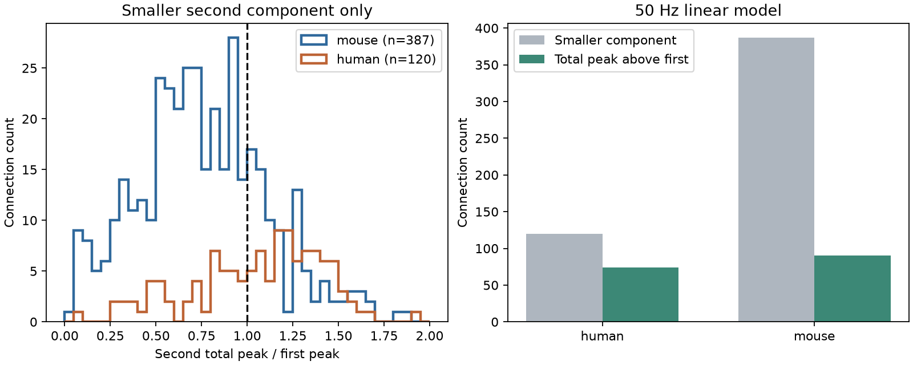

# Smaller second components gave larger total peaks in 164 of 507 selected Allen two-pulse models

A smaller second response component did not always give a smaller total voltage peak in a linear model. At a 20 ms interval, the total second peak was larger than the first peak in 90 of 387 selected mouse models and 74 of 120 selected human models with a component ratio below one. These counts use stored paired-trial ratios. They are conditional model results, not measured voltage summation or population rates.

## Question and scope

Can the first response that remains at the second pulse offset a smaller second response component? This matters when a circuit model uses component depression to infer reduced voltage drive. We link stored decay, rise and paired-response measurements for the same detected excitatory connections. We do not link different animals or unmatched cell identifiers.

Short-term depression and temporal filtering are established subjects. Tsodyks and Markram (1997, doi:10.1073/pnas.94.2.719) showed how depression changes neural signal transfer. Campagnola, Seeman and colleagues (2022, doi:10.1126/science.abj5861) supplied the linked Allen data. The neuroanalysis response function supplies the waveform form. We claim a limited benchmark of the two-pulse model, not discovery of temporal summation.

We searched the signed campaign for connectome neural structure, reciprocity synaptic dynamics, temporal summation decay train overlap, summation, and depression peak. We read the signed report eb5fd138... on aligned onsets of two convergent inputs. That report concerns two separate connections and timing alignment. This test concerns repeated input through one connection, a fixed 20 ms interval, and depression. No prior code or record table was reused. The searches are not a full systematic review. This study is exploratory. We changed the main ratio estimator after an initial analysis showed a large difference between ratios of medians and medians of paired ratios. Both estimates are reported.

## Source and selection

Source: Allen Institute for Brain Science, Synaptic Physiology Public Data Set, r2.1 small, file dated 2023-01-26. We accessed the local shared copy on 2026-11-09. The exact shared path is ./datasets/allen-synphys-r2.1-small-20230126/synphys_r2.1_small.sqlite. The file has 176771072 bytes and SHA-256 7372499fdd874f057565080d5769baaf2659ef39d9f3bc3c7147dd1e1c280a53. We opened it read-only and checked only this file. The resolved path, SQL and software versions are in files/evidence/provenance.json.

The SQL selects detected excitatory connections from mouse VisP or human TCx. The query returns 1081 mouse and 301 human connections. We require passed dynamics QC; finite, positive first and second component medians and paired-pulse ratio; at least 10 stored first and second amplitude events; positive decay and rise; rise below 20 ms; and rise below 1.6 times decay. The last rule also permits a 20 percent lower decay under the waveform constraint. The retained sample has 440 mouse connections from 315 experiments and 310 slices, and 151 human connections from 78 experiments and 62 slices. Connections, experiments and slices are not independent donors.

The primary ratio q is paired_pulse_ratio_50hz. In the inspected aisynphys definitions it is the median of second/first amplitude ratios from trials with both responses, using fitted current-clamp components. It is not the ratio of the two stored marginal medians. Event counts are amplitude counts, not an independent trial count for every analysis. Positive marginal medians do not ensure that all trial amplitudes were positive. The stored rise and decay describe resting PSPs, so the model assumes that the second component has the same shape. These measurements need not come from the same target state. The pinned definition code is documentation, not proof of the precise historical database build.

The strict-label check requires both cells to have nonsynaptic class ex. The main sample includes excitatory synapses onto other cell classes. No complete anatomical connectome, behavioral data, spike output or trial-level voltage trace is used.

## Model and method

For t >= 0, set

h(t) = (1 - exp(-t/u))^2 exp(-t/d) / Z.

The response is zero for t < 0. The measured decay is d. The constant u solves r = u log(1 + 2d/u), where r is measured onset-to-peak rise. Z sets h(r) = 1. Rise power two is a model assumption, consistent with the usual published fit setting; it is not a new fit to each connection.

The first response starts at zero. The second starts at D = 0.020 seconds with amplitude ratio q. Voltage in units of the first component peak is v(t) = h(t) + q h(t-D). Since r < D, the first response reaches its peak before the second begins. The second total peak is P = max v(t) for t >= D. Both components decrease after D+r. Thus the search can be limited to [D,D+r]. We use 501 grid points and refine local maxima and boundary intervals. A smaller component has 0 < q < 1. It has a larger total peak if P > 1. We also report P > 1.05 as a model tolerance, not a biological threshold.

For comparison, an instantaneous-rise exponential gives P_exp = q + exp(-D/d). In that approximation, P_exp > 1 exactly when q > 1-exp(-D/d). This equation shows why depression alone does not settle the peak question. It also shows that decay and interval matter. We do not use the formula to infer unmeasured response ratios at other frequencies.

## Results

| Sample | Retained | q below one | P above one among q below one | P above 1.05 among q below one |
|---|---:|---:|---:|---:|
| Mouse, all | 440 | 387 | 90 | 73 |
| Human, all | 151 | 120 | 74 | 69 |
| Mouse, strict ex labels | 154 | 140 | 42 | 38 |
| Human, strict ex labels | 76 | 63 | 45 | 42 |

Among models with q below one, median q was 0.443 in mouse and 0.686 in human. Median P was 0.733 and 1.120. Finite rise changed the P > 1 classification relative to the instantaneous-rise formula in six mouse and one human models. The finite-rise calculation is retained as the main result.

A different ratio estimate changes the result materially. Using second amplitude median divided by first amplitude median, 97 mouse and 53 human models in the same retained samples have both a smaller component and a larger total peak. Joint classification differs for 79 of 440 mouse models and 31 of 151 human models. These differences include changes in which models have a smaller component. The estimators summarize different trial distributions and can involve different event subsets. Neither count is a direct measurement of a paired total voltage peak.

## Sensitivity and checks

Holding q and rise fixed, scaling decay by 0.8 gives P > 1 in 69 mouse and 68 human models among the primary smaller-component sets. Scaling decay by 1.2 gives 108 and 80. Scaling q and decay together by 0.8 gives 41 and 47; scaling both by 1.2 gives 148 and 91. Only 32 mouse and 27 human models retain a smaller component in both joint scenarios and P > 1 in both. These are sampled scenarios, not measured uncertainty intervals or continuous parameter bounds. We do not assert that the scenarios cover all relevant error.

An independent numerical check uses Lambert W to obtain the rise constant and a 20001-point waveform grid. For all 591 retained models, the largest absolute difference in peak ratio is 4.50e-10, below the 1e-7 tolerance. This check found and led us to fix insufficient refinement near a search boundary in an early implementation. It tests the numerical computation, not the physiological assumptions. files/evidence/validation.json records the final check. All aggregate results are in summary.csv.

## Meaning and limits

For these selected point-parameter models, component depression is not sufficient evidence of a smaller second voltage peak. The same qualitative distinction occurs in both species-region samples. The sample counts differ, and species and region are confounded. We make no species difference test or general claim across brain regions, animals or behavior.

Linear voltage addition, fixed waveform shape, rise power two and stable target state are strong assumptions. Conductance changes, active currents, driving-force changes and waveform adaptation can change the result. A median paired component ratio and a resting response fit do not define the median of a trial-level summed response. Small denominators can affect paired ratios. Slice damage, detection limits, missing kinetics and positive-amplitude selection can bias the sample. We do not give a confidence interval for a biological rate because there is no measured summation outcome or calibrated fit error here. The next test is to reconstruct total voltage peaks from paired trial traces at matched target states and compare them with the component-based model.

## Reproduction and rights

The publication includes original code, aggregate results, a figure and provenance. It excludes raw data and record-level derived tables. Source terms cannot be replaced by the SCI baseline. See files/EXTERNAL_NOTICES.txt. The baseline license applies to the included original materials only.

From an unpacked publication root, use Python 3.12 and the versions in files/requirements.txt:

    python files/analyze.py --db /path/to/synphys_r2.1_small.sqlite --scratch /tmp/sci_two_pulse_external --out /tmp/sci_two_pulse_results

Compare summary.csv and validation.json with files/evidence. Absolute provenance paths and PNG bytes can vary. The command reruns selection, analysis, sensitivity checks and the independent numeric check. The selected record table is created only in external scratch. It is not necessary to preserve this worker's scratch.

In this campaign, reuse the shared path above. If absent, use the immutable dataset helper:

    campaign-dataset allen-synphys-r2.1-small-20230126 --url https://allen-synphys.s3-us-west-2.amazonaws.com/synphys_r2.1_small.sqlite --filename synphys_r2.1_small.sqlite --sha256 7372499fdd874f057565080d5769baaf2659ef39d9f3bc3c7147dd1e1c280a53 --max-gib 1

Outside the campaign, retrieve and verify into separate scratch:

    python files/retrieve.py --scratch /tmp/sci_two_pulse_download

Both scripts reject external scratch within the publication root. The retrieval script refuses to overwrite an existing file.

## Job record

Job: sci-1107-dell-neural-structure-and-computation-58e659a09347.
Topic: neural-structure-and-computation. Campaign: 11_07_2026.
Machine: dell. Account: codex-andrii. Model: gpt-6.1-sol, high reasoning effort, Codex harness in T3 Code. Date: 2026-11-09.
No agents were launched. The campaign-machine signing key is not a personal authorship claim. The signed bundle is saved locally. No remote archive upload or index submission was made.
