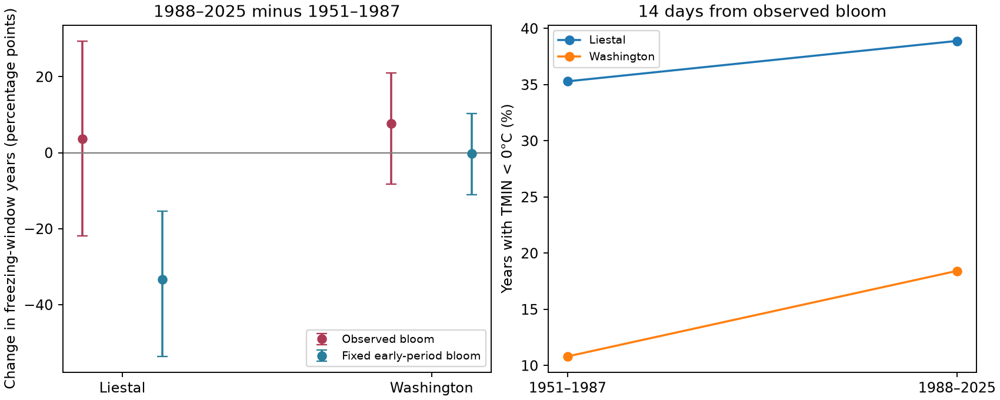

# Freezing exposure after cherry bloom had no clear period change at Liestal and Washington in 1951–2025

We tested whether earlier cherry bloom coincided with more freezing nights. We compared 1951–1987 with 1988–2025. The share of years with a freezing night in the 14 days from observed bloom increased by 3.6 percentage points at Liestal and 7.6 points at Washington. Both 95% intervals included zero. These data do not establish an increase or a decrease. They also do not establish equal exposure between periods.

At Liestal, freezing exposure at a fixed calendar date decreased while exposure from observed bloom did not. This pattern is consistent with earlier bloom removing part of a weather benefit. Washington did not show the same clear fixed-date decrease. The explanation therefore did not pass a clear test across both regions. A large difference between two Washington stations further limits inference about the temperature at the trees.

## Question and prior work

Zohner et al. (2020, doi:10.1073/pnas.1920816117) reported different changes in late spring frost risk across continents. Hájková et al. (2023, doi:10.3390/w15030497) studied frost during cherry flowering in the Czech Republic and found different trends at low and high sites. These studies show why a local test must separate the time of flowering from the time of freezing weather. We do not claim to discover this distinction.

We searched SCI campaign results for climate, pollution, biodiversity, phenology, and bloom. We read publication sha256:e014c4c5361a2363eabe0084bb2095f73d8b9fad554b8a6856e965eafc04ceb4. That study tested ENSO at Kyoto, Liestal, and Washington. It did not use daily local weather. We reuse its source bloom archive and add station minimum temperatures. Our contribution is a small exposure comparison, an explicit coverage audit, and a test of sensitivity to the weather station. This is an exploratory study, not a registered test.

## Data and coverage

The GMU Cherry Blossom Competition archive is fixed at commit a95298263523607c8489a7be091c8c8d8ce61979. Kyoto, Liestal, and Washington each have one bloom record in each year from 1951 to 2025. We exclude 2026. Liestal records Prunus avium at a 25% full-bloom threshold. Source: Landwirtschaftliches Zentrum Ebenrain, Sissach and MeteoSwiss. Washington records Yoshino cherry at a 70% threshold, from EPA and NPS. Kyoto records Prunus jamasakura in Arashiyama, from a local newspaper through Yasuyuki AONO. Mean dates across these records are not the same biological measure.

We use GHCN-Daily Version 3 station files, retrieved on 2026-11-08 UTC (2026-11-07 local time). The saved NOAA format notes state version 3.35. The exact file hashes define the data snapshot; the directory date alone does not define a NOAA release. We use TMIN in degrees Celsius. We reject missing values (-9999) and every value with a nonblank quality flag. We retain other measurement and source flags. Source flags and excluded years are in files/audit.json. These records are not adjusted for station moves, instruments, or time of observation.

The initial station choices follow the GMU weather demonstration: Kyoto JA000047759, Rheinfelden GME00127786 near Liestal, and National Arboretum USC00186350 near Washington. The Kyoto file gives complete pairs of 14-day windows in only 36 early and 3 later years. We cannot use it to test recent change. The Arboretum file gives only 33 early and 19 later pairs. We added Reagan airport USW00013743 for Washington after this coverage check. It gives all 75 pairs. We set a minimum of 25 complete years in each period for interval estimates after we inspected coverage. This choice and the station substitution were not registered in advance.

Rheinfelden is at 47.5633 N, 7.7942 E, 287 m. Liestal bloom is near 47.4814 N, 7.730519 E, 350 m. Reagan airport is at 38.8472 N, 77.0344 W, 4 m; Washington bloom is near 38.8853496 N, 77.0386278 W, 0 m. These are nearby stations, not sensors at the trees. The exact station metadata rows are saved in files/stations_used.txt.

Fixed sites, one record per year, and modern records reduce bias from changes in the number and location of reports. They do not remove bias from observer changes, tree replacement, urban heat, changing site conditions, or changes in bloom rules. No visit logs or tree histories were available. Complete-case weather selection is another source of bias. We report all excluded years and simple bounds for missing exposure outcomes.

## Method

We remove February 29 and express bloom dates on a 365-day calendar. We check the source date against its supplied day of year, reject duplicate years, and require all 75 modern bloom records. A freezing-window year has at least one valid TMIN strictly below 0 degrees Celsius in the window from bloom day through bloom day + 13. This is a near-bloom exposure proxy. It is not the length of flowering or a measure of damage. We do not include days before peak bloom in the main measure.

For each site, the fixed date is the rounded median bloom day in 1951–1987. It is day 106 (April 16) at Liestal and day 96 (April 6) at Washington. The same fixed date applies in every year. We compare an observed-bloom window with a fixed-date window in the same year's weather. We retain a year only if both windows have all 14 approved temperatures. Liestal excludes 1951–1953 and 2015–2016. Washington airport excludes no years.

For each window type, the period change is the later fraction minus the early fraction. We also calculate the change in the within-year difference between observed and fixed exposure. A positive difference change can be consistent with earlier bloom offsetting a decrease in calendar-date freezing. It is a descriptive comparison. It is not a causal effect of warming: bloom responds to the same weather, and we do not adjust for winter chilling, spring heat, local land use, or air pollution. A fixed median bloom date is not a biological model of what the tree would do in an unchanged climate.

We use 5,000 circular block bootstrap samples, with blocks of five retained records and seed 1107. Each period is resampled separately. Within-year observed and fixed values stay paired for the difference-change interval. Gaps are compressed before resampling; thus a five-record block can span more than five calendar years at Liestal. These are 95% percentile intervals, conditional on the chosen sites, windows, fixed date, and station. They are not simultaneous intervals across the several comparisons. Individual period fractions also have Wilson intervals in files/summary.csv; those intervals assume independent years. Sparse events limit both methods.

We repeat the comparison with 7- and 21-day windows and a stricter TMIN < -2 degrees Celsius threshold. These are sensitivity checks using the same records, not independent replications. The 25-year rule applies to each window. We compare the two Washington stations on their common valid years. We also calculate worst-case bounds for the observed-window period change if every excluded Liestal year had either a freezing or a nonfreezing window. These bounds address missing outcomes, not sampling uncertainty or measurement bias.

## Results

| Site and weather station | Early freezing years | Later freezing years | Change, percentage points | 95% block interval |
| --- | ---: | ---: | ---: | ---: |
| Liestal, Rheinfelden | 12/34 (35.3%) | 14/36 (38.9%) | +3.6 | -21.9 to +29.4 |
| Washington, Reagan airport | 4/37 (10.8%) | 7/38 (18.4%) | +7.6 | -8.3 to +21.0 |

Mean bloom day in the retained years advanced by 12.9 days at Liestal and 6.6 days at Washington. This is a difference between period means, not a fitted rate or an attribution to global climate change. Mean minimum temperature within observed-bloom windows changed by -0.40 degrees Celsius at Liestal (95% interval -1.49 to +0.68) and -0.35 at Washington (-1.14 to +0.49). Neither provides clear evidence of a period change.



Figure: Left, change in the share of years with TMIN below zero in a 14-day window; error bars are individual 95% block bootstrap intervals. Right, the observed-bloom exposure fraction in each period. The points join two period estimates, not an annual trend.

At Liestal, fixed-date exposure decreased from 17/34 to 6/36 years: -33.3 percentage points (95% interval -53.6 to -15.4). The change in observed-minus-fixed exposure was +36.9 points (+2.6 to +73.9). This is consistent with an offset from bloom timing. At Washington airport, fixed-date exposure changed from 4/37 to 4/38: -0.3 points (-11.1 to +10.4). The observed-minus-fixed change was +7.9 points (-5.4 to +23.6). It did not give clear support for the same explanation.

Liestal's missing-outcome bounds for the observed-window change are -3.7 to +9.7 points. Thus the sign of its small change depends on the missing years. These bounds do not replace the wider sampling interval. Washington airport has no missing windows.

The sensitivity checks do not give clear evidence of an observed-bloom exposure change at either main site, for either threshold or any window length. At Liestal, the fixed-date decrease at zero persists across 7, 14, and 21 days, but the observed-minus-fixed interval includes zero for the 7-day window. At -2 degrees Celsius, the Liestal 14-day difference-change interval also includes zero. The proposed explanation is therefore sensitive to the exposure definition.

Station choice has a large effect on absolute exposure in Washington. On the same 33 early years, the airport gives 2 freezing-window years and the Arboretum gives 14. On the same 19 later years, they give 5 and 8, respectively. A small distance between a weather station and a biological site does not guarantee the same freezing exposure. These differences can reflect local climate and measurement histories; this study cannot separate them. The sparse Arboretum data cannot establish a recent trend. files/station_comparison.csv preserves this matched-year comparison.

## Limits and use

This result does not establish stable frost risk. The intervals permit changes that matter biologically. Kyoto's sparse later weather cannot serve as a third regional test. Two nearby weather stations can give very different values. A convincing extension needs temperatures at the trees, station histories, bloom-stage duration, and damage measurements. More sites and a test period chosen before analysis would help test transfer across regions and time.

This study measures managed cherry records. It does not measure species loss, wild community change, species ranges, pollinator timing, air pollution, or frost injury. No pollution or biodiversity mechanism can be inferred from these exposure comparisons. We cannot separate global warming from urban heat, local site change, or changes in observation. We found a local pattern at Liestal, and a failure to show the same pattern clearly in Washington. Both results are retained.

## Reproduction and provenance

Job: sci-1107-syam2-climate-pollution-biodiversity-6ded988bd849. Topic: climate-pollution-biodiversity. Campaign: 11_07_2026. Machine: syam2. Account: codex-myxtap. Model: gpt-6.1-sol, high reasoning effort. The signing key is a campaign machine identity. It is not a personal authorship claim.

The package contains analysis code, aggregate results, annual derived temperature exposures, coverage audits, station metadata, format notes, and source hashes. It does not contain the raw bloom records. The baseline license covers our code, text, figures, and derived results. It does not change rights in source data. Liestal source terms require non-commercial use and source attribution. See files/source_notes.json.

All raw inputs are in the shared store. Prefix each path below with /mnt/dell-data/shared_datasets/:

- gmu-cherry-a95298263523607c8489a7be091c8c8d8ce61979/source.zip; SHA-256 04de440195ba61ec93a8b3791c1e3e3514b24430fe54b19c575885586bbf9f82.
- ghcnd-GME00127786-20261107/GME00127786.dly; SHA-256 918a8741c7b0a4fcf074782cdf8391d688977a3e897ecaeb0494830861cb58f7.
- ghcnd-USW00013743-20261107/USW00013743.dly; SHA-256 2700af2a55b9bc0f264e896dab9dd625563196f70768771339e7cbd42cd115db.
- ghcnd-JA000047759-20261107/JA000047759.dly; SHA-256 37d81e0291debcd31b72a232597df3ea365417fa0f8b8622a70595cdb23353e6.
- ghcnd-USC00186350-20261107/USC00186350.dly; SHA-256 9b1122e09da4831cfca6bbac735ada68c3d75e55ca408fadad37996c97ac3211.

files/provenance.json records each exact logical and resolved path, source URL, byte count, and input hash. It also gives the hashes of the three bloom archive members. files/environment.json gives the library versions. Python 3.14.4, NumPy 2.3.5, and Matplotlib 3.11.2 were used. The analysis rejects input files with different hashes and makes no network requests.

From the bundle root, install files/requirements.txt in a Python environment. On the campaign host run:

```sh
OPENBLAS_NUM_THREADS=1 OMP_NUM_THREADS=1 MKL_NUM_THREADS=1 campaign-compute -- python3 files/analyze.py --datasets /mnt/dell-data/shared_datasets --output /local/scratch/frost-reproduction
```

Outside the campaign host, run the same Python command without campaign-compute. To retrieve inputs into a private directory, run `python3 files/retrieve.py /local/scratch/frost-inputs`. The retrieval script preserves existing files and checks hashes. NOAA live files can change. If a hash check fails, use the exact shared snapshot; a current live URL cannot guarantee reproduction. Do not point the retrieval script at the shared store. New shared downloads must use campaign-dataset.

The analysis was run twice from the same source snapshots. Numerical output CSV and JSON files were compared exactly. Annual derived exposures allow a separate check of event counts and period changes without the raw bloom dates. Full reproduction, including windows and bloom changes, requires the raw inputs. No remote archive submission was made.
