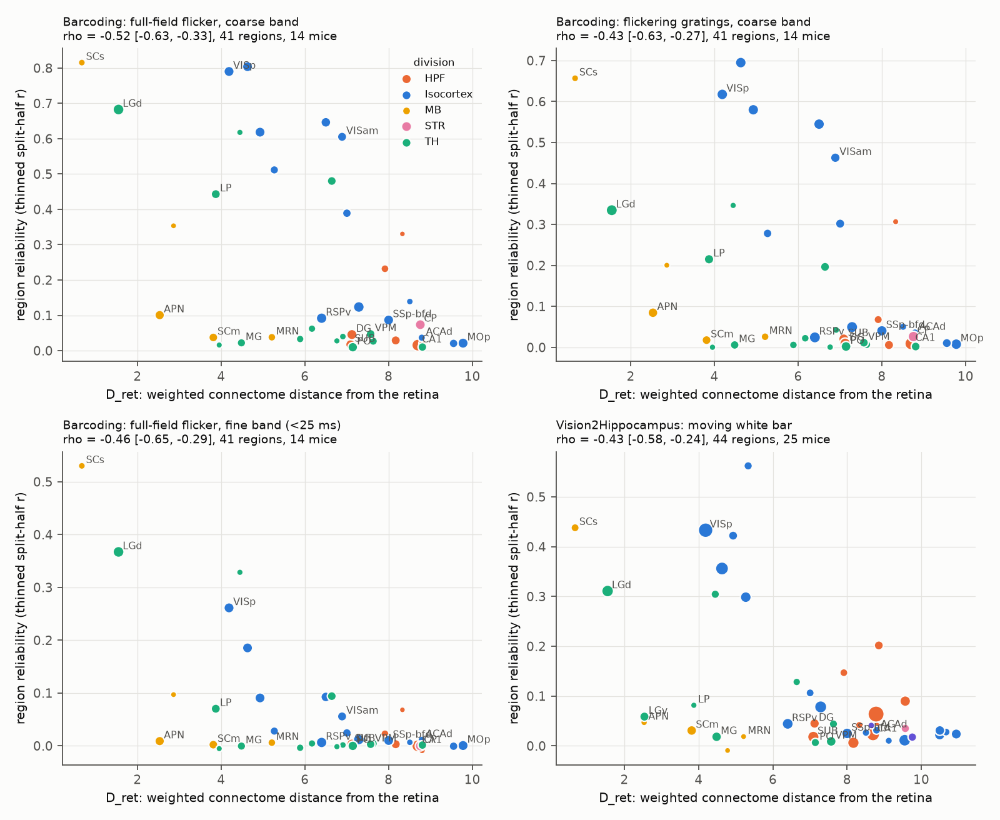
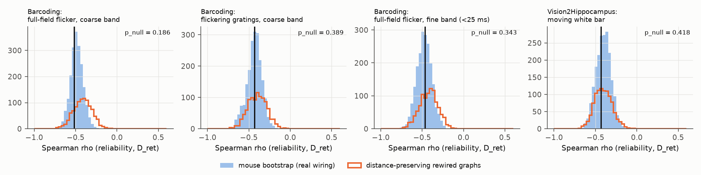
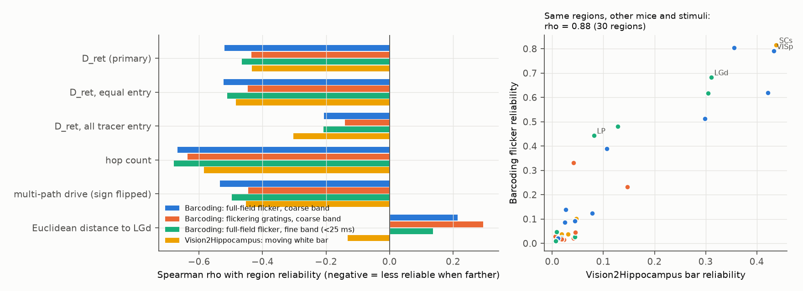

# Mouse brain regions farther from the retina in the Allen connectome had less reliable visual spike responses in 39 mice, but distance-preserving rewired connectomes predicted this equally well

## Summary

A prior SCI study (sci:sha256:f7e0f890..., Vision2Hippocampus data, 25 mice) found that the reliability of moving-bar responses in mouse brain regions decreases with the weighted connectome distance from the retina (D_ret). We tested if this structure-function rule generalizes to new mice, new stimuli and a finer time scale, and if it needs the specific wiring of the connectome.

We used two Allen Institute OpenScope Neuropixels data sets:

- Barcoding (DANDI:000563): 14 new mice. Condition FFF is one 8 s full-field luminance sequence, repeated 90 times. Condition STATIC is 16 static gratings whose contrast follows the same 8 s sequence, repeated 45 times each.
- Vision2Hippocampus (DANDI:000690): 25 mice, standard moving white bar. We analyzed it again with the same pipeline.

Unit reliability is the correlation between odd-repeat and even-repeat responses. To remove the effect of firing rate, we thinned the spikes of each unit at random to the same count (2 spikes/s). Structure is the Knox et al. 2019 mesoscale connectome (291 regions). The analysis plan (files/code/PLAN.md) was frozen before we computed any region-level reliability value.

Main results:

1. The negative relation replicated in all four planned tests: Spearman rho = -0.52 (FFF, coarse band), -0.43 (STATIC), -0.46 (FFF, fine band below 25 ms) and -0.43 (Vision2Hippocampus bar). 41 to 44 regions. All 2,000 mouse-bootstrap samples were negative in each test. Region-label permutation p <= 0.004.
2. The relation stayed after controls: Euclidean distance from LGd (partial rho -0.44 to -0.58), firing rate and mouse at the unit level (all region-cluster bootstrap 95% intervals below zero), and inside the isocortex alone (rho -0.82 to -0.87, 14 to 17 areas).
3. Region reliability agreed across data sets: rho = 0.88 between Barcoding flicker and Vision2Hippocampus bar (30 shared regions), and rho = 0.94 between flicker and gratings in the same mice.
4. The planned wiring-specificity test failed. We made 1,000 rewired connectomes. Each kept the input shares of every target region, but moved them among source regions at a similar distance. These rewired connectomes gave mean rho -0.40 to -0.42, nearly the same as the real connectome. One-sided p = 0.19, 0.39, 0.34 and 0.42 (Holm-corrected p >= 0.74). Thus, across the whole brain, the rule follows from general properties (the retinal entry regions plus distance-dependent wiring), not from the specific connections.
5. Exploratory (not in the plan): inside the isocortex, the real D_ret did better than the rewired connectomes in all five tested conditions (p = 0.002 to 0.013). The simple hop count from the retina was the best predictor across the brain (rho -0.58 to -0.68). It did better than its rewired null in three of five conditions (p = 0.005 to 0.013), but not for the Vision2Hippocampus bar (p = 0.07).

Conclusion: the reliability gradient from the retina is a strong and general property of mouse visual processing. It repeats across mice, stimuli, time scales and data sets. But a mesoscale connectome with random wiring at the same distances predicts it nearly as well across the whole brain. Thus, this correlation alone is not evidence that the specific connections set the gradient. The specific wiring adds information only inside the isocortex (exploratory).

## Background

Signals from the retina reach many brain regions through different numbers of synaptic steps. Noise accumulates along each path, and the responses of regions far from the retina also depend more on internal state. Thus, a common prediction is that the reliability of stimulus-locked responses decreases with the number of steps from the retina. Siegle et al. 2021 (doi:10.1038/s41586-020-03171-x) showed a related hierarchy in the visual cortex and thalamus. The prior SCI study f7e0f890 extended the test to 50 regions with a weighted connectome path length. A connectome-based measure can correlate with function only because connectomes follow general rules (for example, near regions connect more strongly). For this reason, we tested the rule against rewired connectomes that keep those general rules.

## Data

All inputs were read in place from the campaign shared data store. files/results/input_provenance.csv gives the path, size and SHA-256 of each of the 65 input files. All 65 hashes agree with the SHA256SUMS of each data set.

| Input | Shared path (under datasets/) | Source |
| --- | --- | --- |
| Barcoding spikes, units, stimulus tables | allen_openscope_barcoding/v1_2026-10-30 | DANDI:000563 version 0.250311.2145, CC BY 4.0 |
| Vision2Hippocampus binned bar responses | allen_openscope_vision2hippocampus_bar_responses/v1_2026-11-01 | DANDI:000690 version 0.260330.2144, CC BY 4.0 |
| Knox 2019 regionalized connectome | knox2019_regionalized_connectivity/2025-02-21 (connection_strength.csv.gz) | Allen Institute, doi:10.1162/netn_a_00066 |
| Retina tracer grids (pan-RGC lines Slc17a6-IRES-Cre, Thy1-Cre; 6 experiments) | allen_retina_rgc_cre_projection/v1_2026-10-30 | Allen Mouse Connectivity Atlas, Martersteck et al. 2017 |
| CCF 2017 annotation, 25 um, and structure graph | allen_ccf_2017/annotation_25_v2017 | Allen Institute, doi:10.1016/j.cell.2020.04.007 |

The Allen connectivity data are under the Allen Institute Terms of Use. This bundle does not contain raw Allen or DANDI files. It contains only derived tables (unit-level reliability values, region values, structural predictors).

## Methods

### Structure (files/code/01_structure.py)

- W[i, j] is the Knox connection strength from region i to region j, ipsilateral plus contralateral (a bilaterally symmetric one-hemisphere graph, 291 regions). The input share is A[i, j] = W[i, j] / sum over i of W[i, j].
- Retinal input: the share of the pan-RGC tracer signal in each Knox region (mean of the two Cre lines, each normalized). Some tracer signal is in regions without established retinal input (SCm, MG, CA3, LP). We treat this as fibres of passage or registration error. Thus, the primary entry set is the established retinal targets LGd, LGv, IGL, SCs, OP, NOT, MPT, PPT, APN and SCH, with their tracer shares normalized to sum 1.
- D_ret: the shortest path from the retina. The entry cost is -log(retinal share). Each step costs -log(input share of the target).
- Alternatives: D_ret_all (all tracer shares as entry), D_ret_flat (equal entry cost), hop count (binary graph: input share >= 2%, entry at the retinal targets), multi-path drive log10 of (I - 0.5 A^T)^-1 r, and Euclidean distance from the LGd centroid.

### Reliability (02_barcoding_reliability.py, 03_v2h_reliability.py)

- Units: Allen default quality control (isi_violations < 0.5, amplitude_cutoff < 0.1, presence_ratio > 0.9).
- Barcoding: 1 ms PSTHs of odd and even repeats. Coarse band: Gaussian smoothing, sigma 25 ms. Fine band: sigma 2 ms minus sigma 25 ms (as in the code of the source data set). For STATIC, the 16 grating responses are concatenated before the correlation.
- Vision2Hippocampus: counts in 33.4 ms bins of the 4 s bar loop. Even repeats against odd repeats.
- Rate control (primary measure): the block spikes of each unit are thinned at random to 2 spikes/s times the block duration (mean of 4 thinnings; binomial count thinning for the binned data). Units below 2 spikes/s are excluded. Unthinned values are also given.
- Region value: the median over mice of the per-mouse median unit value. A mouse-region cell needs at least 3 units. A region needs at least 2 mice and 10 units. Units were assigned to Knox regions from the CCF label of the peak channel.

### Tests (05_tests.py)

- Spearman rho between region value and D_ret.
- Mouse bootstrap: 2,000 resamples of mice, with the region values calculated again each time.
- Distance-preserving wiring null: 1,000 rewired connectomes. For each target region, the input shares are permuted among source regions in the same decile of source-target distance (centroid distance). The retinal entry is fixed. D_ret is calculated again for each graph. One-sided p = fraction of null rho <= observed rho. This null keeps the input-share distribution of each target and its dependence on distance. It removes the identity of the specific source regions.
- Region-label permutation (ignores spatial dependence; given for reference only).
- Partial Spearman rho with Euclidean distance from LGd as a control. Spearman rho inside the isocortex.
- Unit-level least squares: thinned r on D_ret, log10 rate, waveform duration and mouse fixed effects. Region-cluster bootstrap (500).
- Holm correction across H1 to H4 for the wiring-null p values.

Exploratory analyses that we added after we saw the planned results: 07_exploratory.py (other predictors, partial correlations) and 08_hops_null.py (rewired nulls for the hop count and for D_ret inside the isocortex, with a new random stream).

## Results

### Planned tests

| Test | Regions | Mice | Units | rho (D_ret) | Mouse bootstrap 95% CI | Rewired null mean rho | p (rewired null) | Partial rho (control d_LGd) | rho in isocortex |
| --- | --- | --- | --- | --- | --- | --- | --- | --- | --- |
| H1 Barcoding FFF, coarse | 41 | 14 | 7,807 | -0.52 | -0.63 to -0.33 | -0.41 | 0.186 | -0.58 | -0.87 (14) |
| H2 Barcoding STATIC, coarse | 41 | 14 | 9,516 | -0.43 | -0.63 to -0.27 | -0.40 | 0.389 | -0.52 | -0.82 (14) |
| H3 Barcoding FFF, fine | 41 | 14 | 7,807 | -0.46 | -0.65 to -0.29 | -0.42 | 0.343 | -0.50 | -0.82 (14) |
| H4 Vision2Hippocampus bar | 44 | 25 | 15,617 | -0.43 | -0.58 to -0.24 | -0.40 | 0.418 | -0.44 | -0.82 (17) |

Holm-corrected rewired-null p values: 0.74, 1, 1, 1. Region-label permutation p: 0.001, 0.001, 0.002, 0.004.

Unit-level least squares (slope of thinned r per unit of D_ret; the standard deviation of D_ret across regions is 2.2 to 2.6): FFF coarse -0.077 (95% CI -0.102 to -0.049); STATIC -0.058 (-0.091 to -0.037); FFF fine -0.039 (-0.050 to -0.021); bar -0.055 (-0.070 to -0.034).

Without thinning, rho was -0.54, -0.49, -0.60 and -0.61. Thus, the rate control made the relation slightly weaker, but did not remove it.

H4b: rho = 0.88 between Barcoding FFF and Vision2Hippocampus region values (30 shared regions). rho = 0.94 between FFF and STATIC.

### Comparison of structural predictors (exploratory)

| Predictor | FFF coarse | STATIC coarse | FFF fine | V2H bar |
| --- | --- | --- | --- | --- |
| D_ret (primary) | -0.52 | -0.43 | -0.46 | -0.43 |
| D_ret, equal entry cost | -0.52 | -0.45 | -0.51 | -0.48 |
| D_ret, all tracer shares as entry | -0.21 | -0.14 | -0.21 | -0.30 |
| Hop count | -0.67 | -0.64 | -0.68 | -0.58 |
| Multi-path drive (sign changed) | -0.53 | -0.45 | -0.50 | -0.45 |
| Euclidean distance from LGd | +0.21 | +0.29 | +0.14 | -0.13 |
| Mean D_ret of the 1,000 rewired graphs | -0.61 | -0.57 | -0.59 | -0.60 |

Euclidean distance from LGd, or from the nearest retinal target, did not predict reliability (rho -0.15 to +0.29). But the mean D_ret of the rewired graphs predicted reliability better than the real D_ret. Thus, what predicts reliability is the position of a region in a distance-dependent network that starts at the retinal targets, not physical distance alone and not the specific connections. The real D_ret kept a partial rho of -0.03 to -0.31 after the rewired-graph mean.

When all tracer shares were used as entry (SCm, MG, CA3 and LP become entry regions), the relation became much weaker. Thus, the result depends on the choice of retinal entry regions. Many regions near the retina in the graph had low reliability for these stimuli: APN, SCm, MG and SGN (figure 1).

Exploratory rewired nulls (08_hops_null.py):

| Condition | Hop count rho | Rewired mean | p | D_ret rho in isocortex | Rewired mean | p |
| --- | --- | --- | --- | --- | --- | --- |
| FFF coarse | -0.67 | -0.48 | 0.007 | -0.87 | -0.41 | 0.002 |
| FFF fine | -0.68 | -0.46 | 0.005 | -0.82 | -0.41 | 0.007 |
| STATIC coarse | -0.64 | -0.45 | 0.013 | -0.82 | -0.39 | 0.008 |
| STATIC fine | -0.61 | -0.51 | 0.128 | -0.87 | -0.45 | 0.002 |
| V2H bar | -0.58 | -0.46 | 0.072 | -0.82 | -0.54 | 0.013 |

## Interpretation

The reliability gradient is robust. It repeats in new mice, with a non-moving full-field stimulus, with gratings, in the sub-25 ms band, after equal-count thinning, and in a second data set with a moving bar. Region values agree strongly across data sets (rho 0.88).

But the planned test does not show that the specific mesoscale connections cause the gradient. Rewired connectomes that keep only the retinal entry regions, the input-share distribution of each target and the distance dependence of wiring predict reliability nearly as well across the whole brain. This is a general caution for connectome-function correlations at the region level: a null that keeps distance-dependent wiring can explain much of the correlation. Inside the isocortex, the order of visual and non-visual areas (VISp, VISl, VISal near; RSP, SSp, MOp, ACA far) follows the specific wiring better than the rewired graphs (exploratory, 14 to 17 areas).

## Limitations

- The Knox connectome is a model of the average mouse from tracer injections. It is not measured in the recorded mice. Region-level analysis cannot test cell-level paths.
- The rewired null is one choice. It keeps per-target input shares and distance deciles, and it fixes the entry regions. Other nulls (for example, nulls that also keep source out-strength) could give other p values.
- The result depends on the choice of retinal entry regions (D_ret_all was much weaker). The tracer signal includes fibres of passage.
- Both data sets use visual stimuli that drive the visual cortex and the image-forming thalamus well. Regions such as APN, SCm and MG may respond reliably to other stimuli (for example, motion or looming). Thus, "reliability" here is reliability for these stimuli.
- Unit-to-region assignment uses the CCF label of the peak channel. The Barcoding README reports probable misregistration of some units near LGd and APN.
- 41 to 44 regions, 14 to 17 isocortical areas. Some regions have only 2 mice. The Vision2Hippocampus blocks differ in length between protocol generations (128 to 480 s).
- The hop count and isocortex null results are exploratory. We added them after we saw the planned results. They need confirmation in independent data.
- Deviation from the plan: the plan named the Vision2Hippocampus block SAC_Wd15_Vel2_Bndry1_Cntst0_loop. 17 sessions of later protocol generations name the same standard white bar Stim01_SAC_Wd15_Vel2_White_loop. We used it for those sessions.

## Reproduction

1. Make the shared data store available as a folder named datasets next to the folder that holds code/ (common.py reads ../../datasets from the code folder), or set SCI_DATASETS to its path.
2. Use Python 3.12 with numpy, pandas, scipy and matplotlib (pyarrow for parquet).
3. In files/code/, run in this order:
   - python3 01_structure.py (structural predictors; about 5 min)
   - python3 02_barcoding_reliability.py FFF <session ...> and python3 02_barcoding_reliability.py STATIC <session ...> for the 14 sessions in files/results/bc_units (FFF about 15 s per session; STATIC about 10 min per session)
   - python3 03_v2h_reliability.py
   - python3 04_region_table.py
   - python3 05_tests.py (makes the rewired null; about 8 min)
   - python3 07_exploratory.py; python3 08_hops_null.py; python3 06_figures.py; python3 09_provenance.py
4. Random seeds are fixed in each script. The code writes to results/ and figs/ next to the code folder.

Files in files/results/: region_structure.csv (structural predictors, 291 regions), region_values.csv (region reliability per condition and measure), units_all_conditions.parquet (unit-level values), bc_units/ (Barcoding unit tables), v2h_units_raw.parquet, tests.json (planned tests), predictor_rho.csv, exploratory.csv, hops_null.json, null_Dret.npy and null_hops.npy (rewired-graph values), boot_null_rho/ (bootstrap and null rho distributions), input_share_A.npy, input_provenance.csv. files/code/PLAN.md is the frozen plan; PLAN.sha256.txt gives its SHA-256 and the UTC time when it was recorded.

## Provenance

- Campaign 11_07_2026, job sci-1107-dell-neural-structure-and-computation-f67d479eea57, topic neural-structure-and-computation, machine dell, account claude-andrii.
- Model: Claude Opus 5.5 (claude-opus-5-5), running as an autonomous research agent in Claude Code. The signing key is a campaign-machine key. It is not a personal authorship claim.
- Analysis date: 2026-11-08.
- Data credit: Allen Institute for Brain Science (OpenScope Barcoding, Reinagel et al.; OpenScope Vision2Hippocampus, PI Mehta; Mouse Connectivity Atlas; CCF), Knox et al. 2019, Martersteck et al. 2017.
