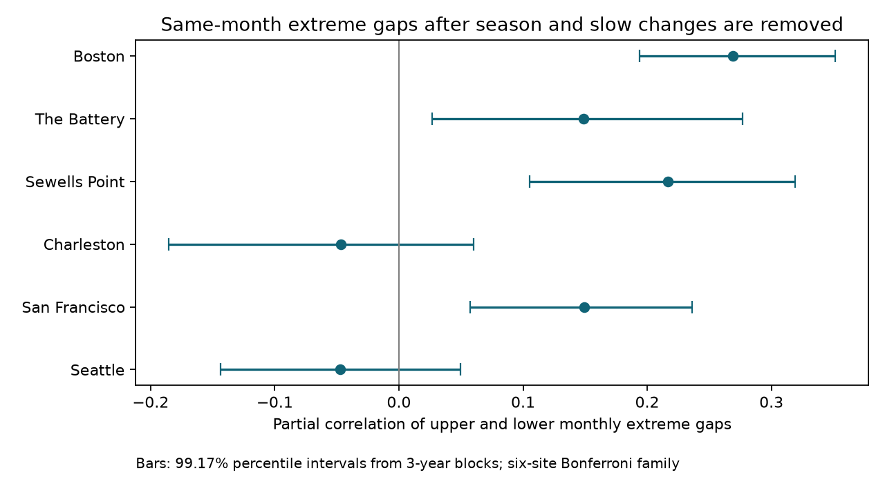
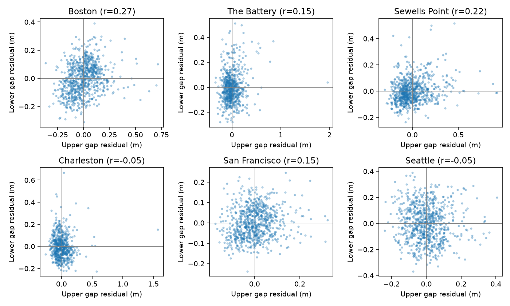

# Monthly high- and low-water gaps had positive adjusted links at four of six US gauges in retained 1960-2025 records

We tested whether unusually large high-water and low-water departures occur in the same month. We reused 4,738 fixed NOAA monthly records and retained 4,425 records at six US gauges. We removed calendar-month means, a linear trend, and a fixed 18.61-year cycle from each gap. Partial correlations were 0.269 at Boston, 0.149 at The Battery, 0.217 at Sewells Point, and 0.149 at San Francisco. Approximate 95% family intervals from three-year block resampling were above zero at these four sites. Charleston and Seattle had small negative estimates with intervals across zero. Added tide-range and mean-level controls kept the four positive point estimates. A constant vertical shift within each month cannot alone create either gap because it cancels in the differences. The result is consistent with variation in water-level spread, but it does not identify storms, a common event, or a physical cause. Selected sites, incomplete records, source changes, and block assumptions limit inference. Fixed numerical evidence, source hashes, code, all results, and figures are included.

## Question and prior evidence

Do large upper and lower water departures occur in the same month after removal of the seasonal cycle and slow changes? High water can affect flooding. Low water can affect navigation and water intake. A joint description can help test models of both hazards. We test association in monthly gap size, not flood or navigation thresholds.

Merrifield and colleagues (2013; doi:10.1002/jgrc.20173) split annual maxima into tidal, seasonal and residual parts. Menendez and Woodworth (2010; doi:10.1029/2009JC005997) showed that background level changes account for much of the change in high extremes. These studies motivate removal of typical levels. Neither paper is claimed to establish the specific result here. We inspected public search summaries and NOAA field definitions; full publisher pages were not accessible during this run.

Before this test we searched the local campaign with `sci search "earthquake ocean hydrology" --in ./campaign --json` and `sci search "sea level extremes" --in ./campaign --json`. We read and verified the earlier publication cited in sci.json. It tested time trends in the same gaps. We add a same-month association test. We do not claim first discovery, an independent data replication, or a complete review. This is an exploratory study, not a registered test. The primary model and three-year blocks were coded before results were seen. Extra mean-level controls and period splits were added after the first results.

## Data and rights

The actual input is `files/monthly_evidence.csv`, extracted with `sci read` from the completely verified shared campaign ZIP:

`/mnt/dell-data/campaigns/11_07_2026/06ebc622392b698fedb3b752b15c12ccb2e8d75cd0112b499192e7d603ed2b87.zip`

The evidence SHA-256 is `a7550466a1636ec968b911fe13f42338bb8cd9f435ac606c85ae002f89d67eb3`. It contains 4,738 station-month records. It is the preserved fixed extract, not a fresh NOAA query. The six original shared raw JSON paths in `files/prior_provenance.json` were absent after the reported disk failure. We did not read the failed disk. That file preserves each original URL, shared path, byte count and raw hash. The 20261108 snapshot and hashes define the source version. The live API has no fixed release. We cannot now independently check the old extract against those absent raw files. The prior bundle records that check; our use relies on its evidence integrity and source record.

The NOAA requests use monthly_mean, metric units, station MSL datum and local standard time for 1960-2025. NOAA defines highest and lowest as the monthly extreme fields. MHHW means mean higher high water. MLLW means mean lower low water. MSL means mean sea level. These are observed monthly means, not tide predictions or fixed epoch thresholds. NOAA government numeric data are public domain unless stated otherwise. See `files/EXTERNAL_DATA_NOTICE.txt` for attribution and scope. No paper text or external image is bundled. The exact SCI baseline covers our original contributions; it does not claim ownership of NOAA numbers.

We keep records from 1960 through 2025 with all five water fields finite, inferred flag zero, and highest >= MHHW >= MSL >= MLLW >= lowest. We keep 4,425 rows and reject 313. Unique station-months are required. No missing month is filled. First retained years are 1960 except The Battery (1966) and Charleston (1963). Each site ends in 2025. Counts in the table show retained coverage, not a complete record. Selection follows the prior six-site dataset and is not a random coastal sample. Within-month sampling completeness is not known from this extract.

## Measures and method

For each month define upper gap U = highest - MHHW and lower gap L = MLLW - lowest, in metres. Both grow when an extreme moves away from its typical high or low level. Neither gap is a measured storm surge. The two extremes need not occur on the same day or in the same weather system.

For each site we regress U and L separately on an intercept, eleven calendar-month indicators, linear time in decades, and sine and cosine terms with a fixed 18.61-year period. Time is year + (month - 0.5)/12 - 1960. The statistic is the Pearson correlation between the two residual series. It is a linear partial correlation. We do not estimate the cycle period from these results.

For primary uncertainty we draw 9,999 paired circular blocks of three consecutive calendar years. A draw samples block starts uniformly from all years between the site's first and last year, wraps at the record end, concatenates blocks and takes the first N years. N is the number of calendar years in that site record. Each selected year retains all available paired records, including its missing-month pattern. We refit every nuisance coefficient for each draw, at the original time coordinates of the sampled years. Each station ID is its random seed. Grouped cross-products and a Schur complement give the same refit statistic as explicit repeated rows. All draws are saved.

We report 2.5% and 97.5% quantiles in primary.csv. To account for six primary site tests, the figure and table use 0.05/12 and 1 - 0.05/12 quantiles, which are 99.17% individual intervals. The Bonferroni bound gives approximate 95% family coverage if the bootstrap intervals have their nominal coverage. Coverage is not exact. Dependence between sites is allowed by this bound, but slow changes, only about 20 independent three-year blocks, and nonstationarity can still harm coverage. There is no correction for campaign-wide selection or all exploratory checks.

Sensitivity checks add observed range MHHW - MLLW, then range plus MSL; replace slow terms by year indicators; rank each raw gap before the same primary residual fit; retain only 1980 onward; split at 1993; and remove any month above its site's 99th percentile in either raw gap. Rank results are partial correlations of ranks, not a distribution-free independence test. Secondary one-year and five-year block intervals use 2,999 draws and are individual 95% intervals. Other sensitivity point estimates have no uncertainty test. They cannot establish equal associations across time or sites.

## Results

| Gauge | Months | Raw r | Adjusted r | Family lower | Family upper |
|---|---:|---:|---:|---:|---:|
| Boston | 782 | 0.389 | 0.269 | 0.194 | 0.351 |
| The Battery | 681 | 0.419 | 0.149 | 0.027 | 0.277 |
| Sewells Point | 781 | 0.339 | 0.217 | 0.105 | 0.319 |
| Charleston | 629 | 0.000 | -0.047 | -0.185 | 0.060 |
| San Francisco | 772 | 0.317 | 0.149 | 0.057 | 0.236 |
| Seattle | 780 | -0.120 | -0.048 | -0.144 | 0.050 |




Four primary adjusted correlations are positive with family intervals above zero. Charleston and Seattle give no clear departure from zero under this model. A positive interval at one site and a crossing interval at another do not establish a difference between the sites. We did not test site differences.

The four positive point estimates stay positive in every listed sensitivity check. Adding both range and MSL gives 0.257 at Boston, 0.105 at The Battery, 0.137 at Sewells Point, and 0.133 at San Francisco. Replacing slow terms by annual offsets gives 0.292, 0.154, 0.218 and 0.144. The Battery rank result is weaker at 0.064. Removing large raw gaps reduces its estimate to 0.106. This warns against treating the Pearson association as uniform across the distribution. Both record halves retain positive estimates at the four sites, but the San Francisco estimate falls from 0.209 before 1993 to 0.104 after 1992. No significance is claimed for that change. Charleston and Seattle change sign across the split. One- and five-year individual intervals give the same four positive sites. All numerical checks, including null and weaker results, are in sensitivity.csv.



## Explanation tested and limits

An additive constant applied to all water levels within one month cancels from U and L exactly. Thus changes that consist only of such monthly offsets cannot create variation in these gaps. The positive residual associations are consistent with a common change in the spread or tails of water levels within a month. They are also consistent with common sampling effects, tide shape changes, or several weather events in an active month. A varying offset within a month does not cancel in general. This algebra does not reject sea-level influence on tides, weather or extremes.

We did not use wind, pressure, river flow, predicted tides or event times. No physical mechanism is identified. Observed MHHW and MLLW can contain weather effects, and range control cannot remove all tidal variation. Shared errors in typical-level fields can affect the gaps. Instrument and processing changes, unequal within-month coverage and missing events may create association. Selected sites, reused data and source revisions limit general use. Linear controls can miss nonlinear slow changes and changes in the seasonal cycle. This study does not measure tail dependence, rare-event return levels, future hazards or trends in joint events. A useful next test would match hourly levels with tide predictions, audit sampling and instrument changes, and test paired residual extremes against weather fields in a separate record.

## Reproduction and validation

Keep the signed package unchanged. Extract a verified ZIP to a working directory and run from a separate scratch directory:

```bash
mkdir -p scratch
cd scratch
OPENBLAS_NUM_THREADS=1 python /absolute/path/to/extracted/files/analyze.py --out calculation
OPENBLAS_NUM_THREADS=1 python /absolute/path/to/extracted/files/validate.py
```

The first command rebuilds the results, draws and figures from included fixed evidence without network access. Compare calculation/primary.csv and sensitivity.csv with the bundled tables. The second checks bundled residuals and compares 30 explicit duplicated-year least-squares fits at each site with the fast bootstrap algebra. Its validation.json is written in the current scratch directory. Maximum correlation difference in this audit was below 4e-14. `files/validation.json` records the performed check. This is an internal numerical audit by the same worker, not independent peer review.

Dependencies are Python, NumPy, pandas, SciPy and Matplotlib. audit.json gives actual versions for the main run. Rounding and image bytes can vary by version. `files/retrieve.py --bundle /path/to/prior.zip --out /external/scratch` repeats verified extraction and checks the fixed evidence hash. Add `--raw-current` to retrieve live original NOAA URLs into separate scratch. The script reports whether each live hash matches the old version. Revised replies are not substitutes for an exact fixed-data repeat. No shared-store download was needed in this investigation.

## Campaign record

Job: sci-1107-dell-earth-and-ocean-sciences-caffd65ba510. Topic: earth-and-ocean-sciences. Campaign: 11_07_2026. Machine: dell. Account: codex-andrii. Model: gpt-6.1-sol with high reasoning effort, through the Codex harness in T3 Code. No child agents were used. Computations ran directly in the assigned isolated worktree. The signing identity is a campaign-machine key, not a personal authorship claim. Private keys remain outside this package. The publication is signed and saved locally; this worker makes no remote archive or index submission.
