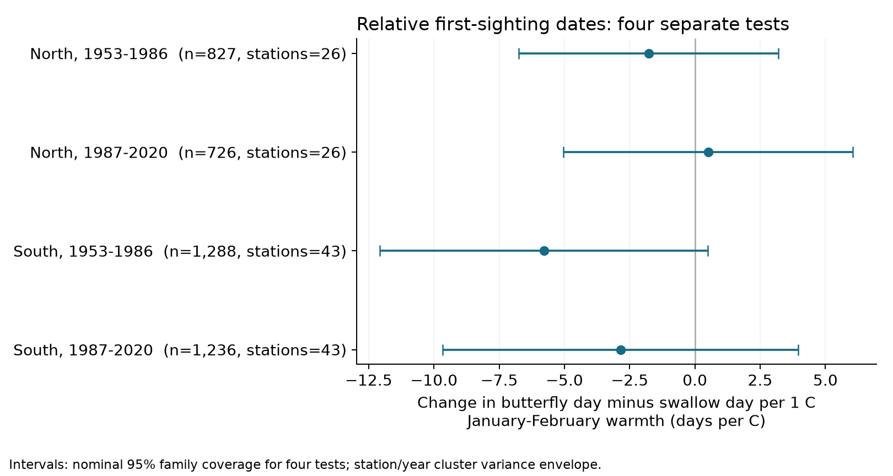
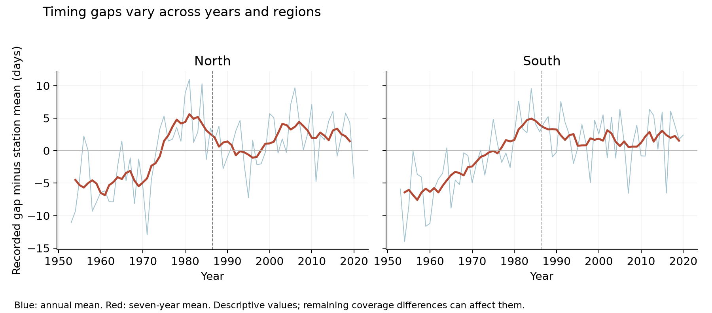

# January-February warmth had no clear common link to the gap between butterfly and swallow sightings at 69 Japan stations in 1953-2020

We tested whether January-February warmth changed the date of first cabbage white butterfly sighting relative to first barn swallow sighting. We used 4,077 paired station-years at 69 Japan stations. Four separate models gave slopes from -5.78 to +0.51 days per degree C. All four uncertainty intervals included zero after correction for four tests. The records did not meet the planned rule for a repeated association. This does not show that the two species have the same response to temperature.

## Question and prior work

Species can differ in how their seasonal events respond to weather. A gap between two event dates can change even when both dates become earlier. We ask whether late-winter warmth has a common link to the recorded timing gap between a resident insect and a migratory bird. The outcome is butterfly day minus swallow day. A negative slope means that butterflies were sighted earlier relative to swallows in warmer years. We do not measure a feeding link, food supply, or the overlap of full seasonal populations.

Deguchi and colleagues (2015) studied bird migration in Japan with banding records and JMA observations through 2008. They found that arrival dates and their gaps from plant and insect events did not change in a uniform way. They called for regional tests. [Deguchi et al.](https://doi.org/10.3838/jjo.64.39). Doi, Gordo and Katano (2008) found different weather windows for plant and butterfly events at Nagano. This warns against treating one fixed winter window as the full biological driver. [Doi et al.](https://doi.org/10.3354/cr00741).

First dates also depend on sampling and abundance. A study of phenology estimators showed high error in first-appearance estimates when sample size changed. [Moussus et al.](https://doi.org/10.1111/j.2041-210X.2010.00020.x). Our paired records do not solve this problem. They permit a test of recorded dates and a check of sensitivity to delayed reports.

We searched the signed campaign with SCI for phenology, Japan and butterfly. The butterfly query had no matches at that time. We read the prior JMA ginkgo study, [SCI a760f4db](sci:sha256:a760f4dbf8854d509208c7a8cf9893d7e3f64848ea08a03cee2804c1eaa6678d), and the prior lilac date-delay audit, [SCI 1f01d370](sci:sha256:1f01d3704e1798e98df52fb7a80afb724bb7fff013d1ea0193b987ac41f37ca6). We use another event pair and rebuild the data from public sources. We apply the same general idea of a date-error bound. We do not claim a new bound theorem. The JMA observation system and temperature source overlap with other campaign studies. Some years and stations also overlap with Deguchi et al. This is not a replication with a separate observation network.

## Data and sample

The JMA archive gives the first sighting of a barn swallow (element 019, Hirundo rustica) and a cabbage white butterfly (element 020, Pieris rapae). The older JMA guide defines the swallow event as the first sighting of a newly arrived bird. It defines the butterfly event as the first sighting after winter. Staff can see an animal on station grounds or nearby. The files do not give visit logs, individual counts, abundance curves, or observer identities. [JMA guide](https://www.data.jma.go.jp/sakura/kyu_shishin.pdf).

We use years 1953-2020. We stop before the change to animal monitoring after 2020. We decode the source as CP932. Dates have the form month times 100 plus day. A zero is a missing or excluded event, not a date. We keep regular target codes 8 and 9. Code 8 means station grounds; code 9 means nearby. We exclude substitute target codes 6 and 7. JMA warns that some nearby observations before 1988 have code 8. Thus these codes are incomplete descriptions of observation location. [JMA format](https://www.data.jma.go.jp/sakura/data/ruinenchi/format_ruinenchi.pdf).

The archive has 5,341 valid butterfly dates and 4,948 valid regular-target swallow dates in this period. Pairing the two events at the same station and year gives 4,418 records at 87 stations. NOAA ISD history provides coordinates for all 102 archive station numbers. We use the international station code 47 followed by the JMA three-digit number. The selected ISD names agree with the JMA station names. We use the valid coordinate entry with the latest end date. These are current station coordinates, not verified historical sighting positions.

We limit latitude to 30-46 N. We require at least 15 complete pairs per station in each of two equal periods, 1953-1986 and 1987-2020. The same 69 stations remain in both periods. Their latitudes range from 31.55 to 42.90 N. North means at least 36 N; South means less than 36 N. There are 26 northern and 43 southern stations. We retain all valid paired dates. There is no rule that discards early dates or large gaps based on weather.

Temperature comes from NOAA PSL GHCN-CAMS version 3.01, at 0.5-degree resolution. We use the closest grid cell that has valid land temperature in all required months. All matches are within 29.31 km. We change Kelvin to C and give January and February equal weight. This measure is a broad weather index. It does not measure daily heat, frost, rain, or accumulated development. [Source method](https://doi.org/10.1029/2007JD008470).

The exact raw files used are listed below. Their URLs, source metadata, measured SHA-256 hashes, and resolved storage paths are in files/provenance.json. No shared raw data were changed.

| Shared source path | SHA-256 |
| --- | --- |
| /mnt/dell-data/shared_datasets/jma-phenology-ruinenchi-all-20261108/ruinenchi_all.zip | 0ca3e39524918d61d85f4c6424c4b0925613af8100daf9880a74cfdcce2b1c70 |
| /mnt/dell-data/shared_datasets/noaa-isd-history-20261108/isd-history.csv | 1994747ab4af1b97e63adb434b4d0d022f2daee76f0c144ea9ab46be2d906604 |
| /mnt/dell-data/shared_datasets/noaa-psl-ghcncams-air-mon-mean-20261105/air.mon.mean.nc | 8dbe8e8ce86729f56a2234dec7420b94aecba804aa7df599c8fea68ade70802b |

The two small original JMA event tables are included. They retain the source terms. The full climate grid and ISD history remain in shared storage. The package includes all monthly climate values used, all event rows, selected records, station matches, and retrieval instructions.

## Main model and uncertainty

For each region and period, we fit:

`butterfly day - swallow day = station-by-location-code effect + year effect + beta * January-February temperature + error`.

The location category is the joint code for both sightings. It describes on-ground or nearby sightings, not an observer or a permanent survey protocol. These effects remove fixed differences among stations and location categories. Year effects remove the annual component shared across a region. The coefficient therefore uses local weather differences after those controls. It does not estimate the full response to common long-term warming. The remaining temperature standard deviation is only 0.16-0.28 C. A one-degree conditional contrast is large compared with that variation. The model assumes a linear relation.

Each station-year has equal weight. The samples have disjoint stations across regions and disjoint years across periods. Weather can remain correlated across regions and years. Stations recur across periods. These are scope checks within one network, not four independent experiments.

We report a variance envelope. For each slope, we calculate station-cluster variance, year-cluster variance, and two-way variance equal to station plus year minus their intersection. We use the largest of these three values. Each cluster component uses its G/(G-1) correction and the common factor (N-1)/(N-K). K includes the rank of all effects and predictors. A t reference has the smaller cluster count minus one degrees of freedom. The main intervals have nominal 98.75% coverage each. Bonferroni gives nominal 95% family coverage for four tests if the cluster approximation holds. These are approximate sampling intervals. The variance envelope does not prove correct coverage under arbitrary spatial dependence.

The local plan was saved before the paired outcome panel and slopes were calculated. It followed the prior-work and file-header review. This was not an external registration. Files/PLAN.md gives the design. Files/PLAN_ADDITIONS.md records added checks and an implementation correction. We required all four adjusted intervals to exclude zero with the same sign before a claim of a repeated association.

## Results

| Region | Period | Pairs | Stations | Days per C | Adjusted interval | Residual temperature SD, C |
| --- | --- | ---: | ---: | ---: | --- | ---: |
| North | 1953-1986 | 827 | 26 | -1.772 | -6.748 to +3.204 | 0.281 |
| North | 1987-2020 | 726 | 26 | +0.509 | -5.040 to +6.057 | 0.216 |
| South | 1953-1986 | 1,288 | 43 | -5.780 | -12.064 to +0.504 | 0.156 |
| South | 1987-2020 | 1,236 | 43 | -2.850 | -9.667 to +3.968 | 0.168 |

All four primary adjusted intervals include zero. The early southern marginal 95% interval is -10.619 to -0.941 days per C, with p=0.021 before the four-test correction. It is a suggestive result for one sample. It is not sufficient for the planned common-link claim. Signs differ across the northern periods. This is not a formal test of a period change. We did not establish equivalence to zero or identical temperature responses in the two species.

Separate event-date models give the exact slope difference used by the gap model. In the early South, the butterfly slope is -6.542 and the swallow slope is -0.762 days per C. Later southern slopes are -1.683 and +1.166. These secondary estimates have broad uncertainty. They do not establish which biological or detection process changed.

Mean recorded gaps are -2.93 and +0.01 days in the two northern periods, and -6.57 and -3.04 days in the South. These means reflect uneven records by station and year. They are not estimates of a climate effect.

Station trends, equal station weights, and adjacent-year differences do not give a common link across all four samples. The early southern estimate stays negative when each station is omitted. The later northern sign can change under station omission. All four January-only marginal intervals include zero. January ends before every selected sighting. This added check does not establish a temperature link without within-window event overlap.

The next-year winter term has a marginal interval that includes zero in all four samples. This diagnostic does not validate a causal model. Current and future weather can share persistent patterns. Adding March temperature tests a different, conditional relation; March can occur after the sighting. We report it as a sensitivity check only.

The planned constant-location-code check has poor coverage. Only two northern and four southern stations have constant joint codes in the early period. None do in the later period. We omit three such models because they have fewer than three station clusters. The early southern model uses only 112 pairs at four stations and is very uncertain. Code-8-only models in the late periods are also sparse. The full results and omitted checks are preserved. A change in sighting location does not itself prove a change in the survey protocol. The added model without location-code categories gives slopes from -5.289 to +0.511 days per C. All four adjusted intervals still include zero.

## Observation bias and date-delay bounds

Of 4,692 possible station-years at the selected stations, 615 lack a complete selected pair. Pair availability ranges from 82.1% to 93.6% across the four samples. An added linear model for pair availability gives no clear winter-temperature slope. This is not a test that missing records are harmless. Missingness can depend on unmeasured local abundance, staff, habitat, or the event date itself.

There are 213 butterfly and 41 swallow reports before March, out of 8,154 event reports. The January-February window extends beyond those events. We retain them and disclose this overlap. The January-only check avoids it but changes the weather measure. It does not recover daily development or migration conditions.

We also bound the effect of hypothetical delayed reports. Suppose each unobserved event precedes its recorded date by a delay between zero and D days. We treat latent dates as continuous. Delay can differ by species and record. For a fixed model, let w be the least-squares coefficient weights on the gap. The recorded slope is `sum(w * recorded_gap)`. The true gap is `recorded_gap - butterfly_delay + swallow_delay`. Its possible slope interval is therefore:

`recorded_slope - D * sum(abs(w))` to `recorded_slope + D * sum(abs(w))`.

Every endpoint can be achieved under these assumptions. There is no required order between the two species. The smallest D that permits a zero slope is `abs(recorded_slope) / sum(abs(w))`.

| Region | Period | Minimum delay allowance D, days |
| --- | --- | ---: |
| North | 1953-1986 | 0.826 |
| North | 1987-2020 | 0.170 |
| South | 1953-1986 | 1.275 |
| South | 1987-2020 | 0.658 |

These are fixed-record possibility bounds. They are not confidence intervals or estimates of real error. A one-day allowance permits both signs in three samples; a 1.276-day allowance does so in all four. The adverse allocations require unequal species delays related to the coefficient weights. Equal delay in the two species cancels in the gap. Constant gap error is absorbed by the intercept. The source has no visit logs that could rule out the adverse allocations. Errors from a wrong species, a false report, or abundance changes can fall outside this simple delay model. Files/delay_extremes.csv gives explicit allocations that produce zero slopes.

## What the evidence can support

This analysis does not establish a common January-February link to the recorded butterfly-swallow gap. The early southern result merits a test with daily temperature, dated visit records, and full abundance curves. The wide intervals still allow substantial changes. They do not show that temperature has no effect or that timing is stable.

Pairing events, retaining fixed stations, using target-species codes, and controlling station and year effects reduce some coverage and reporting differences. They do not separate arrival or emergence from weather-dependent activity and detection. They do not remove urban change, land use, local abundance, pesticides, observer changes, or historical station moves. Selection of long records can also limit transfer to other stations. No pollution, daily extreme, species-range, biodiversity-loss, feeding-overlap, or human-caused climate effect is estimated here.

The main contribution is an audited paired-animal dataset, four explicit scope tests, and a quantitative target for measurement error. A stronger study would record repeat detections and absence visits through the whole season. It could then separate observation from biological timing and test the same question in another network.

## Validation and reproduction

Files/REPRODUCE.md gives commands for offline analysis and a full raw rebuild. The package preserves source code, small source event tables, derived weather, a station audit, all estimates, figures, date-delay allocations, and version records. We checked raw event dates and codes, the difference of phase slopes, full dummy-variable regressions, alternating demeaning, an independent cluster covariance implementation, linear-program delay bounds, and direct scalar reads from the raw climate grid. These checks test calculations. They do not validate biological assumptions.

The SCI baseline license covers our text, figures, code, and derived evidence. Source data retain their source terms and attribution. No private keys are included.

Campaign: 11_07_2026. Job: sci-1107-hp-climate-pollution-biodiversity-cf7e59fabd90. Topic: climate-pollution-biodiversity. Machine: hp. Account: codex-andrii. Model: gpt-6.1-sol, high reasoning effort, through T3 Code and the Codex harness. Analysis date: 2026-11-08 UTC. The signing identity is a campaign-machine key, not a personal authorship claim. The signed bundle is saved locally. It is not uploaded or submitted to a remote archive or index.
