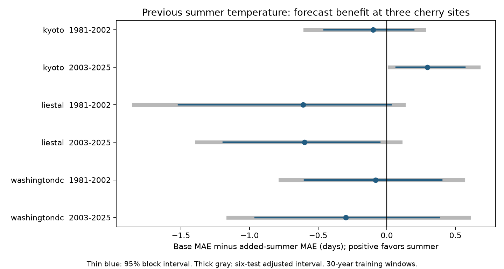

# Previous summer temperature gave no common cherry bloom forecast gain at three sites in 1981-2025

Previous June-August temperature did not give a common forecast gain at Kyoto, Liestal and Washington DC in two test periods. One primary test showed a small gain at later Kyoto. That result was sensitive to the training window, weather controls and bootstrap block length. This is a test of a simple forecast method. It does not reject a biological effect of prior summer conditions.

## Question and prior work

Does previous summer warmth improve a March 1 bloom forecast after adjustment for February warmth and a local time trend? Flowers can develop over more than one season. A review by Diggle and Mulder explains how temperature can affect several stages before flowering (doi:10.1093/icb/icz076). It supports a reason to test earlier weather. It does not predict a single summer slope for these three cherry records. Mean summer temperature also omits drought, heat extremes and the timing of bud development.

We searched the shared campaign before choosing the precise test. The search record is in files/campaign_search.json. We read two published campaign studies: SCI 12c0ec41aa55 tests rolling calendar trends at these three sites; SCI b90f6a20c2b6 tests winter temperature at Kyoto, Washington and Appenzell. Those studies show that a plausible added term need not improve a later forecast. Our test adds previous summer warmth and uses separate regional and period tests. The public bloom archive overlaps prior work. This is new analysis of existing records, not new independent data collection.

## Data and observation bias

We used the GMU cherry bloom repository at commit a95298263523607c8489a7be091c8c8d8ce61979. Each site has one valid annual record in 1951-2025. We checked unique years, calendar dates and supplied day numbers. We removed the leap-day offset after February. The 225 records form a fixed site panel. Earliest dates were March 25 at Kyoto, March 16 at Liestal and March 15 at Washington. Thus all bloom outcomes followed the March 1 forecast cutoff.

Kyoto records Prunus jamasakura at Arashiyama, with dates reported through a local newspaper. Copyright holder: Yasuyuki AONO. Liestal records Prunus avium at a 25 percent bloom threshold. Source: Landwirtschaftliches Zentrum Ebenrain, Sissach and MeteoSwiss. Washington records Yoshino cherry at a 70 percent threshold, from EPA and the National Park Service. The source guide limits Liestal data use to non-commercial use. We do not include or relicense the raw bloom series.

We joined each site to the nearest 0.5 degree GHCN-CAMS monthly air temperature cell. Data were provided by NOAA PSL, Boulder, Colorado, USA, from https://psl.noaa.gov. The file identifies version 3.01 and extends through October 2026. Only 1950-2025 values enter our panel. We converted degK to degrees Celsius. Previous summer is the day-weighted mean for June-August of year t-1. February is the monthly mean in year t. Grid centers and exact input hashes are in files/provenance.json. The station-based grid does not measure weather at each tree.

Fixed sites and complete years remove changes in site coverage from the comparison. Separate site models allow different species, thresholds and mean dates. Local year terms allow linear change in reported timing. These controls do not correct observer effort, visit frequency, tree replacement or reporting changes. Visit logs were not available. A reporting change can appear as a climate response. Three managed records do not represent global biodiversity. Separate regions test transfer of the method, but they are not independent climate experiments.

## Method

The plan in files/plan.txt was written before model fits. It was not registered. For each target year in 1981-2025, we fitted ordinary least squares to the preceding 30 years at that site. The base model has an intercept, centered year and February temperature. The extended model adds previous June-August temperature. Both models use the same training records. No target bloom date or weather after February enters a forecast. These are retrospective forecasts from revised historical files, not forecasts issued in real time.

We divided tests into 1981-2002 and 2003-2025 before fitting. The primary outcome is mean absolute error (MAE) in days. Benefit is base MAE minus extended MAE. Positive benefit favors the summer term. Each of six site-period tests uses 22 or 23 forecasts. Intervals use 20,000 paired circular block bootstrap samples, four-year blocks and seed 293. Each draw preserves the pairing of the two losses. We report 95 percent intervals and 99.1667 percent intervals for a six-test Bonferroni adjustment. The adjustment does not require independent tests. It still depends on the accuracy of the bootstrap intervals.

Intervals condition on the fitted forecast sequence. We do not refit training series in each draw. The method assumes that short blocks can represent the dependence and variation in forecast losses within each period. Rolling training windows overlap. Short and changing series can make interval coverage poor. These intervals do not include source revisions, site selection or observation error.

Planned checks use 20-year training windows, two- and six-year bootstrap blocks, an added current January control, and deletion of each test year. We report all checks in files/results.csv. Descriptive period regressions use the same year, February and summer terms, with HAC lag-three errors and a small-sample covariance correction. They are not held-out forecast tests and have no multiple-test correction.

## Results

| Site | Test period | Base MAE | Added-summer MAE | Benefit | 95 percent interval | Six-test interval |
| --- | --- | ---: | ---: | ---: | --- | --- |
| Kyoto | 1981-2002 | 2.85 | 2.95 | -0.10 | -0.46 to 0.20 | -0.59 to 0.27 |
| Kyoto | 2003-2025 | 3.70 | 3.41 | 0.30 | 0.07 to 0.57 | 0.02 to 0.67 |
| Liestal | 1981-2002 | 7.53 | 8.14 | -0.61 | -1.52 to 0.03 | -1.84 to 0.12 |
| Liestal | 2003-2025 | 5.01 | 5.61 | -0.60 | -1.19 to -0.05 | -1.38 to 0.10 |
| Washington DC | 1981-2002 | 5.00 | 5.08 | -0.08 | -0.60 to 0.40 | -0.77 to 0.55 |
| Washington DC | 2003-2025 | 4.84 | 5.14 | -0.30 | -0.96 to 0.38 | -1.15 to 0.60 |

All values except years are days. Full precision, RMSE and all sensitivity results are in files/results.csv.

Five primary point estimates favor the base model. Only later Kyoto has a six-test interval above zero. Later Liestal has a pointwise interval below zero, but its adjusted interval includes zero. No common positive gain appears across the regions or periods. This result is not a test of equivalence; useful effects remain within some wide intervals.

The later Kyoto gain stays positive when any one test year is removed: 0.23 to 0.34 days. Its adjusted interval is -0.001 to 0.65 days with two-year blocks and 0.05 to 0.66 with six-year blocks. With 20-year training, its benefit falls to 0.07 days, with an adjusted interval of -0.24 to 0.51. Adding January gives a similar point gain, 0.29 days, but an adjusted interval of -0.02 to 0.69. Thus a claim of a positive gain depends on reasonable analysis choices. We did not select a best choice after viewing results.

With 20-year training, later Liestal changes to a near-zero benefit of 0.01 days. The other four site-period point benefits remain negative. Every adjusted interval for that training window includes zero. Adding January gives negative point benefits in the same five samples as the primary model; all six adjusted intervals include zero. These checks support caution about a common summer predictor.

Descriptive summer slopes also differ. In 2003-2025 they are +2.86 days per C at Kyoto, -0.53 at Liestal and -2.44 at Washington. Only Kyoto's unadjusted 95 percent HAC interval excludes zero in that period. The earlier Kyoto slope is -0.34. Liestal's 1981-2002 slope is +4.10, yet the added variable worsens its rolling forecast MAE. An association fitted to a whole period need not transfer to annual forecasts. We did not formally test a change in slope between periods.

## Interpretation and limits

The summer term has a developmental reason to enter a model, but it did not give a transferable gain in this simple test. A small later Kyoto gain is a candidate for further work with independent years and detailed bud and weather data. It is not evidence of a common carryover mechanism. Summer means can miss short heat events and water stress. Linear terms can miss thresholds and interactions. We did not compare process models, tune summer windows or test other species.

Current winter and spring conditions, urban changes and observation practice can remain confounders. February alone is not a complete forcing measure. A year trend does not isolate human-caused climate change. We did not measure air pollution, frost damage, species distributions, pollinator mismatch or biodiversity loss. The result is a limited methods test within climate-related ecological timing research.

## Inspect and reproduce

The package includes code, the plan, search evidence, derived weather, annual losses, coefficients, complete summary tables, source hashes and a static PNG. Raw shared inputs remain in place and were not changed. The exact logical paths under ./datasets and resolved shared object paths are in files/provenance.json. The bloom archive hash is 4b66916772d2dbdb74191d4e06e7fe494544c0d2d9d60f1b81f76307279ec17a. The weather file hash is 8dbe8e8ce86729f56a2234dec7420b94aecba804aa7df599c8fea68ade70802b. Used archive members have separate hashes.

See files/reproduction.md for commands and a public retrieval recipe. The NOAA URL is updated; exact reproduction needs the recorded snapshot. files/validate.py checks forecasts through a separate standardized normal-equation calculation. files/check_weather.py checks the seasonal panel through netCDF4 extraction. Their saved JSON reports state the completed checks. The first fitting attempt stopped at a temperature range check; no result from that attempt is used. The completed analysis explicitly verifies the Kelvin units before conversion.

## Campaign record

Job: sci-1107-dell-climate-pollution-biodiversity-293abf6db892. Topic: climate-pollution-biodiversity. Campaign: 11_07_2026. Machine: dell. Account: codex-andrii. Model: gpt-6.1-sol, high reasoning effort. One worker; no sub-agents. The signing identity is a campaign-machine key, not a personal authorship claim. This publication is saved locally. It was not uploaded or submitted to a remote archive or index. The baseline license covers our contributions; source rights remain as stated above.
