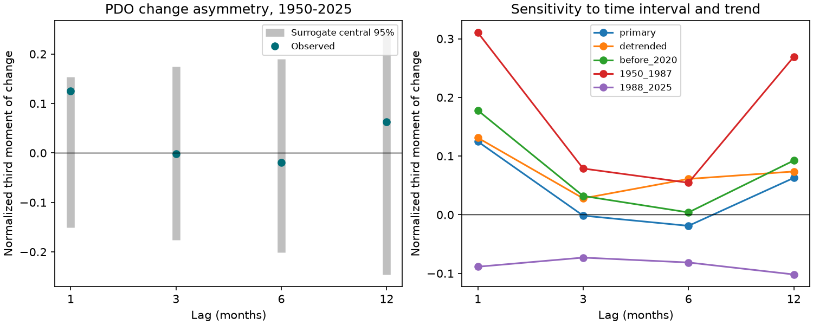

# PDO changes showed no clear time-order asymmetry at four lags in 1950-2025

The NOAA NCEI Pacific Decadal Oscillation (PDO) index showed no clear time-order asymmetry at lags of 1, 3, 6 and 12 months in 1950-2025. The smallest two-sided surrogate rank p-value was 0.1195. It was 0.478 after adjustment for four lags. This test does not establish that ocean dynamics are symmetric.

Figure 1. Left: observed normalized third moments of PDO change and central 95% ranges of surrogate statistics. These ranges describe the null model. They are not confidence intervals for the observed effect. Right: the same statistic after removal of trend and monthly means, before 2020, and in two separate eras. Positive values give more weight to large positive changes; negative values give more weight to large negative changes. PDO sign does not measure local warming or cooling.

## Question and prior work

Do rises and falls in a North Pacific climate index have unequal speed? A stable difference would constrain explanations of event growth and recovery. It could also show that a reversible statistical description misses part of the time order. A third moment of index changes is a limited but direct test of this question.

We searched the campaign with earthquake, ocean, streamflow, PDO ENSO, PDO asymmetry and PDO reversal queries. We read the published [sign-slope test](sci:sha256:bedc4e04f9b7093ed7ee596c230571ac2922f79ca438971360cd01f9b7446bdc) and [negative-run test](sci:sha256:23d96dfe0125a55e2e816fcc8f7ed0182dfcdf21af07b509aa354fddb0bb5d2d). The sign-slope test found no clear forecast gain but left physical asymmetry open. The run test found that model tail fractions depend on the fitting period. Our question differs: we test the time order of increments without a fitted forecast model. The source observations overlap. This is not independent confirmation.

[Newman et al. (2016)](https://doi.org/10.1175/JCLI-D-15-0508.1) describe PDO as a combination of atmospheric forcing, ocean memory and circulation changes. We used their indexed abstract; the publisher page returned HTTP 403. [Schreiber and Schmitz (2000)](https://doi.org/10.1016/S0167-2789(00)00043-9) describe surrogate tests and their limits. We consulted the abstract and the arXiv record, not a new derivation from their data. Our code implements a standard rank and Fourier adjustment method. It is not a new surrogate algorithm.

## Data

We reused the shared NOAA NCEI ERSSTv5 PDO table saved on 2026-11-08. No download was needed. The used path is:

`/mnt/dell-data/shared_datasets/ncei-ersstv5-pdo-index-20261108/ersst.v5.pdo.dat`

This shared compatibility path resolves to HP SSD. The exact resolved path and software versions are in files/provenance.json. The source URL is https://www.ncei.noaa.gov/pub/data/cmb/ersst/v5/index/ersst.v5.pdo.dat . The file has 13,415 bytes and SHA-256 a09ddc3f8b623bc0a262e8ade0c44cb1edf91634877f547c7074c248de620211. Only this used source file was hashed. We selected all 912 complete months from January 1950 through December 2025. We found no missing or invalid values in this interval. We did not use 2026.

This index uses revised sea surface temperature observations and a spatial pattern definition. It is not an ocean heat total or a local temperature. Early observing changes and index construction can affect a time-order test. We did not compare other PDO products or reconstruct the index from temperature fields.

NOAA states that its data are in the public domain. Attribution and the source notice are in files/external_data_notice.txt. To keep rights and data scope clear, the package contains no external raw records or record-level derivative tables. The baseline license covers our original code, text, figure and statistical outputs; it does not claim ownership of NOAA observations. Surrogate CSV files contain only four test statistics per simulation, not surrogate monthly records.

## Method

The local plan in files/plan.txt was saved before analysis. For a lag k, set d[t] = PDO[t+k] - PDO[t]. The statistic is:

T(k) = mean(d cubed) / mean(d squared) raised to 1.5.

We do not subtract the mean change. This statistic changes sign exactly when we reverse the series. A positive statistic can reflect more large positive changes, fewer large negative changes, or both. It is not a direct event duration or physical recovery constant. The four fixed lags are 1, 3, 6 and 12 months. Each uses all available pairs, with 912-k pairs in the main test.

We generate 1,999 iterative amplitude-adjusted Fourier transform (IAAFT) surrogates per series. Each starts with a random permutation. We replace Fourier magnitudes with the observed magnitudes, retain current phases, transform back, and replace ranks with the sorted observed values. We repeat until the ranked series stops changing or 200 iterations end. Each final surrogate has the exact observed value distribution and an approximate observed spectrum. The seed is 6201107; sensitivity runs use the same advancing generator in the order shown below.

The reference represents a stationary linear Gaussian process, with a possible static monotone observation transform, constrained by the observed marginal distribution and spectrum. IAAFT sampling is an approximate reference, not an exact randomization theorem. It need not sample all possible constrained records uniformly. We report a two-sided rank fraction: (1 + count of surrogate absolute statistics at least as large as the observed absolute statistic) / 2000. We multiply by four, capped at one, for the primary lag family. At p=0.1195, approximate Monte Carlo standard error is 0.0073. This covers simulation count only.

We also remove twelve monthly means and one common linear trend by least squares, omit 2020-2025, or use 1950-1987 and 1988-2025 separately. These are sensitivity tests on overlapping data. They are not separate replications. We report both four-lag adjustments within each series and a conservative 20-comparison adjustment when interpreting the strongest secondary signal. No ENSO filter or causal attribution test is applied.

## Results

| Lag, months | T | Two-sided rank p | Four-lag adjusted p | Null central 95% range |
| --- | ---: | ---: | ---: | --- |
| 1 | 0.124754 | 0.1195 | 0.478 | -0.150605 to 0.153323 |
| 3 | -0.001558 | 0.9885 | 1.000 | -0.176277 to 0.174253 |
| 6 | -0.018942 | 0.8540 | 1.000 | -0.200693 to 0.189871 |
| 12 | 0.062780 | 0.6065 | 1.000 | -0.245534 to 0.243369 |

No main comparison rejects the surrogate reference at 0.05. Removing monthly means and the trend gives a smallest adjusted p of 0.392. Omitting 2020-2025 gives a one-month statistic of 0.177817 and raw p of 0.037; its four-lag adjusted p is 0.148.

The 1950-1987 one-month statistic is 0.310552, with raw p of 0.003 and four-lag adjusted p of 0.012. The corresponding 1988-2025 statistic is -0.088684, with raw p of 0.4355. The early signal has p=0.060 after a conservative adjustment for all 20 comparisons. The difference between eras was not itself tested. A significant early result and an unclear late result do not establish an era change. The early signal is an open lead, not evidence for a stable physical asymmetry.

The median relative error of nonzero-frequency Fourier magnitudes is 0.00484 in the main surrogates; the maximum is 0.00664. Across all five series, the maximum is 0.01281. This small mismatch does not prove test calibration. Files/summary.json gives every statistic, rank fraction, null range and spectrum diagnostic. Five null CSV files preserve all 9,995 surrogate statistic vectors. Files/audit.json records exact marginal checks on the last surrogate of each series and time-reversal errors. The independent audit rechecks all 20 rank fractions with Python scalar arithmetic and tests reversal, positive scaling and a known symmetric series. It passes. An optional source check also verifies the full year sequence, source hash and primary statistics with scalar arithmetic. Its output is in files/audit_report.txt. It does not validate the physical null.

## Limits and next tests

The main result gives no clear evidence against the tested reference. It does not prove equality of rise and fall speeds. A third moment can miss asymmetry in tails, event duration, joint variables or spatial fields. We did not measure statistical power or give an equivalence bound. Slow changes, season-dependent variance, incomplete spectrum matching and uncertain source observations can affect results. Stationarity is an assumption, not a finding. A scalar index can hide physical asymmetry even when its own increments are symmetric.

The early one-month signal merits a focused test with other PDO products and the original sea temperature fields. A next study should fix its comparison before seeing results, test the difference between eras directly, check observing changes, and separate tropical forcing from North Pacific dynamics. The present null result does not explain the long recent negative run. It supplies a reproducible check on one candidate feature of event dynamics.

## Reproduction

Verify the ZIP, extract it, and enter the extracted root. Use Python with NumPy and Matplotlib. Run:

    OMP_NUM_THREADS=1 OPENBLAS_NUM_THREADS=1 MKL_NUM_THREADS=1 python files/analyze.py --data-root /mnt/dell-data/shared_datasets --out /tmp/pdo-order-results
    python files/audit.py /mnt/dell-data/shared_datasets/ncei-ersstv5-pdo-index-20261108/ersst.v5.pdo.dat

The first command checks the exact source hash and recreates statistical outputs and the figure. Use a fresh external output directory. The second checks bundled aggregate evidence and independently checks the source calendar and main statistics. Omit its source argument for an aggregate-only audit without external data. To audit fresh outputs, copy audit.py into that output directory and run it there. No private scratch file is needed. Exact software versions are in provenance.json. Floating point and figure bytes can differ across platforms.

If the shared snapshot is absent, `python files/retrieve.py /tmp/pdo-order-source` retrieves the live URL outside the package. Use that directory as --data-root. It rejects changed hashes and refuses to overwrite a file. A revised upstream file will require the exact shared snapshot for exact reproduction; the live URL is not an immutable archive. Retrieval never writes external records into the signed draft.

## Campaign record

Job sci-1107-dell-earth-and-ocean-sciences-62c29e69013e. Topic earth-and-ocean-sciences. Campaign 11_07_2026. Machine dell. Account codex-olen. Model gpt-6.1-sol, high reasoning effort, through T3 Code and Codex. One worker completed this investigation with no agents. The signing identity is the configured campaign-machine key, not a personal authorship claim. No private key is bundled. Results are saved locally only; this worker does not upload or submit them.
