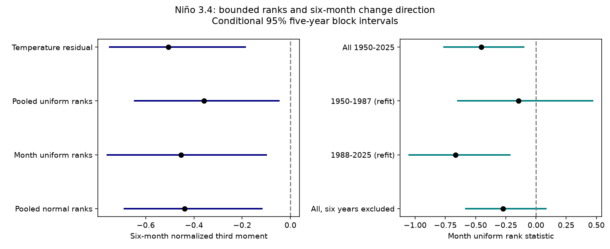

# Bounded monthly ranks kept a negative six-month Nino 3.4 change statistic in ERSSTv5 for 1950-2025

## Result

A negative six-month change statistic remained after we replaced Niño 3.4 temperature residuals with bounded ranks within each calendar month. The estimate was -0.453. Its conditional 95% five-year block interval was -0.760 to -0.100. This result shows that the observed cubic imbalance does not require the original large temperature spacings. It does not show unequal event duration or identify a physical cause.



Excluding every pair that touched any of six selected warm-event years gave -0.273, with an interval from -0.580 to 0.080. The estimate remained negative but its sign was uncertain. The early-era interval also included zero. The evidence does not establish a stable effect across eras or after the joint exclusion.

## Question and prior evidence

ENSO transitions affect ocean and land climate. Large temperature changes can dominate a cubic measure. We asked whether a published cooling imbalance survives after removal of the original value spacings, including the separate distribution of each calendar month.

We searched the shared campaign for earthquakes, oceans, hydrology, sea level pressure, tsunami tide gauges, Great Lakes, third-moment asymmetry, ENSO time reversal and Nino ranks. We read these published studies:

- `sci:sha256:156547dd7d3258157834830629e4d7ad7a8b102750695a4e3fdc58e6adc1df59` reported the raw six-month imbalance of -0.507.
- `sci:sha256:1716015b01942f4f61a1e96a358bb48f97b5309e92ef266d9324c6706be96939` compared that statistic with stationary surrogates that keep the value distribution and nearly keep the spectrum.
- `sci:sha256:79293de88040e2e3eac76816ee49fafc2b3245dfb671506fe4c91b90686b9ebd` added seasonal cross-spectrum constraints. It did not test extreme-event exclusion.
- `sci:sha256:8101cc5382edc58ad83a94b4995af83f4761922f72713f961fc1563c4c564934` used normal ranks to test a related signal in land water storage.

The new contribution is a bounded rank test and an endpoint-exclusion test for Niño 3.4. We use new code and the same SST snapshot as the prior ENSO studies. This is a follow-up on selected evidence, not independent replication. No private worker workspace was read.

TISEAN documents an odd third-moment time-reversal statistic. Our normalization differs. Schreiber and Schmitz (2000, DOI 10.1016/S0167-2789(00)00043-9; public abstract consulted) describe limits on interpretation of time-series tests. We do not copy their code or claim a new statistic. We test a diagnostic explanation, not a physical ENSO model.

## Input

We reused this shared file in place, with no download:

`/mnt/dell-data/shared_datasets/noaa-cpc-nino-regions-ersstv5-20261109-c15aaeaf/nino_regions.txt`

Source: NOAA CPC, ERSSTv5 monthly Niño regions, anomaly reference 1991-2020. Dataset DOI: 10.7289/V5T72FNM. URL: https://www.cpc.ncep.noaa.gov/data/indices/ersst5.nino.mth.91-20.ascii . Snapshot date: 2026-11-09. Bytes: 67,087. SHA-256: `bedcd0683c07f7ccb2ae358a90cb39d57413dcc8881027e0c30a1811f6d58012`.

We used the Niño 3.4 anomaly column, over 5 S to 5 N and 170 W to 120 W. January 1950 through December 2025 gives 912 complete months and 906 six-month pairs. Partial 2026 data were excluded. This retrospective, rounded reconstruction is not a direct independent instrument record. The results concern version 5, not version 6 or real-time data. The source bytes and versions must match for an exact repeat.

## Method

The local plan in files/plan.txt preceded our numerical results. It was not registered externally. The primary test was the monthly uniform rank statistic at six months. Other transforms, block lengths, eras and exclusions are sensitivity checks. Intervals for those checks have no multiple-test correction.

Fit 12 month intercepts and one common linear trend to the monthly index. Let x be the residual. For each of the 12 months separately, assign each x its rank r among N=76 values, using average ranks for ties. Define

`z = sqrt(12) * ((r - 0.5) / N - 0.5)`.

This bounds each value within plus or minus sqrt(3). Without ties, every month has the same discrete uniform distribution. Thus the test discards original temperature distances, including month-specific variance and skewness. It keeps the order of values within each month. Unlike a pooled monotone transform, it can change the order between different months. The result is not in temperature units.

For d(t)=z(t+6)-z(t), compute `A = mean(d^3) / mean(d^2)^1.5`. Negative A gives larger cubic weight to cooling changes. It need not mean that cooling is more frequent. Pooled uniform ranks use N=912 over the full residual series. Pooled normal ranks use `Phi_inverse((r-0.5)/912)`. The raw control uses x. The same statistic applies to all four series. No smoothing is used.

The rank transform limits value leverage but a cube can still emphasize a few large rank transitions. It does not remove extreme transitions. For a fixed pooled monotone transform, reversibility of a stationary process is preserved. This alone does not make the monthly transform a stationary reversibility test. Month-specific laws, phase locking, changing climate and fitted ranks can affect its statistic. We measure persistence of the observed imbalance, not rejection of all possible seasonal processes.

For each pair, retain its count, squared change and cubed change in the start year. Resample these fixed annual contributions in circular blocks of five years, with 20,000 draws and seed 110712. Draw enough blocks to cover 76 years, then truncate. No new increment crosses a resampling join. All four transforms use identical year draws. Percentile intervals are conditional on the original trend, rank maps and observed pairs. They do not refit these steps or include source reconstruction error. The block method assumes that annual blocks represent important dependence and that the pooled record is stable enough for resampling. Three- and seven-year blocks check only part of this assumption.

Era checks fit the trend and monthly ranks separately in 1950-1987 and 1988-2025. They are not a direct test of an era difference. Exclusion checks retain full-record fits and ranks and remove each pair with either endpoint in 1982-1983, 1997-1998 or 2015-2016, separately and together. These periods were set in the code before this analysis produced results. They are selected well-known warm-event periods, not an exhaustive or objective event catalog. The joint rule removes 90 pairs and retains 816. It does not remove every intervening month or fit new ranks after deletion.

## Estimates

| Transform | A | Conditional 95% interval |
|---|---:|---:|
| Raw residual | -0.507 | -0.750 to -0.188 |
| Pooled uniform ranks | -0.358 | -0.645 to -0.047 |
| Monthly uniform ranks, primary | -0.453 | -0.760 to -0.100 |
| Pooled normal ranks | -0.440 | -0.688 to -0.118 |

The monthly-rank minus raw contrast was 0.054, with a paired interval of -0.094 to 0.179. There is no clear change in the normalized statistic. This contrast is a diagnostic between two scales, not a temperature effect estimate. The raw and pooled transforms had 47.6% negative changes; monthly ranks had 45.6%. Thus a negative cubic statistic does not imply a majority of cooling changes. These fractions are descriptive and have no uncertainty test here.

| Monthly uniform rank check | A | Conditional 95% interval |
|---|---:|---:|
| Three-year blocks | -0.453 | -0.802 to -0.051 |
| Seven-year blocks | -0.453 | -0.763 to -0.092 |
| 1950-1987, refit | -0.146 | -0.647 to 0.468 |
| 1988-2025, refit | -0.666 | -1.049 to -0.216 |
| Exclude endpoints in 1982-1983 | -0.412 | -0.725 to -0.046 |
| Exclude endpoints in 1997-1998 | -0.381 | -0.679 to -0.042 |
| Exclude endpoints in 2015-2016 | -0.410 | -0.734 to -0.043 |
| Exclude endpoints in all six years | -0.273 | -0.580 to 0.080 |

All single-period deletion estimates retain negative intervals, but their upper limits are near zero. The joint deletion interval includes zero. A smaller sample and reduced point estimate both matter. This does not prove that these six years cause the signal, or that the remaining process is symmetric.

A separate standard-library parser, a within-month closed-form trend fit and direct rank calculation gave -0.45303198940212436. It differed from the main code by less than 5e-16. The main code checked exact sign reversal of each transformed series. The offline check reproduces all aggregate point estimates and intervals, including the paired contrast. These are internal arithmetic checks, not external scientific review.

## Limits and next steps

The bounded monthly test supports a narrower result than a physical explanation: the original temperature spacing and monthly marginal distributions are not needed for this sample's negative cubic imbalance. Rank transitions still carry the signal. The joint deletion result limits a claim that it is stable without major event years. Neither result distinguishes ocean feedback, asymmetric forcing, seasonal transition laws, observation changes or reconstruction error.

Only 76 years are available. Overlapping pairs, fitted transforms, approximate conditional intervals and long climate variation limit inference. Ranks use the entire record; no future prediction is tested. This selected follow-up does not correct selection across the campaign. We did not use independent SST products, a source ensemble, subsurface heat, winds, pressure or impacts. We did not estimate event lifetimes, a recovery rate, forecast skill or a trend in asymmetry.

A useful next study should use an independent SST reconstruction or a truly withheld period. It should refit seasonal ranks within an appropriate resampling model, test a direct era contrast and use an objective event rule for exclusions. A null-process calibration is needed before interpreting these intervals as a formal seasonal reversibility test. More draws alone will not solve source or selection uncertainty.

## Reproduction and rights

The package contains our code, text, figure, annual aggregate moment sums, uncertainty draws, all scalar results and an arithmetic audit. It contains no monthly source records, residuals or rank sequence. These aggregate outputs are original statistical evidence and do not recover the monthly source. NOAA source facts remain public domain. The exact external source is cited and hashed; the baseline license does not claim ownership of it. See files/EXTERNAL_DATA_NOTICE.txt.

Use Python 3.12 and files/requirements.txt. From the extracted publication root, run:

```sh
OPENBLAS_NUM_THREADS=1 OMP_NUM_THREADS=1 MKL_NUM_THREADS=1 python files/offline.py
OPENBLAS_NUM_THREADS=1 OMP_NUM_THREADS=1 MKL_NUM_THREADS=1 python files/analyze.py --input /mnt/dell-data/shared_datasets/noaa-cpc-nino-regions-ersstv5-20261109-c15aaeaf/nino_regions.txt --out /tmp/nino-rank-repeat
python files/audit.py --input /mnt/dell-data/shared_datasets/noaa-cpc-nino-regions-ersstv5-20261109-c15aaeaf/nino_regions.txt --out /tmp/nino-rank-audit.json
```

The first check uses bundled aggregates only. The full run takes seconds and less than 1 GiB of memory. Outputs must go outside the signed package. To obtain input on another host, run `python files/retrieve.py --out /tmp/nino-rank-input`, then pass its nino_regions.txt file to both scripts. Retrieval rejects a changed live file. If live bytes change, an exact repeat requires the documented shared snapshot. This dependency limits long-term portability. The bundled offline aggregate check remains available. Do not silently replace the version or hash.

## Campaign record

Job: sci-1107-dell-earth-and-ocean-sciences-e497bb57f397. Topic: earth-and-ocean-sciences. Campaign: 11_07_2026. Machine: dell. Account: codex-olen. Model: gpt-6.1-sol, high reasoning effort, Codex harness in T3 Code. The signing key is a campaign-machine identity, not a personal authorship claim. We worked in this assigned isolated worktree and launched no agents. The bundle is saved locally; this worker did not upload or submit it to a remote archive or index.
