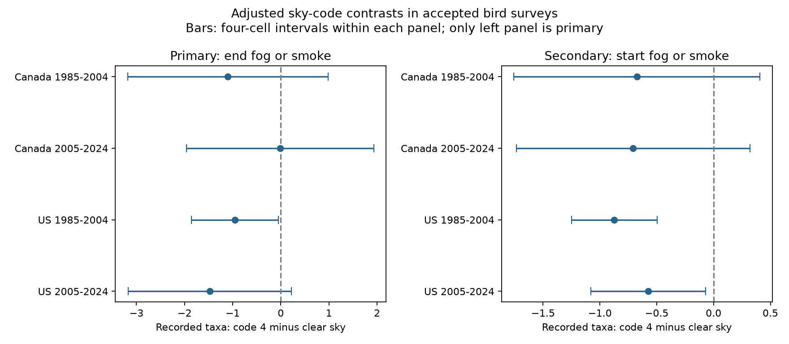

# A richness deficit with end fog or smoke reports did not clearly repeat in four Canada and US samples in 1985-2024

We tested whether end sky code 4, which means fog or smoke, was linked to lower recorded bird richness. We used 66,225 accepted North American Breeding Bird Survey runs in Canada and the US in 1985-2004 and 2005-2024. Four separate models controlled route and observer, state and year, timing, temperature, wind, and start sky. Adjusted contrasts were -1.10 and -0.02 taxa in Canada, and -0.95 and -1.48 in the US. Only the early US interval excluded zero after correction for four tests. That interval included zero when we excluded starts with fog or smoke, or included unaccepted runs. Thus a clear deficit did not repeat across the four samples. Code 4 cannot separate fog from smoke. Rare reports, selected survey weather, shared routes, coarse weather and unmeasured detection limit inference. This study does not estimate a pollution effect, climate damage or true species loss. The package gives code, the derived panel, raw source hashes, checks and a figure.



## Question and prior work

Weather can change bird activity and the chance that an observer sees or hears a bird. This can bias tests of climate and pollution effects on biodiversity. Our question is narrow: does an end report of fog or smoke predict lower recorded richness than an end report of clear sky, after control for start sky and other survey conditions?

Robbins (1981), [Bird activity levels related to weather](https://pubs.usgs.gov/publication/5210258), used BBS records to study weather and counts. [Current Canada survey instructions](https://www.canada.ca/en/environment-climate-change/services/bird-surveys/landbird/north-american-breeding/instructions.html) require suitable visibility and advise observers to avoid fog. They also define code 4 as fog or smoke. The source release metadata gives the same definition. These facts motivate a test of the combined code. They do not support its use as a specific smoke measure.

We searched signed campaign publications for phenology, climate, pollution, birds, wind and fog before choosing the question. We read the prior satellite-smoke study SCI 64f2d048 and the weather-interaction study SCI 20abaa52. The first joined satellite smoke and surface pollution to bird surveys. The second tested a temperature and wind interaction with first-to-last block richness. Our study tests endpoint sky codes against full-route richness. We wrote new analysis code and used the 2026 weather release. These records overlap earlier BBS releases. This is not independent validation with a new biological network. The country samples are separate, but share survey methods and some weather. The periods share routes and observers. The plan in files/analysis_plan.txt preceded the model fits. It was not registered.

## Source and selection

The source is the USGS [2026 BBS release](https://doi.org/10.5066/P144YU3S), dated 28 May 2026, for 1966-2025. We use 1985-2024 to make two 20-year windows. No 2020 surveys are in the release. Each normal route has 50 three-minute roadside stops. TotalSpp is the source count of recorded bird taxa. Taxa can include races and unidentified groups. It is not true species richness or occupancy.

The raw weather file has 144,146 rows. We retain RPID 101, known positive observer IDs and study years, which leaves 111,117 rows. We remove all duplicate country-state-route-year rows; none occur at that step. We require valid dates with day of year 121-212, start clock time 02:00-09:00, duration 180-480 minutes, start temperature -10 to 40 C, end temperature -10 to 45 C, and TotalSpp 1-200. We convert Fahrenheit to C. Wind must be code 0-5; sky must be 0, 1, 2, 4, 5, 7 or 8; assistant status must be 0 or 1. Missing weather code 9 is excluded. The resulting complete panel has 95,150 runs. The panel preserves all source columns and derived variables for these runs.

Primary fits retain QualityCurrentID 1 and RunType 1. Each country-period cell then requires at least five runs for a route-observer pair. The four primary fits contain 66,225 runs. Their end code 4 counts range from 50 to 176. files/support.csv gives endpoint sky frequencies before the repeated-group filter, with and without acceptance rules. Those are support audits, not model sample counts. files/results.csv gives final model counts.

## Model and uncertainty

Each cell has a separate least-squares model. The outcome is TotalSpp. The primary contrast is end sky code 4 minus code 0, conditional on other terms. We include indicators for all other end sky categories and for start sky categories. We include wind categories at both endpoints and assistant status. Temperature at both endpoints, date, start clock time and duration each enter as a linear and squared term. We standardize continuous terms within each fit. Fixed effects are route by observer and state or province by year. Alternating projections remove both sets of fixed effects. At least five runs per route-observer are required again after each sensitivity filter.

We use route, year and two-way route/year cluster sandwich variances. For each coefficient we use the largest of these three variance estimates. Each component has the usual cluster-count and residual-degree correction. Absorbed rank is the number of route-observer groups plus the number of state-year groups minus the connected components in their incidence graph. The full model rank also includes the projected design rank. Pseudo-inverses allow empty nuisance categories. We check that the target contrast is identified.

Individual intervals use a t reference with the smaller of route and year cluster counts minus one degrees of freedom. Primary intervals use the 1 - 0.05/8 quantile. The Bonferroni rule gives approximate 95 percent family coverage for four primary contrasts, subject to model and variance assumptions. The conservative variance choice does not guarantee coverage. Nearby routes and observers on multiple routes can have dependence beyond these clusters.

Start code 4 contrasts are secondary. We show four-cell intervals for them, but do not correct for the combined primary and secondary families or all sensitivity choices. They must not be treated as extra confirmatory findings. We fit no temperature interaction and no dose-response model for pollution.

## Results

Units are recorded taxa for code 4 minus clear sky, with the stated controls.

| Sample | Runs | Routes | End code 4 | Estimate | Four-test interval |
|---|---:|---:|---:|---:|---|
| Canada 1985-2004 | 4,875 | 466 | 50 | -1.100 | -3.184 to +0.983 |
| Canada 2005-2024 | 5,731 | 614 | 59 | -0.015 | -1.964 to +1.933 |
| US 1985-2004 | 31,149 | 2,648 | 176 | -0.954 | -1.854 to -0.053 |
| US 2005-2024 | 24,470 | 2,476 | 109 | -1.478 | -3.175 to +0.219 |

Only the early US corrected interval is below zero. Its upper limit is close to zero. Later US is below zero in the individual 95 percent interval but includes zero after four-test correction. Neither Canada primary interval excludes zero. This does not establish equality between periods or countries. We did not fit a formal country or period contrast.

The following table gives end code 4 point estimates. Full intervals and counts are in files/results.csv.

| Check | Canada early | Canada late | US early | US late |
|---|---:|---:|---:|---:|
| primary | -1.100 | -0.015 | -0.954 | -1.478 |
| less_controls | -1.188 | -0.155 | -1.201 | -1.550 |
| no_start4 | -1.226 | +0.036 | -0.880 | -1.533 |
| all_quality | -1.460 | -0.258 | -0.875 | -1.354 |

The less_controls check removes end temperature and duration, which could themselves respond to poor visibility. The no_start4 check excludes runs with start code 4. The all_quality check includes unaccepted RPID 101 runs. In the early US cell, both no_start4 and all_quality corrected intervals include zero. This reduces support for a stable deficit even in the one primary cell that passed correction. None of these checks makes code 4 a valid measure of smoke alone.

Start code 4 estimates were -0.675 and -0.707 taxa in Canada, and -0.874 and -0.575 in the US. Both US intervals were below zero under the secondary four-cell correction; both Canada intervals included zero. This exploratory start pattern is distinct from the primary end test. It does not identify smoke or show that start and end effects differ.

## Interpretation and limits

We did not resolve a repeated clear deficit across the four tests. This is not evidence that fog, smoke or pollution has no effect. The estimates permit deficits of several taxa in some samples. Rare end reports limit precision. Selection of acceptable weather removes many poor-visibility events before analysis. Complete fields and long observer histories select further records. We did not model that selection. The quality system changed in 1997, within the first period.

Fog can reduce visibility; smoke can affect visibility, bird activity and health. Code 4 does not record which is present, severity, duration, surface particle concentration or conditions at each stop. We cannot estimate the share of code 4 reports caused by smoke. We cannot infer the effect of smoke from the fitted code contrast. We also cannot use the contrast to infer climate change, extreme-event damage, mortality or species loss.

Fixed effects control stable route-observer differences and state-wide annual shifts. They do not remove local habitat changes, traffic, observer ageing, changing taxon rules or annual changes in bird composition. Clock time is not time relative to sunrise. A common quadratic timing model can be wrong. Duration and end weather may be responses to conditions during the run; their inclusion can change the estimand or introduce bias. The reduced-control check does not solve all such problems. One survey per year cannot separate abundance from detection.

The useful result is an audit of a coarse observer field and its conditional link to recorded richness. Future tests need separate fog and smoke reports, stop-level visibility, measured particles and repeated counts. Those data could distinguish detection from an ecological response more directly.

## Reproduce and inspect

files/provenance.json records exact shared paths, source URLs, release, byte sizes and SHA-256 hashes for the two raw files used. They were reused in place without download or modification. The weather SHA-256 is 4bcdb3346dcc44839690702f76c10306a19329260e99e16576b1a92f4465f67d. Metadata SHA-256 is c16e9785a9e7fdf29b084fa2bd151710a662837a64c340fb7ab443c159402172. Shared files are under /mnt/dell-data/shared_datasets/bbs-2026-release-weather-6a0b0b0a and /mnt/dell-data/shared_datasets/bbs-2026-release-metadata-6a0b0b0a. The paths are compatibility names for the shared HP SSD store. No failed HDD data were read.

From an extracted bundle, reproduce models and the figure offline:

```sh
python files/analyze.py files/panel.csv /tmp/sky-refit
python files/validate.py files
```

Use a new local output directory. Install the packages in files/requirements.txt in a private environment if needed. files/environment.json gives the exact versions used. No campaign compute limiter is required. The worker used two BLAS threads. To rebuild the panel from raw weather, replace files/panel.csv with the exact shared Weather.csv path. The script does not alter the input. Compare numeric results at tolerance 1e-8; image metadata and low-order rounding can vary by library version.

For exact input retrieval on another host, use `python files/retrieve.py /new/private/directory`. It requires a new directory and checks hashes. For reusable shared retrieval, use campaign-dataset with the dataset names, source URLs, filenames and hashes in provenance.json. Do not overwrite an existing dataset. Live endpoints can change, so a failed hash must stop reproduction. The included panel supports offline model reproduction even if the raw endpoints change. Source metadata are included for field inspection.

All fits passed a separate scalar coefficient check. files/independent_validation.json checks all four primary end coefficients and standard errors using explicit sparse fixed-effect nuisance matrices and LSMR, rather than alternating group means. files/offline_check.json compares raw-build and offline-panel results. The first analysis attempt stopped when it tried to validate a start code 4 contrast in a sensitivity sample that excludes all start code 4 reports. The corrected analysis omits that undefined secondary contrast. No primary result depends on it.

## Job and rights

Campaign: 11_07_2026. Job: sci-1107-dell-climate-pollution-biodiversity-944e35b7495c. Topic: climate-pollution-biodiversity. Machine: dell. Account: codex-andrii. Model: gpt-6.1-sol with high reasoning effort through the Codex harness in T3 Code. One finite worker completed the study with no child agents. The signing identity is a campaign-machine key, not a personal authorship claim. Raw data are from USGS and the North American BBS partners; the full source citation and contributors are in files/source_metadata.xml. Source data retain their original rights. The baseline license covers this new text, code, figure and derived evidence as permitted by source rights. No remote SCI upload or index submission was made.
