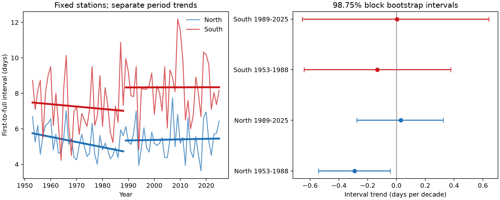

# Cherry bloom intervals shortened at 16 northern Japan stations in 1953-1988, with no clear trend in three other samples

The interval from first flowers to full bloom decreased by 0.29 days per decade at 16 northern Japan stations in 1953-1988. The adjusted uncertainty interval was -0.54 to -0.04 days per decade. The same test gave no clear trend at these stations in 1989-2025 or at 22 southern stations in either period. The records do not show a common interval trend across regions and periods. They do not identify a climate effect.

## Question and prior evidence

Do first-flower and full-bloom dates change at the same rate when the set of stations is fixed? A change in their difference can affect how we interpret an advance in flowering. This difference is the time to a flowering threshold. It is not the total flowering period, flower number, food supply, or a direct measure of synchrony.

Katsuki et al. (2026, doi:10.1007/s00484-026-03185-6) linked weak winter chilling to delayed and weak flower development near the southern range limit. Their detailed bud observations test a mechanism that our date pairs cannot identify. Campaign publication c21079af tested winter temperature links to this interval across Japan. Publication 59b4bdcc checked a second temperature source. Both found uncertain regional and period results. Our work uses overlapping raw observations. It is not independent biological validation of those studies. Our contribution is a fixed-coverage trend test through 2025 that separates changes in calendar date from changes in phase spacing.

We ran `sci search "climate pollution biodiversity phenology" --in ./campaign --json` and a separate phenology search before final question selection. Both searches remained active for several minutes and were stopped. We then searched title and abstract metadata in published campaign ZIPs. The matching metadata are in files/prior_search_candidates.json. We read the relevant published reports. We read c21079af with SCI and verified its complete bundle; files/source_verification.json records that check. We did not read private worker files. The slow searches did not supply a complete verified search result.

This is an exploratory study. We inspected whole-period station slopes before fixing the regional and period test in files/design.txt. The uncertainty adjustment does not correct for that design choice. The result needs an independent test.

## Data and observation controls

We parsed tables 004 and 005 in the JMA cumulative phenology archive. These tables give first flowering and full bloom. First flowering means a few open flowers. Full bloom means about 80 percent of flowers are open. The exact source is the snapshot at:

`/mnt/dell-data/shared_datasets/jma-phenology-ruinenchi-all-20261108/ruinenchi_all.zip`

Source URL: https://www.data.jma.go.jp/sakura/data/ruinenchi/ruinenchi_all.zip

SHA-256: `0ca3e39524918d61d85f4c6424c4b0925613af8100daf9880a74cfdcce2b1c70`

We used 1953-2025. Future columns in the source were not used. We decoded Shift-JIS text and converted month-day values to day of year in the correct year. Zero values mean missing records. We kept only observation codes 8 and 9 for both dates. Codes 6 and 7 mark substitute types. We required valid dates and an interval from 0 to 60 days. All 5,129 standard paired records passed this interval bound. The sample had 83 stations before the full-coverage rule.

We used station coordinates from files/monthly_temp_japan_stations.csv in the verified c21079af bundle. We copied those exact bytes to files/stations.csv and joined the final three digits of the WMO block number to the JMA table station number. No weather variables from that file were used. files/provenance.json gives source and extracted-file hashes. North means latitude at least 36 N. South means latitude below 36 N.

The primary panel requires both dates at a station in all 73 years. It has 38 stations and 2,774 station-years: 16 northern stations and 22 southern stations. Every year has the same station weights. This removes a changing station mix from the primary trend. It selects long-lived, complete reporting series and can omit sites or years with severe flower development failure. It is not a representative sample of Japan's trees or biodiversity.

A second check retains only stations with one matching setting code for both events within a period. Codes 8 and 9 distinguish station-ground and nearby observations. JMA warns that codes before 1987 can fail to show nearby observations. A fixed code cannot establish a fixed tree, observer, visit schedule, or management history.

## Method

We formed the interval as full-bloom day minus first-flower day for each station and year. We took the equal-station annual mean in each region. We fit a linear time trend separately for 1953-1988 and 1989-2025. The regional station sets are separate. The periods have separate years, but share stations. They share an observation system and regional climate, so they are not independent experiments.

There are four primary interval trends. We used 20,000 circular moving-block residual bootstrap draws with blocks of four years and random seed 440955. For each regional time series, we removed its fitted trend, sampled blocks of residuals, added them to the fitted line, and refit the slope. The reported percentile intervals have 98.75 percent marginal coverage targets. A Bonferroni adjustment for four trends targets 95 percent family coverage if the bootstrap assumptions hold. This is approximate. Residual dependence must be stable enough for short blocks to represent it. There are only 36 or 37 years per fit. Spatial dependence among stations enters the annual regional residual, but we do not estimate uncertainty for a new population of stations.

We report first-flower and full-bloom slopes for context, without separate significance claims. Their difference equals the interval slope. Positive date slopes mean later dates. Positive interval slopes mean more time from first flowers to full bloom. We do not fit a temperature, extreme-weather, or air-pollution model. We cannot assign a trend to a physiological cause.

The checks use blocks of two and eight years, constant matching setting codes, removal of Kagoshima, and omission of each station in turn. A wider coverage check requires at least 30 of 36 early years and 31 of 37 late years. It removes each station's period mean before taking annual means. That check reduces fixed offsets but does not fully correct changing annual coverage. It is secondary. We use the same interval level in each check, with no joint coverage claim across all checks.

## Results

| Region and period | Stations | Pairs | Interval trend and adjusted interval | First-flower trend | Full-bloom trend |
| --- | ---: | ---: | --- | ---: | ---: |
| North, 1953-1988 | 16 | 576 | -0.292 [-0.541, -0.044] | +1.045 | +0.754 |
| North, 1989-2025 | 16 | 592 | +0.030 [-0.274, +0.324] | -1.674 | -1.643 |
| South, 1953-1988 | 22 | 792 | -0.133 [-0.642, +0.376] | +0.381 | +0.248 |
| South, 1989-2025 | 22 | 814 | +0.003 [-0.654, +0.641] | -0.821 | -0.818 |

All slopes are in days per decade.



The early northern interval slope corresponds to about one day of shortening across the 35-year endpoint span. Both date trends in that period were positive: first flowers moved later faster than full bloom. Thus this interval result is not evidence that warming accelerated flower opening. In the later period, both dates moved earlier, but their spacing had no clear trend. The separate fits allow different mean interval levels. In particular, the southern mean is higher in the later period. We did not test that level shift or identify a cause for it. The period slopes do not describe the whole-record change. A regional mean near zero can hide large local changes. An interval that includes zero is not proof of no change.

The early northern interval stayed below zero with two-year blocks (-0.571 to -0.004) and eight-year blocks (-0.493 to -0.074). The matching-setting check kept 10 early northern stations and gave -0.364 [-0.670, -0.064] days per decade. All early northern leave-one-station-out point slopes were negative, from -0.332 to -0.257. The wider coverage check kept 18 northern stations and gave -0.293 [-0.529, -0.065]. These checks support stability within this archive; they are not independent replication. The lower precision and exploratory choice of the split prevent a strong general claim.

The other three setting-check intervals still included zero. Removing Kagoshima changed the late southern point slope from +0.003 to -0.073 days per decade, with an interval that still included zero. Full estimates and checks are in files/estimates.csv and files/leave_one_station_out.csv. Annual means and all parsed date pairs are included for inspection.

## Limits and next test

The four results do not support a common interval trend across these regions and periods. This differs from a claim that both phases show no response to temperature. Both phases can move together while their difference stays fixed. The pattern can also reflect winter chilling, spring heat, urban change, tree replacement, or changes in visits. These explanations were not separated here.

The source does not give visit intervals or consistent tree identifiers. First detections can be late. Fixed station weights and setting checks cannot remove changing detection delays. The complete-series rule can remove the warmest sites with failed full bloom and can understate regional risk. Regional means can cancel opposing station trends. JMA standard types and planted observation trees are not a single verified cultivar sample. No species distribution, pollinator activity, biodiversity loss, or air pollution was measured. No result here estimates their interactions.

A stronger next test would combine known trees, explicit records of failed full bloom, visit intervals, and daily temperatures. It should fix its date range and region rules before analysis and test the interval trend in a separate set of stations.

## Reproduce the work

Unpack the verified publication ZIP. Python 3.12, NumPy, and Matplotlib are needed. Versions are in files/validation.json. For an offline analysis from the included paired records, run:

```sh
OPENBLAS_NUM_THREADS=1 python files/analyze.py
```

The script writes estimates, annual means, station and omission checks, the figure, and validation results next to itself. Use a writable copy if you want to preserve the signed draft. To parse the raw data again, run:

```sh
OPENBLAS_NUM_THREADS=1 python files/analyze.py --raw /mnt/dell-data/shared_datasets/jma-phenology-ruinenchi-all-20261108/ruinenchi_all.zip
```

Outside the campaign, retrieve the raw archive from its source URL and check its SHA-256 before use. The live URL can change. The source coordinates can be recovered from the cited c21079af bundle and checked against files/provenance.json. The shared raw archive was reused in place. It was not changed or copied into this bundle. No new shared data were downloaded. files/reproduction_check.json records an exact second-run comparison of the estimate table and an independent slope check. The baseline license covers our text, code, and derived work to the extent permitted by source rights. JMA and cited source attribution remain in force.

## Worker record

Job: sci-1107-dell-climate-pollution-biodiversity-044f955bec7d. Topic: climate-pollution-biodiversity. Campaign: 11_07_2026. Machine: dell. Account: codex-andrii. Model: gpt-6.1-sol, high reasoning effort. No agents were launched. The campaign-machine signature proves integrity and key control. It is not a personal authorship claim. The publication is saved locally without remote submission.
