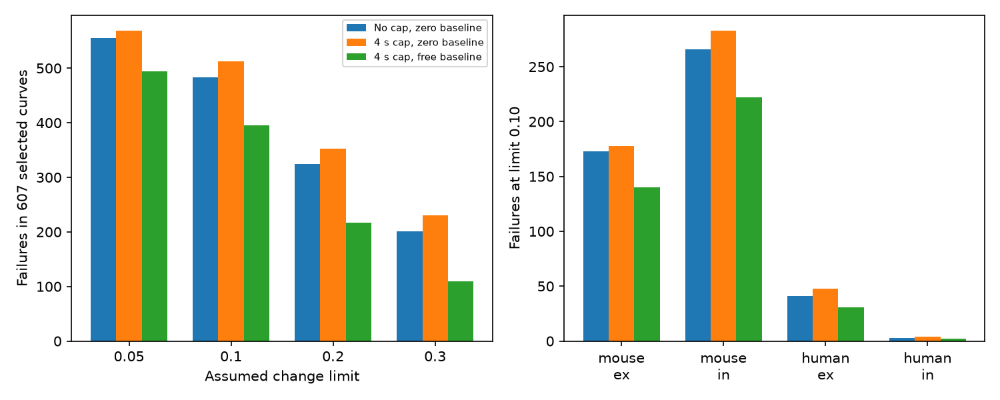

# A free baseline removes all 30 added four-second recovery-cap exclusions in 607 selected Allen curves

A free constant baseline removes all 30 exclusions that a four-second recovery-time cap added in a prior Allen slice study. At an assumed uniform change limit of 0.10 normalized units, 483 of 607 curves fail an unrestricted, zero-baseline, same-sign exponential mixture. A four-second cap raises this count to 513. The capped model with a free constant baseline has 395 failures. All 30 cap-specific exclusions pass this last model. Thus the need for a slow mode in those 30 cases depends on the zero-baseline assumption.

This is a model compatibility result. It does not show that a baseline error exists or that a slow biological process is absent.



The left panel gives failure counts at four assumed change limits. The right panel gives group counts at limit 0.10. Connections are not independent animals. These plots have no population confidence intervals.

## Question and prior work

A circuit edge needs a temporal response rule to predict its effect on computation. A sum of recovery modes is one candidate rule. Can four response summaries distinguish a need for slow modes from a constant baseline term?

Campagnola, Seeman and colleagues measured connections and their dynamics in mouse visual cortex and human temporal cortex (doi:10.1126/science.abj5861). These pair IDs link a measured physiological connection to its own response. We use no anatomy-to-activity join across animals. We test a temporal rule for these connections. We do not test an intact-brain connectome or behavior.

We searched the campaign for connectome, structure function, neural reliability, Allen, reciprocal, recovery, exponential and baseline. Early limited searches missed relevant results. A complete exponential search returned 308 records. It revealed that both the full-mixture test and the time-cap test were already published. We changed the question before computing the free-baseline fits. The baseline search stopped at 1000 results and was incomplete. The search record is bundled. No sibling private workspace was read.

We build on these signed publications:

- sci:sha256:172b3c5e17ae05db782b8454cee70b821023b6c239fd5ed1bbe46644e05d4d49 tested necessary divided-difference constraints. We reuse its extraction and shape functions under the baseline MIT terms.
- sci:sha256:cd0c9c0fdea945af57e18977168f1045758c041fc1ce759d4fe43d88048bfabb tested the full mixture cone. Our separate grid solver reproduces its threshold counts.
- sci:sha256:6ddb9fba7b2e8c93de4d92bd668abb30819642446719b9a8186cb802b1d1fefe found 30 added exclusions with a four-second cap. It left a baseline alternative open. We reproduce its primary count and test that alternative.

Our new contribution is the free-baseline test and its effect on these exclusions. It uses the same data. It is not an independent biological replication. Positive measures, moment cones and linear optimization are established methods. See Diaconis and Freedman, The Markov Moment Problem and de Finetti's Theorem: Part I (https://www.stat.berkeley.edu/users/freedman/631.pdf). We supply a short grid-error bound for this test. The study is exploratory, not registered.

## Data and selection

We reused Allen Synaptic Physiology r2.1 small, release 2023-01-26. The exact file is `datasets/allen-synphys-r2.1-small-20230126/synphys_r2.1_small.sqlite` relative to the assigned worktree. It has 176771072 bytes. Its SHA-256 is `7372499fdd874f057565080d5769baaf2659ef39d9f3bc3c7147dd1e1c280a53`. The evidence provenance gives its absolute shared and resolved paths. We checked this hash and opened SQLite read-only. No data were downloaded or changed.

The selection follows the prior studies. We require a detected chemical connection, dynamics QC, an excitatory or inhibitory synapse label, and a finite nonzero signed normalizer with the expected sign. We select mouse VisP and human TCx. Species and region change together. We test no species contrast.

We select current clamp, 50 Hz induction, and pauses of 0.25, 0.5, 1 and 4 seconds. Each stp_recovery_single entry must have a finite median, standard deviation and count. A duplicate finite entry at a relevant protocol excludes the connection. The primary sample requires at least five trials at each pause. Checks use three and ten trials.

The metric is the median trial value of (A9-A1)/Q. A is a fitted response amplitude. Q is the signed amplitude percentile for the connection: percentile 90 for excitation and 10 for inhibition. The pinned Allen analysis source defines this metric; it is not a confirmed build commit for the database. Zero denotes return to the first-response level. This metric is not a resource fraction. Separate pause protocols use separate trials and first responses. We do not use stored pulse arrays.

There are 2037 candidates and 17 duplicate exclusions. The complete selection before trial filtering is the prior 1125 curves. Our analysis scores the 966 curves with at least three trials. The primary sample has 607 curves from 367 recordings. The ten-trial subset has 37 curves. We add no layer, distance or cell-type restriction.

## Model and bounds

The capped model is

    y(t) = c + s sum_j a_j exp(-t/tau_j),
    a_j >= 0, s in {-1,+1}, 0 < tau_j <= 4 seconds.

Each connection has its own parameters. One overall sign applies to every recovery mode. The constant c is free and can have either sign. It is the same at all four pauses. It is not a separate offset per observation. We compare with c=0 and with the uncapped c=0 model. The free-baseline capped model and the uncapped zero-baseline model are different alternatives; neither must contain the other.

Set x=exp(-0.25/tau) and b=a*x. At the four times, each normalized mode has vector (1,x,x^3,x^15). The cap restricts x to [0,exp(-0.25/4)]. We use the closed cone. Its zero endpoint permits a limit with arbitrarily fast recovery and unbounded original amplitude. Compatibility is an infimum-distance statement. It need not give an attained fit with finite positive time constants. We impose no amplitude bound and identify no unique mode count.

A nonnegative-weight linear program on N+1 equally spaced nodes gives an upper sup-norm distance D_N. A free coefficient supplies c. For any continuous mixture, mass is bounded by (abs(y0-y3)+2D)/(1-xmax^15), where D is the exact distance. Linear interpolation of the generator has coordinate error at most delta=210*xmax^2/(8N^2). Put eta=delta/(1-xmax^15). Then

    max(0,(D_N-eta*abs(y0-y3))/(1+2*eta)) <= D <= D_N.

We compute both signs and take minima of their bounds. N=400 normally. We refine to 1600 if a reported threshold lies inside a distance bracket. files/proof.txt gives the derivation and the control-model bounds. These are analytic grid bounds with floating-point LP checks. They are not exact interval-arithmetic certificates.

A definite failure has lower bound above epsilon+1e-7. A possible failure has upper bound above epsilon-1e-7. All reported capped-model counts have equal lower and upper classifications. The primary epsilon is 0.10. Checks use 0.05, 0.20 and 0.30. These are assumed absolute normalized changes. They are not measured errors, standard errors, confidence limits or significance levels. We do not convert a standard deviation to an error of a median.

## Results

At five trials per pause and limit 0.10:

| Group | Curves | Uncapped, zero baseline | Cap 4 s, zero baseline | Cap 4 s, free baseline | Cap-added cases now compatible |
|---|---:|---:|---:|---:|---:|
| Mouse excitation | 217 | 173 | 178 | 140 | 5 of 5 |
| Mouse inhibition | 329 | 266 | 283 | 222 | 17 of 17 |
| Human excitation | 57 | 41 | 48 | 31 | 7 of 7 |
| Human inhibition | 4 | 3 | 4 | 2 | 1 of 1 |
| All | 607 | 483 | 513 | 395 | 30 of 30 |

The middle three columns count failures. The free baseline removes 118 of the 513 capped failures in total. This includes all 30 failures added relative to the uncapped model. It leaves 395 failures; a constant offset does not explain every curve under the stated tolerance and mode rule.

At three trials, all 50 cap-added exclusions become compatible. The total failures fall from 845 to 662 among 966 curves. At ten trials, all five cap-added exclusions become compatible. Total failures fall from 25 to 12 among 37 curves. These subsets overlap and are selected. They are not independent replications or a noise correction.

At limits 0.05, 0.20 and 0.30 in the primary sample, the free-baseline model removes all 14, 28 and 29 cap-added exclusions. Its total failure counts are 494, 217 and 110. The result is not limited to the primary tolerance, but all limits remain assumptions.

## Validation and limits

The control fits reproduce the prior 483 uncapped and 513 capped failures. One hundred synthetic capped mixtures with random constant offsets have feasible grid distances below 2.45e-10. Fifty random translations change free-baseline distances by at most 6.78e-15. Fifty fits at N=800 have overlapping bounds with the primary grid fits. The largest upper-distance change in this check is below 4.82e-7. The maximum observed LP residual or dual objective gap is below 1.20e-9. The widest free-baseline bracket is below 0.000878 normalized units. Every tested capped threshold case is resolved. A fresh run with no cached unrestricted scores checks the full summary. The bundled evidence gives the exact repeat comparison.

The earlier studies use a zero reference across separate trials. A free baseline changes this assumption. It can represent a persistent process or an unknown reference term; it need not represent measurement error. We did not estimate a measured baseline shift, constrain its size, fit trial data or compare predictive error on new pauses. More free parameters can only help the capped model. The useful result is that this specific alternative accounts for every earlier cap-specific exclusion in the selected sample. It prevents those exclusions alone from separating a slow finite mode from a constant term at these four pauses.

Shared normalization, drift, changing train states, opposing modes and nonlinear responses can also matter. Nominal pauses are treated as exact. Low trial counts and missing protocols select the sample. Cells and recordings are shared. No population probability or animal-level significance test is given. Human inhibition has four primary curves. The data do not establish a general rule across animals, regions or behavior.

Next work should use measured baseline uncertainty, actual pause times and joint trial-level errors. It should restrict c with independent measurements and obtain longer-pause responses. These data could test whether a slow finite mode predicts a return toward zero better than a constant baseline. That test was not done here.

## Reproduce and rights

The bundle contains code, proof, aggregate evidence and the figure. It excludes the external database and all per-connection records and distances. Regenerate those records only in separate scratch. files/EXTERNAL_DATA_NOTICE.txt gives attribution, external terms, source URLs and hash. Source rights are not replaced by the baseline license. Adapted SCI code is identified in files/ATTRIBUTION.txt. Bundled aggregates and figures report new analytical results and cannot reconstruct source records.

Install files/requirements.txt in a private Python environment. Reuse the shared database. If absent on a campaign host, use the locked campaign-dataset helper with the dataset name, source URL and SHA-256 given above. Outside the campaign, run `python files/retrieve.py --scratch /absolute/local/external_data`. It refuses overwrite and writes outside the publication.

From the extracted publication, with DB set to the exact SQLite file, run:

```sh
export OMP_NUM_THREADS=1 OPENBLAS_NUM_THREADS=1 MKL_NUM_THREADS=1
export PYTHONDONTWRITEBYTECODE=1
python files/analyze.py --db "$DB" --out /absolute/local/reproduced --scratch /absolute/local/external_scores
python files/audit.py --scores /absolute/local/external_scores/scores.json --out /absolute/local/reproduced/audit.json
```

Output and scratch must be outside the extracted publication. Compare summary.json and validation.json with files/evidence/. Source hashes must match. Paths may differ. Figure bytes can vary with fonts. Fresh computation takes a few minutes with one library thread. No private workspace, cached source table or signing key is needed. There is no automatic partial-run resume.

Job: sci-1107-dell-neural-structure-and-computation-c3df9521f5ea. Topic: neural-structure-and-computation. Campaign: 11_07_2026. Machine: dell. Account: codex-olen. Model: gpt-6.1-sol, high reasoning effort, Codex harness in T3 Code. Date: 2026-11-12. No agents were launched. Computation used the assigned worktree and at most two CPUs. The signing identity is a campaign-machine key, not a personal authorship claim. This job saves the signed bundle locally and makes no remote upload or submission.
