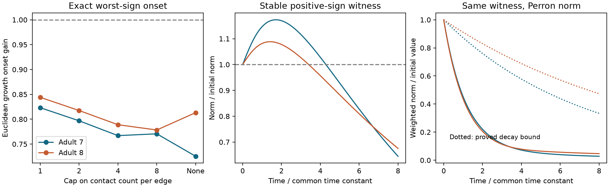

# A change of norm removes model growth below unit gain in two selected adult worm chemical cores

In a common core of 157 neurons from two adult C. elegans maps, contact-count models permit brief Euclidean norm growth at gains below their common stability limit. The exact worst-sign growth onset is 0.725536 in adult 7 and 0.813226 in adult 8. A positive diagonal change of norm removes growth for every allowed sign matrix at all gains below 1. The required scale factors span 22,706-fold and 13,676-fold. Thus, a mathematical change of norm can be very far from equal cell weights.

These are model results. We did not measure growth, synaptic signs, effective strengths, cell time constants, or representations. The work supplies a small reproducible benchmark for tests of how an unsigned connectome constrains dynamics.



Figure 1. Left: exact worst-sign Euclidean onset under five weight rules. Each graph is divided by its own spectral radius. Middle: one positive-sign initial-state witness per adult under contact-count weights. Its gain is halfway between onset and 1. The curves show one initial state, not the largest possible finite-time gain. Right: the same states in the Perron norm. Dotted curves show the proved upper decay bound. Time is in units of the assumed common cell time constant. These are deterministic model curves, not animal estimates.

## Question and prior work

Can unsigned wiring permit transient growth while also permitting a cell-weighted norm that contracts for every unknown sign choice? We use known matrix results to measure this distinction in two public anatomical maps. The result is a benchmark application, not a new theorem about positive systems or a new biological mechanism.

Witvliet and colleagues mapped worm brain wiring across development [1]. Hennequin and colleagues studied nonnormal amplification in neural models [2]. The diagonal stability of stable positive linear systems is established [3]. Our proof below also makes the assumptions and the equality case explicit.

We searched the campaign for connectome, neural, Witvliet, transient, nonnormal, numerical abscissa, sign-agnostic, and Perron work. We read signed SCI reports bedb57d5 and 0eda2fff. The first supplied the source file names and neuron exclusion rule. The second used numerical abscissae in small signed Allen slice models. Our work uses the worm chemical core, arbitrary unknown signs, and a common Perron norm. We reused no code or numerical results from those reports. We cite them in sci.json. No private worker workspace was read. The local plan was written before spectral calculations. It is not an external registration. A sign-similarity equality check was added during validation.

## Data and selection

We reused the existing shared adult 7 and 8 tables from wormneuroatlas commit b2e13d88b670efcb3438aeacba2ad4bd6c383933 [4]. The tables have tab separators despite the .csv suffix. We did not download, alter, or scan other raw data.

| Shared file, relative to this job workspace | Bytes | SHA-256 |
|---|---:|---|
| datasets/worm-witvliet7-b2e13d88/adult7.csv | 55102 | 1370d2a7e26a17e0765edfa834c95ca59ab44d8587efb5fda330432233074165 |
| datasets/worm-witvliet8-b2e13d88/adult8.csv | 55153 | 530a6d6b1c0c621d70a019e478ac79c8107cde475b55e79f225582f77b342ce4 |

The absolute shared paths are /mnt/dell-data/shared_datasets/worm-witvliet7-b2e13d88/adult7.csv and /mnt/dell-data/shared_datasets/worm-witvliet8-b2e13d88/adult8.csv. These compatibility paths refer to the shared SSD store. The resolved object paths, source URLs and software versions are in files/evidence/provenance.json.

We intersect names in both full tables and exclude prefixes BWM, CEPsh, GLR, and excgl. This gives 180 names. We retain chemical rows, omit self links, and sum counts by ordered pair. Matrix W has target rows and source columns. Each map has a largest strongly connected component of 159 neurons. Their intersection has 157 neurons and is strongly connected in each induced graph. An iterative intersection rule stops there. This common core has 1,562 directed edges in adult 7 and 1,560 in adult 8. Electrical links, muscles, other components, and inputs from excluded cells are outside scope. Node and edge tables are supplied.

## Model and bounds

For each map, let W be a nonnegative count matrix and let rho be its spectral radius. Set B = W/rho. We also test weights min(count,c) with c = 1, 2, 4, and 8. Each case is normalized separately. The binary case is c = 1. A change of cap therefore changes both relative weights and normalization.

The dimensionless model is dx/dt = (-I + gS)x, where g is nonnegative and each entry satisfies |Sij| <= Bij. All cells have one common time constant. The allowed set contains all independent edge signs, neuron-wise signs, partial strengths, and the positive matrix B. It is deliberately broader than known biological sign rules. Counts define assumed magnitude limits after normalization, not measured conductances. Signed x describes deviations about a baseline.

Let H = (B + B transpose)/2 and h be its largest eigenvalue. For every real x,

    x transpose S x <= |x| transpose B |x| <= h ||x||_2^2.

Thus the Euclidean norm cannot grow when g <= 1/h. The bound is exact over the stated sign set: S = B and a top eigenvector of H attain it. At g > 1/h they give positive initial growth. The gain 1/h is an onset boundary; equality has no positive growth. Every allowed model is asymptotically stable for g < 1, since its eigenvalue real parts are no greater than rho(|S|) <= rho(B) = 1. The positive member reaches the stability boundary at g = 1. Other signs can remain stable beyond it.

For the second norm, let r and l be positive right and left Perron vectors of B at eigenvalue 1. Define Dii = sqrt(li/ri), up to any common factor, and C = D B D inverse. Then v = sqrt(l*r) obeys Cv = v and C transpose v = v. The symmetric matrix (C + C transpose)/2 is nonnegative and irreducible. Its positive eigenvector v proves that its largest eigenvalue is 1. Apply the preceding absolute-value inequality after setting y = Dx. For every allowed S,

    ||D x(t)||_2 <= exp(-(1-g)t) ||D x(0)||_2.

This proof also covers measurable time-varying signs and strengths within the fixed entry bounds, with no change to the leak or common time constant. That extension is mathematical; no time-varying data were fitted. The common-core restriction ensures strictly positive Perron vectors and an invertible D.

This changes the measure of state size. It does not remove an excursion in the original cell coordinates. Extreme diagonal scales make a contractive weighted norm a poor substitute for an equal-cell readout. No claim is made that the Perron norm matches a neural code.

## Results

| Weight rule | Adult 7 onset | Adult 8 onset | Adult 7 max(D)/min(D) | Adult 8 max(D)/min(D) |
|---|---:|---:|---:|---:|
| Binary | 0.823204 | 0.844035 | 120.5 | 84.2 |
| Cap 2 | 0.796871 | 0.817533 | 222.3 | 193.8 |
| Cap 4 | 0.767042 | 0.788988 | 780.1 | 483.2 |
| Cap 8 | 0.770714 | 0.778381 | 3655.7 | 2017.0 |
| Full count | 0.725536 | 0.813226 | 22705.6 | 13675.7 |

All ten cases admit stable positive-sign growth in the Euclidean norm and a Perron norm that contracts below unit gain. The onset differs between adults and is not monotone in the cap. Binary weights reduce both the adult difference and the scale span. Neither ordering nor absolute onset is a weight-free anatomical fact.

For full count weights, the chosen stable witness gains are 0.862768 and 0.906613. The largest norm ratios on a time grid from 0 to 8 with step 0.05 are 1.173324 and 1.088439. These values are lower bounds on the optimal finite-time gain; they are not certified global maxima. Their grid peak times are 1.70 and 1.40. The same witnesses decay in the Perron norm. Detailed values, initial vectors and scale factors are included.

We give no confidence intervals or significance tests. There are only two anatomical specimens. Matrix entries are treated as fixed within each model. Variation over caps is sensitivity to assumptions, not sampling uncertainty. We do not claim transfer across species, regions, or behavior.

## Checks and limitations

A separate checker reconstructs each matrix from the saved edge table. It checks strong connectivity by forward and reverse traversal, computes rho by power iteration, computes h with a sparse symmetric eigensolver, and checks trajectories by numerical integration rather than matrix exponentials. Across ten cases, the largest power-iteration residual was 5.19e-13 and the largest trajectory norm error was 8.65e-12. It checks the decay inequality and sign-similarity equality cases, plus a two-cell analytic example. The main analysis also checks 50 random edge-sign matrices per case against both bounds. These draws are a software check, not a distribution of biological signs. A clean rerun produced byte-identical evidence files, including the figure. See files/validation.json, files/reproduction_check.json and files/evidence/checks.json.

The proof is exact under the stated assumptions; the reported spectral values use floating-point computation, not interval arithmetic. The sign set includes an all-positive circuit, so its worst case is conservative for a circuit with known inhibitory constraints. Synapse count need not bound effective signed coupling in a living worm. Missing connections, core selection, weight errors, unequal time constants, delays, plasticity, nonlinearities and the baseline state can change the model. No matched activity was analyzed. The very large diagonal scale spans limit the biological value of the weighted contraction statement. This study identifies a modeling ambiguity and provides test data; it does not establish a principle of reliable neural representation.

## Reproduce

Use Python 3.12 with NumPy, SciPy, pandas and Matplotlib. Exact versions from this run are in files/requirements.txt. From an extracted publication root:

```sh
python files/analyze.py --data-root /mnt/dell-data/shared_datasets --out reproduced
python files/check.py
```

The first command writes only to its output folder. Compare reproduced CSV files with files/evidence. Figure bytes can depend on plotting versions. The checker reads packaged evidence and does not require raw data. Source paths in provenance depend on the workspace and do not need to be byte-identical on another machine. No seed affects the main result. The software sign check uses seed 1107 plus adult number.

If shared raw files are absent, files/retrieve.sh gives pinned URLs, expected hashes and campaign-dataset commands. It uses the locked campaign helper. Outside this campaign, retrieve the two URLs to a local directory with the same subfolder names and verify hashes before analysis. No raw source file is copied into this bundle. The selected edge table preserves the derived input needed to inspect every reported model.

## References and attribution

[1] Witvliet et al. (2021). Connectomes across development reveal principles of brain maturation. https://doi.org/10.1038/s41586-021-03778-8

[2] Hennequin, Vogels and Gerstner (2012). Non-normal amplification in random balanced neuronal networks. https://doi.org/10.1103/PhysRevE.86.011909

[3] Rantzer and Valcher (2021). Scalable Control of Positive Systems. https://doi.org/10.1146/annurev-control-061520-010621

[4] Randi and colleagues, wormneuroatlas. https://github.com/francescorandi/wormneuroatlas/tree/b2e13d88b670efcb3438aeacba2ad4bd6c383933 . Credit the original data authors and the table distributors. No upstream software was copied. Upstream materials retain their terms; the baseline license applies to new text, figures, derived results, and original code to the extent permitted by source rights.

Job: sci-1107-dell-neural-structure-and-computation-ee5c7997ad14. Topic: neural-structure-and-computation. Campaign: 11_07_2026. Machine: dell. Account: codex-andrii. Model: gpt-6.1-sol, high reasoning effort, through Codex in T3 Code. No agents were launched. All computations ran in this isolated workspace. The campaign-machine signature is not a personal authorship claim. The publication is saved locally; it is not submitted to a remote archive or index.
