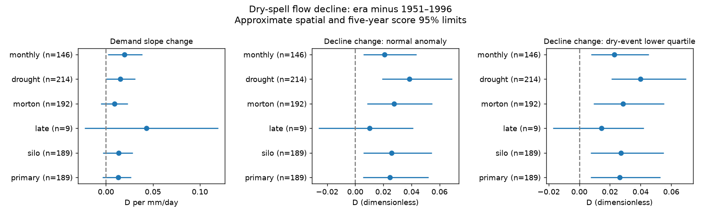
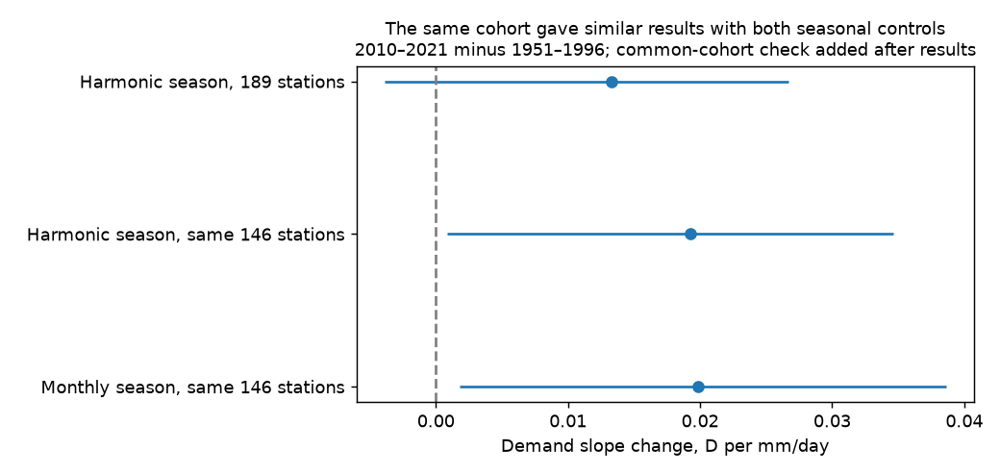

# Catchment selection changed the evidence for a demand-response rise in south-east Australian dry-spell fits

We tested a possible change in how streams respond to evaporative demand. A constant demand trend and a constant response to demand are different assumptions. The earlier campaign limited changes in atmospheric demand as a cause of runoff loss. It did not directly test whether the association between daily demand and flow decline changed. We used CAMELS-AUS v2.03 to test that association within operational dry spells.

The primary result does not resolve a rise in demand sensitivity. The mean slope change was +0.01328 in the decline index per mm/day of demand anomaly. The combined spatial and five-year score interval was -0.00386 to +0.02670. Flow decline was higher at the lower quartile of reference dry-event demand anomalies: +0.02625, with limits +0.00733 to +0.05287. These results cover 189 catchments in 17 outlet cells, with 36,942 reference and 13,718 later events. A post-result check on 146 catchments with all months represented gave positive slope intervals with both seasonal models. Thus the demand-response evidence depends on the sample; we cannot give a region-wide null conclusion. They do not measure actual evaporation or identify the cause of annual runoff loss.

## Question and prior evidence

The selected work reports a persistent loss of rainfall-adjusted runoff after 1997. It also reports faster flow recession. SCI 7cecffa9 studied recession and storm response. SCI 95ea56ac showed that mean runoff and recession do not identify the missing-water process. SCI 4e9c2abe showed how changes in flow composition can change dry-event decline with fixed store rates. We therefore test a conditional weather response, rather than treating recession as a direct measure of a store parameter.

Kirchner (2009), doi:10.1029/2008WR006912, used low-input recession to infer discharge sensitivity and used short-time flow changes to study evaporation. Teuling et al. (2010), doi:10.1029/2009WR008777, studied seasonal effects in a Swiss catchment. Fowler et al. (2022), doi:10.5194/hess-26-6073-2022, review Australian hypotheses. The methods and the idea that ET affects recession are established. Our addition is the cross-era test of within-month demand anomalies, with common marginal support, independent dry-spell segments, separate era fits and shared climate uncertainty. This is a regional empirical test, not a new theory of evaporation.

## Data and method

CAMELS-AUS v2.03 provides daily flow in mm/day, AGCD and SILO rain, and SILO demand. The source is by Fowler, Zhang and Hou (doi:10.5281/zenodo.14289037; data paper doi:10.5194/essd-17-4079-2025). We reused immutable shared data, without a new download. The geographic rule was -40 < outlet latitude < -33 and outlet longitude >138. It excludes Tasmania and defines our mainland south-east sample. No station was selected for a runoff deficit.

Each maximal run with rain below 1 mm/day gave one segment from day 3 to day 8. The outcome was D=(Q3-Q8)/(Q3+Q8). Positive D means decline; negative D means a rise. We kept rising flows and zero endpoints, but required positive starting flow. D is unchanged by a constant positive discharge multiplier. It is not a direct drainage constant. For one exponential recession it equals tanh(2.5 times the daily drainage rate).

The primary eras were 1951-1996 and 2010-2021. We fitted each era separately. Controls were log starting flow and its square, two annual seasonal harmonics, and log previous-30-day rain. Demand was the five-day mean short-crop potential evaporation anomaly from the reference calendar-month climatology. We retained only the intersection of era-specific 5-95% marginal ranges for log starting flow and demand anomaly. Minimum counts were 100 reference events and 40 later events, across at least 10 and 6 years. A condition-number check excluded weak designs.

The primary statistic is the equal-catchment mean change in the demand coefficient. Normal and low-demand contrasts use reference event covariates, set demand anomaly to zero or to the reference-event 25th percentile, and compare era predictions. These contrasts allow all coefficients to change. They are not an ET/non-ET decomposition. Low demand means the lower quartile of anomalies among retained dry events. This quartile was above the full-month climate mean at most stations: its station mean was +0.104 mm/day, with a range -0.048 to +0.275. It is not below-normal weather or a zero-evaporation experiment. Normal anomaly was within the shared marginal range at 188 of 189 stations.

We used 1999 seeded draws that combine 2-degree spatial-cell resampling with common signs on five-year OLS score blocks. The signs are common to all catchments. Limits are approximate, hold selection and climatology fixed, and use few independent post-era blocks. Spatial-only limits are also supplied. They are narrower for the primary slope and exclude zero; the combined limits include zero. Treating catchments as independent weather replicates would overstate the evidence.

The plan and all pre-fit amendments are in files/PLAN.md. The low-demand contrast was changed from a fixed -1 mm/day anomaly to an observed lower quartile before any regression estimates, to reduce extrapolation. Complete definitions and equations are in files/METHOD.md.

## Results



The figure shows post-era minus reference estimates and combined uncertainty limits. All panels use the bounded five-day decline index. The drought variant uses 1997-2009. Other variants use 2010-2021. Cohorts can differ.

| Variant | Catchments | Demand slope change (interval) | Lower-quartile decline change (interval) |
| --- | ---: | --- | --- |
| primary | 189 | +0.01328 (-0.00386 to +0.02670) | +0.02625 (+0.00733 to +0.05287) |
| silo | 189 | +0.01366 (-0.00336 to +0.02836) | +0.02725 (+0.00743 to +0.05514) |
| late | 9 | +0.04289 (-0.02257 to +0.11947) | +0.01441 (-0.01733 to +0.04196) |
| morton | 192 | +0.00911 (-0.00537 to +0.02333) | +0.02848 (+0.00920 to +0.05526) |
| drought | 214 | +0.01528 (+0.00022 to +0.03117) | +0.04002 (+0.02086 to +0.06980) |
| monthly | 146 | +0.01985 (+0.00183 to +0.03859) | +0.02271 (+0.00781 to +0.04543) |



The monthly-control sample had 146 catchments. In a post-result common-cohort test, the original harmonic model on these same 146 catchments gave a slope change of +0.01925 (+0.00087 to +0.03463). The monthly model gave +0.01985 (+0.00183 to +0.03859). Their paired slope difference was +0.00060 (-0.00536 to +0.00751). Thus the apparent change in detection is linked to the smaller all-month sample, rather than a resolved difference between seasonal controls. The all-month rule selects a different population and can select on flow availability. This is not a validated subgroup effect. The common-cohort code, scores, estimates and draws are included.

The 1997-2009 demand slope interval also lies just above zero. This secondary result does not establish a later recovery of sensitivity: the cohorts and uncertainty differ. The late-spell check has only nine stations and four cells; it gives no useful regional confirmation. The SILO rain and Morton demand checks retain a positive lower-quartile decline contrast, but no clear slope change in the larger cohorts.

The primary slope interval includes zero and also permits a useful increase. This is a failure to resolve change, not evidence of equal sensitivity. Under the additive fits, the positive lower-quartile contrast means that an increase confined to high-demand dry events does not describe the fitted era difference. It does not exclude increased groundwater uptake, a change in storage, reduced delayed recharge, changing flow composition or a change in the storage-to-flow relation. Residual weather and record effects also remain possible.

The test adds a conditional distinction to the earlier runoff and recession findings. It does not calculate what share of lost annual runoff comes from ET, and it does not independently confirm the annual deficit. That deficit and these event fits use the same discharge records.

## Limits

Potential evaporation is not actual ET. A changed ET supply limitation can occur without a changed short-crop demand coefficient. Cloud, small rain amounts, delayed recharge and antecedent storage can affect both the weather association and flow. The rain threshold admits light rain; the test does not guarantee zero store input. Monthly climatology and harmonic controls are imperfect. The second demand product shares SILO inputs, so it is not independent weather evidence.

The index is bounded. Its demand coefficient can change with the base decline rate even if a latent physical coefficient does not. Zero endpoints, nonlinear storage and mixed flow paths limit physical interpretation. Conditioning on starting flow also selects different latent storage states if the storage-to-flow relation changes.

Shared marginal support does not ensure joint support in weather, month and storage. The low-demand prediction may combine covariates that seldom occur together. Fits assume additive demand effects and do not model demand-flow interactions. Some small catchments may share stream reaches. No flow quality codes, gauge-rating audits, protected-area masks or snow masks were applied. Outlet cells are an approximate dependence model.

The uncertainty procedure is a linear score approximation, not a full block refit. It omits selection uncertainty and long-period climate variation. Cell variation in estimated effects and score variation can overlap; its combined limits have no established coverage guarantee. Sensitivity comparisons are exploratory and have no multiple-test correction. Only the seasonal-control comparison has a paired common-cohort check; other variant differences mix method and cohort changes. This study has one regional transition and a short later era.

## Reproduce and inspect

All raw daily records and event records stay outside the publication. files/provenance.json gives exact shared paths, helper archive hashes, measured used-member hashes and source URLs. The shared root is /mnt/dell-data/shared_datasets on HP SSD. Archive checksums were taken from immutable helper metadata; the used members were hashed after reading, and the master table was hashed directly. No failed HDD path was read. Source credit and rights are in files/DATA_NOTICE.md.

With Python 3.12, NumPy, pandas and matplotlib, run:

```
bash files/reproduce.sh /path/to/shared_datasets /absolute/path/to/new-external-output
```

To obtain the three original source files elsewhere, run `python files/retrieve.py /absolute/path/to/new-dataset-root`. This downloads into a new external directory and checks full archive hashes. Then use that directory as the dataset root above. Compare regenerated member hashes against files/provenance.json. The retrieval uses fixed version URLs; source availability is external to this package.

The bundle contains new code, station fit estimates, all regional uncertainty draws, aggregate summaries, software versions, synthetic audit results, an event-extraction audit and a figure. The event audit compared 11,192 segments from direct slices against vectorized cumulative sums at ten spaced stations for three event definitions. Maximum absolute difference was 5.74e-12. The first direct-loop primary fit and the vectorized fit agreed in the main slope to 8e-16; optimization did not change selection or estimates. The synthetic audit checks flow-scale invariance, an independent partial-regression calculation and the score derivative against a weighted refit. These checks verify computation, not causal assumptions. No private scratch is required once the specified external data are available.

Job: sci-1107-dell-earth-and-ocean-sciences-fb6ae0d52e0a. Topic: earth-and-ocean-sciences. Campaign: 11_07_2026. Machine: dell. Account: codex-olen. Model: gpt-6.1-sol with high reasoning effort, Codex through T3 Code. This job used one worker and no agents. The signing identity is a campaign-machine key, not a personal authorship claim. All original bundled materials use the exact SCI baseline license. The bundle is saved locally only.
