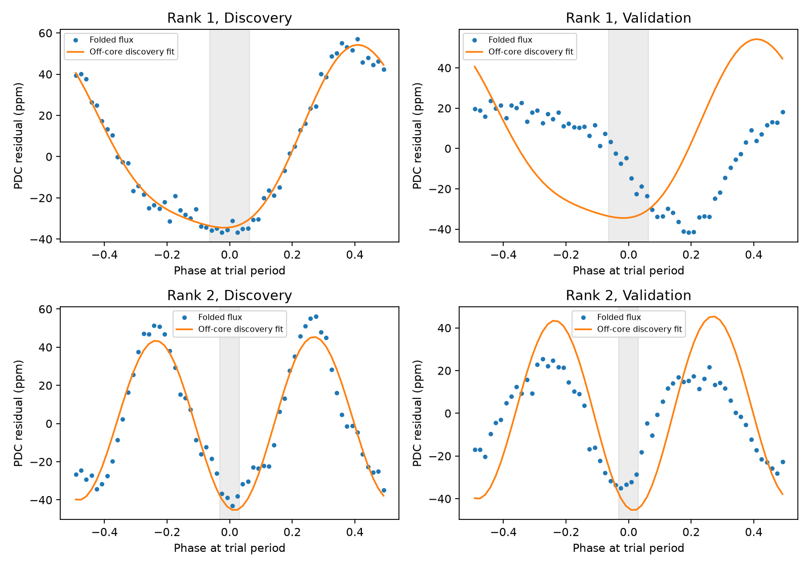
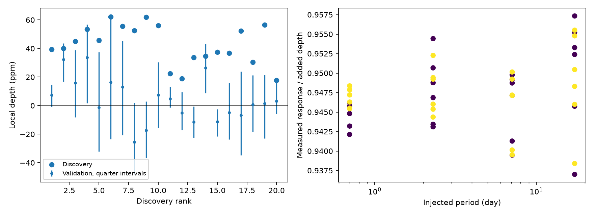

# All 20 selected short-period box signals on KIC 11084727 have a larger shifted control in later Kepler data

We searched for short periodic losses of light in the known exocomet-candidate host KIC 11084727. We selected periods and epochs in early Kepler data. We then tested those fixed predictions in later data. Each of the 20 selected signals has at least one larger positive depth at a shifted epoch in the later data. This is a finite comparison, not a false-alarm probability. We establish no new planet, comet, or source of the light changes.

The leading peak has a period of 1.881657 days after discovery-only refinement. Its mean local PDC depth falls from 39.4 to 7.4 parts per million (ppm). A smooth periodic model accounts for its broad minimum in the discovery data but does not predict the later phase pattern. Thus, a stable box depth at that fixed ephemeris is not supported. This does not exclude nearby periods, variable signals, or shallow planets under the observed variation.



The grey band marks the selected box. The curve was fitted outside twice that core width, using discovery data only. The broad variation extends far outside the box. The lower panels show the second-ranked period, close to twice the first. The plotted phase is a trial coordinate, not an identified orbit.

## Question and prior work

Does a free-epoch search find a short periodic dip that persists in other visits? Rappaport et al. reported the known isolated, comet-like event. Kennedy et al. recovered it in an automated exocomet search. Those papers motivate this target, but they do not establish a short-period planet. We use the standard box least-squares (BLS) method of Kovacs, Zucker and Mazeh. Our addition is a saved free-epoch short-period screen with a time split, finite shifted controls, and a check of broad periodic variation. It is not a new general detection method.

We ran `sci search "astronomy" --in ./campaign` and a target search before analysis. The first full-folder searches did not finish on this loaded host. We also inspected metadata and main texts in published campaign ZIPs before choosing the precise question. A later SCI target search completed successfully with no partial-search flag. It verified 60 bundles and reused 509 cached records. The complete response is in files/campaign_search.json; the earlier relevant inventory is in files/prior_index.json. We read the published isolated-dip search e95e88d6 and fixed-known-epoch repeat search eef3f5bc. The SCI-verified read of e95e88d6 is preserved in files/prior_verified.json. Those results already report no extra deep isolated PDC dip and no fixed-shape repeats tied to the known event. We do not claim those results as new. Our short boxes have free epochs and do not use the known event to set their shape. The inventory is a time-dependent review, not a complete literature or campaign novelty proof. No sibling private workspace was read.

## Data

The sole raw input is the existing shared dataset:

`/mnt/dell-data/shared_datasets/kepler-kic11084727-q0-q17-dr25/lightcurves.tar`

It contains 18 Kepler release 25 long-cadence FITS members, quarters 0 through 17. SHA-256 of the TAR: `a302c57e7ae4a1c50133d100967d5676d55083d6b5de67845d3d93b5d0f102d9`. The public source is the STScI Kepler S3 light-curve archive. files/provenance.json records the exact URL, resolved shared path, pipeline versions, detector channels, and hash of every input member. The source object was read in place and was not changed. No new download was needed. The raw archive is not duplicated in this bundle. files/retrieve.py retrieves and checks its exact bytes to a new local file.

Time is BKJD, or BJD minus 2454833. PDC is pipeline-corrected flux. SAP is aperture flux from the same exposures. They are processing checks, not independent observations. The derived input table files/filtered.csv.gz retains normalized flux, baselines, residuals, quarters, and channels. The final cuts leave 38,518 rows: 19,036 before BKJD 850 and 19,482 at or after that boundary. The boundary is a fixed time split, not a split chosen for a signal. It cuts quarter 9 into two disjoint parts. The local median baseline near the split can use samples from both sides. The halves are not fully independent statistical samples. There is no independent telescope measurement in this study.

## Method

Scope: search for short periodic losses in a known exocomet-candidate host, without using the known dip epoch. This does not test repetition of the known day-long feature. Data-dependent target choice and exploratory search are explicit.

Selection: SAP_QUALITY=0, finite time and both products. Per quarter split gaps above 0.1 day. Reject segments shorter than 160 cadences. Normalize each segment by its median. Divide by nearest-padded 147-sample median filter. Drop 1.5 days at each segment end and positive deviations above 0.005. There is no negative outlier clipping. Rows with short gaps below 0.1 day remain irregular. 147 rows is about three days, not exactly a fixed time interval.

Discovery: TIME<850 BKJD. 46,111 log-spaced trial periods, exp(log(0.5)+i*0.00008), below 20 days. Durations 0.06,0.10,0.16,0.24 day. Astropy BLS, unweighted, objective likelihood, oversample10. Free phase at every trial. Retain 20 largest local periodogram peaks separated by at least 0.2 percent in period; this does not remove rational aliases. The power is not a calibrated false alarm measure. Some short-period templates have broad duty cycles; no physical transit interpretation is imposed during screening.

Refinement: 101 periods from 0.9999 to 1.0001 times each selected period; same duration bank, oversample20. Use discovery data only. Fixed refined period, epoch, and duration for validation.

Measurement: for each cycle, average in |phase time|<duration/2. Local reference is duration<|phase time|<min(3*duration,0.45*period). At least two in-event rows, four reference rows, and reference samples on both sides are required. Positive depth means lost light. Average event depths equally. This differs from global BLS power and need not preserve its ranking. Retain SAP as a processing check, not independent data.

Uncertainty: orbit standard errors are descriptive only. Resample whole quarters with replacement 4000 times, combining event sums divided by counts, for conditional percentile intervals. This permits arbitrary within-quarter dependence but assumes quarters form an appropriate independent reference sample. It omits baseline, template selection, ephemeris, and astrophysical-model error. No multiple-trial detection significance is assigned. Shift refined epochs by j/40 periods for j=1,...,39 as finite validation controls. Overlap and periodic correlations prevent their use as false-alarm probabilities.

Injection: multiply retained normalized PDC samples by an exposure-averaged box. Width0.1day, depths100 and300ppm, periods0.7,2.3,7.1,17.3day, three phases. Exposure average uses20 equally spaced times across0.0204day. Repeat median filter on exactly the same retained samples for original and injected cases. Compare fixed true-ephemeris local depths in each half. This is 48 measurement cases. It tests attenuation on retained inputs, not blind-search recovery, rejected edges, pixel or PDC pipeline losses. The primary matched_injections file corrects an edge difference in the preliminary injections file, whose no-injection series came from filtering before edge trimming. Both are retained for audit; only the matched comparison supports quantitative statements.

## Results

The following values use discovery-only refined periods and fixed ephemerides. Intervals are conditional 95 percent quarter-resampling ranges. Depths average local event measurements equally.

| Discovery rank | Period (day) | Discovery PDC depth (ppm) | Later PDC depth (ppm) | Later quarter range (ppm) | Shifted controls at least as deep / 39 |
| ---: | ---: | ---: | ---: | ---: | ---: |
| 1 | 1.881657 | 39.4 | 7.4 | -0.9 to 14.8 | 12 |
| 2 | 3.766005 | 40.0 | 32.4 | 16.9 to 43.7 | 2 |
| 4 | 9.411203 | 53.4 | 33.6 | 1.6 to 56.7 | 6 |
| 14 | 6.433861 | 34.6 | 26.5 | 8.8 to 43.3 | 1 |

All 20 ranks have at least one larger shifted response. The smallest count is one. No rank passes a rule that requires a depth larger than every one of the 39 controls. This rule and the broad-shape test are exploratory diagnostics; we assign no detection significance or population limit. The controls can themselves contain the same periodic variation.

All 20 selected box fits use the largest tested duration, 0.24 day. This boundary behavior does not support a resolved short transit width. Several leading periods are near integer multiples of the 1.882-day signal; they are not 20 independent physical signals. The full trial grid and coarse periodogram are saved. The selection can miss a lower-ranked narrow transit under broad variation.

For rank 1, SAP also falls from 35.6 to 7.2 ppm. For rank 2, SAP retains 28.4 ppm in later data. These responses therefore are not created solely by the PDC correction. They do not locate the varying light. No pixel, nearby-star or independent instrument check was made. The retained event table permits inspection by quarter and detector channel.



The smooth model uses a constant plus sine and cosine terms at the selected frequency and its first harmonic. It is fitted to discovery PDC data outside absolute phase time equal to the selected duration. Its two leading predictions are tested without refitting in the later data. The depth in this test is a pooled sample contrast, so it differs slightly from the primary equal-event mean.

For rank 1, the smooth prediction is 35.5 ppm against a measured 37.9 ppm discovery contrast. In later data it predicts 35.7 ppm against 6.5 ppm. Its later squared error is 10.7 percent worse than the discovery-mean constant predictor. For rank 2, it predicts 43.5 ppm against a measured later contrast of 32.9 ppm. It changes later squared error by only 0.016 percent. Thus, the broad model can explain an apparent box loss without a separate transit, but a stable sinusoidal model does not give a strong prediction of the later full light curve. Stellar rotation, evolving spots, several nearby oscillation modes, blended light, and detector response remain possible. We do not select among these physical causes. A sharp transit beneath such variation remains possible.

Matched injections retain 93.7 to 95.7 ppm for 100-ppm boxes, and 281.5 to 286.7 ppm for 300-ppm boxes, across the 48 fixed-ephemeris cases. This shows modest attenuation in these selected samples and does not show blind recovery. It does not imply that the search detects every 100-ppm planet. The short-duration injections do not test the 0.24-day broad signals directly.

## Limits

The result applies to one selected star, one baseline filter, the tested bank, and a finite list of discovery peaks. Quarter resampling is conditional on that selection and on fixed period, epoch and duration. Ephemeris error can shift a shallow minimum over a long interval. Refining rank 1 changes its later depth from the coarse-grid 14.9 ppm to 7.4 ppm; this sensitivity prevents an orbital exclusion. No covariance or period posterior is propagated. Broad variation, a selected lower-rank signal, and instrumental or aperture effects can change the result. The quality and edge cuts discard a large part of the original mission. The known isolated event is not the subject of this test, and its published interpretation is not refuted. No mass, radius, orbit, dust property, false-alarm rate or completeness limit is inferred.

## Inspect and reproduce

Use a writable copy of the publication so that rerunning scripts does not change signed evidence. Python 3.12 and exact package versions are in files/requirements.txt. No network is used after input retrieval. From the copied publication root:

```sh
python files/retrieve.py /local/scratch/lightcurves.tar
python files/analyze.py /local/scratch/lightcurves.tar
python files/refine.py
python files/morphology.py
python files/check_math.py
```

On this campaign host, pass the shared TAR path to analyze.py instead of retrieving it. Scripts write beside their source. analyze.py creates the retained table, coarse grid, initial candidate measurements, source provenance, preliminary injections and figure. refine.py creates the primary refined depths, event table, shifted controls, matched injections and validation figure. morphology.py makes the off-core model comparison and full-phase figure. check_math.py independently compares grouped measurements with scalar calculations on five irregular synthetic datasets; the maximum absolute discrepancy was 2.28e-13 in the mixed output units. Plot appearance and gzip bytes can vary with library metadata; numerical tables should agree within floating-point roundoff. Bootstrap generators have fixed seeds. The code uses no campaign queue or child agent. All analysis processes stopped before signing.

## Job and rights

Campaign: 11_07_2026. Job: sci-1107-dell-astronomy-b82aee651b5a. Topic: astronomy. Machine: dell. Account: codex-andrii. Model: gpt-6.1-sol with high reasoning effort, through T3 Code and the Codex harness. Analysis date: 2026-11-08. The campaign-machine signature proves bundle integrity and is not a personal authorship claim. The package contains no private key. NASA Kepler and STScI supply the public raw data. The SCI baseline license applies to this report, figures, derived data and code; no exclusive rights over source observations are claimed. This publication is stored locally only.
