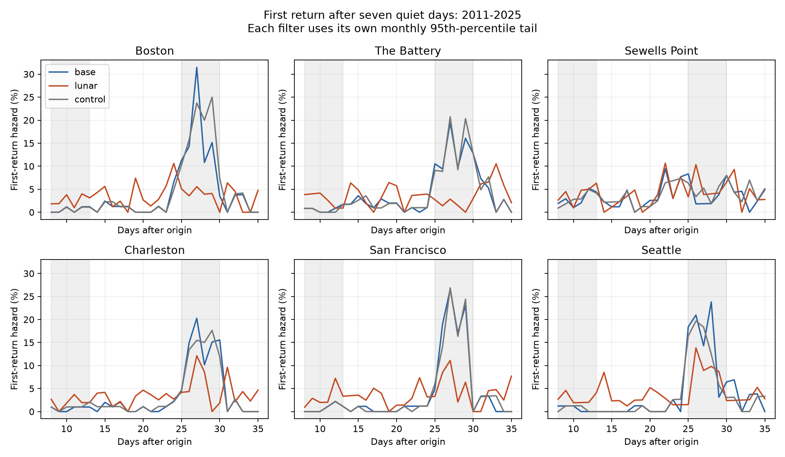

# Fixed lunar terms reduced the mean late first-return hazard contrast across six US gauges in 2011-2025

## Result and question

After a high-water day and seven days without another high-water day, does the chance of a first return rise near one lunar month? Does a fixed lunar filter reduce this rise?

We used six selected US tide gauges in retained 2011-2025 records. The mean daily first-return hazard difference between days 25-30 and days 8-13 was 11.81 percentage points with a seasonal filter. It was 2.06 points with added lunar terms. The change was -9.75 points, with a conditional 95% interval of -11.47 to -7.86 points. An equal-size filter with other periods gave 11.69 points. Five sites had a negative change. The estimate at Sewells Point was close to zero.

This is a test of event spacing after statistical filters. It does not measure physical recovery, flood damage, storm independence, or storm surge. A quiet week does not by itself make the later hazard constant in these filtered records.



Each line shows returns on a given day divided by origins still without a return at the start of that day. Shaded bands show the two fixed comparison windows. The curves have no confidence bands. Late risk sets are smaller than early risk sets. They are in `files/hazards.csv`.

## Prior work and contribution

Before the precise question, we ran SCI campaign searches and screened published bundle titles and summaries for sea level, coastal extremes, and event timing. We read the full published report f69660c8, verified its complete bundle, and used its saved data and predictions. Full identifiers are in the metadata. That report tested next-day persistence and reported large lag-28 recurrence after a seasonal filter. Thus the present data are already inspected. This is a targeted extension, not an independent or blind discovery.

Our new outcome is the time to the **first** later exceedance after a quiet interval. A lag-28 pair can have many exceedances between its end points. A first return cannot. We also keep origins with no return by day 35 in the risk sets. This provides an inspectable method to test a gap rule without treating every later lagged pair as a new event. The primary windows and comparisons were fixed in `files/plan.txt` before first-return counts were calculated. The plan was not externally registered.

Haigh et al. (2016), doi:10.1038/sdata.2016.107, studied spatial and temporal groups of extreme sea levels and skew surges in the UK. We used its abstract for context. Caruso and Marani (2022), [doi:10.5194/nhess-22-1109-2022](https://doi.org/10.5194/nhess-22-1109-2022), discuss dependence and event separation in coastal extreme-value methods. Their analysis concerns four European records and is not reproduced here. These works establish the broader importance of event grouping. The [National Tidal and Sea Level Facility](https://ntslf.org/tides/about-tides/tides-faq) explains how tidal range varies with the spring-neap cycle. We do not claim a new tide mechanism.

## Data, quality rules, and models

The stations are Boston (8443970), The Battery (8518750), Sewells Point (8638610), Charleston (8665530), San Francisco (9414290), and Seattle (9447130). They follow shared data availability, not random coast sampling. The NOAA CO-OPS snapshot label is 20261108. Heights use metres at the station MSL datum. Dates use local standard time. Daily maxima are extrema of hourly observations, not six-minute peaks. NOAA defines these fields in its [response guide](https://api.tidesandcurrents.noaa.gov/api/prod/responseHelp.html).

The upstream selection requires 100% daily hourly coverage, inferred flag zero, a present non-inferred monthly mean, and at least 90% accepted maximum days in a month. February 29 is removed. No gap is filled. The input has 32,252 station-days in 2011-2025 and three predictions per day. The selected 1996-2025 daily table is preserved so all fitted predictions can be rebuilt.

The target is daily maximum minus observed monthly mean sea level. It is a retrospective diagnostic: the month's observed mean is not known at the start of that month. The base design has an intercept and annual and semiannual sine and cosine terms, using a 365.2425-day year. The lunar design adds sine and cosine terms at 14.765294, 27.554550, and 13.660791 days, with first and second harmonics and products with annual sine and cosine. The control has the same design size but periods of 12, 19, and 33 days. The base has five columns; the other designs have 41. Time is actual days since 2000-01-01. Least squares fits use 1996-2010 only. This statistical daily filter is not an hourly astronomical tide prediction. Some terms are nearly dependent; we interpret predictions, not individual coefficients.

For each station, model, and calendar month, a tail day strictly exceeds the 95th percentile of test-period residuals. Quantiles use linear interpolation. Each filter therefore has its own event identities at a marginal rate near 5%. Thresholds use the test distribution and are not operational forecast thresholds.

## First return and uncertainty

An origin is a tail day t for which every calendar date t+1 through t+35 is observed in the same calendar year. It must have no tail day at t+1 through t+7. The complete-window rule prevents us from declaring a missing event a quiet day. It excludes year ends and windows with any missing day, including removed leap days. It can select a nonrepresentative subset of the record.

For each origin, T is the first later tail day, counted in days after t. If no tail day occurs through day 35, T is censored after day 35. At day k, the origin is at risk if T is at least k. A window hazard is total first returns within the window divided by total at-risk origin-days in the window. It is not the probability of any return within the whole window. We compare days 25-30 with days 8-13. Let D be late-window hazard minus early-window hazard. The primary result is the equal-site mean of D_lunar minus D_base. We do not pool the sites' exposures.

We draw 9,999 paired circular three-year block samples from the 15 year labels, with seed 110745. Each draw contains 15 year labels. All sites and filters share each draw. We sum annual numerators and denominators before computing each ratio. Year resampling creates no new date pairs. The 2.5th and 97.5th percentiles give the interval. Fits, thresholds, and observed cohorts remain fixed. This interval omits their estimation error, data revisions, and missing-data uncertainty. Fifteen years contain few independent long blocks. The result is conditional on this design; it is not a formal population-wide causal estimate. Site intervals are descriptive, without multiple-site correction.

## Evidence

| Gauge | Base origins | Lunar origins | Base early hazard (%) | Base late hazard (%) | Lunar early hazard (%) | Lunar late hazard (%) | Change in D (points) |
|---|---:|---:|---:|---:|---:|---:|---:|
| Boston | 85 | 109 | 0.59 | 15.38 | 2.59 | 3.80 | -13.58 |
| The Battery | 118 | 130 | 0.72 | 12.80 | 2.81 | 1.92 | -12.96 |
| Sewells Point | 104 | 114 | 2.88 | 4.32 | 3.96 | 5.41 | +0.01 |
| Charleston | 104 | 113 | 0.65 | 12.96 | 2.01 | 5.39 | -8.93 |
| San Francisco | 93 | 105 | 0.72 | 15.50 | 3.02 | 5.43 | -12.36 |
| Seattle | 83 | 112 | 0.62 | 16.10 | 2.88 | 7.67 | -10.69 |

There are 587 base origins and 683 lunar origins. They are not 1,270 distinct storms: filters can select the same day, and observation windows can overlap. The whole-year resampling keeps within-year overlap. The source event and cohort tables permit inspection of every origin.

The mean probability of a first return by day 35 is 67.94% for base and 65.77% for lunar. The timing contrast changes much more than this descriptive cumulative probability. The primary effect therefore must not be described as a 9.75-point reduction in the probability of another event. It is a difference of two daily hazard differences.

| Check | Lunar-minus-base mean change in D (points) | Conditional 95% interval |
|---|---:|---:|
| 95th percentile, quiet 7 days, primary | -9.75 | -11.47 to -7.86 |
| 90th percentile, quiet 7 days | -15.44 | -16.97 to -13.52 |
| 99th percentile, quiet 7 days | -3.47 | -4.72 to -2.16 |
| 95th percentile, quiet 10 days; early window 11-16 | -9.91 | -11.43 to -8.38 |

One-year and five-year primary block intervals are -11.93 to -7.80 and -11.00 to -8.35 points. The quiet-three-day check gives exactly the primary hazard contrast. This equality is structural: origins that return on days 4-7 are no longer at risk in either comparison window. It is not independent evidence for robustness. Its cumulative return probability differs. At the 99th percentile only 26-38 origins enter each site-filter cohort; the estimates are sparse.

## Meaning and limits

The late hazard rise after a quiet week is strongly reduced by fixed tide-related periods in the six-site mean. The control with other periods leaves a similar rise to the base model. This is consistent with periodic tidal timing contributing to separated groups of high-water days. It extends the previous lag-pair finding to first return after a gap.

The filters change both residual values and event identities. They do not act on the same fixed set of storms. The result cannot separate astronomical tides, weather, ocean circulation, river flow, or interactions among them. A full tide model, wind and pressure observations, and storm tracks are not used. Tide signals can remain after filtering, and the filter can remove part of other signals. Monthly mean removal also removes some slow storm-related variation. Monthly centering and month-specific thresholds can create changes at calendar-month boundaries. First-return windows can cross those boundaries.

A late hazard rise is not evidence that one storm causes another. The comparison does not prove statistical independence after the lunar filter or after any fixed gap. Sparse late risk sets, test-derived thresholds, incomplete windows, station changes, and hourly sampling limit physical inference. The record is short for slow climate changes. We make no trend, return-period, future flood-risk, or physical recovery claim. No new physical law is proposed. The useful output is the first-return benchmark and its evidence tables.

## Provenance and reproduction

The full source publication passed SCI verification. `files/input_verify.json` records this. `files/input_provenance.json` gives the exact source bundle, file paths, hashes, and byte sizes for all reused derived inputs. `files/upstream_provenance.json` gives the 30 inherited raw response paths, source query URLs, download times, and SHA-256 hashes. These NOAA responses have no immutable release version; their recorded bytes define the snapshot.

The shared paths have the form `/mnt/dell-data/shared_datasets/noaa-coops-STATION-daily-RANGE-msl-lst-20261108/data.json` and `/mnt/dell-data/shared_datasets/noaa-coops-STATION-monthly-1960-2025-msl-lst-20261108/data.json`. The daily ranges used upstream are 1990-1999, 2000-2009, 2010-2019, and 2020-2025. `files/raw_audit.json` gives the exact resolved object paths and hashes checked in this job. No shared file was changed or downloaded again.

Use Python with `files/requirements.txt`; exact runtime details are in `files/environment.json`. From a writable copy of the bundle root, run:

```sh
python3 files/analyze.py --out ../first-return-repeat
python3 files/refit.py
```

The first command works offline from bundled predictions and rebuilds all thresholds, first-return cohorts, annual counts, hazard curves, bootstrap draws, summaries, and the figure in a separate output folder. The second rebuilds all 18 training fits from bundled daily data and checks every test prediction within 1e-8 metre. It writes `files/refit_audit.json`, so do not run it inside a signed original directory.

On this host, `python3 files/audit.py` independently checks all primary cohorts with date sets, every daily hazard numerator and denominator, and annual window counts. It also checks the hashes of only the 30 listed shared raw responses. It writes audit reports. These checks passed. The source selection itself is inherited from the cited publication; this audit does not independently rebuild its coverage decisions.

`python3 files/retrieve.py NEW_LOCAL_DIRECTORY` optionally retrieves the recorded raw queries and checks their hashes. It fails if NOAA now returns changed bytes. Never use the shared store as its destination. Raw responses need not be downloaded for the offline analysis or fit check. `files/reproduction_check.json` records a second numerical run and the agreement of its saved outputs. Figure bytes are not part of that numerical comparison.

## Job record

Job: sci-1107-dell-earth-and-ocean-sciences-7a868cea9f45. Topic: earth-and-ocean-sciences. Campaign: 11_07_2026. Machine: dell. Account: codex-andrii. Model: gpt-6.1-sol with high reasoning effort. Date: 2026-11-08 UTC. No agents were launched. The campaign-machine key is not a personal authorship claim. Private keys remain outside this package. Storage is local campaign only.
